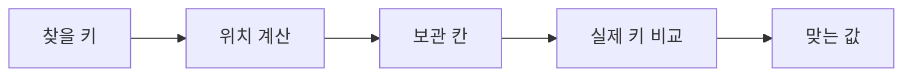

<!-- level:1 -->
# 해시 테이블 — 이름표로 보관 위치 계산하기

> **한 문장으로:** 키를 계산 규칙에 넣어 보관 위치를 찾고, 같은 위치에 몰린 값도 구별해 저장합니다.

## 왜 필요한가요?

사용자 이름이나 상품 번호로 데이터를 자주 찾습니다. 매번 전체 목록을 훑는 대신 찾을 위치를 빨리 결정하는 구조가 필요합니다.

## 일상에서 떠올려 보기

물건 이름을 보고 보관함 번호를 정하는 안내 규칙을 생각해 보세요. 다른 물건이 같은 번호를 받을 수도 있습니다. 그때 이름표를 다시 확인하고 같은 칸의 목록이나 다른 칸을 이용해 물건을 구별합니다.

## 순서대로 따라가기

1. 사용자 ID 같은 키를 해시 함수에 넣어 위치를 계산합니다.
2. 그 위치에 자료를 저장하거나 이미 있는 자료를 확인합니다.
3. 다른 키가 같은 위치로 오면 실제 키를 비교하고 충돌 처리 규칙을 사용합니다.



## 작은 예로 확인하기

이름 길이를 칸 수로 나눈 나머지를 위치로 쓰는 단순한 규칙을 생각해 보세요. ‘민수’와 ‘지수’는 같은 길이라 같은 위치로 갈 수 있습니다. 위치 번호가 같다고 두 이름이 같다고 판단하면 안 됩니다.

## 처음 만나는 용어

| 용어 | 쉬운 뜻 |
|---|---|
| 키 | 값을 찾을 때 사용하는 사용자 ID 같은 식별 정보입니다. |
| 해시 함수 | 입력값을 정해진 계산으로 해시 값으로 바꾸는 함수입니다. |
| 버킷 | 자료가 놓이는 칸이나 자료 묶음입니다. |
| 충돌 | 서로 다른 키가 같은 해시 값이나 보관 위치를 갖는 상황입니다. |

**비유의 한계:** 위치를 계산한다고 모든 검색이 항상 같은 속도를 갖지는 않습니다. 충돌, 키 비교 비용, 용량 변경이 영향을 줍니다. 해시 값이 같다는 사실은 키 자체가 같다는 보장이 아닙니다.

## 스스로 확인

두 키의 해시 값이 같다면 두 데이터가 같은 것일까요?

**답과 이유:** 아닙니다. 실제 키가 같은지 확인해야 합니다. 다른 키이면 충돌 처리 규칙으로 둘 다 올바르게 관리합니다.
<!-- level:2 -->
# 분포, 적재율, 동등성

<!-- beginner-guide:start -->
## 읽기 전 길잡이

교육용 예제에서는 칸의 목록에서 실제 키를 비교하는 부분을 찾아보세요. 해시 계산은 후보 위치를 좁히고 최종 판단은 키 비교가 맡습니다.

## 이 단계에서 만날 말

| 용어 | 쉬운 뜻 |
|---|---|
| 체이닝 | 같은 칸에 여러 원소의 목록을 연결해 보관하는 방식입니다. |
| 개방 주소법 | 충돌하면 규칙에 따라 다른 빈 칸을 찾는 방식입니다. |
| 적재율 | 칸 수에 비해 얼마나 많은 원소를 담았는지 나타내는 비율입니다. |
| 재해싱 | 용량이나 위치 규칙이 바뀔 때 원소의 위치를 다시 정하는 것입니다. |
| 동등성 | 두 키를 같은 키라고 판단하는 규칙입니다. |
| 최악 비용 | 충돌 등이 심한 가장 불리한 경우의 처리 비용입니다. |

<!-- beginner-guide:end -->

적재율은 원소 수와 버킷/슬롯 수의 비율과 관련된다. 체이닝과 개방 주소법에서 의미와 허용 범위가 다르다. 키 조회는 해시 계산 후 후보의 실제 동등성을 확인한다. 키가 저장된 뒤 해시·동등성 기준이 바뀌면 다시 찾을 수 없게 될 수 있다.

다음 Python 3 코드는 충돌 처리를 보여 주는 **교육용 체이닝 모델**이다.

```python
buckets = [[] for _ in range(4)]
def put(key, value):
    bucket = buckets[key % len(buckets)]
    for i, (k, _) in enumerate(bucket):
        if k == key:
            bucket[i] = (key, value); return
    bucket.append((key, value))
def get(key):
    return next(v for k, v in buckets[key % 4] if k == key)
put(1, "one"); put(5, "five")
assert get(1) == "one" and get(5) == "five"
```

실제 해시 테이블은 삭제, 성장, tombstone, 공격 저항성 등을 구현한다. 일반적인 평균 조회는 O(1)로 설명하지만 키 길이에 따른 해시 비용과 나쁜 분포에서의 비용은 따로 고려한다. 순서 보장이 필요하면 언어와 구현 계약을 확인한다.
<!-- level:3 -->
# 가상 장애 — 특정 입력에서 lookup CPU가 급증한다

<!-- beginner-guide:start -->
## 읽기 전 길잡이

검색이 갑자기 느려지면 특정 칸에 자료가 몰렸는지, 용량 변경이 반복되는지 조사합니다. 같은 평균 속도라도 일부 요청의 충돌 비용은 클 수 있습니다.

<!-- beginner-guide:end -->

가상 공개 API가 사용자가 보낸 많은 키를 테이블에 넣는다. 편향된 해시나 악의적 충돌 입력에서 후보 비교가 늘어 CPU가 증가할 수 있다. 모든 느린 lookup을 충돌 공격이라고 단정하지 말고 키 크기, 원소 수, 재해시, 동등성 함수 비용도 본다.

**진단:** 버킷/프로브 길이 또는 프로파일의 비교 함수 비중을 확인한다. 실제 구현이 해시 무작위화나 충돌 대응을 제공하는지도 문서로 확인한다. 데이터 분포가 다른 부하를 함께 재현한다.

**수정:** 검증된 표준 구현을 사용하고 입력 원소 수·키 길이·요청 비용을 제한한다. 자가 구현의 단순 modulo 해시는 학습용으로 제한한다. 재해시가 지연을 만드는 경우 초기 용량과 성장 정책을 조정한다.

**재검증:** 정상·편향·최대 길이 키의 처리량과 최악 지연, 메모리를 비교한다. 가변 키를 넣은 뒤 변경하는 오류를 별도 테스트한다.
<!-- level:4 -->
# 조회 속도와 계약의 균형

<!-- beginner-guide:start -->
## 읽기 전 길잡이

빠른 키 검색이 필요한지, 정렬된 범위 검색이 필요한지를 구분합니다. 해시 테이블의 장점과 추가 메모리, 충돌 관리 비용을 다른 구조와 비교하세요.

<!-- beginner-guide:end -->

| 구조 | 장점 | 비용 |
|---|---|---|
| 해시 테이블 | 동등 키 조회가 평균적으로 빠름 | 분포·성장·키 해시 비용 |
| 균형 탐색 트리 | 정렬·범위 탐색과 최악 경계 | 비교·포인터 비용 |
| 정렬 배열 | 읽기 위주와 지역성 | 삽입·삭제 이동 비용 |

“O(1)”만 보고 범위 조회, 정렬 출력, 메모리 한도를 무시하지 않는다. 큰 키의 해시 비용과 재해시 순간 지연도 SLO에 영향을 준다. 여러 스레드의 공유 테이블에는 별도의 동시성 계약이 필요하다.

**판단 연습:** 사용자 ID 정확 조회와 시간 구간 검색을 같은 구조로 해결할까? 조회 분포·정렬 요구·입력 신뢰성·증가율을 기준으로 선택하자.

참고: [Princeton Hash Tables](https://algs4.cs.princeton.edu/34hash/), [Python 데이터 모델: hash](https://docs.python.org/3/reference/datamodel.html#object.__hash__).
<!-- quizzes -->
[{"level":1,"question":"두 키의 해시 값이 같으면 어떤 동작이 필요한가요?","choices":["두 키를 무조건 동일 취급","둘 다 삭제","실제 키 동등성을 확인하고 충돌 처리","테이블 사용 중단"],"answer_index":2,"explanation":"충돌은 정상적으로 가능합니다. 같은 해시 후보 중 실제 키를 비교해야 정확한 값을 찾습니다."},{"level":2,"question":"해시 테이블의 평균 O(1) 설명에서 빠뜨리면 안 되는 것은?","choices":["키 해시 비용과 분포·성장 전제","파일 제목","HTTP 버전","모든 키가 숫자라는 가정"],"answer_index":0,"explanation":"긴 키의 해시와 나쁜 분포·재해시 비용은 실제 성능에 영향을 줍니다. 평균과 최악을 구분해야 합니다."},{"level":3,"question":"공개 API의 충돌·비싼 키 입력에 대한 합리적 대응은?","choices":["무제한 입력 허용","검증된 구현과 원소·키 길이·요청 비용 상한","모든 오류 무시","테이블 버킷을 하나로 고정"],"answer_index":1,"explanation":"자료구조의 대응뿐 아니라 신뢰하지 않는 입력의 비용을 제한해야 합니다. 정상·편향 입력으로 효과를 확인합니다."},{"level":4,"question":"정렬과 범위 탐색이 중요하면 비교할 대안은?","choices":["충돌을 숨기는 문자열","DNS 서버","무제한 큐","균형 트리나 정렬 배열"],"answer_index":3,"explanation":"해시의 강점은 정확 키 조회입니다. 범위·정렬 요구에는 정렬된 구조의 탐색 비용과 변경 비용을 비교합니다."}]
