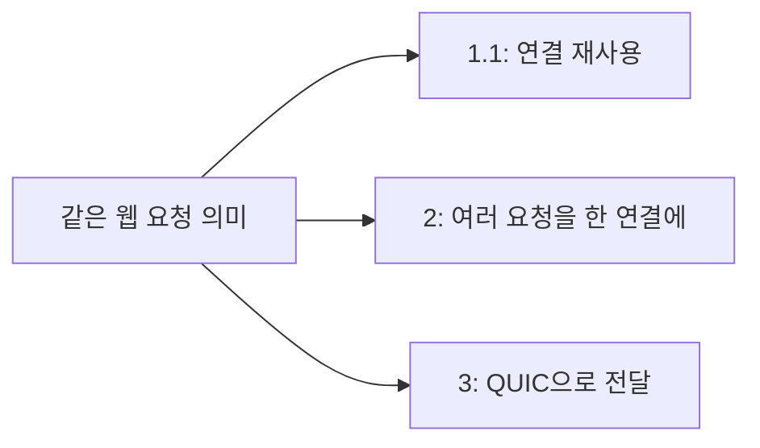

<!-- level:1 -->
# HTTP 버전 — 웹 요청을 함께 전달하는 방식의 변화

> **한 문장으로:** HTTP는 웹의 요청과 응답 규칙이고, 버전마다 여러 데이터를 운반하는 방식이 달라집니다.

## 왜 필요한가요?

웹 페이지 하나를 열어도 글·사진·스크립트 등 여러 파일을 요청합니다. 이 요청들을 효율적으로 주고받기 위해 HTTP의 전달 방식이 발전했습니다.

## 일상에서 떠올려 보기

식당에서 여러 테이블의 주문표를 전달한다고 생각해 보세요. 주문이 무엇을 뜻하는지는 같지만 주문표를 한 장씩 보내거나, 테이블 번호를 붙여 섞어 보내는 방식은 달라질 수 있습니다. 버전은 이런 운반 방식의 차이에 가깝습니다.

## 순서대로 따라가기

1. 브라우저가 ‘이 자료를 주세요’라는 요청을 보내고 서버가 상태와 데이터를 응답합니다.
2. HTTP/1.1은 연결을 다시 쓸 수 있고, HTTP/2는 한 연결에서 여러 요청의 데이터를 구분해 섞어 보낼 수 있습니다.
3. HTTP/3는 QUIC이라는 전송 방식을 사용합니다. 서로 다른 요청 흐름의 전달을 분리하지만 모든 지연이 사라지는 것은 아닙니다.



## 작은 예로 확인하기

사진 A와 B를 한 연결로 받는 HTTP/2에서는 TCP 데이터 일부가 빠지면 여러 요청이 함께 기다릴 수 있습니다. HTTP/3는 요청 흐름의 전달을 더 독립적으로 다루지만 느린 서버 계산이나 큰 사진 자체까지 빠르게 만들지는 않습니다.

## 처음 만나는 용어

| 용어 | 쉬운 뜻 |
|---|---|
| HTTP | 웹에서 요청과 응답을 주고받는 규칙입니다. |
| 스트림 | 서로 구분해 처리하는 한 데이터 흐름입니다. |
| 멀티플렉싱 | 여러 흐름을 구별하는 정보를 붙여 같은 통로에서 함께 보내는 것입니다. |
| QUIC | UDP 위에서 보안·신뢰성·여러 흐름의 전달을 관리하는 전송 방식입니다. |

**비유의 한계:** 버전 숫자가 높다고 항상 빠르지는 않습니다. 클라이언트·서버·중간 경로의 지원과 실제 병목이 중요합니다. QUIC의 여러 흐름도 같은 네트워크 용량을 함께 사용합니다.

## 스스로 확인

HTTP/3를 켜면 느린 데이터베이스 검색도 자동으로 빨라질까요?

**답과 이유:** 아닙니다. 웹 데이터를 전달하는 방식의 개선과 서버 안의 데이터 검색 속도는 별도입니다. 전체 요청에서 어디가 느린지 나눠 봐야 합니다.
<!-- level:2 -->
# 프레임·스트림·보안 협상

<!-- beginner-guide:start -->
## 읽기 전 길잡이

먼저 메시지를 작은 조각으로 나누고 요청 번호로 구별한다는 흐름을 보세요. curl 명령은 실제 연결에서 어떤 버전을 사용했는지 보여 줍니다. 옵션 이름보다 출력된 협상 결과를 확인하세요.

## 이 단계에서 만날 말

| 용어 | 쉬운 뜻 |
|---|---|
| 프레임 | HTTP/2 등의 전송에서 사용하는 작은 데이터 조각입니다. |
| 헤더 | 요청과 응답의 종류·길이·캐시 등 부가 정보를 담는 부분입니다. |
| HPACK·QPACK | 반복되는 헤더 정보를 효율적으로 전달하는 압축 방식입니다. |
| ALPN | 보안 연결 과정에서 사용할 응용 프로토콜을 합의하는 방식입니다. |
| fallback | 새 방식이 안 되면 지원되는 이전 방식으로 전환하는 것입니다. |
| 0-RTT | 이전 연결 정보를 활용해 일부 데이터를 빠르게 보내는 기능으로 재전송 위험을 고려해야 합니다. |

<!-- beginner-guide:end -->

HTTP/1.1은 텍스트 기반 메시지 구조를 사용하며 정확한 메시지 길이 규칙이 필요하다. HTTP/2는 HEADERS/DATA 같은 프레임과 stream ID로 요청을 나눈다. HPACK은 헤더 압축에, HTTP/3의 QPACK은 QUIC의 전송 특성에 맞춘 헤더 압축에 쓰인다. 두 버전을 한 단순 압축 규칙으로 설명하지 않는다.

curl의 빌드가 지원하는 버전을 먼저 확인한다.

```bash
curl --version
curl --http1.1 -sS -o /dev/null -w '%{http_version} %{time_total}\n' https://example.com
curl --http2 -sS -o /dev/null -w '%{http_version} %{time_total}\n' https://example.com
```

옵션은 클라이언트 의도를 나타내고 실제 협상 결과는 출력으로 확인한다. HTTP/3 옵션 지원은 curl 라이브러리와 서버 설정에 따라 다르다. 비교에는 같은 리소스·캐시 상태·연결 재사용 조건이 필요하다. HTTPS의 HTTP/2 협상에는 ALPN 등이 사용된다.

QUIC은 TLS 1.3과 통합해 보안 연결을 설정하고 UDP 위에서 신뢰성·혼잡 제어를 구현한다. 0-RTT 데이터는 재전송 공격에 대한 별도 주의가 필요하며 결제 같은 변경 요청에 무조건 쓰지 않는다.
<!-- level:3 -->
# 가상 장애 — HTTP/3를 켰는데 일부 사용자가 느려진다

<!-- beginner-guide:start -->
## 읽기 전 길잡이

새 버전을 켰는데 일부 환경이 느려지는 사례입니다. 주소 찾기·연결·보안 확인·서버 처리의 시간을 나누어 어느 단계가 늘었는지 살펴보세요.

<!-- beginner-guide:end -->

가상 배포 후 UDP 경로가 제한된 환경에서 연결 시도가 실패하거나 fallback 시간이 늘었다. 먼저 실제 협상 버전과 연결 시간, TLS 시간, 서버 처리 시간을 분리한다. HTTP/3 지원이라는 설정만으로 모든 요청이 HTTP/3였다고 가정하지 않는다.

클라이언트·CDN 로그에서 버전별 성공률과 지연을 비교한다. 요청 본문 크기, 연결 재사용, 손실과 재전송 단서를 함께 본다. HTTP/2에서도 stream 한도나 긴 스트림이 자원을 차지해 지연이 생길 수 있다.

**수정:** HTTP/2·1.1 fallback 경로를 유지하고 문제 경로에서 실패가 빠르게 감지되는지 확인한다. 서버의 stream/connection 한도와 기한을 조정한다. 프로토콜 변경과 캐시 설정 변경을 동시에 배포해 원인을 섞지 않는다.

**재검증:** 네트워크 유형·지역·버전별 p95와 오류율을 확인한다. 합성 요청 한 번의 속도보다 실제 사용자 페이지 로드와 서버 자원 사용을 함께 비교한다.
<!-- level:4 -->
# 버전 도입의 의사결정

<!-- beginner-guide:start -->
## 읽기 전 길잡이

새 버전을 선택할 때는 모바일 이동과 손실 환경에서의 이득, 지원되지 않는 경로의 전환 비용을 비교합니다. 변경 전후에 실제 사용자 결과를 측정하는 기준을 정하세요.

<!-- beginner-guide:end -->

| 선택 | 이득 | 검증할 조건 |
|---|---|---|
| HTTP/1.1 유지 | 호환성과 운영 단순성 | 다수 리소스의 연결 비용 |
| HTTP/2 | 스트림 멀티플렉싱·헤더 압축 | TCP 손실·stream 한도 |
| HTTP/3 | QUIC 스트림·연결 이동 특성 | UDP 경로·CPU·fallback |

프로토콜만 최적화하면 전체 경로의 병목을 놓칠 수 있다. 응답 크기, CDN 캐시, 서버 처리, 프론트엔드 렌더링까지 분해한다. 버전 전환의 목표를 연결 지연·손실 환경·모바일 이동 등 구체적으로 정하고 점진적 노출과 rollback 조건을 설정한다.

**설계 연습:** 이동 중 연결이 자주 바뀌는 모바일 서비스와 내부 데이터센터 RPC에서 같은 우선순위를 둘까? 요구된 지연·호환성·관측 비용을 기준으로 선택하자.

참고: [HTTP Semantics RFC 9110](https://www.rfc-editor.org/rfc/rfc9110), [HTTP/2 RFC 9113](https://www.rfc-editor.org/rfc/rfc9113), [HTTP/3 RFC 9114](https://www.rfc-editor.org/rfc/rfc9114).
<!-- quizzes -->
[{"level":1,"question":"HTTP/2의 멀티플렉싱이 없애지 못하는 병목은?","choices":["모든 HTTP 메서드","TCP 손실로 인한 전송 지연","요청 스트림 식별","응답 헤더"],"answer_index":1,"explanation":"HTTP/2는 응용 계층 다중 스트림을 지원하지만 TCP 연결의 순서 전달과 손실이 여러 스트림에 영향을 줄 수 있습니다."},{"level":2,"question":"HTTP/3의 기반 전송으로 올바른 것은?","choices":["UDP 위의 QUIC","DNS만으로 전송","암호화 없는 HTTP/1.1","모든 데이터를 ICMP로 전달"],"answer_index":0,"explanation":"HTTP/3는 QUIC을 사용합니다. QUIC은 UDP 위에 보안·신뢰성·혼잡 제어·스트림 기능을 구현합니다."},{"level":3,"question":"HTTP/3 배포 뒤 일부 환경만 느릴 때 첫 비교 지표는?","choices":["코드 줄 수","사이트 제목","실제 협상 버전·연결 단계별 시간·fallback","오직 평균 DB 행 수"],"answer_index":2,"explanation":"UDP 경로 제한이나 fallback 비용일 수 있습니다. 설정이 아니라 실제 협상 결과와 단계별 지연으로 가설을 확인합니다."},{"level":4,"question":"0-RTT 변경 요청을 설계할 때 고려할 것은?","choices":["모든 요청은 자동 무중복","TLS가 재전송 위험을 항상 제거","캐시를 무조건 삭제","재전송 위험과 업무 멱등성"],"answer_index":3,"explanation":"0-RTT 데이터는 재전송 공격과 업무 중복을 고려해야 합니다. 결제 등 상태 변경에는 안전한 정책과 멱등성 설계가 필요합니다."}]
