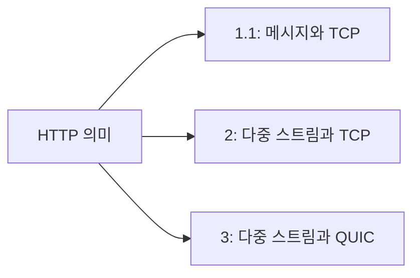

<!-- level:1 -->
# HTTP 버전 — 메시지 의미와 운반 방식

HTTP는 요청·응답의 의미를 정의하고 버전별로 전달 형식이 달라진다. HTTP/1.1은 연결을 재사용할 수 있다. HTTP/2는 한 연결에 여러 스트림을 프레임으로 섞어 보낸다. HTTP/3는 TCP 대신 QUIC을 사용한다. 메서드·상태 코드·캐시 같은 의미가 버전마다 완전히 사라지는 것은 아니다.



차선 여러 개로 차량을 섞어 보내는 모습이 멀티플렉싱의 비유다. HTTP/2는 응용 계층의 여러 요청을 한 연결에서 다루지만 TCP 바이트 스트림의 손실이 여러 스트림의 전달을 지연시킬 수 있다. QUIC은 스트림 간 전달을 독립시키지만 네트워크 용량·혼잡까지 서로 독립이라는 뜻은 아니다.

**비유의 한계:** 버전 숫자가 높으면 모든 상황에서 더 빠른 것은 아니다. 서버·클라이언트·프록시·경로 지원, 연결 재사용, 손실률이 결과를 바꾼다.

**확인:** HTTP/3의 도입이 느린 DB 쿼리를 직접 빨라지게 할까?
<!-- level:2 -->
# 프레임·스트림·보안 협상

HTTP/1.1은 텍스트 기반 메시지 구조를 사용하며 정확한 메시지 길이 규칙이 필요하다. HTTP/2는 HEADERS/DATA 같은 프레임과 stream ID로 요청을 나눈다. HPACK은 헤더 압축에, HTTP/3의 QPACK은 QUIC의 전송 특성에 맞춘 헤더 압축에 쓰인다. 두 버전을 한 단순 압축 규칙으로 설명하지 않는다.

curl의 빌드가 지원하는 버전을 먼저 확인한다.

```bash
curl --version
curl --http1.1 -sS -o /dev/null -w '%{http_version} %{time_total}\n' https://example.com
curl --http2 -sS -o /dev/null -w '%{http_version} %{time_total}\n' https://example.com
```

옵션은 클라이언트 의도를 나타내고 실제 협상 결과는 출력으로 확인한다. HTTP/3 옵션 지원은 curl 라이브러리와 서버 설정에 따라 다르다. 비교에는 같은 리소스·캐시 상태·연결 재사용 조건이 필요하다. HTTPS의 HTTP/2 협상에는 ALPN 등이 사용된다.

QUIC은 TLS 1.3과 통합해 보안 연결을 설정하고 UDP 위에서 신뢰성·혼잡 제어를 구현한다. 0-RTT 데이터는 재전송 공격에 대한 별도 주의가 필요하며 결제 같은 변경 요청에 무조건 쓰지 않는다.
<!-- level:3 -->
# 가상 장애 — HTTP/3를 켰는데 일부 사용자가 느려진다

가상 배포 후 UDP 경로가 제한된 환경에서 연결 시도가 실패하거나 fallback 시간이 늘었다. 먼저 실제 협상 버전과 연결 시간, TLS 시간, 서버 처리 시간을 분리한다. HTTP/3 지원이라는 설정만으로 모든 요청이 HTTP/3였다고 가정하지 않는다.

클라이언트·CDN 로그에서 버전별 성공률과 지연을 비교한다. 요청 본문 크기, 연결 재사용, 손실과 재전송 단서를 함께 본다. HTTP/2에서도 stream 한도나 긴 스트림이 자원을 차지해 지연이 생길 수 있다.

**수정:** HTTP/2·1.1 fallback 경로를 유지하고 문제 경로에서 실패가 빠르게 감지되는지 확인한다. 서버의 stream/connection 한도와 기한을 조정한다. 프로토콜 변경과 캐시 설정 변경을 동시에 배포해 원인을 섞지 않는다.

**재검증:** 네트워크 유형·지역·버전별 p95와 오류율을 확인한다. 합성 요청 한 번의 속도보다 실제 사용자 페이지 로드와 서버 자원 사용을 함께 비교한다.
<!-- level:4 -->
# 버전 도입의 의사결정

| 선택 | 이득 | 검증할 조건 |
|---|---|---|
| HTTP/1.1 유지 | 호환성과 운영 단순성 | 다수 리소스의 연결 비용 |
| HTTP/2 | 스트림 멀티플렉싱·헤더 압축 | TCP 손실·stream 한도 |
| HTTP/3 | QUIC 스트림·연결 이동 특성 | UDP 경로·CPU·fallback |

프로토콜만 최적화하면 전체 경로의 병목을 놓칠 수 있다. 응답 크기, CDN 캐시, 서버 처리, 프론트엔드 렌더링까지 분해한다. 버전 전환의 목표를 연결 지연·손실 환경·모바일 이동 등 구체적으로 정하고 점진적 노출과 rollback 조건을 설정한다.

**설계 연습:** 이동 중 연결이 자주 바뀌는 모바일 서비스와 내부 데이터센터 RPC에서 같은 우선순위를 둘까? 요구된 지연·호환성·관측 비용을 기준으로 선택하자.

참고: [HTTP Semantics RFC 9110](https://www.rfc-editor.org/rfc/rfc9110), [HTTP/2 RFC 9113](https://www.rfc-editor.org/rfc/rfc9113), [HTTP/3 RFC 9114](https://www.rfc-editor.org/rfc/rfc9114).
<!-- quizzes -->
[{"level":1,"question":"HTTP/2의 멀티플렉싱이 없애지 못하는 병목은?","choices":["모든 HTTP 메서드","TCP 손실로 인한 전송 지연","요청 스트림 식별","응답 헤더"],"answer_index":1,"explanation":"HTTP/2는 응용 계층 다중 스트림을 지원하지만 TCP 연결의 순서 전달과 손실이 여러 스트림에 영향을 줄 수 있습니다."},{"level":2,"question":"HTTP/3의 기반 전송으로 올바른 것은?","choices":["UDP 위의 QUIC","DNS만으로 전송","암호화 없는 HTTP/1.1","모든 데이터를 ICMP로 전달"],"answer_index":0,"explanation":"HTTP/3는 QUIC을 사용합니다. QUIC은 UDP 위에 보안·신뢰성·혼잡 제어·스트림 기능을 구현합니다."},{"level":3,"question":"HTTP/3 배포 뒤 일부 환경만 느릴 때 첫 비교 지표는?","choices":["코드 줄 수","사이트 제목","실제 협상 버전·연결 단계별 시간·fallback","오직 평균 DB 행 수"],"answer_index":2,"explanation":"UDP 경로 제한이나 fallback 비용일 수 있습니다. 설정이 아니라 실제 협상 결과와 단계별 지연으로 가설을 확인합니다."},{"level":4,"question":"0-RTT 변경 요청을 설계할 때 고려할 것은?","choices":["모든 요청은 자동 무중복","TLS가 재전송 위험을 항상 제거","캐시를 무조건 삭제","재전송 위험과 업무 멱등성"],"answer_index":3,"explanation":"0-RTT 데이터는 재전송 공격과 업무 중복을 고려해야 합니다. 결제 등 상태 변경에는 안전한 정책과 멱등성 설계가 필요합니다."}]
