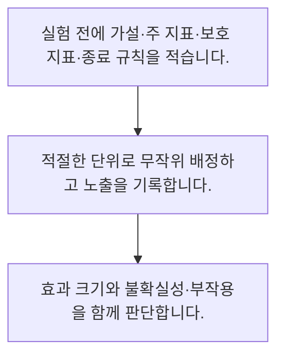

<!-- level:1 -->
# 가설 검정과 A/B 실험

> **한 문장으로:** 변경의 효과를 확인하려면 비교군을 만들고 우연한 변동과 운영상 중요한 차이를 구분합니다.

## 왜 필요한가요?

버튼이나 업무 방식을 바꾼 뒤 결과가 좋아져도 원인이 그 변경인지 알기 어렵습니다. 비교 실험을 설계하면 우연과 다른 조건의 영향을 줄이며 결정할 수 있습니다.

## 일상에서 떠올려 보기

새 비료를 시험할 때 햇빛이 좋은 밭에만 새 비료를 쓰면 비료 효과인지 햇빛 효과인지 알기 어렵습니다. 비교 조건을 설계해야 합니다.

## 순서대로 따라가기

1. 실험 전에 가설·주 지표·보호 지표·종료 규칙을 적습니다.
2. 적절한 단위로 무작위 배정하고 노출을 기록합니다.
3. 효과 크기와 불확실성·부작용을 함께 판단합니다.



## 처음 만나는 용어

| 용어 | 쉬운 뜻 |
|---|---|
| 대조군 | 기존 조건으로 비교의 기준이 되는 집단 |
| 무작위 배정 | 관측된 특성과 숨은 특성의 차이를 줄이도록 임의 배정하는 절차 |
| 보호 지표 | 개선 과정에서 악화되면 안 되는 품질·피해 지표 |

**비유의 한계:** p값은 가설이 참일 확률이 아니고, 통계적 유의성이 실무적으로 큰 효과를 뜻하지도 않습니다. 실험 단위 간 간섭과 반복 확인도 결과에 영향을 줍니다.

## 스스로 확인

A/B 실험에서 먼저 정할 것은?

**답과 이유:** 가설·지표·종료 규칙 — 결과를 보기 전에 비교와 판단 규칙을 정해야 유리한 순간만 골라 해석하는 위험을 줄입니다.
<!-- level:2 -->
# 가설 검정과 A/B 실험 — 실제 흐름 따라가기

## 읽기 전 길잡이

변경의 효과를 확인하려면 비교군을 만들고 우연한 변동과 운영상 중요한 차이를 구분합니다. 아래 예제는 외부 시스템에 연결하지 않는 작은 학습용 사례입니다. 입력, 처리 조건, 결과를 순서대로 살펴보세요.

1. 실험 전에 가설·주 지표·보호 지표·종료 규칙을 적습니다.
2. 적절한 단위로 무작위 배정하고 노출을 기록합니다.
3. 효과 크기와 불확실성·부작용을 함께 판단합니다.

## 예제로 확인하기

```python
a_success, a_total = 50, 1000
b_success, b_total = 60, 1000
lift = b_success/b_total-a_success/a_total
assert round(lift, 3) == 0.01
print("관측 차이(퍼센트포인트):", round(lift*100, 1))
```

## 결과를 해석하기

전환율 5%와 6%의 관측 차이는 1퍼센트포인트입니다. 이 코드만으로 유의성이나 인과를 확정하지 않습니다. 배정, 표본 수, 구간, 실험 기간과 다른 지표가 필요합니다.

## 실무에 옮기기 전

p값은 가설이 참일 확률이 아니고, 통계적 유의성이 실무적으로 큰 효과를 뜻하지도 않습니다. 실험 단위 간 간섭과 반복 확인도 결과에 영향을 줍니다. 실제 업무에서는 실험 종료를 결과에 맞춰 바꾸지 않고 업무 위험과 최소 의미 효과에 맞춰 설계합니다. 출시 결정에는 오류·불만·매출의 장기 영향도 포함합니다.

## 확인 질문

5%에서 6%로 변한 관측 차이는?

**답과 이유:** 비율의 절대 차이와 상대 변화는 다릅니다. 관측 차이만으로 실험 타당성은 보장되지 않습니다.
<!-- level:3 -->
# 가설 검정과 A/B 실험 — 가상 사례로 문제 해결하기

실제 고객의 장애 기록이 아닌 학습용 재현 시나리오입니다. 결과만 바꾸기 전에 관측한 증거와 원인 가설을 구분합니다.

## 1. 어떤 문제가 생겼나요?

가상 실험에서 매시간 결과를 보고 유의해진 순간만 골라 출시합니다.

## 2. 먼저 확인할 증거

종료 규칙, 확인 횟수, 노출 비율과 기간별 지표를 점검합니다.

## 3. 원인 가설

사전에 정한 절차 없이 유리한 순간을 선택해 오판 가능성이 커졌습니다.

## 4. 수정 방법

고정 기간 또는 적절한 순차 분석 절차를 정하고 모든 분석을 기록합니다.

## 5. 재검증

새 실험에서 배정 비율과 로그 무결성을 확인하고 효과 구간·보호 지표를 재평가합니다.

## 놓치기 쉬운 조건

p값은 가설이 참일 확률이 아니고, 통계적 유의성이 실무적으로 큰 효과를 뜻하지도 않습니다. 실험 단위 간 간섭과 반복 확인도 결과에 영향을 줍니다.

## 확인 질문

매시간 유의성을 보고 종료한 실험의 우선 점검은?

**답과 이유:** 반복 확인을 고려하지 않은 선택은 오류율을 바꿀 수 있습니다. 분석 절차의 적합성을 먼저 봅니다.
<!-- level:4 -->
# 가설 검정과 A/B 실험 — 업무와 아키텍처의 선택

## 읽기 전 길잡이

같은 개념도 업무의 규모, 오류 비용, 운영 역량에 따라 적용 방식이 달라집니다. 아래 비교는 특정 제품의 성능 순위가 아닌 선택 기준입니다.

| 선택 | 얻는 점 | 감수할 점 |
|---|---|---|
| 고정 기간 실험 | 절차와 해석이 명확 | 조기 판단의 유연성 제한 |
| 설계된 순차 실험 | 중간 판단을 체계적으로 허용 | 통계 설계와 운영 복잡성 |

## 선택 기준

실험 종료를 결과에 맞춰 바꾸지 않고 업무 위험과 최소 의미 효과에 맞춰 설계합니다. 출시 결정에는 오류·불만·매출의 장기 영향도 포함합니다.

## 도입과 운영에서 확인할 것

고정 기간 또는 적절한 순차 분석 절차를 정하고 모든 분석을 기록합니다. 새 실험에서 배정 비율과 로그 무결성을 확인하고 효과 구간·보호 지표를 재평가합니다.

## 판단 연습

출시 의사결정에 적절한 근거는?

**판단의 근거:** 통계적 신호와 업무상 가치·피해는 별도 축입니다. 이들을 함께 검토해야 합니다.

참고: [NIST 통계 핸드북](https://www.itl.nist.gov/div898/handbook/), [PostgreSQL 쿼리](https://www.postgresql.org/docs/current/queries.html).
<!-- quizzes -->
[{"level":1,"question":"A/B 실험에서 먼저 정할 것은?","choices":["가설·지표·종료 규칙","좋아 보이는 결과","보고서 색상","승리할 집단"],"answer_index":0,"explanation":"결과를 보기 전에 비교와 판단 규칙을 정해야 유리한 순간만 골라 해석하는 위험을 줄입니다."},{"level":2,"question":"5%에서 6%로 변한 관측 차이는?","choices":["인과가 자동 확정","1퍼센트포인트","1명","100퍼센트포인트"],"answer_index":1,"explanation":"비율의 절대 차이와 상대 변화는 다릅니다. 관측 차이만으로 실험 타당성은 보장되지 않습니다."},{"level":3,"question":"매시간 유의성을 보고 종료한 실험의 우선 점검은?","choices":["불리한 지표 삭제","분모 숨기기","사전 종료·분석 절차","더 좋은 시간만 선택"],"answer_index":2,"explanation":"반복 확인을 고려하지 않은 선택은 오류율을 바꿀 수 있습니다. 분석 절차의 적합성을 먼저 봅니다."},{"level":4,"question":"출시 의사결정에 적절한 근거는?","choices":["p값 하나","전환율 최고 순간","비교군 없는 호평","효과 크기·불확실성·보호 지표"],"answer_index":3,"explanation":"통계적 신호와 업무상 가치·피해는 별도 축입니다. 이들을 함께 검토해야 합니다."}]
