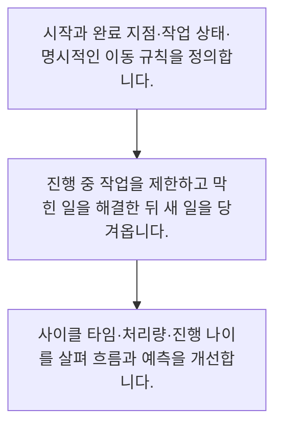

<!-- level:1 -->
# 칸반·진행 중 작업 제한·흐름 지표

> **한 문장으로:** 칸반은 작업의 흐름을 보이게 하고 동시에 진행하는 일을 제한해, 시작한 일이 끝까지 도착하도록 돕습니다.

## 왜 필요한가요?

여러 일을 동시에 시작하면 모두 바쁘지만 끝나는 결과는 적을 수 있습니다. 진행 중인 일과 대기를 보이게 하면 병목을 해결하고 시작한 일을 끝까지 전달하는 데 도움이 됩니다.

## 일상에서 떠올려 보기

카페가 주문을 무한히 받으면 모든 손님이 오래 기다립니다. 바리스타가 처리 중인 주문을 제한하고 병목을 살피면 일이 어디에서 막히는지 보입니다. 새 일을 빨리 시작하는 것과 손님에게 빨리 전달하는 것은 다릅니다.

## 순서대로 따라가기

1. 시작과 완료 지점·작업 상태·명시적인 이동 규칙을 정의합니다.
2. 진행 중 작업을 제한하고 막힌 일을 해결한 뒤 새 일을 당겨옵니다.
3. 사이클 타임·처리량·진행 나이를 살펴 흐름과 예측을 개선합니다.



## 처음 만나는 용어

| 용어 | 쉬운 뜻 |
|---|---|
| WIP | 시작했지만 아직 완료되지 않은 작업 수 |
| 사이클 타임 | 정의한 시작부터 완료까지 걸린 시간 |
| 작업 나이 | 진행 중인 일이 시작된 뒤 지금까지 지난 시간 |

**비유의 한계:** 개발 작업은 커피보다 크기와 변동성이 다릅니다. 평균 처리율만으로 개별 작업의 완료일을 보장할 수 없고 작업 유형·긴급도·대기 경계를 정의해야 합니다.

## 스스로 확인

WIP가 의미하는 것은 무엇인가요?

**답과 이유:** 시작했지만 끝나지 않은 작업 수 — 진행 중 작업의 범위를 명확히 해야 대기와 작업 전환을 관리할 수 있습니다.
<!-- level:2 -->
# 칸반·진행 중 작업 제한·흐름 지표 — 실제 흐름 따라가기

## 읽기 전 길잡이

칸반은 작업의 흐름을 보이게 하고 동시에 진행하는 일을 제한해, 시작한 일이 끝까지 도착하도록 돕습니다. 아래 예제는 외부 시스템에 연결하지 않는 작은 학습용 사례입니다. 입력, 처리 조건, 결과를 순서대로 살펴보세요.

1. 시작과 완료 지점·작업 상태·명시적인 이동 규칙을 정의합니다.
2. 진행 중 작업을 제한하고 막힌 일을 해결한 뒤 새 일을 당겨옵니다.
3. 사이클 타임·처리량·진행 나이를 살펴 흐름과 예측을 개선합니다.

## 예제로 확인하기

```markdown
# 업무 흐름 합의
- 시작: 구현 시작으로 이동한 순간
- 완료: 검토·배포 확인이 끝난 순간
- 구현 중 제한: 3건
- 검토 중 제한: 2건
- 제한에 도달하면: 새 일보다 검토와 막힌 일 해결을 우선
- 긴급 작업: 사유·승인자 기록, 기존 작업 영향 공개
- 점검: 오래된 진행 작업과 막힘 이유를 매일 확인
- 예측: 비슷한 작업의 과거 사이클 타임 분포 참고
```

## 결과를 해석하기

대기열을 줄이려면 사람이 바쁘게 보이는 정도보다 끝난 결과와 기다림을 봐야 합니다. 리틀의 법칙은 안정된 흐름의 장기 평균에서 평균 WIP=평균 처리율×평균 체류 시간이라는 관계를 말하며 오늘 작업의 마감일을 보장하는 공식은 아닙니다.

## 실무에 옮기기 전

개발 작업은 커피보다 크기와 변동성이 다릅니다. 평균 처리율만으로 개별 작업의 완료일을 보장할 수 없고 작업 유형·긴급도·대기 경계를 정의해야 합니다. 실제 업무에서는 처음부터 최적의 제한 숫자를 찾으려 하기보다 현재 흐름을 정의하고 작은 제한을 실험합니다. 속도를 높이려고 검토 품질을 낮추지 말고 긴급 작업이 들어왔을 때 밀린 일의 영향도 보여 줍니다.

## 확인 질문

사이클 타임을 측정하기 전에 무엇을 정해야 하나요?

**답과 이유:** 같은 작업도 경계에 따라 시간이 달라지므로 측정 정의를 먼저 합의해야 합니다.
<!-- level:3 -->
# 칸반·진행 중 작업 제한·흐름 지표 — 가상 사례로 문제 해결하기

실제 고객의 장애 기록이 아닌 학습용 재현 시나리오입니다. 결과만 바꾸기 전에 관측한 증거와 원인 가설을 구분합니다.

## 1. 어떤 문제가 생겼나요?

구현은 빠르지만 검토 대기 작업이 열 건 쌓여 출시가 느려집니다.

## 2. 먼저 확인할 증거

작업 나이는 늘어나고 개발자는 새 티켓을 계속 시작합니다.

## 3. 원인 가설

개별 가동률을 높이느라 전체 완료 흐름의 병목을 무시한 것이 원인 가설입니다.

## 4. 수정 방법

검토 WIP 제한을 정하고 개발자가 검토 준비·테스트를 도와 기존 작업을 끝내도록 합니다.

## 5. 재검증

처리량·사이클 타임 분포·오래된 작업의 수가 개선되는지 확인하고 품질 저하 여부도 함께 봅니다.

## 놓치기 쉬운 조건

개발 작업은 커피보다 크기와 변동성이 다릅니다. 평균 처리율만으로 개별 작업의 완료일을 보장할 수 없고 작업 유형·긴급도·대기 경계를 정의해야 합니다.

## 확인 질문

검토 대기가 쌓일 때 적절한 대응은 무엇인가요?

**답과 이유:** 전체 흐름의 병목을 풀어야 사용자에게 도착하는 결과가 빨라질 수 있습니다.
<!-- level:4 -->
# 칸반·진행 중 작업 제한·흐름 지표 — 업무와 아키텍처의 선택

## 읽기 전 길잡이

같은 개념도 업무의 규모, 오류 비용, 운영 역량에 따라 적용 방식이 달라집니다. 아래 비교는 특정 제품의 성능 순위가 아닌 선택 기준입니다.

| 선택 | 얻는 점 | 감수할 점 |
|---|---|---|
| WIP 제한과 당겨오기 | 미완료와 전환 비용을 줄이기 쉬움 | 긴급 예외와 막힘 해결 규칙이 필요 |
| 제한 없는 작업 시작 | 새 요청에 즉시 착수하기 쉬움 | 대기와 전환이 늘어 완료 예측이 어려움 |

## 선택 기준

처음부터 최적의 제한 숫자를 찾으려 하기보다 현재 흐름을 정의하고 작은 제한을 실험합니다. 속도를 높이려고 검토 품질을 낮추지 말고 긴급 작업이 들어왔을 때 밀린 일의 영향도 보여 줍니다.

## 도입과 운영에서 확인할 것

검토 WIP 제한을 정하고 개발자가 검토 준비·테스트를 도와 기존 작업을 끝내도록 합니다. 처리량·사이클 타임 분포·오래된 작업의 수가 개선되는지 확인하고 품질 저하 여부도 함께 봅니다.

## 판단 연습

리틀의 법칙을 사용할 때 주의할 점은 무엇인가요?

**판단의 근거:** 평균 관계에는 흐름의 안정성과 경계가 중요하며 개별 작업의 확정 약속으로 쓰면 안 됩니다.

참고: [Scrum Guide](https://scrumguides.org/scrum-guide.html), [The Kanban Guide 2025](https://kanbanguides.org/the-kanban-guide/2025.5/), [GOV.UK Agile delivery](https://www.gov.uk/service-manual/agile-delivery).
<!-- quizzes -->
[{"level":1,"question":"WIP가 의미하는 것은 무엇인가요?","choices":["완료된 기능의 매출","직원의 근무 연수","시작했지만 끝나지 않은 작업 수","다음 달 모든 아이디어"],"answer_index":2,"explanation":"진행 중 작업의 범위를 명확히 해야 대기와 작업 전환을 관리할 수 있습니다."},{"level":2,"question":"사이클 타임을 측정하기 전에 무엇을 정해야 하나요?","choices":["게시판의 색상만","회의실 이름","개발 언어 버전만","작업의 시작과 완료 지점"],"answer_index":3,"explanation":"같은 작업도 경계에 따라 시간이 달라지므로 측정 정의를 먼저 합의해야 합니다."},{"level":3,"question":"검토 대기가 쌓일 때 적절한 대응은 무엇인가요?","choices":["새 일보다 검토 병목과 오래된 작업을 해결한다","모두 새 작업을 시작한다","검토 열을 숨긴다","완료 기준을 없앤다"],"answer_index":0,"explanation":"전체 흐름의 병목을 풀어야 사용자에게 도착하는 결과가 빨라질 수 있습니다."},{"level":4,"question":"리틀의 법칙을 사용할 때 주의할 점은 무엇인가요?","choices":["단 하루 결과로 확정한다","안정된 흐름의 장기 평균 관계로 해석한다","개별 티켓 종료일을 보장한다","품질과 무관하게 WIP를 0으로 둔다"],"answer_index":1,"explanation":"평균 관계에는 흐름의 안정성과 경계가 중요하며 개별 작업의 확정 약속으로 쓰면 안 됩니다."}]
