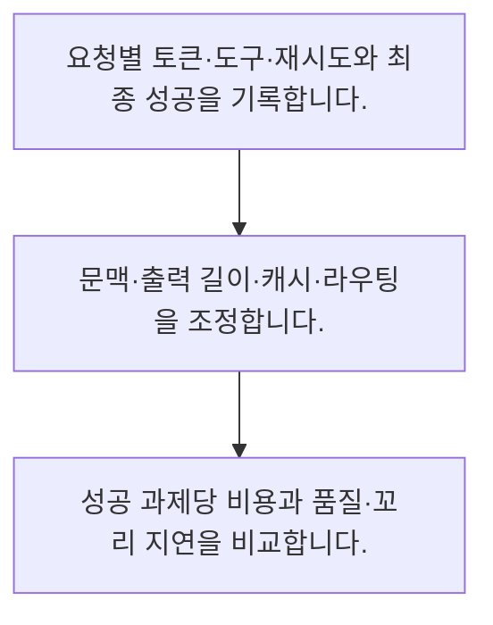

<!-- level:1 -->
# LLM 비용·지연·캐시·모델 라우팅

> **한 문장으로:** AI 비용과 지연은 입력·출력·재시도·도구 호출·캐시를 과제 단위로 측정해야 실제 효율을 알 수 있습니다.

## 왜 필요한가요?

AI 답변 한 번의 가격이 작아 보여도 긴 입력과 재시도·도구 호출이 쌓이면 부담이 커집니다. 비용과 기다리는 시간을 함께 보면 품질을 지키며 줄일 수 있는 부분을 찾을 수 있습니다.

## 일상에서 떠올려 보기

배송비를 상자 하나의 가격만으로 계산하면 반품과 재배송 비용을 놓칩니다. 한 업무가 끝날 때까지 든 전체 비용을 합쳐야 합니다.

## 순서대로 따라가기

1. 요청별 토큰·도구·재시도와 최종 성공을 기록합니다.
2. 문맥·출력 길이·캐시·라우팅을 조정합니다.
3. 성공 과제당 비용과 품질·꼬리 지연을 비교합니다.



## 처음 만나는 용어

| 용어 | 쉬운 뜻 |
|---|---|
| 모델 라우팅 | 과제 특성에 따라 사용할 모델·경로를 고르는 방식 |
| 프롬프트 캐시 | 지원 조건에서 반복 입력 계산을 재사용하는 기능 |
| 성공 과제당 비용 | 전체 지출을 실제 성공한 업무 수로 나눈 값 |

**비유의 한계:** 가격과 과금 단위는 제공자·시점·계약에 따라 달라집니다. 아래 숫자는 단가 구조를 설명하는 가상 값이며 특정 서비스 가격이 아닙니다.

## 스스로 확인

비용 비교의 적절한 단위는?

**답과 이유:** 성공한 과제당 전체 비용 — 재시도와 실패율까지 포함해야 업무 효율을 알 수 있습니다.
<!-- level:2 -->
# LLM 비용·지연·캐시·모델 라우팅 — 실제 흐름 따라가기

## 읽기 전 길잡이

AI 비용과 지연은 입력·출력·재시도·도구 호출·캐시를 과제 단위로 측정해야 실제 효율을 알 수 있습니다. 아래 예제는 외부 시스템에 연결하지 않는 작은 학습용 사례입니다. 입력, 처리 조건, 결과를 순서대로 살펴보세요.

1. 요청별 토큰·도구·재시도와 최종 성공을 기록합니다.
2. 문맥·출력 길이·캐시·라우팅을 조정합니다.
3. 성공 과제당 비용과 품질·꼬리 지연을 비교합니다.

## 예제로 확인하기

```python
# 특정 공급자의 실제 단가가 아닌 계산 연습
input_units,output_units=100,20
input_price,output_price=0.01,0.03
cost=input_units*input_price+output_units*output_price
assert abs(cost-1.6)<1e-9
print(cost)
```

## 결과를 해석하기

가상 비용은 1.6입니다. 실제 청구에는 캐시·실패·재시도·도구·인프라가 더해질 수 있습니다. 단위와 시점·계약을 확인하고 업무 성공률로 나누어 비교합니다.

## 실무에 옮기기 전

가격과 과금 단위는 제공자·시점·계약에 따라 달라집니다. 아래 숫자는 단가 구조를 설명하는 가상 값이며 특정 서비스 가격이 아닙니다. 실제 업무에서는 평가를 통과한 범위에서 최적화합니다. 캐시 키에는 권한 범위·모델·프롬프트·자료 버전을 포함하고 민감한 결과의 공유를 막습니다.

## 확인 질문

가상 예제의 비용은?

**답과 이유:** 입력 비용 1과 출력 비용 0.6을 더합니다.
<!-- level:3 -->
# LLM 비용·지연·캐시·모델 라우팅 — 가상 사례로 문제 해결하기

실제 고객의 장애 기록이 아닌 학습용 재현 시나리오입니다. 결과만 바꾸기 전에 관측한 증거와 원인 가설을 구분합니다.

## 1. 어떤 문제가 생겼나요?

가상 챗봇의 단일 호출 단가는 낮아졌는데 총 비용이 늘어납니다.

## 2. 먼저 확인할 증거

과제별 호출 수·출력 길이·실패 재시도와 성공률을 확인합니다.

## 3. 원인 가설

싼 모델의 실패로 재시도와 상위 모델 재호출이 늘었습니다.

## 4. 수정 방법

경로별 성공률을 반영해 라우팅과 상한을 조정합니다.

## 5. 재검증

동일 과제에서 성공당 비용과 지연·품질을 재측정합니다.

## 놓치기 쉬운 조건

가격과 과금 단위는 제공자·시점·계약에 따라 달라집니다. 아래 숫자는 단가 구조를 설명하는 가상 값이며 특정 서비스 가격이 아닙니다.

## 확인 질문

단가가 낮아도 총 비용이 늘면?

**답과 이유:** 낮은 성공률은 재시도와 재작업 비용을 늘릴 수 있습니다.
<!-- level:4 -->
# LLM 비용·지연·캐시·모델 라우팅 — 업무와 아키텍처의 선택

## 읽기 전 길잡이

같은 개념도 업무의 규모, 오류 비용, 운영 역량에 따라 적용 방식이 달라집니다. 아래 비교는 특정 제품의 성능 순위가 아닌 선택 기준입니다.

| 선택 | 얻는 점 | 감수할 점 |
|---|---|---|
| 단일 강한 모델 | 경로·운영 단순 | 단순 과제의 비용 부담 |
| 라우팅·캐시 결합 | 반복·쉬운 과제 비용 감소 가능 | 오분류·캐시 격리·운영 복잡성 |

## 선택 기준

평가를 통과한 범위에서 최적화합니다. 캐시 키에는 권한 범위·모델·프롬프트·자료 버전을 포함하고 민감한 결과의 공유를 막습니다.

## 도입과 운영에서 확인할 것

경로별 성공률을 반영해 라우팅과 상한을 조정합니다. 동일 과제에서 성공당 비용과 지연·품질을 재측정합니다.

## 판단 연습

캐시 키에 필요한 것은?

**판단의 근거:** 같은 질문이어도 접근 범위와 자료·모델 버전이 다를 수 있습니다.

참고: [Google Cloud MLOps](https://docs.cloud.google.com/architecture/mlops-continuous-delivery-and-automation-pipelines-in-machine-learning), [NIST AI RMF](https://www.nist.gov/itl/ai-risk-management-framework), [OWASP 생성형 AI 보안](https://genai.owasp.org/llm-top-10/), [Google SRE Workbook](https://sre.google/workbook/table-of-contents/).
<!-- quizzes -->
[{"level":1,"question":"비용 비교의 적절한 단위는?","choices":["성공한 과제당 전체 비용","단일 토큰 가격만","모델 이름","최고 속도 한 건"],"answer_index":0,"explanation":"재시도와 실패율까지 포함해야 업무 효율을 알 수 있습니다."},{"level":2,"question":"가상 예제의 비용은?","choices":["120","1.6","1","0.6"],"answer_index":1,"explanation":"입력 비용 1과 출력 비용 0.6을 더합니다."},{"level":3,"question":"단가가 낮아도 총 비용이 늘면?","choices":["품질 평가 삭제","무조건 더 싼 모델","호출 수·재시도·성공률 확인","가격표만 확인"],"answer_index":2,"explanation":"낮은 성공률은 재시도와 재작업 비용을 늘릴 수 있습니다."},{"level":4,"question":"캐시 키에 필요한 것은?","choices":["질문 텍스트만","사용자 비밀번호","응답 색상","권한 범위와 구성 버전"],"answer_index":3,"explanation":"같은 질문이어도 접근 범위와 자료·모델 버전이 다를 수 있습니다."}]
