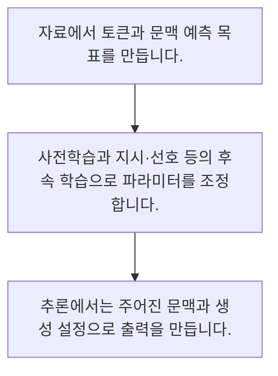

<!-- level:1 -->
# LLM의 사전학습·후속 학습·추론

> **한 문장으로:** 언어 모델은 문맥에서 다음 토큰을 예측하도록 학습하며 후속 학습으로 지시 응답 등을 조정하고 추론 때 문맥을 바탕으로 출력을 만듭니다.

## 왜 필요한가요?

정답 토큰에 부여한 확률의 음의 로그를 계산한 작은 손실 예제입니다. 정답 확률이 커질수록 손실이 작아집니다. 전체 모델이나 학습 자료 수집·분산 학습을 구현한 코드는 아닙니다.

## 일상에서 떠올려 보기

많은 글을 읽고 다음에 올 말을 연습하는 사람을 떠올려 볼 수 있습니다. 다만 모델은 사실을 확인한 도서관 사서가 아니라 학습된 수치로 출력 분포를 계산합니다.

## 순서대로 따라가기

1. 자료에서 토큰과 문맥 예측 목표를 만듭니다.
2. 사전학습과 지시·선호 등의 후속 학습으로 파라미터를 조정합니다.
3. 추론에서는 주어진 문맥과 생성 설정으로 출력을 만듭니다.



## 처음 만나는 용어

| 용어 | 쉬운 뜻 |
|---|---|
| 사전학습 | 큰 자료에서 일반적인 표현과 예측 패턴을 학습하는 과정 |
| 후속 학습 | 지시 따르기나 선호 같은 추가 목표로 모델을 조정하는 과정 |
| 추론 | 학습된 모델에 입력을 주고 출력을 계산하는 단계 |

**비유의 한계:** 다음 토큰 예측이 사실성·추론 능력·안전을 자동 보장하지 않습니다. 학습에 노출된 자료와 현재 지식도 구분해야 하며 추론 중 모든 대화가 자동으로 가중치를 바꾸는 것은 아닙니다.

## 스스로 확인

일반적인 추론 단계의 설명은?

**답과 이유:** 학습된 파라미터와 문맥으로 출력 계산 — 추론과 가중치 학습은 다른 단계이며 검색도 별도 기능입니다.
<!-- level:2 -->
# LLM의 사전학습·후속 학습·추론 — 실제 흐름 따라가기

## 읽기 전 길잡이

언어 모델은 문맥에서 다음 토큰을 예측하도록 학습하며 후속 학습으로 지시 응답 등을 조정하고 추론 때 문맥을 바탕으로 출력을 만듭니다. 아래 예제는 외부 시스템에 연결하지 않는 작은 학습용 사례입니다. 입력, 처리 조건, 결과를 순서대로 살펴보세요.

1. 자료에서 토큰과 문맥 예측 목표를 만듭니다.
2. 사전학습과 지시·선호 등의 후속 학습으로 파라미터를 조정합니다.
3. 추론에서는 주어진 문맥과 생성 설정으로 출력을 만듭니다.

## 예제로 확인하기

```python
import math
probabilities=[0.1,0.7,0.2]
target_index=1
loss=-math.log(probabilities[target_index])
assert 0<loss<1
print(round(loss,3))
```

## 결과를 해석하기

정답 토큰에 부여한 확률의 음의 로그를 계산한 작은 손실 예제입니다. 정답 확률이 커질수록 손실이 작아집니다. 전체 모델이나 학습 자료 수집·분산 학습을 구현한 코드는 아닙니다.

## 실무에 옮기기 전

다음 토큰 예측이 사실성·추론 능력·안전을 자동 보장하지 않습니다. 학습에 노출된 자료와 현재 지식도 구분해야 하며 추론 중 모든 대화가 자동으로 가중치를 바꾸는 것은 아닙니다. 실제 업무에서는 문제의 원인이 최신 지식 부족인지 출력 방식인지 구분합니다. 지식 갱신과 행동 적응을 같은 방법 하나로 해결하려 하지 않고 독립 평가로 효과를 확인합니다.

## 확인 질문

정답 토큰 확률이 높아지면 예제 손실은?

**답과 이유:** 음의 로그 손실은 정답에 높은 확률을 줄수록 작아집니다.
<!-- level:3 -->
# LLM의 사전학습·후속 학습·추론 — 가상 사례로 문제 해결하기

실제 고객의 장애 기록이 아닌 학습용 재현 시나리오입니다. 결과만 바꾸기 전에 관측한 증거와 원인 가설을 구분합니다.

## 1. 어떤 문제가 생겼나요?

가상 챗봇이 최근 변경된 사내 정책을 자신 있게 틀립니다.

## 2. 먼저 확인할 증거

정책 버전·검색 사용 여부·프롬프트에 실제 제공한 문서를 확인합니다.

## 3. 원인 가설

학습된 패턴만으로 최신 사실을 답하게 했습니다.

## 4. 수정 방법

최신 근거를 검색해 제공하고 불충분할 때 답을 유보하도록 설계합니다.

## 5. 재검증

정책 변경·상충 문서·답 없는 질문을 포함한 평가를 반복합니다.

## 놓치기 쉬운 조건

다음 토큰 예측이 사실성·추론 능력·안전을 자동 보장하지 않습니다. 학습에 노출된 자료와 현재 지식도 구분해야 하며 추론 중 모든 대화가 자동으로 가중치를 바꾸는 것은 아닙니다.

## 확인 질문

최근 정책을 틀리면 먼저 볼 것은?

**답과 이유:** 최신 근거가 입력에 실제로 있었는지 확인해야 합니다.
<!-- level:4 -->
# LLM의 사전학습·후속 학습·추론 — 업무와 아키텍처의 선택

## 읽기 전 길잡이

같은 개념도 업무의 규모, 오류 비용, 운영 역량에 따라 적용 방식이 달라집니다. 아래 비교는 특정 제품의 성능 순위가 아닌 선택 기준입니다.

| 선택 | 얻는 점 | 감수할 점 |
|---|---|---|
| 기존 모델 추론 | 빠른 도입 | 자료 최신성·제어 범위 한계 |
| 추가 학습·외부 근거 결합 | 업무 적응 가능 | 자료·평가·운영 책임 |

## 선택 기준

문제의 원인이 최신 지식 부족인지 출력 방식인지 구분합니다. 지식 갱신과 행동 적응을 같은 방법 하나로 해결하려 하지 않고 독립 평가로 효과를 확인합니다.

## 도입과 운영에서 확인할 것

최신 근거를 검색해 제공하고 불충분할 때 답을 유보하도록 설계합니다. 정책 변경·상충 문서·답 없는 질문을 포함한 평가를 반복합니다.

## 판단 연습

지식 갱신 문제의 설계 출발점은?

**판단의 근거:** 최신 지식과 행동 방식의 문제를 나눠 적합한 방법을 검증합니다.

참고: [Hugging Face LLM 과정](https://huggingface.co/learn/llm-course/chapter1/1), [RAG 원논문](https://arxiv.org/abs/2005.11401), [LoRA 원논문](https://arxiv.org/abs/2106.09685), [JSON Schema 학습](https://json-schema.org/learn/getting-started-step-by-step).
<!-- quizzes -->
[{"level":1,"question":"일반적인 추론 단계의 설명은?","choices":["학습된 파라미터와 문맥으로 출력 계산","모든 대화로 자동 재학습","최신 사실 자동 검색","정답 데이터베이스 조회만"],"answer_index":0,"explanation":"추론과 가중치 학습은 다른 단계이며 검색도 별도 기능입니다."},{"level":2,"question":"정답 토큰 확률이 높아지면 예제 손실은?","choices":["항상 음수","작아짐","항상 커짐","변하지 않음"],"answer_index":1,"explanation":"음의 로그 손실은 정답에 높은 확률을 줄수록 작아집니다."},{"level":3,"question":"최근 정책을 틀리면 먼저 볼 것은?","choices":["문장 길이만","더 단정적 지시","근거 문서와 버전","모델 이름만"],"answer_index":2,"explanation":"최신 근거가 입력에 실제로 있었는지 확인해야 합니다."},{"level":4,"question":"지식 갱신 문제의 설계 출발점은?","choices":["항상 전체 재학습","모든 응답 자동 승인","가격만 비교","오류 원인과 근거 공급 평가"],"answer_index":3,"explanation":"최신 지식과 행동 방식의 문제를 나눠 적합한 방법을 검증합니다."}]
