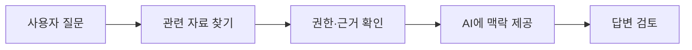

<!-- level:1 -->
# LLM과 벡터 검색 — 참고 자료를 찾아 AI 답변에 연결하기

> **한 문장으로:** 질문과 관련된 문서를 먼저 찾고 AI에 참고로 주면 답변의 자료 근거를 연결할 수 있습니다.

## 왜 필요한가요?

AI 모델이 회사의 최신 문서나 바뀐 제품 정보를 모두 알고 있다고 기대할 수는 없습니다. 필요한 자료를 찾아 주고 답이 실제 근거에 맞는지 확인하는 과정이 필요합니다.

## 일상에서 떠올려 보기

도서관에서 사서가 질문과 관련된 책을 찾아 주고 답변자가 그 책을 읽는 상황을 떠올려 보세요. 벡터 검색은 관련 자료의 후보를 찾는 도구, LLM은 주어진 맥락에서 답변 문장을 만드는 모델에 가깝습니다. 비슷한 책을 찾았다고 책 내용이 사실이거나 답이 맞다는 보장은 없습니다.

## 순서대로 따라가기

1. 문서를 작은 부분으로 나누고 의미의 특징을 숫자 묶음으로 표현합니다. 이를 embedding이라고 부릅니다.
2. 질문도 같은 방식으로 표현해 가까운 문서 후보를 찾고 읽기 권한을 확인합니다.
3. 필요한 문서와 질문을 LLM에 주어 답변을 생성하고, 근거·정확성·정보 노출을 검토합니다.



## 작은 예로 확인하기

‘환불은 언제 되나요?’와 ‘반품 후 돈은 언제 받나요?’는 표현이 달라도 비슷한 주제를 찾을 수 있습니다. 하지만 검색된 문서가 오래됐거나 다른 고객의 비공개 자료이면 그대로 답에 쓰면 안 됩니다. 유사도는 관련성의 신호이고 진실성·권한 검사는 별도입니다.

## 처음 만나는 용어

| 용어 | 쉬운 뜻 |
|---|---|
| LLM | 입력된 글을 바탕으로 이어질 문장 조각을 예측하며 답변을 생성하는 모델입니다. |
| embedding | 문장 등의 특징을 검색에 활용할 수 있는 숫자 묶음으로 표현한 것입니다. |
| 벡터 DB | 이런 숫자 표현을 저장하고 가까운 후보 검색 등을 돕는 저장소입니다. |
| RAG | 관련 자료를 검색해 답변 생성의 맥락으로 제공하는 방식입니다. |

**비유의 한계:** LLM은 사람이 책을 읽듯 진위를 판단하는 사서가 아닙니다. 자료를 줘도 잘못 해석하거나 없는 답을 만들 수 있습니다. 문서 안의 지시를 시스템 명령으로 취급하면 안 됩니다.

## 스스로 확인

질문과 아주 비슷한 문서를 찾았다면 답의 정확성과 사용자 읽기 권한도 확인된 것일까요?

**답과 이유:** 아닙니다. 관련 후보를 찾았다는 의미입니다. 자료의 신선도·진실성·권한과 최종 답변의 근거를 따로 확인해야 합니다.
<!-- level:2 -->
# prefill·decode와 검색 파이프라인

<!-- beginner-guide:start -->
## 읽기 전 길잡이

아래 숫자 벡터 예제는 의미를 이해하는 모델이 아니라 유사도 계산을 보여 주는 장난감입니다. 질문 벡터와 후보 벡터를 비교해 순위를 정하는 흐름을 보세요. 실제 서빙에서는 입력 처리와 출력 생성, 메모리 사용도 나눠 관리합니다.

## 이 단계에서 만날 말

| 용어 | 쉬운 뜻 |
|---|---|
| 토큰 | 모델이 입력과 출력을 처리하는 문장 조각 단위입니다. |
| prefill·decode | 입력 맥락을 먼저 처리하는 단계와 출력 토큰을 이어 생성하는 단계입니다. |
| KV cache | 이전 토큰 처리 결과 일부를 보관해 이후 계산에 재사용하는 메모리입니다. |
| chunk·rerank | 문서의 작은 조각과, 검색 후보를 다시 정렬하는 과정입니다. |
| ANN·recall | 가까운 후보를 근사적으로 찾는 방법과 필요한 관련 후보를 얼마나 찾아냈는지의 지표입니다. |
| prompt injection | 외부 자료의 지시가 AI의 원래 동작 규칙을 바꾸도록 유도하는 공격입니다. |
| TTFT | 첫 출력 토큰이 나오기까지 걸린 시간입니다. |
| fine-tuning | 추가 학습으로 모델의 특정 행동이나 형식을 조정하는 과정입니다. |

<!-- beginner-guide:end -->

prefill은 입력 맥락을 처리하고 decode는 출력 토큰을 순차 생성한다. KV cache는 이전 토큰의 attention 상태를 재사용하지만 요청 길이·동시성에 따라 메모리를 소비한다. 모델 가중치뿐 아니라 KV cache·런타임·배치 여유까지 GPU 예산에 포함한다.

아래 Python 3 예제는 **의미 embedding이 아닌 교육용 숫자 벡터**의 cosine 검색이다.

```python
from math import sqrt
def cosine(a, b):
    norm = sqrt(sum(x*x for x in a)) * sqrt(sum(y*y for y in b))
    if norm == 0: raise ValueError("zero vector")
    return sum(x*y for x,y in zip(a,b)) / norm
docs = {"a": [1,0], "b": [0,1], "c": [1,1]}
query = [1,0]
print(sorted(docs, key=lambda key: cosine(query,docs[key]), reverse=True))
```

실제 RAG는 수집→정제→chunk→embedding→권한·버전 metadata 저장→검색→rerank→맥락 구성→답변 평가를 잇는다. HNSW·IVF 같은 ANN은 정확도·메모리·검색 비용을 바꾼다. exact 검색 결과와 recall을 비교하고 filter와 인덱스의 상호작용을 측정한다.
<!-- level:3 -->
# 가상 장애 — 답변은 빠른데 근거가 틀리고 GPU가 포화

<!-- beginner-guide:start -->
## 읽기 전 길잡이

문서를 많이 넣었는데 답이 틀리고 첫 응답도 늦는 상황을 봅니다. 검색 관련성, 문서 길이, 모델 대기, 권한을 따로 조사합니다. 검색 점수가 높은지와 답이 맞는지는 별도 평가입니다.

<!-- beginner-guide:end -->

가상 서비스가 긴 문서를 무제한 넣어 prefill·KV cache가 커지고 관련 없는 chunk가 답변을 흐린다. TTFT(time to first token), 토큰 간 지연, 전체 기한, 입력·출력 길이, 검색 recall, 문서 신선도와 권한을 각각 관측한다.

**수정:** 토큰·동시성·큐 상한을 두고 chunk·검색·rerank·맥락 예산을 평가셋으로 조정한다. continuous batching은 처리량을 높일 수 있지만 개별 지연과 메모리를 검증한다. 권한은 검색 전후에 서버가 적용하고 출력에 민감 정보가 섞이지 않도록 확인한다.

**재검증:** 긴 입력·동시 부하·없는 답·오래된 문서·다른 tenant·문서 내 악성 지시를 포함한다. 근거 정확성·거절·보안·지연·비용을 함께 평가한다. 벡터 유사도 점수만으로 정답을 선언하지 않는다.
<!-- level:4 -->
# 관리형·자가 서빙과 품질 비용

<!-- beginner-guide:start -->
## 읽기 전 길잡이

외부 모델 API와 자체 GPU 운영, 검색 보강과 추가 학습의 비용을 비교합니다. 정답률·근거·권한·첫 응답 시간·운영 부담을 실제 질문 묶음으로 검증해 선택하세요.

<!-- beginner-guide:end -->

| 선택 | 이득 | 부담 |
|---|---|---|
| 관리형 모델 API | 초기 운영과 모델 접근 용이 | 토큰 비용·외부 의존·보관 정책 |
| 자체 서빙 | 용량·데이터·튜닝 통제 | GPU·운영·업데이트·안전 평가 |
| RAG | 자료 신선도·근거 연결 | 검색·권한·문서 품질 |
| fine-tuning | 특정 행동·형식 개선 | 데이터·평가·학습 운영 |

양자화는 가중치 메모리·속도를 바꿀 수 있지만 모델별 정확성·지원 커널·KV 예산을 다시 평가한다. tensor/pipeline/data parallelism의 병렬 대상과 통신 비용을 구분한다. 모델 크기만으로 품질이나 GPU 수를 결정하지 않는다.

**판단 연습:** 문서 검색형 튜터의 성공을 무엇으로 평가할까? 정답·근거·유도 질문·권한·TTFT·비용과 회귀 평가셋을 정하고 모델·검색·프롬프트 변경마다 비교하자.

참고: [vLLM Parallelism and Scaling](https://docs.vllm.ai/en/latest/serving/parallelism_scaling/), [PagedAttention 원 논문](https://arxiv.org/abs/2309.06180), [pgvector 공식 저장소](https://github.com/pgvector/pgvector), [OWASP LLM Prompt Injection](https://cheatsheetseries.owasp.org/cheatsheets/LLM_Prompt_Injection_Prevention_Cheat_Sheet.html).
<!-- quizzes -->
[{"level":1,"question":"벡터 유사도가 직접 보장하지 못하는 것은?","choices":["벡터 거리 비교","가까운 후보 선택","검색 모델의 점수","문서 진실성·사용자 권한·최종 정답"],"answer_index":3,"explanation":"유사도는 검색 신호입니다. 자료 품질·권한·근거와 최종 답변 정확성은 별도 검증해야 합니다."},{"level":2,"question":"LLM GPU 메모리 예산에 포함할 것은?","choices":["가중치뿐 아니라 KV cache·동시 요청·런타임 여유","가중치 파일 크기만","출력 문자열 길이만","모델 이름 길이"],"answer_index":0,"explanation":"토큰과 동시성에 따른 KV 상태도 메모리를 사용합니다. 서빙 구조·배치·런타임 비용을 함께 계산해야 합니다."},{"level":3,"question":"RAG 튜터 회귀 평가에 필요한 사례는?","choices":["관련 질문 한 개만","없는 답·오래된 문서·다른 tenant·악성 문서 지시","유사도 최고값만","성공 출력만 저장"],"answer_index":1,"explanation":"검색과 생성뿐 아니라 권한·신선도·prompt injection·거절 경계를 검증해야 실제 운영 품질을 평가할 수 있습니다."},{"level":4,"question":"자가 LLM 서빙 선택에서 비교할 기준은?","choices":["항상 GPU가 가장 저렴","모델 파라미터 수만","평가 품질·토큰 부하·지연·보안·운영·총비용","양자화하면 품질 동일 보장"],"answer_index":2,"explanation":"서빙은 모델 크기 외에 KV·부하·통신·운영과 정확성의 선택입니다. 실제 평가와 용량 계획으로 판단합니다."}]
