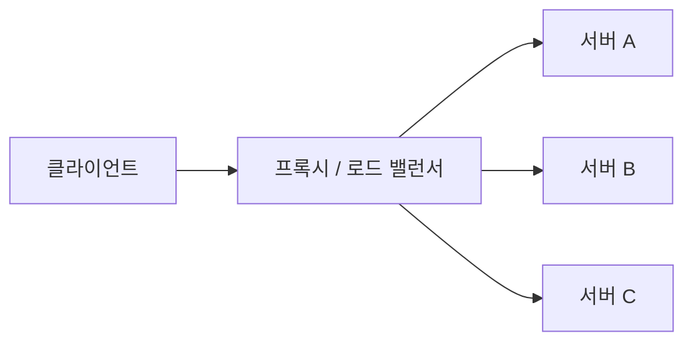

<!-- level:1 -->
# 로드 밸런서와 리버스 프록시 — 요청을 나누는 입구

식당 안내 직원은 손님을 가능한 테이블로 배치한다. 로드 밸런서는 여러 서버에 요청이나 연결을 나누고, 리버스 프록시는 서버 앞에서 요청을 받아 대신 전달한다. 둘은 역할이 겹칠 수 있지만 동일 개념은 아니다. 리버스 프록시는 TLS 종료·캐시·라우팅·정책 적용도 할 수 있다.



L4 분산은 전송 연결 등 정보로, L7 분산은 HTTP 경로·헤더 같은 앱 정보를 사용해 결정할 수 있다. round-robin은 돌아가며 선택하고 least-connections는 연결 수 등을 고려한다. 연결 수가 실제 작업량과 항상 같지는 않다.

**비유의 한계:** 서버가 여러 대라는 사실만으로 무한 용량이나 무중단이 보장되지 않는다. 분산기의 한도와 장애, 공유 DB, 세션·재시도·헬스체크가 모두 영향을 준다.

**확인:** 로그인을 처리한 서버만 세션을 메모리에 갖고 있다면 다음 요청이 다른 서버로 갈 때 무엇이 필요할까?
<!-- level:2 -->
# 라우팅과 헬스체크의 실제 계약

헬스체크는 서버를 대상에 포함할지 판단한다. 포트 응답, 프로세스 생존, 업무 준비 상태는 다르다. readiness와 liveness를 나누고 검사 간격·실패 횟수·회복 조건을 정한다. 종료하는 서버는 새 요청을 멈추고 기존 요청을 drain할 시간이 필요하다.

다음은 NGINX 설정 예시이며 실행에는 로컬 backend 두 개와 NGINX 설치가 필요하다.

```nginx
upstream app_pool {
    server 127.0.0.1:3001;
    server 127.0.0.1:3002;
}
server {
    listen 8080;
    location / {
        proxy_pass http://app_pool;
        proxy_set_header Host $host;
        proxy_set_header X-Forwarded-Proto $scheme;
        proxy_connect_timeout 2s;
        proxy_read_timeout 10s;
    }
}
```

이 최소 설정에는 운영용 능동 헬스체크·TLS·인증·접근 로그 정책이 모두 포함된 것은 아니다. upstream 제품·에디션의 지원 기능을 확인한다. 프록시가 넣는 전달 헤더는 신뢰할 프록시 경계에서만 사용해야 하며 클라이언트가 보낸 값을 그대로 인증 판단에 쓰지 않는다.
<!-- level:3 -->
# 가상 장애 — 배포할 때 간헐적 502가 생긴다

가상 서버 교체 과정에서 로드밸런서는 아직 종료 중인 서버로 요청을 보낸다. 다음처럼 프록시와 backend 로그를 연결한다.

```text
proxy: upstream connection closed before response
backend: shutting down, active_requests=7
```

먼저 실패가 연결 설정, 응답 대기, 앱 오류 중 어느 단계인지 나눈다. 요청 ID로 양쪽 로그를 맞추고 대상 상태·drain 기간·readiness 전환 시점을 확인한다. 헬스체크가 성공해도 특정 경로가 실패할 수 있다.

**수정:** 새 요청을 차단한 뒤 진행 요청을 제한 시간 안에 마무리하고 종료한다. 프록시·앱·오케스트레이터의 기한을 서로 맞춘다. 상태 변경 요청의 자동 재시도는 업무 중복을 일으킬 수 있어 멱등성을 검토한다.

**재검증:** 부하를 유지하며 rolling 배포, 강제 장애, 느린 요청을 재현한다. 502·504·중복 처리·연결 실패율과 p95 지연을 확인한다.
<!-- level:4 -->
# 분산 정책과 상태의 위치

| 선택 | 이득 | 비용 |
|---|---|---|
| L4 | 상대적으로 단순한 전송 분산 | 앱 경로별 정책 제한 |
| L7 | 경로·헤더별 라우팅과 관측 | TLS·파싱·정책 운영 비용 |
| sticky session | 서버 로컬 상태 유지가 쉬움 | 장애·불균형·이관 문제 |
| 외부 세션 저장 | 서버 교체와 수평 확장 용이 | 저장소 의존·지연·일관성 |

대규모 트래픽에서는 유입을 고르게 나누는 것뿐 아니라 과부하 서버에 더 보내지 않는 것이 중요하다. 큐 길이·동시 처리·비용이 큰 요청의 분포를 본다. 모든 backend가 공유하는 DB가 병목이면 서버 증설만으로 처리량이 늘지 않는다.

**판단 연습:** 장기 WebSocket 연결과 짧은 HTTP 요청을 같은 분산 정책으로 처리해야 할까? 연결 이동·drain·지역 장애·사용자 상태 요구를 근거로 정책을 정하고 backend별 부하 편차를 관측하자.

참고: [NGINX HTTP Load Balancing](https://docs.nginx.com/nginx/admin-guide/load-balancer/http-load-balancer/), [Kubernetes Pod 종료](https://kubernetes.io/docs/concepts/workloads/pods/pod-lifecycle/).
<!-- quizzes -->
[{"level":1,"question":"L7 로드밸런싱에서 활용할 수 있는 정보는?","choices":["HTTP 경로와 헤더","오직 전압","모든 backend의 소스 코드","CPU 레지스터 전체"],"answer_index":0,"explanation":"L7은 앱 프로토콜 정보를 바탕으로 경로·헤더별 라우팅을 할 수 있습니다. L4 연결 분산과 책임·비용이 다릅니다."},{"level":2,"question":"외부 클라이언트가 보낸 X-Forwarded 헤더를 처리할 때 필요한 기준은?","choices":["항상 무조건 신뢰","토큰 대신 헤더만 쓰기","신뢰 가능한 프록시 경계에서 검증·재설정","모든 헤더 삭제 후 무조건 성공"],"answer_index":2,"explanation":"클라이언트도 헤더를 위조할 수 있습니다. 전달 헤더는 신뢰할 프록시 경계와 앱 설정이 일치해야 합니다."},{"level":3,"question":"종료 중 backend로 요청이 가서 502가 날 때 필요한 개선은?","choices":["로그만 숨기기","readiness 전환·새 요청 차단·진행 요청 drain 순서 정렬","모든 요청을 무제한 재시도","타임아웃 제거"],"answer_index":1,"explanation":"배포 수명주기와 프록시 대상 제거가 맞아야 합니다. 진행 요청 처리와 종료 기한을 맞추고 상태 변경 재시도는 멱등성을 검토합니다."},{"level":4,"question":"sticky session의 주요 설계 부담은?","choices":["모든 지연을 없앰","DB가 불필요해짐","모든 장애 격리 자동 제공","서버 장애·부하 불균형·상태 이관"],"answer_index":3,"explanation":"서버에 사용자를 붙이면 로컬 상태를 쓰기 쉽지만 장애와 확장 시 이동이 어렵습니다. 외부 세션 저장 등의 대안을 비교해야 합니다."}]
