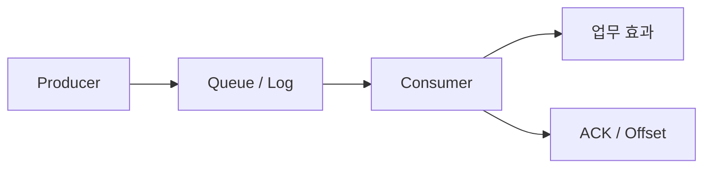

<!-- level:1 -->
# 메시지 큐 — 생산과 처리 속도를 분리하기

식당 주문표를 줄에 놓으면 주문 접수와 조리 속도를 분리할 수 있다. 메시지 큐와 로그는 작업·사건을 생산자에서 소비자로 전달한다. 비동기 처리는 사용자 응답을 줄일 수 있지만 작업 완료까지의 지연·실패·재처리를 숨겨서는 안 된다.



RabbitMQ 같은 큐와 Kafka 같은 로그는 분배·보관·재읽기 모델이 다르다. 실제 제품 기능을 확인해야 한다. at-least-once 전달에서는 중복 처리가 생길 수 있다. 큐의 “정확히 한 번” 기능도 외부 DB·메일 효과 전체를 자동으로 한 번만 만드는 뜻은 아니다.

**비유의 한계:** 큐가 병목을 없애는 것은 아니다. 처리 속도보다 유입이 빠르면 backlog가 늘고 결국 용량·지연 한도를 만난다.
<!-- level:2 -->
# 처리 완료와 확인의 순서

소비자는 메시지를 읽고 업무 상태를 변경한 뒤 ACK 또는 offset commit을 한다. 상태 변경 후 확인 전에 죽으면 다시 전달돼 중복이 생길 수 있다. 먼저 확인하고 업무를 하면 장애 때 누락될 수 있다. 외부 효과와 확인의 경계가 핵심이다.

Python 3의 **교육용 멱등 소비자 모델**이다. 실제 DB에는 같은 트랜잭션과 unique 제약으로 구현해야 한다.

```python
processed, total = set(), 0
def consume(event_id, amount):
    global total
    if event_id in processed: return
    total += amount
    processed.add(event_id)
consume("e-1", 10); consume("e-1", 10)
assert total == 10
```

메모리 set만으로 프로세스 재시작이나 여러 워커의 경쟁을 막을 수 없다. durable event ID와 업무 저장을 연결한다. 순서 보장은 Kafka에서 일반적으로 파티션 단위이며 전역 순서가 아니다. 큐에서 여러 소비자의 완료 순서도 전달 순서와 다를 수 있다.
<!-- level:3 -->
# 가상 장애 — 독성 메시지 재시도가 큐를 막는다

가상 소비자가 잘못된 스키마 메시지를 무한 재시도해 처리량을 소모한다. transient 오류와 영구 입력 오류를 구분하고 재시도 횟수·처리 시간·lag·DLQ 원인을 본다.

**수정:** 기한·지수 backoff·지터·재시도 상한을 두고 영구 실패를 quarantine/DLQ에 보낸다. DLQ는 폐기함이 아니라 원인·수정·재처리 절차가 필요한 운영 큐다. 메시지 스키마 버전과 호환성을 검증한다.

**재검증:** 처리 후 ACK 전 장애, 중복, 순서 변경, poison payload, 재처리에서 업무 결과가 한 번의 의미를 유지하는지 확인한다. backlog가 감소할 여유 처리량과 복구 시간도 측정한다.
<!-- level:4 -->
# 전달 보장과 용량 계약

| 선택 | 장점 | 비용 |
|---|---|---|
| 작업 큐 | 작업 분배와 확인 | 중복·재시도·가시성 |
| 보관 로그 | 재읽기·여러 소비자 | 파티션·보존·offset 운영 |
| 동기 호출 | 즉시 결과 계약 | 의존 지연·실패 전파 |

업무 DB 변경과 메시지 발행의 dual-write를 피하려면 outbox나 CDC를 검토한다. 메시지를 보냈지만 DB rollback되거나 반대 상황을 다룬다. 큐 저장량과 소비 속도, 최대 이벤트 크기, retention, replay 부하를 계획한다. 전달 보장·업무 멱등성·사용자 확인을 각각 명시한다.

참고: [Kafka Design and Delivery Semantics](https://kafka.apache.org/41/design/design/), [RabbitMQ Consumer Acknowledgements](https://www.rabbitmq.com/docs/confirms).
<!-- quizzes -->
[{"level":1,"question":"at-least-once 소비에서 필요한 전제는?","choices":["중복 가능성을 처리","모든 외부 효과 자동 정확히 한 번","큐가 무한 용량","ACK 순서는 무관"],"answer_index":0,"explanation":"확인 전 장애 등으로 메시지가 다시 전달될 수 있습니다. 업무 효과의 멱등성과 durable 처리 기록이 필요합니다."},{"level":2,"question":"업무 저장 후 ACK 전에 죽으면 무엇이 발생할 수 있나요?","choices":["항상 메시지 영구 삭제","동일 메시지 재전달과 중복 효과","전역 순서 자동 보장","DB가 자동 rollback된다는 보장"],"answer_index":1,"explanation":"저장은 됐지만 확인되지 않아 다시 전달될 수 있습니다. ACK와 외부 효과의 경계를 설계해야 합니다."},{"level":3,"question":"영구적으로 잘못된 메시지의 무한 재시도 개선은?","choices":["오류 로그만 삭제","worker 무제한 증가","오류 분류·상한·DLQ와 재처리 절차","항상 성공 ACK"],"answer_index":2,"explanation":"복구 불가능한 입력은 반복해도 낫지 않습니다. 격리·원인 분석·수정 후 통제된 재처리 정책이 필요합니다."},{"level":4,"question":"DB 변경과 메시지 발행의 불일치를 다룰 패턴은?","choices":["운에 맡기기","두 작업을 무조건 동시에 시작","로그를 없애기","outbox 또는 CDC와 멱등 소비"],"answer_index":3,"explanation":"dual-write의 부분 실패를 관리하려면 저장 경계와 발행 이행을 연결합니다. 발행·소비의 중복도 처리해야 합니다."}]
