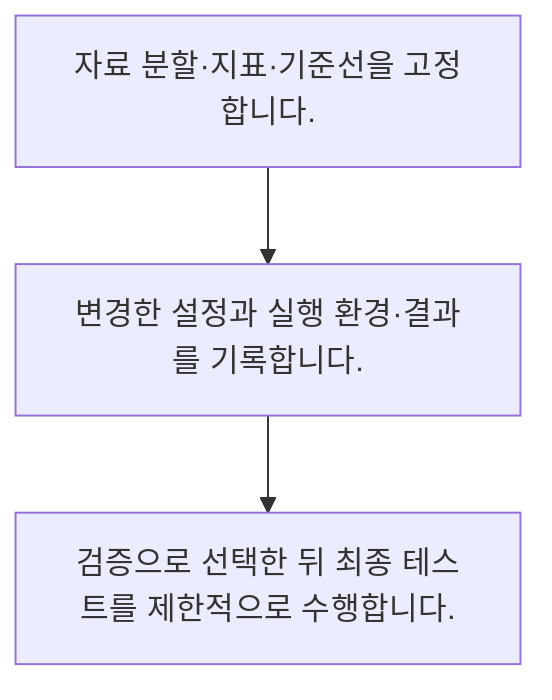

<!-- level:1 -->
# 모델 실험·재현성과 튜닝

> **한 문장으로:** 설정·자료·평가 절차를 기록해야 어떤 변경이 성능에 기여했는지 다시 확인할 수 있습니다.

## 왜 필요한가요?

모델이 좋아진 이유가 새 방법 때문인지 다른 데이터나 설정 때문인지 구분해야 합니다. 실험 조건과 결과를 함께 남기면 같은 비교를 반복하고 팀에서 검증할 수 있습니다.

## 일상에서 떠올려 보기

요리 실험에서 재료와 오븐 온도를 동시에 바꾸고 기록하지 않으면 무엇이 맛을 바꿨는지 알기 어렵습니다.

## 순서대로 따라가기

1. 자료 분할·지표·기준선을 고정합니다.
2. 변경한 설정과 실행 환경·결과를 기록합니다.
3. 검증으로 선택한 뒤 최종 테스트를 제한적으로 수행합니다.



## 처음 만나는 용어

| 용어 | 쉬운 뜻 |
|---|---|
| 하이퍼파라미터 | 학습 전에 선택하는 설정 값 |
| 실험 추적 | 자료·설정·코드·결과를 연결해 기록하는 과정 |
| 재현성 | 같은 절차와 조건으로 결과를 확인할 수 있는 성질 |

**비유의 한계:** 난수 시드를 고정해도 하드웨어·병렬 연산·라이브러리 차이로 완전히 같은 결과가 보장되지 않습니다. 반복 변동과 환경을 함께 기록합니다.

## 스스로 확인

실험 추적에 필요한 연결은?

**답과 이유:** 자료·설정·코드·결과 — 결과가 만들어진 조건을 함께 기록해야 재실행과 원인 분석이 가능합니다.
<!-- level:2 -->
# 모델 실험·재현성과 튜닝 — 실제 흐름 따라가기

## 읽기 전 길잡이

설정·자료·평가 절차를 기록해야 어떤 변경이 성능에 기여했는지 다시 확인할 수 있습니다. 아래 예제는 외부 시스템에 연결하지 않는 작은 학습용 사례입니다. 입력, 처리 조건, 결과를 순서대로 살펴보세요.

1. 자료 분할·지표·기준선을 고정합니다.
2. 변경한 설정과 실행 환경·결과를 기록합니다.
3. 검증으로 선택한 뒤 최종 테스트를 제한적으로 수행합니다.

## 예제로 확인하기

```python
runs=[{"depth":2,"validation":0.72},{"depth":4,"validation":0.78},{"depth":8,"validation":0.74}]
best=max(runs,key=lambda r:r["validation"])
assert best["depth"]==4
print(best)
```

## 결과를 해석하기

가상의 검증 점수로 깊이 4를 고릅니다. 점수는 실측 벤치마크가 아닌 비교용 예시입니다. 선택 후의 최종 테스트는 튜닝에 사용한 검증 결과와 구분해 보고합니다.

## 실무에 옮기기 전

난수 시드를 고정해도 하드웨어·병렬 연산·라이브러리 차이로 완전히 같은 결과가 보장되지 않습니다. 반복 변동과 환경을 함께 기록합니다. 실제 업무에서는 실험 예산과 종료 조건을 정하고 검증 점수의 작은 차이를 과대평가하지 않습니다. 모델과 자료·전처리·평가 버전을 하나의 실행 기록으로 연결합니다.

## 확인 질문

예제 검증 점수로 선택한 깊이는?

**답과 이유:** 검증 점수 0.78이 가장 높으므로 깊이 4를 선택합니다.
<!-- level:3 -->
# 모델 실험·재현성과 튜닝 — 가상 사례로 문제 해결하기

실제 고객의 장애 기록이 아닌 학습용 재현 시나리오입니다. 결과만 바꾸기 전에 관측한 증거와 원인 가설을 구분합니다.

## 1. 어떤 문제가 생겼나요?

가상 팀의 최고 모델을 다른 사람이 재실행하자 성능이 달라집니다.

## 2. 먼저 확인할 증거

자료 해시·분할·시드·라이브러리와 코드 버전을 대조합니다.

## 3. 원인 가설

데이터 파일과 피처 설정이 기록 없이 바뀌었습니다.

## 4. 수정 방법

실행별 불변 자료 식별자와 설정·환경·산출물을 함께 저장합니다.

## 5. 재검증

같은 실험을 재실행하고 여러 시드에서 변동 범위와 결과 차이를 보고합니다.

## 놓치기 쉬운 조건

난수 시드를 고정해도 하드웨어·병렬 연산·라이브러리 차이로 완전히 같은 결과가 보장되지 않습니다. 반복 변동과 환경을 함께 기록합니다.

## 확인 질문

재실행 결과가 다르면 먼저 대조할 것은?

**답과 이유:** 실험 조건이 달라졌는지 확인해야 변동 원인을 좁힐 수 있습니다.
<!-- level:4 -->
# 모델 실험·재현성과 튜닝 — 업무와 아키텍처의 선택

## 읽기 전 길잡이

같은 개념도 업무의 규모, 오류 비용, 운영 역량에 따라 적용 방식이 달라집니다. 아래 비교는 특정 제품의 성능 순위가 아닌 선택 기준입니다.

| 선택 | 얻는 점 | 감수할 점 |
|---|---|---|
| 작은 수동 탐색 | 이해·원인 분석 쉬움 | 넓은 공간 탐색 제한 |
| 자동 탐색 | 제한된 예산에서 후보 확장 | 반복 비교의 과적합·계산 비용 |

## 선택 기준

실험 예산과 종료 조건을 정하고 검증 점수의 작은 차이를 과대평가하지 않습니다. 모델과 자료·전처리·평가 버전을 하나의 실행 기록으로 연결합니다.

## 도입과 운영에서 확인할 것

실행별 불변 자료 식별자와 설정·환경·산출물을 함께 저장합니다. 같은 실험을 재실행하고 여러 시드에서 변동 범위와 결과 차이를 보고합니다.

## 판단 연습

난수 시드만 같으면 완전 재현이 보장되나요?

**판단의 근거:** 하드웨어와 비결정적 연산 등도 결과에 영향을 줍니다.

참고: [Google ML Crash Course](https://developers.google.com/machine-learning/crash-course), [scikit-learn 평가](https://scikit-learn.org/stable/model_selection.html), [scikit-learn 흔한 실수](https://scikit-learn.org/stable/common_pitfalls.html).
<!-- quizzes -->
[{"level":1,"question":"실험 추적에 필요한 연결은?","choices":["발표 날짜만","자료·설정·코드·결과","최고 점수만","모델 이름만"],"answer_index":1,"explanation":"결과가 만들어진 조건을 함께 기록해야 재실행과 원인 분석이 가능합니다."},{"level":2,"question":"예제 검증 점수로 선택한 깊이는?","choices":["8","항상 최댓값","4","2"],"answer_index":2,"explanation":"검증 점수 0.78이 가장 높으므로 깊이 4를 선택합니다."},{"level":3,"question":"재실행 결과가 다르면 먼저 대조할 것은?","choices":["팀 이름","보고서 색상","테스트 삭제","자료·분할·환경 버전"],"answer_index":3,"explanation":"실험 조건이 달라졌는지 확인해야 변동 원인을 좁힐 수 있습니다."},{"level":4,"question":"난수 시드만 같으면 완전 재현이 보장되나요?","choices":["환경과 연산 방식도 필요","항상 보장","코드는 달라도 됨","자료가 달라도 됨"],"answer_index":0,"explanation":"하드웨어와 비결정적 연산 등도 결과에 영향을 줍니다."}]
