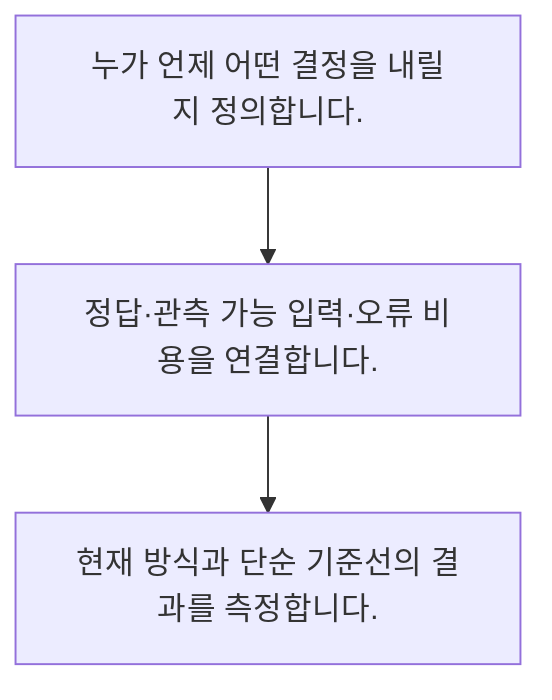

<!-- level:1 -->
# 머신러닝 문제 정의와 기준선

> **한 문장으로:** 업무 문제를 예측 대상·결정 시점·오류 비용으로 바꾸고 단순한 기준선과 비교합니다.

## 왜 필요한가요?

모델을 만들었는데 정작 업무에는 도움이 안 되는 일이 있습니다. 누구의 어떤 결정을 도울지 먼저 정하면 필요한 자료와 성공 기준을 구체적으로 잡을 수 있습니다.

## 일상에서 떠올려 보기

날씨를 예측하는 목적이 우산 준비인지 항공기 운항인지에 따라 필요한 시간과 허용 오류가 다릅니다. 예측 숫자보다 그 뒤의 결정이 중요합니다.

## 순서대로 따라가기

1. 누가 언제 어떤 결정을 내릴지 정의합니다.
2. 정답·관측 가능 입력·오류 비용을 연결합니다.
3. 현재 방식과 단순 기준선의 결과를 측정합니다.



## 처음 만나는 용어

| 용어 | 쉬운 뜻 |
|---|---|
| 라벨 | 학습·평가에서 맞히려는 정답 값 |
| 기준선 | 복잡한 모델을 비교할 단순한 출발 방법 |
| 결정 시점 | 실제 판단에 입력을 사용할 수 있어야 하는 시각 |

**비유의 한계:** 예측이 맞는 것과 좋은 업무 결정을 내리는 것은 다릅니다. 인과 효과를 추정하거나 정책을 바꾸는 문제는 단순 예측 평가만으로 해결되지 않습니다.

## 스스로 확인

문제 정의에 꼭 필요한 것은?

**답과 이유:** 결정 시점과 오류 비용 — 언제 무엇을 결정하는지 알아야 적절한 입력과 평가가 정해집니다.
<!-- level:2 -->
# 머신러닝 문제 정의와 기준선 — 실제 흐름 따라가기

## 읽기 전 길잡이

업무 문제를 예측 대상·결정 시점·오류 비용으로 바꾸고 단순한 기준선과 비교합니다. 아래 예제는 외부 시스템에 연결하지 않는 작은 학습용 사례입니다. 입력, 처리 조건, 결과를 순서대로 살펴보세요.

1. 누가 언제 어떤 결정을 내릴지 정의합니다.
2. 정답·관측 가능 입력·오류 비용을 연결합니다.
3. 현재 방식과 단순 기준선의 결과를 측정합니다.

## 예제로 확인하기

```python
actual=[0,0,0,0,1]
baseline=[0]*len(actual)
accuracy=sum(a==b for a,b in zip(actual,baseline))/len(actual)
assert accuracy==0.8
print(accuracy)
```

## 결과를 해석하기

전부 정상이라고 예측해도 예제 정확도는 80%입니다. 찾으려는 드문 사건을 하나도 탐지하지 못하므로 정확도 하나로 업무 가치를 평가할 수 없습니다.

## 실무에 옮기기 전

예측이 맞는 것과 좋은 업무 결정을 내리는 것은 다릅니다. 인과 효과를 추정하거나 정책을 바꾸는 문제는 단순 예측 평가만으로 해결되지 않습니다. 실제 업무에서는 예측 결과를 누가 어떤 행동에 쓸지 먼저 정합니다. 모델 지표, 사람의 조치, 최종 업무 결과를 나눠 관찰하고 개입 효과는 적절한 실험으로 확인합니다.

## 확인 질문

예제의 전부 정상 기준선 정확도는?

**답과 이유:** 5건 중 정상 4건을 맞히지만 관심 사건은 놓칩니다.
<!-- level:3 -->
# 머신러닝 문제 정의와 기준선 — 가상 사례로 문제 해결하기

실제 고객의 장애 기록이 아닌 학습용 재현 시나리오입니다. 결과만 바꾸기 전에 관측한 증거와 원인 가설을 구분합니다.

## 1. 어떤 문제가 생겼나요?

가상 이탈 모델이 높은 정확도에도 상담 성과를 높이지 못합니다.

## 2. 먼저 확인할 증거

연락 시점·실제 개입 가능 고객·기준선 대비 성과를 확인합니다.

## 3. 원인 가설

이탈 뒤에만 생기는 정보를 쓰거나 조치할 수 없는 대상을 예측했습니다.

## 4. 수정 방법

결정 시점 입력으로 대상을 다시 정의하고 개입 효과를 따로 평가합니다.

## 5. 재검증

운영 가능한 고객군에서 오류 비용과 실제 조치 결과를 확인합니다.

## 놓치기 쉬운 조건

예측이 맞는 것과 좋은 업무 결정을 내리는 것은 다릅니다. 인과 효과를 추정하거나 정책을 바꾸는 문제는 단순 예측 평가만으로 해결되지 않습니다.

## 확인 질문

높은 정확도가 업무 성과로 이어지지 않으면?

**답과 이유:** 점수와 실질적인 행동·효과 사이의 연결을 확인해야 합니다.
<!-- level:4 -->
# 머신러닝 문제 정의와 기준선 — 업무와 아키텍처의 선택

## 읽기 전 길잡이

같은 개념도 업무의 규모, 오류 비용, 운영 역량에 따라 적용 방식이 달라집니다. 아래 비교는 특정 제품의 성능 순위가 아닌 선택 기준입니다.

| 선택 | 얻는 점 | 감수할 점 |
|---|---|---|
| 예측 점수 최적화 | 모델 비교가 명확 | 후속 결정과 가치가 다를 수 있음 |
| 업무 결과까지 평가 | 실제 효익과 연결 | 개입 실험·운영 협력이 필요 |

## 선택 기준

예측 결과를 누가 어떤 행동에 쓸지 먼저 정합니다. 모델 지표, 사람의 조치, 최종 업무 결과를 나눠 관찰하고 개입 효과는 적절한 실험으로 확인합니다.

## 도입과 운영에서 확인할 것

결정 시점 입력으로 대상을 다시 정의하고 개입 효과를 따로 평가합니다. 운영 가능한 고객군에서 오류 비용과 실제 조치 결과를 확인합니다.

## 판단 연습

개입의 인과 효과를 확인하려면?

**판단의 근거:** 예측과 개입 효과는 다른 질문입니다. 비교 설계가 필요합니다.

참고: [Google ML Crash Course](https://developers.google.com/machine-learning/crash-course), [scikit-learn 평가](https://scikit-learn.org/stable/model_selection.html), [scikit-learn 흔한 실수](https://scikit-learn.org/stable/common_pitfalls.html).
<!-- quizzes -->
[{"level":1,"question":"문제 정의에 꼭 필요한 것은?","choices":["발표 자료 길이","결정 시점과 오류 비용","알고리즘 이름만","코드 줄 수"],"answer_index":1,"explanation":"언제 무엇을 결정하는지 알아야 적절한 입력과 평가가 정해집니다."},{"level":2,"question":"예제의 전부 정상 기준선 정확도는?","choices":["20%","0%","80%","100%"],"answer_index":2,"explanation":"5건 중 정상 4건을 맞히지만 관심 사건은 놓칩니다."},{"level":3,"question":"높은 정확도가 업무 성과로 이어지지 않으면?","choices":["정확도만 확대 표시","라벨 삭제","이탈 후 입력 추가","결정·개입 경로를 조사"],"answer_index":3,"explanation":"점수와 실질적인 행동·효과 사이의 연결을 확인해야 합니다."},{"level":4,"question":"개입의 인과 효과를 확인하려면?","choices":["적절한 비교 실험","예측 정확도만","학습 손실만","모델 크기만"],"answer_index":0,"explanation":"예측과 개입 효과는 다른 질문입니다. 비교 설계가 필요합니다."}]
