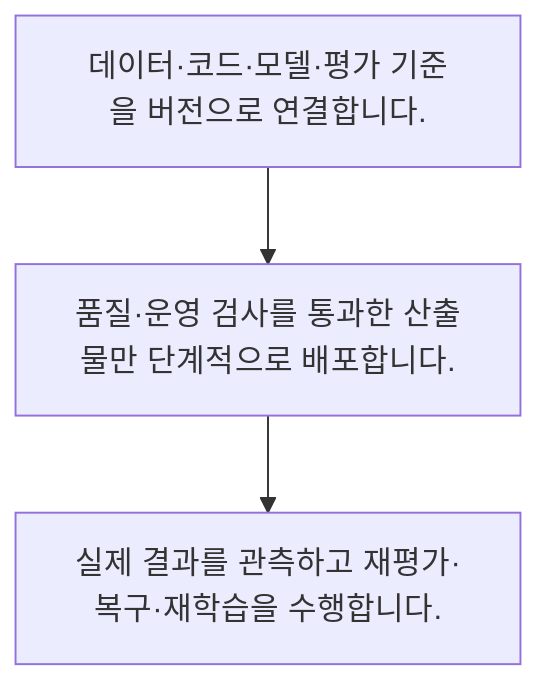

<!-- level:1 -->
# MLOps·LLMOps와 모델 수명주기

> **한 문장으로:** 모델 운영은 학습 코드뿐 아니라 데이터·평가·배포·관측·재학습을 하나의 변경 흐름으로 연결하는 일입니다.

## 왜 필요한가요?

버전 묶음을 기록하는 최소 예입니다. 실제 운영은 이 식별자가 불변 산출물과 평가 결과를 가리키는지, 누가 승인했는지와 복구 방법을 함께 관리합니다.

## 일상에서 떠올려 보기

식당에서 새 요리법을 만든 뒤 재료 공급·품질 검사·판매·고객 반응까지 관리하는 것과 같습니다. 레시피 파일만 있으면 영업이 끝나는 것이 아닙니다.

## 순서대로 따라가기

1. 데이터·코드·모델·평가 기준을 버전으로 연결합니다.
2. 품질·운영 검사를 통과한 산출물만 단계적으로 배포합니다.
3. 실제 결과를 관측하고 재평가·복구·재학습을 수행합니다.



## 처음 만나는 용어

| 용어 | 쉬운 뜻 |
|---|---|
| MLOps | 머신러닝 개발과 운영을 연결하는 실무 체계 |
| LLMOps | 프롬프트·검색·모델·평가 등을 포함하는 LLM 서비스 운영 |
| 수명주기 | 생성·검증·사용·변경·폐기의 전체 과정 |

**비유의 한계:** 파이프라인 자동화가 모델 품질과 안전을 보장하지는 않습니다. 자료 변화·평가·사람 판단이 필요한 경계는 별도 책임으로 유지합니다.

## 스스로 확인

MLOps의 범위는?

**답과 이유:** 자료부터 배포·관측까지 — 모델을 지속 운영하기 위한 주변 체계와 책임을 포함합니다.
<!-- level:2 -->
# MLOps·LLMOps와 모델 수명주기 — 실제 흐름 따라가기

## 읽기 전 길잡이

모델 운영은 학습 코드뿐 아니라 데이터·평가·배포·관측·재학습을 하나의 변경 흐름으로 연결하는 일입니다. 아래 예제는 외부 시스템에 연결하지 않는 작은 학습용 사례입니다. 입력, 처리 조건, 결과를 순서대로 살펴보세요.

1. 데이터·코드·모델·평가 기준을 버전으로 연결합니다.
2. 품질·운영 검사를 통과한 산출물만 단계적으로 배포합니다.
3. 실제 결과를 관측하고 재평가·복구·재학습을 수행합니다.

## 예제로 확인하기

```python
release={"data":"d3","code":"c7","model":"m2","eval":"e4"}
assert all(release.values())
print(release)
```

## 결과를 해석하기

버전 묶음을 기록하는 최소 예입니다. 실제 운영은 이 식별자가 불변 산출물과 평가 결과를 가리키는지, 누가 승인했는지와 복구 방법을 함께 관리합니다.

## 실무에 옮기기 전

파이프라인 자동화가 모델 품질과 안전을 보장하지는 않습니다. 자료 변화·평가·사람 판단이 필요한 경계는 별도 책임으로 유지합니다. 실제 업무에서는 팀 규모와 변경 빈도에 맞게 자동화하고 모델 품질·사업 영향·운영 신뢰성을 각각 검증합니다. 자동 재학습도 배포 전에 독립 평가를 통과해야 합니다.

## 확인 질문

예제 릴리스 묶음에 들어간 것은?

**답과 이유:** 생성 조건과 평가를 연결해 추적 가능하게 합니다.
<!-- level:3 -->
# MLOps·LLMOps와 모델 수명주기 — 가상 사례로 문제 해결하기

실제 고객의 장애 기록이 아닌 학습용 재현 시나리오입니다. 결과만 바꾸기 전에 관측한 증거와 원인 가설을 구분합니다.

## 1. 어떤 문제가 생겼나요?

가상 배포 뒤 어떤 학습 자료로 만든 모델인지 찾을 수 없습니다.

## 2. 먼저 확인할 증거

모델 등록 정보·학습 실행·자료 스냅샷·배포 기록을 대조합니다.

## 3. 원인 가설

모델 파일만 복사하고 전체 생성 조건을 연결하지 않았습니다.

## 4. 수정 방법

릴리스에 자료·코드·전처리·평가 버전을 묶습니다.

## 5. 재검증

임의 릴리스에서 학습 조건과 평가·복구 산출물을 추적할 수 있는지 확인합니다.

## 놓치기 쉬운 조건

파이프라인 자동화가 모델 품질과 안전을 보장하지는 않습니다. 자료 변화·평가·사람 판단이 필요한 경계는 별도 책임으로 유지합니다.

## 확인 질문

학습 자료를 못 찾는 배포의 개선은?

**답과 이유:** 어떤 자료와 코드로 만들었는지 추적할 수 있어야 합니다.
<!-- level:4 -->
# MLOps·LLMOps와 모델 수명주기 — 업무와 아키텍처의 선택

## 읽기 전 길잡이

같은 개념도 업무의 규모, 오류 비용, 운영 역량에 따라 적용 방식이 달라집니다. 아래 비교는 특정 제품의 성능 순위가 아닌 선택 기준입니다.

| 선택 | 얻는 점 | 감수할 점 |
|---|---|---|
| 수동 실험·배포 | 초기 구축 간단 | 재현·감사·반복 작업 부담 |
| 검증된 자동 파이프라인 | 반복성과 추적 향상 | 유지·권한·품질 게이트 비용 |

## 선택 기준

팀 규모와 변경 빈도에 맞게 자동화하고 모델 품질·사업 영향·운영 신뢰성을 각각 검증합니다. 자동 재학습도 배포 전에 독립 평가를 통과해야 합니다.

## 도입과 운영에서 확인할 것

릴리스에 자료·코드·전처리·평가 버전을 묶습니다. 임의 릴리스에서 학습 조건과 평가·복구 산출물을 추적할 수 있는지 확인합니다.

## 판단 연습

자동 재학습 뒤 필요한 것은?

**판단의 근거:** 새 학습 산출물도 품질과 운영 조건을 검증해야 합니다.

참고: [Google Cloud MLOps](https://docs.cloud.google.com/architecture/mlops-continuous-delivery-and-automation-pipelines-in-machine-learning), [NIST AI RMF](https://www.nist.gov/itl/ai-risk-management-framework), [OWASP 생성형 AI 보안](https://genai.owasp.org/llm-top-10/), [Google SRE Workbook](https://sre.google/workbook/table-of-contents/).
<!-- quizzes -->
[{"level":1,"question":"MLOps의 범위는?","choices":["자료부터 배포·관측까지","학습 함수만","GPU 구매만","모델 이름 변경"],"answer_index":0,"explanation":"모델을 지속 운영하기 위한 주변 체계와 책임을 포함합니다."},{"level":2,"question":"예제 릴리스 묶음에 들어간 것은?","choices":["사용자 비밀번호","자료·코드·모델·평가","모델 이름만","화면 색상"],"answer_index":1,"explanation":"생성 조건과 평가를 연결해 추적 가능하게 합니다."},{"level":3,"question":"학습 자료를 못 찾는 배포의 개선은?","choices":["지난 기록 삭제","재학습만 반복","불변 버전과 실행 연결","파일명만 변경"],"answer_index":2,"explanation":"어떤 자료와 코드로 만들었는지 추적할 수 있어야 합니다."},{"level":4,"question":"자동 재학습 뒤 필요한 것은?","choices":["바로 전면 배포","모든 승인 삭제","학습 손실만 확인","독립 평가와 배포 통제"],"answer_index":3,"explanation":"새 학습 산출물도 품질과 운영 조건을 검증해야 합니다."}]
