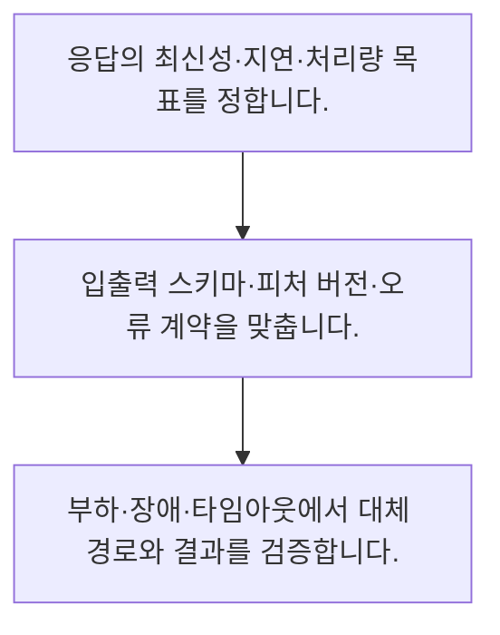

<!-- level:1 -->
# 배치·온라인 추론과 서빙 계약

> **한 문장으로:** 추론을 미리 계산할지 요청마다 수행할지는 최신성·지연·처리량과 실패 시 행동으로 결정합니다.

## 왜 필요한가요?

밤에 한꺼번에 처리하는 예측과 사용자가 기다리는 답변은 필요한 방식이 다릅니다. 배치와 실시간 처리를 구분하면 속도·비용·최신성에 맞는 제공 방식을 고를 수 있습니다.

## 일상에서 떠올려 보기

식당에서 미리 도시락을 준비하는 방식과 주문 뒤 조리하는 방식은 필요한 신선도와 대기 시간에 따라 다릅니다.

## 순서대로 따라가기

1. 응답의 최신성·지연·처리량 목표를 정합니다.
2. 입출력 스키마·피처 버전·오류 계약을 맞춥니다.
3. 부하·장애·타임아웃에서 대체 경로와 결과를 검증합니다.



## 처음 만나는 용어

| 용어 | 쉬운 뜻 |
|---|---|
| 배치 추론 | 여러 입력의 결과를 묶어 미리 계산하는 방식 |
| 온라인 추론 | 요청에 맞춰 결과를 계산하는 방식 |
| 피처 일관성 | 학습과 서빙의 입력 의미·변환이 일치하는 성질 |

**비유의 한계:** 배치가 항상 저렴하거나 온라인이 항상 최신인 것은 아닙니다. 피처 생성과 캐시·자료 갱신 시각까지 함께 확인해야 합니다.

## 스스로 확인

배치와 온라인 선택의 핵심 기준은?

**답과 이유:** 신선도·지연·처리량 — 업무가 요구하는 시간과 부하 조건에 맞춰야 합니다.
<!-- level:2 -->
# 배치·온라인 추론과 서빙 계약 — 실제 흐름 따라가기

## 읽기 전 길잡이

추론을 미리 계산할지 요청마다 수행할지는 최신성·지연·처리량과 실패 시 행동으로 결정합니다. 아래 예제는 외부 시스템에 연결하지 않는 작은 학습용 사례입니다. 입력, 처리 조건, 결과를 순서대로 살펴보세요.

1. 응답의 최신성·지연·처리량 목표를 정합니다.
2. 입출력 스키마·피처 버전·오류 계약을 맞춥니다.
3. 부하·장애·타임아웃에서 대체 경로와 결과를 검증합니다.

## 예제로 확인하기

```python
prediction={"value":0.7,"computed_at":100,"model":"m2"}
now,max_age=130,60
assert now-prediction["computed_at"]<=max_age
print("허용 신선도 안의 결과")
```

## 결과를 해석하기

가상 시각 단위로 결과의 나이를 검사하는 예제입니다. 실제 서비스는 시계·원본 자료 시각·계산 실패와 만료 시 행동을 명확히 정의해야 합니다.

## 실무에 옮기기 전

배치가 항상 저렴하거나 온라인이 항상 최신인 것은 아닙니다. 피처 생성과 캐시·자료 갱신 시각까지 함께 확인해야 합니다. 실제 업무에서는 업무가 허용하는 결과의 나이와 요청별 조건을 기준으로 선택합니다. 혼합 구성에서는 미리 계산한 값과 실시간 피처의 버전·시각을 함께 관리합니다.

## 확인 질문

예제 결과의 나이는?

**답과 이유:** 현재 시각 130에서 계산 시각 100을 뺍니다.
<!-- level:3 -->
# 배치·온라인 추론과 서빙 계약 — 가상 사례로 문제 해결하기

실제 고객의 장애 기록이 아닌 학습용 재현 시나리오입니다. 결과만 바꾸기 전에 관측한 증거와 원인 가설을 구분합니다.

## 1. 어떤 문제가 생겼나요?

가상 추천 결과가 하루 전 고객 상태를 반영합니다.

## 2. 먼저 확인할 증거

추론 결과·원본 피처·캐시의 갱신 시각을 각각 확인합니다.

## 3. 원인 가설

서빙은 빠르지만 피처 생성 배치가 지연됐습니다.

## 4. 수정 방법

신선도 기준과 오래된 결과의 대체·거부 정책을 둡니다.

## 5. 재검증

배치 지연·피처 실패에서 최종 응답의 나이와 안전한 대체를 확인합니다.

## 놓치기 쉬운 조건

배치가 항상 저렴하거나 온라인이 항상 최신인 것은 아닙니다. 피처 생성과 캐시·자료 갱신 시각까지 함께 확인해야 합니다.

## 확인 질문

빠른데 오래된 추천이면 먼저 확인할 것은?

**답과 이유:** 요청 지연과 입력·결과의 최신성은 별도 문제입니다.
<!-- level:4 -->
# 배치·온라인 추론과 서빙 계약 — 업무와 아키텍처의 선택

## 읽기 전 길잡이

같은 개념도 업무의 규모, 오류 비용, 운영 역량에 따라 적용 방식이 달라집니다. 아래 비교는 특정 제품의 성능 순위가 아닌 선택 기준입니다.

| 선택 | 얻는 점 | 감수할 점 |
|---|---|---|
| 배치 결과 조회 | 대량 계산과 응답 속도에 유리 | 정보 지연 |
| 온라인 계산 | 요청별 입력 활용 | 실시간 자원·장애·지연 부담 |

## 선택 기준

업무가 허용하는 결과의 나이와 요청별 조건을 기준으로 선택합니다. 혼합 구성에서는 미리 계산한 값과 실시간 피처의 버전·시각을 함께 관리합니다.

## 도입과 운영에서 확인할 것

신선도 기준과 오래된 결과의 대체·거부 정책을 둡니다. 배치 지연·피처 실패에서 최종 응답의 나이와 안전한 대체를 확인합니다.

## 판단 연습

만료된 결과의 처리에 필요한 것은?

**판단의 근거:** 업무 위험에 맞는 명시적 신선도 계약이 필요합니다.

참고: [Google Cloud MLOps](https://docs.cloud.google.com/architecture/mlops-continuous-delivery-and-automation-pipelines-in-machine-learning), [NIST AI RMF](https://www.nist.gov/itl/ai-risk-management-framework), [OWASP 생성형 AI 보안](https://genai.owasp.org/llm-top-10/), [Google SRE Workbook](https://sre.google/workbook/table-of-contents/).
<!-- quizzes -->
[{"level":1,"question":"배치와 온라인 선택의 핵심 기준은?","choices":["항상 온라인","모델 크기만","신선도·지연·처리량","서버 이름"],"answer_index":2,"explanation":"업무가 요구하는 시간과 부하 조건에 맞춰야 합니다."},{"level":2,"question":"예제 결과의 나이는?","choices":["60","100","130","30"],"answer_index":3,"explanation":"현재 시각 130에서 계산 시각 100을 뺍니다."},{"level":3,"question":"빠른데 오래된 추천이면 먼저 확인할 것은?","choices":["피처·결과·캐시의 시각","응답 길이","브라우저 글꼴","로고"],"answer_index":0,"explanation":"요청 지연과 입력·결과의 최신성은 별도 문제입니다."},{"level":4,"question":"만료된 결과의 처리에 필요한 것은?","choices":["시각 숨기기","대체·거부 정책","항상 그대로 응답","무한 대기"],"answer_index":1,"explanation":"업무 위험에 맞는 명시적 신선도 계약이 필요합니다."}]
