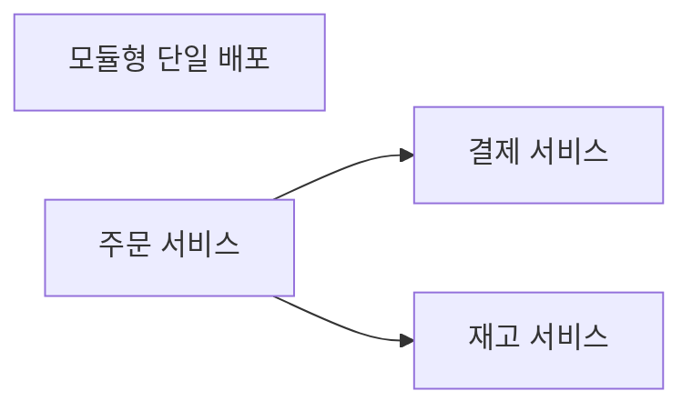

<!-- level:1 -->
# 모놀리스와 MSA — 배포 경계를 어디에 둘까

한 건물 안의 부서와 여러 건물의 부서는 소통·독립성 비용이 다르다. 모놀리스는 보통 하나의 배포 단위 안에서 여러 기능을 실행한다. MSA는 독립 배포·운영 경계를 가진 서비스들로 나눈다. 모놀리스도 내부 모듈을 잘 나눌 수 있으며, 서비스가 많다고 결합이 낮다는 보장은 없다.



함수 호출을 네트워크 호출로 바꾸면 시간 초과·재시도·부분 실패·버전 차이가 생긴다. MSA의 핵심은 폴더 분할보다 소유권·데이터·업무 계약과 독립 변경에 있다.

**비유의 한계:** 건물 분리는 안전한 실패 격리를 자동으로 제공하지 않는다. 모든 서비스가 같은 DB와 동기 체인에 강하게 묶이면 장애가 함께 번질 수 있다.
<!-- level:2 -->
# 호출과 데이터 소유권의 차이

단일 프로세스 호출은 대체로 같은 실행과 메모리 경계에 있지만 원격 호출은 응답이 없을 때 상대가 실행했는지 모를 수 있다. 서비스가 데이터를 소유하면 다른 서비스가 테이블을 직접 갱신하는 대신 API·이벤트 계약을 거친다.

아래는 **설계용 의사코드**다.

```text
createOrder(command):
  validate(command)
  order = orderRepository.savePending(command.idempotencyKey)
  publish(OrderRequested(order.id))
  return order.state

onInventoryReserved(event):
  applyTransition(orderId, expected="pending", next="reserved")
```

비동기 상태 전이는 즉시 완료 응답과 다른 UX 계약이다. 이벤트 스키마·멱등성·업무 상태 머신을 정의한다. 서비스별 저장소를 나눈다고 cross-service 무결성이 없어지는 것은 아니며 그 책임이 계약·복구로 옮겨간다. 모듈형 모놀리스도 코드 의존·데이터 경계를 명확히 유지할 수 있다.
<!-- level:3 -->
# 가상 장애 — 서비스 분리 후 응답 시간이 길어진다

가상 API가 주문→고객→재고→결제→알림의 동기 호출 체인을 갖는다. 각 서비스가 빨라도 합산 지연과 실패 확률·재시도가 전체 흐름을 악화시킬 수 있다. trace로 critical path, 중복 호출, timeout·retry를 찾는다.

**수정:** 불필요한 호출을 합치거나 읽기 projection·배치 조회·비동기 경계를 검토한다. 상위 기한을 하위 호출에 전달하고 retry budget을 제한한다. 의미가 강하게 함께 바뀌는 서비스는 경계를 재평가한다.

**재검증:** 특정 서비스 지연·장애·재시작을 주입해 전체 사용자 결과와 부하를 확인한다. 평균뿐 아니라 p95·오류율·운영 복잡성을 비교한다.
<!-- level:4 -->
# 독립성의 이득과 분산 비용

| 선택 | 이득 | 비용 |
|---|---|---|
| 모듈형 모놀리스 | 거래·디버깅·배포 단순 | 공동 배포·자원 경계 |
| MSA | 팀·배포·부하의 독립성 | 네트워크·데이터·관측·온콜 |
| 점진 추출 | 위험을 줄여 특정 경계 분리 | 임시 계약·이행 |

트래픽 규모만으로 MSA를 결정하지 않는다. 팀 소유권, 배포 빈도, 업무 경계, 서로 다른 부하와 규제 요구가 근거가 된다. 서비스별 독립 배포를 주장하면서 공유 DB 스키마를 함께 바꾸는 구조는 실제 결합을 점검해야 한다.

**판단 연습:** 3명의 팀과 20개 독립 제품 팀이 같은 운영 비용을 감수할 수 있을까? 분리의 성공 조건과 rollback 가능한 이행 단계를 적자.

참고: [Martin Fowler — Microservices](https://martinfowler.com/articles/microservices.html), [Monolith First](https://martinfowler.com/bliki/MonolithFirst.html).
<!-- quizzes -->
[{"level":1,"question":"서비스 수가 많아도 독립성이 낮을 수 있는 이유는?","choices":["분산이면 모든 결합이 사라짐","공유 DB와 강한 동기 계약으로 함께 변경될 수 있음","모놀리스는 모듈이 없음","모든 팀 규모가 동일"],"answer_index":1,"explanation":"배포·데이터·업무 계약의 결합을 봐야 합니다. 프로세스 수나 폴더 수만으로 독립성을 판단할 수 없습니다."},{"level":2,"question":"원격 호출이 함수 호출에 추가하는 중요한 조건은?","choices":["항상 같은 실패 보장","응답 없음은 반드시 실행 안 됨","지연·부분 실패·실행 여부 불확실성","트랜잭션 자동 공유"],"answer_index":2,"explanation":"타임아웃 때 상대가 이미 실행했을 수 있습니다. 기한·멱등성·오류 계약을 추가해야 합니다."},{"level":3,"question":"긴 동기 호출 체인 지연을 조사할 방법은?","choices":["분산 trace로 critical path와 재시도·중복 호출 확인","서비스 수만 증가","모든 기한 제거","p95를 기록하지 않음"],"answer_index":0,"explanation":"전체 경로의 합산 지연과 실패 전파를 관측해야 합니다. 경계·projection·기한을 실제 계약에 맞춰 개선합니다."},{"level":4,"question":"MSA 선택의 합리적 근거는?","choices":["유행만","트래픽 숫자 하나","서버 이름","팀 소유권·독립 배포·업무 경계와 운영 비용"],"answer_index":3,"explanation":"분산의 이득과 비용을 조직·워크로드·데이터 요구로 비교합니다. 작은 팀은 운영 복잡성이 이득보다 클 수 있습니다."}]
