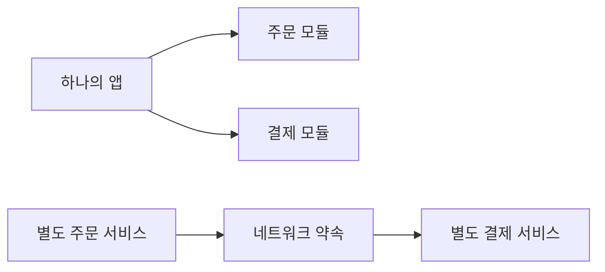

<!-- level:1 -->
# 모놀리식과 MSA — 한 서비스에 모으거나 여러 서비스로 나누기

> **한 문장으로:** 기능을 어디까지 함께 배포하고 운영할지 나누는 선택이며, 나눌수록 통신과 데이터 약속이 중요해집니다.

## 왜 필요한가요?

한 앱의 주문·결제·상품 기능이 커지면 팀과 변경 속도가 달라질 수 있습니다. 함께 관리하는 단순함과 따로 배포하는 이점을 비교해야 합니다.

## 일상에서 떠올려 보기

한 가게에서 접수·제작·배송을 모두 하거나 여러 전문 업체에 나눠 맡긴다고 생각해 보세요. 나누면 각 업체가 따로 바뀔 수 있지만 연락, 일정, 결과 확인을 맞춰야 합니다.

## 순서대로 따라가기

1. 기능과 데이터의 책임 경계를 찾습니다.
2. 같은 앱 안의 모듈로 나눌지, 별도 서비스로 배포할지 정합니다.
3. 서비스를 나누면 네트워크 호출·권한·실패·데이터 변경 약속을 함께 설계합니다.



## 작은 예로 확인하기

서비스를 다섯 개로 나눠도 같은 데이터베이스 구조를 함께 바꾸고 모두 동시에 배포해야 한다면 독립성이 낮습니다. 서비스 개수보다 각 책임이 자기 데이터를 관리하고 다른 구현과 안전하게 연결되는지가 중요합니다.

## 처음 만나는 용어

| 용어 | 쉬운 뜻 |
|---|---|
| 모놀리식 | 주요 기능을 하나의 배포 단위로 운영하는 구조입니다. |
| 모듈 | 앱 안에서 책임을 나눈 코드 부분입니다. |
| MSA | 기능을 여러 서비스의 책임과 배포 경계로 나누는 구조입니다. |
| 원격 호출 | 다른 서비스에 네트워크로 기능을 요청하는 것입니다. |

**비유의 한계:** 업체를 나누면 모든 문제가 줄어드는 것은 아닙니다. MSA가 자동으로 빠르거나 확장에 유리하다고 단정할 수 없습니다. 코드 모듈 분리만으로도 충분한 개선을 얻을 수 있습니다.

## 스스로 확인

서비스 수는 늘었는데 항상 함께 수정·배포합니다. 독립성이 높다고 볼 수 있을까요?

**답과 이유:** 그렇지 않을 수 있습니다. 공유 데이터와 강한 동기 약속이 변경을 묶을 수 있습니다. 책임과 배포 경계가 실제로 분리됐는지 봐야 합니다.
<!-- level:2 -->
# 호출과 데이터 소유권의 차이

<!-- beginner-guide:start -->
## 읽기 전 길잡이

의사코드에서 같은 프로세스의 함수 호출과 다른 서비스로 보내는 요청을 구분하세요. 응답이 없을 때 상대가 실제로 처리했는지 모른다는 점이 원격 호출의 중요한 차이입니다.

## 이 단계에서 만날 말

| 용어 | 쉬운 뜻 |
|---|---|
| 데이터 소유권 | 어느 서비스가 자료의 의미와 변경 책임을 맡는지 정한 경계입니다. |
| 동기 호출 | 다른 서비스의 결과를 기다리며 진행하는 요청입니다. |
| 부분 실패 | 일부 서비스는 성공하고 다른 서비스는 실패하는 상황입니다. |
| 관측 가능성 | 로그·지표·추적으로 여러 서비스의 진행을 이해하는 능력입니다. |
| 계약 | 서비스 사이 입력·결과·오류의 약속입니다. |
| 분산 모놀리스 | 서비스가 나뉘었어도 변경과 실행이 강하게 묶인 상태를 가리키는 표현입니다. |

<!-- beginner-guide:end -->

단일 프로세스 호출은 대체로 같은 실행과 메모리 경계에 있지만 원격 호출은 응답이 없을 때 상대가 실행했는지 모를 수 있다. 서비스가 데이터를 소유하면 다른 서비스가 테이블을 직접 갱신하는 대신 API·이벤트 계약을 거친다.

아래는 **설계용 의사코드**다.

```text
createOrder(command):
  validate(command)
  order = orderRepository.savePending(command.idempotencyKey)
  publish(OrderRequested(order.id))
  return order.state

onInventoryReserved(event):
  applyTransition(orderId, expected="pending", next="reserved")
```

비동기 상태 전이는 즉시 완료 응답과 다른 UX 계약이다. 이벤트 스키마·멱등성·업무 상태 머신을 정의한다. 서비스별 저장소를 나눈다고 cross-service 무결성이 없어지는 것은 아니며 그 책임이 계약·복구로 옮겨간다. 모듈형 모놀리스도 코드 의존·데이터 경계를 명확히 유지할 수 있다.
<!-- level:3 -->
# 가상 장애 — 서비스 분리 후 응답 시간이 길어진다

<!-- beginner-guide:start -->
## 읽기 전 길잡이

한 서비스의 지연이 다른 서비스에 퍼지는 사례를 봅니다. 요청 경로, 기한, 재시도, 대기 중인 자원을 서비스별로 따라가세요.

<!-- beginner-guide:end -->

가상 API가 주문→고객→재고→결제→알림의 동기 호출 체인을 갖는다. 각 서비스가 빨라도 합산 지연과 실패 확률·재시도가 전체 흐름을 악화시킬 수 있다. trace로 critical path, 중복 호출, timeout·retry를 찾는다.

**수정:** 불필요한 호출을 합치거나 읽기 projection·배치 조회·비동기 경계를 검토한다. 상위 기한을 하위 호출에 전달하고 retry budget을 제한한다. 의미가 강하게 함께 바뀌는 서비스는 경계를 재평가한다.

**재검증:** 특정 서비스 지연·장애·재시작을 주입해 전체 사용자 결과와 부하를 확인한다. 평균뿐 아니라 p95·오류율·운영 복잡성을 비교한다.
<!-- level:4 -->
# 독립성의 이득과 분산 비용

<!-- beginner-guide:start -->
## 읽기 전 길잡이

팀 규모와 변경 빈도, 운영 역량을 함께 비교합니다. 독립 배포가 주는 이득과 통신·데이터 일관성·장애 조사 비용을 구체적인 업무 경계에 적용해 보세요.

<!-- beginner-guide:end -->

| 선택 | 이득 | 비용 |
|---|---|---|
| 모듈형 모놀리스 | 거래·디버깅·배포 단순 | 공동 배포·자원 경계 |
| MSA | 팀·배포·부하의 독립성 | 네트워크·데이터·관측·온콜 |
| 점진 추출 | 위험을 줄여 특정 경계 분리 | 임시 계약·이행 |

트래픽 규모만으로 MSA를 결정하지 않는다. 팀 소유권, 배포 빈도, 업무 경계, 서로 다른 부하와 규제 요구가 근거가 된다. 서비스별 독립 배포를 주장하면서 공유 DB 스키마를 함께 바꾸는 구조는 실제 결합을 점검해야 한다.

**판단 연습:** 3명의 팀과 20개 독립 제품 팀이 같은 운영 비용을 감수할 수 있을까? 분리의 성공 조건과 rollback 가능한 이행 단계를 적자.

참고: [Martin Fowler — Microservices](https://martinfowler.com/articles/microservices.html), [Monolith First](https://martinfowler.com/bliki/MonolithFirst.html).
<!-- quizzes -->
[{"level":1,"question":"서비스 수가 많아도 독립성이 낮을 수 있는 이유는?","choices":["분산이면 모든 결합이 사라짐","공유 DB와 강한 동기 계약으로 함께 변경될 수 있음","모놀리스는 모듈이 없음","모든 팀 규모가 동일"],"answer_index":1,"explanation":"배포·데이터·업무 계약의 결합을 봐야 합니다. 프로세스 수나 폴더 수만으로 독립성을 판단할 수 없습니다."},{"level":2,"question":"원격 호출이 함수 호출에 추가하는 중요한 조건은?","choices":["항상 같은 실패 보장","응답 없음은 반드시 실행 안 됨","지연·부분 실패·실행 여부 불확실성","트랜잭션 자동 공유"],"answer_index":2,"explanation":"타임아웃 때 상대가 이미 실행했을 수 있습니다. 기한·멱등성·오류 계약을 추가해야 합니다."},{"level":3,"question":"긴 동기 호출 체인 지연을 조사할 방법은?","choices":["분산 trace로 critical path와 재시도·중복 호출 확인","서비스 수만 증가","모든 기한 제거","p95를 기록하지 않음"],"answer_index":0,"explanation":"전체 경로의 합산 지연과 실패 전파를 관측해야 합니다. 경계·projection·기한을 실제 계약에 맞춰 개선합니다."},{"level":4,"question":"MSA 선택의 합리적 근거는?","choices":["유행만","트래픽 숫자 하나","서버 이름","팀 소유권·독립 배포·업무 경계와 운영 비용"],"answer_index":3,"explanation":"분산의 이득과 비용을 조직·워크로드·데이터 요구로 비교합니다. 작은 팀은 운영 복잡성이 이득보다 클 수 있습니다."}]
