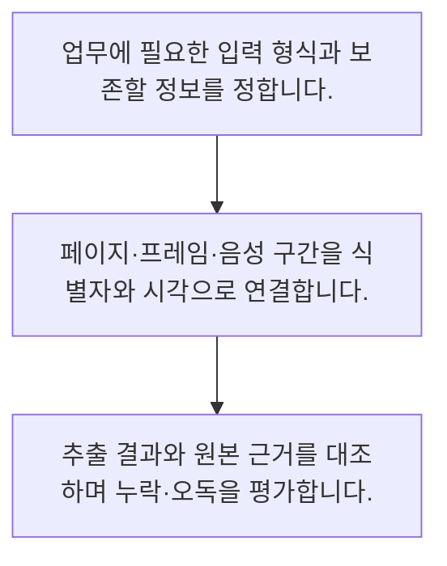

<!-- level:1 -->
# 멀티모달·이미지·음성·문서 이해

> **한 문장으로:** 멀티모달 모델은 글·이미지·음성 같은 여러 입력을 다루므로 각 형식의 해상도·시간·출처를 보존해야 합니다.

## 왜 필요한가요?

발언 시점 이전의 가장 최근 슬라이드를 고르는 단순 정렬 예제입니다. 실제 영상 분석은 구간 길이·전환 지연·누락 프레임을 고려하고 원본과 연결된 근거를 남겨야 합니다.

## 일상에서 떠올려 보기

회의를 이해할 때 녹음만 듣는 것과 화면 자료를 같이 보는 것은 다릅니다. 하지만 발표 슬라이드와 발언 시점이 어긋나면 오해할 수 있습니다.

## 순서대로 따라가기

1. 업무에 필요한 입력 형식과 보존할 정보를 정합니다.
2. 페이지·프레임·음성 구간을 식별자와 시각으로 연결합니다.
3. 추출 결과와 원본 근거를 대조하며 누락·오독을 평가합니다.



## 처음 만나는 용어

| 용어 | 쉬운 뜻 |
|---|---|
| 멀티모달 | 여러 종류의 자료 형식을 함께 다루는 방식 |
| OCR | 이미지에서 글자를 추출하는 기술 |
| 시간 정렬 | 음성·프레임 등의 구간 시점을 맞추는 과정 |

**비유의 한계:** 모델이 이미지를 받는다고 모든 글자·표·공간 관계를 정확히 읽지는 않습니다. 지원 입력, 해상도·페이지 제한·비용과 민감정보 처리를 확인해야 합니다.

## 스스로 확인

멀티모달 모델 사용 시 보장되지 않는 것은?

**답과 이유:** 작은 글자와 표의 완전한 인식 — 입력 지원은 모든 세부 인식의 정확성을 보장하지 않습니다.
<!-- level:2 -->
# 멀티모달·이미지·음성·문서 이해 — 실제 흐름 따라가기

## 읽기 전 길잡이

멀티모달 모델은 글·이미지·음성 같은 여러 입력을 다루므로 각 형식의 해상도·시간·출처를 보존해야 합니다. 아래 예제는 외부 시스템에 연결하지 않는 작은 학습용 사례입니다. 입력, 처리 조건, 결과를 순서대로 살펴보세요.

1. 업무에 필요한 입력 형식과 보존할 정보를 정합니다.
2. 페이지·프레임·음성 구간을 식별자와 시각으로 연결합니다.
3. 추출 결과와 원본 근거를 대조하며 누락·오독을 평가합니다.

## 예제로 확인하기

```python
frames=[{"time":1,"slide":"A"},{"time":5,"slide":"B"}]
speech_time=6
frame=max((f for f in frames if f["time"]<=speech_time),key=lambda f:f["time"])
assert frame["slide"]=="B"
print(frame)
```

## 결과를 해석하기

발언 시점 이전의 가장 최근 슬라이드를 고르는 단순 정렬 예제입니다. 실제 영상 분석은 구간 길이·전환 지연·누락 프레임을 고려하고 원본과 연결된 근거를 남겨야 합니다.

## 실무에 옮기기 전

모델이 이미지를 받는다고 모든 글자·표·공간 관계를 정확히 읽지는 않습니다. 지원 입력, 해상도·페이지 제한·비용과 민감정보 처리를 확인해야 합니다. 실제 업무에서는 문서·음성에서 놓치면 안 되는 필드와 오류 비용을 기준으로 자동 승인 범위를 정합니다. 개인 정보와 원본 접근 권한도 입력·로그·보관 단계에서 유지합니다.

## 확인 질문

예제에서 시각 6의 발언에 연결한 슬라이드는?

**답과 이유:** 시각 6 이전의 가장 최근 프레임은 시각 5의 B입니다.
<!-- level:3 -->
# 멀티모달·이미지·음성·문서 이해 — 가상 사례로 문제 해결하기

실제 고객의 장애 기록이 아닌 학습용 재현 시나리오입니다. 결과만 바꾸기 전에 관측한 증거와 원인 가설을 구분합니다.

## 1. 어떤 문제가 생겼나요?

가상 영수증 처리에서 금액의 소수점과 통화가 잘못 추출됩니다.

## 2. 먼저 확인할 증거

원본 해상도·잘린 영역·OCR 중간 결과와 숫자 검증을 확인합니다.

## 3. 원인 가설

작은 글자와 표 구조를 잘못 읽은 결과를 그대로 승인했습니다.

## 4. 수정 방법

이미지 품질 조건과 합계·통화 의미 검증, 사람 검토 경계를 둡니다.

## 5. 재검증

낮은 해상도·회전·다국어·표 경계 사례로 오류율을 평가합니다.

## 놓치기 쉬운 조건

모델이 이미지를 받는다고 모든 글자·표·공간 관계를 정확히 읽지는 않습니다. 지원 입력, 해상도·페이지 제한·비용과 민감정보 처리를 확인해야 합니다.

## 확인 질문

영수증 금액 오독이 보이면 먼저 할 일은?

**답과 이유:** 추출 경계와 실제 금액 조건을 대조해야 합니다.
<!-- level:4 -->
# 멀티모달·이미지·음성·문서 이해 — 업무와 아키텍처의 선택

## 읽기 전 길잡이

같은 개념도 업무의 규모, 오류 비용, 운영 역량에 따라 적용 방식이 달라집니다. 아래 비교는 특정 제품의 성능 순위가 아닌 선택 기준입니다.

| 선택 | 얻는 점 | 감수할 점 |
|---|---|---|
| 전용 추출기와 규칙 | 정형 양식의 검증 용이 | 새 양식 적응 부담 |
| 멀티모달 모델 | 다양한 양식·문맥 활용 | 오독·비용·근거 추적 관리 |

## 선택 기준

문서·음성에서 놓치면 안 되는 필드와 오류 비용을 기준으로 자동 승인 범위를 정합니다. 개인 정보와 원본 접근 권한도 입력·로그·보관 단계에서 유지합니다.

## 도입과 운영에서 확인할 것

이미지 품질 조건과 합계·통화 의미 검증, 사람 검토 경계를 둡니다. 낮은 해상도·회전·다국어·표 경계 사례로 오류율을 평가합니다.

## 판단 연습

자동 승인 범위의 기준은?

**판단의 근거:** 오독 가능성과 업무 피해에 맞춰 사람 검토 경계를 설계합니다.

참고: [Hugging Face LLM 과정](https://huggingface.co/learn/llm-course/chapter1/1), [RAG 원논문](https://arxiv.org/abs/2005.11401), [LoRA 원논문](https://arxiv.org/abs/2106.09685), [JSON Schema 학습](https://json-schema.org/learn/getting-started-step-by-step).
<!-- quizzes -->
[{"level":1,"question":"멀티모달 모델 사용 시 보장되지 않는 것은?","choices":["원본 근거의 중요성","작은 글자와 표의 완전한 인식","여러 형식 입력 기능","형식별 처리 필요"],"answer_index":1,"explanation":"입력 지원은 모든 세부 인식의 정확성을 보장하지 않습니다."},{"level":2,"question":"예제에서 시각 6의 발언에 연결한 슬라이드는?","choices":["둘 다 삭제","슬라이드 없음","B","A"],"answer_index":2,"explanation":"시각 6 이전의 가장 최근 프레임은 시각 5의 B입니다."},{"level":3,"question":"영수증 금액 오독이 보이면 먼저 할 일은?","choices":["응답 문장 미화","모델 자신감 신뢰","모든 결과 자동 승인","원본·해상도·의미 검증"],"answer_index":3,"explanation":"추출 경계와 실제 금액 조건을 대조해야 합니다."},{"level":4,"question":"자동 승인 범위의 기준은?","choices":["필드 오류 비용과 검증 가능성","모델 이름만","자료 형식 개수","무조건 전면 자동화"],"answer_index":0,"explanation":"오독 가능성과 업무 피해에 맞춰 사람 검토 경계를 설계합니다."}]
