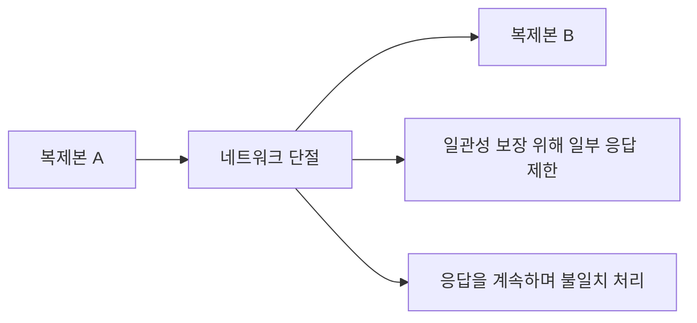

<!-- level:1 -->
# NoSQL과 CAP — 저장 모델과 장애 선택은 다른 축

문서 DB는 객체 형태를, 키값 DB는 키로 찾는 값을, 넓은 컬럼 저장은 키·컬럼 기반 접근을, 그래프 DB는 관계 탐색을 중심으로 설계한다. NoSQL이라는 이름이 “스키마 없음·트랜잭션 없음·무조건 빠름”을 의미하지 않는다. 제품과 기능의 실제 계약을 확인해야 한다.



CAP는 네트워크 분할 상황에서 linearizable 일관성과 엄밀한 가용성을 동시에 보장할 수 없다는 정리다. 평소 성능·업무 정확성·내구성의 모든 선택을 설명하는 “세 가지 중 두 개” 체크리스트로 쓰면 오해가 생긴다.

**비유의 한계:** 여기의 일관성은 ACID의 업무 불변식 의미와 같지 않다. 분할이 없는 상황에서도 지연과 복제 비용의 선택이 존재한다.
<!-- level:2 -->
# 모델과 읽기 계약을 명시하기

저장 모델은 조회 키, 관계, 트랜잭션 범위와 성장 패턴으로 평가한다. eventual consistency는 갱신이 멈춘 뒤 복제본이 수렴한다는 방향의 계약이며 일정 초 이내 최신이라는 수치 보장은 별도로 필요하다. read-your-writes, monotonic read, linearizability를 구분한다.

다음 Python 3 코드는 실제 DB가 아닌 **교육용 지연 복제 모델**이다.

```python
primary, replica = {}, {}
primary["stock"] = 4
replica.update(primary)
primary["stock"] = 3
assert replica["stock"] == 4   # 아직 복제 전
replica.update(primary)
assert replica["stock"] == 3
```

quorum의 R+W>N 조건을 공식 하나로 모든 최신성·linearizability 보장이라고 단정하지 않는다. 복제 버전·동시 쓰기·장애·sloppy quorum·합의 구현에 따라 계약이 달라진다. 제품별 read/write consistency 문서를 확인한다.
<!-- level:3 -->
# 가상 장애 — 저장 직후 조회에서 옛 값이 나온다

가상 앱이 쓰기는 primary, 읽기는 지연 replica로 보낸다. 사용자에게 저장 실패처럼 보인다. 요청 ID와 쓰기 버전, 읽기 대상, 복제 지연을 확인한다. 데이터 손실과 일시적 stale read를 구분해야 한다.

**수정:** 특정 흐름의 primary 읽기, 세션별 버전 추적, 보장된 read-your-writes 기능을 검토한다. 무조건 긴 sleep은 신선도 보장이 아니며 p95 복제 지연만으로 최악을 보장하지 않는다. 충돌 데이터에는 도메인별 병합·중재 규칙을 둔다.

**재검증:** 복제 지연·분할·동시 쓰기·복구에서 읽기 계약을 확인한다. stale 비율과 지연, 읽기 분산 비용을 함께 측정한다.
<!-- level:4 -->
# 업무별 가용성과 일관성

| 업무 | 중요한 요구 | 검토할 선택 |
|---|---|---|
| 결제·고유 예약 | 정확한 경쟁 처리 | 합의·제약·실패 응답 |
| 피드·추천 | 낮은 지연·높은 가용성 | 허용 stale·수렴 |
| 사용자 설정 | 저장 직후 체감 | 세션 일관성·읽기 라우팅 |

분할 시 실패를 반환하는 것도 정확한 계약일 수 있다. 계속 응답한다면 충돌·수렴·유실 가능성을 사용자 흐름과 연결한다. 멀티 리전은 지리 지연, 비용, 재해 복구와 데이터 규제를 포함하며 “AP/CP” 라벨만으로 설계할 수 없다.

**판단 연습:** 재고와 좋아요 수에 같은 일관성 계약을 적용할까? stale 허용 범위, 중복·충돌 비용, 복구 정책을 업무 기준으로 정하자.

참고: [Gilbert·Lynch CAP 원 논문](https://groups.csail.mit.edu/tds/papers/Gilbert/Brewer2.pdf), [Dynamo 원 논문](https://www.allthingsdistributed.com/files/amazon-dynamo-sosp2007.pdf).
<!-- quizzes -->
[{"level":1,"question":"CAP를 정확하게 적용한 설명은?","choices":["평소 언제나 세 가지 중 둘만 선택","NoSQL은 모두 AP","분할 시 linearizable 일관성과 엄밀한 가용성 동시 보장 불가","트랜잭션이 모두 불가능"],"answer_index":2,"explanation":"CAP의 전제와 일관성·가용성 정의가 중요합니다. ACID 일관성이나 모든 평상시 성능 선택과 같은 말이 아닙니다."},{"level":2,"question":"eventual consistency만으로 보장하지 않는 것은?","choices":["갱신이 멈춘 뒤 수렴 가능성","명시된 고정 시간 이내 최신 읽기","복제 모델의 존재","제품별 추가 계약 검토"],"answer_index":1,"explanation":"수렴과 구체적 시간 한도는 다릅니다. 저장 직후 읽기나 최신성 기한에는 별도 계약이 필요합니다."},{"level":3,"question":"저장 후 옛 값이 조회되면 조사할 핵심 정보는?","choices":["읽기 대상·쓰기 버전·복제 지연","UI 폰트만","항상 데이터 삭제","무조건 10초 sleep"],"answer_index":0,"explanation":"primary와 replica의 경로를 알아야 stale read와 저장 실패를 구분합니다. 임의 대기는 보장을 대신하지 않습니다."},{"level":4,"question":"결제와 추천 피드의 일관성을 설계할 때 적절한 접근은?","choices":["모든 업무에 같은 라벨 적용","DB 이름만 선택","분할 복구를 제외","업무 오류 비용·허용 stale·가용성과 복구를 비교"],"answer_index":3,"explanation":"업무마다 불일치와 실패 응답의 비용이 다릅니다. 정리의 라벨보다 실제 계약과 복구를 명시해야 합니다."}]
