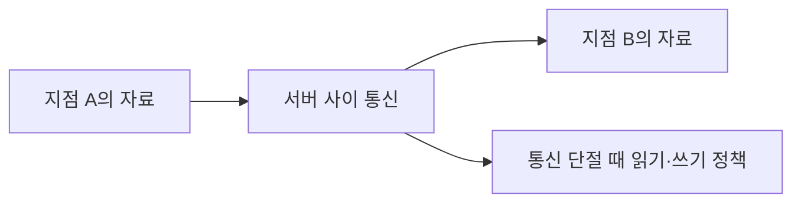

<!-- level:1 -->
# NoSQL과 CAP — 자료 형태와 장애 때의 약속 고르기

> **한 문장으로:** 자료를 담는 방식과, 서버 사이 통신이 끊겼을 때 어떤 응답을 보장할지 함께 선택합니다.

## 왜 필요한가요?

모든 자료가 같은 조회 방식과 관계를 갖지는 않습니다. 여러 서버에 자료를 나누거나 복사하면 통신 장애 때 사본을 어떻게 읽을지도 정해야 합니다.

## 일상에서 떠올려 보기

두 지점의 예약 장부를 맞춘다고 생각해 보세요. 지점 사이 전화가 끊기면 최신 예약을 확인할 수 없습니다. 최신 결과와 맞는지 확신할 때까지 일부 요청을 멈출지, 각 지점이 자기 정보를 사용해 계속 답할지 정책이 필요합니다.

## 순서대로 따라가기

1. 키로 값 찾기, 문서 통째 읽기, 관계 따라가기 중 주요 조회를 정합니다.
2. 여러 서버에 자료가 있을 때 갱신을 전달하고 읽는 규칙을 정합니다.
3. 서버 간 통신이 끊긴 상황에서 어떤 응답을 허용할지 명시합니다. 최신 상태를 엄밀하게 맞추는 보장과 모든 정상 노드 요청에 유효하게 답하는 보장을 함께 유지할 수 없는 경우를 다룹니다.



## 작은 예로 확인하기

A지점에서 마지막 좌석을 예약했는데 B지점에 갱신이 전달되지 않았습니다. B가 이전 장부로 예약을 받으면 최신 상태와 어긋날 수 있습니다. 그렇다고 연결이 끊긴 상태에서 최신 상태를 확인할 방법 없이 모든 요청에 즉시 유효한 결과를 보장할 수는 없습니다.

## 처음 만나는 용어

| 용어 | 쉬운 뜻 |
|---|---|
| NoSQL | 키-값·문서·그래프 등 다양한 저장 모델을 묶어 부르는 범주입니다. |
| 복제본 | 다른 서버에 보관한 데이터 사본입니다. |
| 네트워크 분할(P) | 서버 그룹 사이 통신이 끊겨 정보를 나눌 수 없는 상황입니다. |
| CAP | 분할 중 엄밀한 일관성(C)과 가용성(A)의 동시 보장 한계를 다루는 정리입니다. |

**비유의 한계:** CAP는 언제나 세 가지 중 아무 두 개를 고른다는 구호가 아닙니다. 통신 분할 상황의 엄밀한 보장에 대한 설명입니다. NoSQL도 제품과 설정에 따라 다른 트랜잭션·일관성 기능을 갖습니다.

## 스스로 확인

통신이 끊긴 두 서버가 모든 요청에 답하면서 항상 최신 완료 쓰기와 같은 결과를 보장할 수 있을까요?

**답과 이유:** CAP의 전제에서 두 보장을 동시에 유지할 수 없습니다. 어떤 작업을 지연·거절하고 어떤 읽기를 허용할지 구체적으로 정해야 합니다.
<!-- level:2 -->
# 모델과 읽기 계약을 명시하기

<!-- beginner-guide:start -->
## 읽기 전 길잡이

아래 예제는 실제 DB가 아니라 사본 반영이 늦는 상황을 보여 주는 모델입니다. 쓰기 완료 시점과 각 사본에서 읽는 시점을 나눠 보세요. 일관성 이름마다 약속하는 범위가 다릅니다.

## 이 단계에서 만날 말

| 용어 | 쉬운 뜻 |
|---|---|
| linearizability | 각 작업이 한 순간에 일어난 것처럼 최신 완료 작업과 실제 시간 순서를 지키는 일관성입니다. |
| CAP의 가용성 | 실패하지 않은 노드의 모든 요청에 오류가 아닌 유효한 응답을 끝낼 수 있다는 보장입니다. |
| eventual consistency | 새 갱신이 멈추면 사본들이 최종적으로 같은 상태로 수렴하는 계약입니다. |
| read-your-writes | 자신이 완료한 쓰기를 이후 읽기에서 볼 수 있게 하는 보장입니다. |
| 키-값·문서·그래프 | 키의 값, 필드 묶음 문서, 연결 관계 중심의 저장 모델입니다. |
| 트랜잭션 범위 | 하나의 성공·실패 단위로 관리할 수 있는 데이터 범위입니다. |

<!-- beginner-guide:end -->

저장 모델은 조회 키, 관계, 트랜잭션 범위와 성장 패턴으로 평가한다. eventual consistency는 갱신이 멈춘 뒤 복제본이 수렴한다는 방향의 계약이며 일정 초 이내 최신이라는 수치 보장은 별도로 필요하다. read-your-writes, monotonic read, linearizability를 구분한다.

다음 Python 3 코드는 실제 DB가 아닌 **교육용 지연 복제 모델**이다.

```python
primary, replica = {}, {}
primary["stock"] = 4
replica.update(primary)
primary["stock"] = 3
assert replica["stock"] == 4   # 아직 복제 전
replica.update(primary)
assert replica["stock"] == 3
```

quorum의 R+W>N 조건을 공식 하나로 모든 최신성·linearizability 보장이라고 단정하지 않는다. 복제 버전·동시 쓰기·장애·sloppy quorum·합의 구현에 따라 계약이 달라진다. 제품별 read/write consistency 문서를 확인한다.
<!-- level:3 -->
# 가상 장애 — 저장 직후 조회에서 옛 값이 나온다

<!-- beginner-guide:start -->
## 읽기 전 길잡이

사용자마다 다른 값을 보는 상황에서 사본 지연인지 잘못된 읽기 경로인지 확인합니다. ‘언젠가 맞는다’는 표현만으로 얼마나 오래된 값을 허용할지 설명할 수는 없습니다.

<!-- beginner-guide:end -->

가상 앱이 쓰기는 primary, 읽기는 지연 replica로 보낸다. 사용자에게 저장 실패처럼 보인다. 요청 ID와 쓰기 버전, 읽기 대상, 복제 지연을 확인한다. 데이터 손실과 일시적 stale read를 구분해야 한다.

**수정:** 특정 흐름의 primary 읽기, 세션별 버전 추적, 보장된 read-your-writes 기능을 검토한다. 무조건 긴 sleep은 신선도 보장이 아니며 p95 복제 지연만으로 최악을 보장하지 않는다. 충돌 데이터에는 도메인별 병합·중재 규칙을 둔다.

**재검증:** 복제 지연·분할·동시 쓰기·복구에서 읽기 계약을 확인한다. stale 비율과 지연, 읽기 분산 비용을 함께 측정한다.
<!-- level:4 -->
# 업무별 가용성과 일관성

<!-- beginner-guide:start -->
## 읽기 전 길잡이

제품 이름보다 자료 모델, 조회 패턴, 업무별 장애 응답 계약을 비교합니다. 재고 확정과 추천 목록처럼 데이터마다 허용할 수 있는 오래된 값의 정도가 다를 수 있습니다.

<!-- beginner-guide:end -->

| 업무 | 중요한 요구 | 검토할 선택 |
|---|---|---|
| 결제·고유 예약 | 정확한 경쟁 처리 | 합의·제약·실패 응답 |
| 피드·추천 | 낮은 지연·높은 가용성 | 허용 stale·수렴 |
| 사용자 설정 | 저장 직후 체감 | 세션 일관성·읽기 라우팅 |

분할 시 실패를 반환하는 것도 정확한 계약일 수 있다. 계속 응답한다면 충돌·수렴·유실 가능성을 사용자 흐름과 연결한다. 멀티 리전은 지리 지연, 비용, 재해 복구와 데이터 규제를 포함하며 “AP/CP” 라벨만으로 설계할 수 없다.

**판단 연습:** 재고와 좋아요 수에 같은 일관성 계약을 적용할까? stale 허용 범위, 중복·충돌 비용, 복구 정책을 업무 기준으로 정하자.

참고: [Gilbert·Lynch CAP 원 논문](https://groups.csail.mit.edu/tds/papers/Gilbert/Brewer2.pdf), [Dynamo 원 논문](https://www.allthingsdistributed.com/files/amazon-dynamo-sosp2007.pdf).
<!-- quizzes -->
[{"level":1,"question":"CAP를 정확하게 적용한 설명은?","choices":["평소 언제나 세 가지 중 둘만 선택","NoSQL은 모두 AP","분할 시 linearizable 일관성과 엄밀한 가용성 동시 보장 불가","트랜잭션이 모두 불가능"],"answer_index":2,"explanation":"CAP의 전제와 일관성·가용성 정의가 중요합니다. ACID 일관성이나 모든 평상시 성능 선택과 같은 말이 아닙니다."},{"level":2,"question":"eventual consistency만으로 보장하지 않는 것은?","choices":["갱신이 멈춘 뒤 수렴 가능성","명시된 고정 시간 이내 최신 읽기","복제 모델의 존재","제품별 추가 계약 검토"],"answer_index":1,"explanation":"수렴과 구체적 시간 한도는 다릅니다. 저장 직후 읽기나 최신성 기한에는 별도 계약이 필요합니다."},{"level":3,"question":"저장 후 옛 값이 조회되면 조사할 핵심 정보는?","choices":["읽기 대상·쓰기 버전·복제 지연","UI 폰트만","항상 데이터 삭제","무조건 10초 sleep"],"answer_index":0,"explanation":"primary와 replica의 경로를 알아야 stale read와 저장 실패를 구분합니다. 임의 대기는 보장을 대신하지 않습니다."},{"level":4,"question":"결제와 추천 피드의 일관성을 설계할 때 적절한 접근은?","choices":["모든 업무에 같은 라벨 적용","DB 이름만 선택","분할 복구를 제외","업무 오류 비용·허용 stale·가용성과 복구를 비교"],"answer_index":3,"explanation":"업무마다 불일치와 실패 응답의 비용이 다릅니다. 정리의 라벨보다 실제 계약과 복구를 명시해야 합니다."}]
