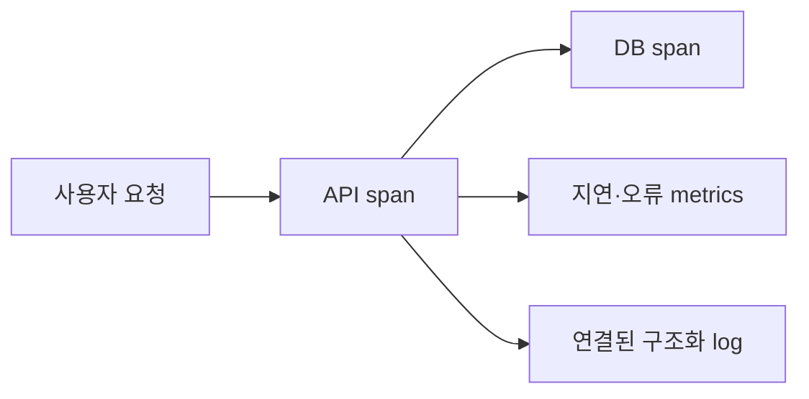

<!-- level:1 -->
# 가시성 — 시스템 안에서 무엇이 일어났는지 추론하기

자동차의 속도계, 정비 기록, 운행 경로는 서로 다른 질문에 답한다. metrics는 수치의 시간 변화, logs는 사건의 상세, traces는 요청이 여러 경계를 지나는 흐름을 보여 준다. 도구를 설치하는 것만으로 문제를 설명할 수 있는 것은 아니며 어떤 질문에 답할지 먼저 정한다.



요청 수·오류율·지연·포화는 서비스 상태의 핵심 단서다. 평균 응답 시간은 일부 사용자의 긴 지연을 숨길 수 있어 p95·p99 같은 분포를 본다. 관측 지표와 사용자 SLO를 연결한다.

**비유의 한계:** trace가 한 요청을 보여 줘도 모든 요청을 저장한 것은 아닐 수 있다. 샘플링·누락·시계 차이와 개인정보·비용을 고려한다.
<!-- level:2 -->
# 의미 있는 이벤트와 카디널리티

로그에는 시각·severity·서비스·요청/trace ID·사건 종류·결과를 구조화한다. metrics label에는 제한된 차원을 사용한다. 사용자 ID나 요청 ID를 label로 넣으면 시계열이 폭증할 수 있다. 그 정보는 적절히 보호된 로그·trace에 둘 수 있다.

Python 3의 구조화 로그 학습 예제다. 실제 사용자 데이터는 포함하지 않는다.

```python
import json, time
started = time.perf_counter()
# 예제 작업
result = sum(range(1000))
print(json.dumps({
    "event": "calculation_complete", "status": "ok",
    "duration_ms": (time.perf_counter()-started)*1000,
    "result": result,
}))
```

분산 trace는 컨텍스트를 호출 경계로 전파하고 span 수명·오류를 기록한다. trace ID를 인증 권한으로 사용하지 않는다. latency histogram의 bucket/집계 방식과 quantile 의미를 확인하고 서로 다른 호스트의 quantile을 단순 평균내지 않는다.
<!-- level:3 -->
# 가상 장애 — 평균은 정상인데 사용자 불만이 늘어난다

가상 서비스의 일부 tenant가 느린 DB 쿼리를 만나 p99가 악화된다. 평균만 보면 정상처럼 보인다. 지연 분포와 endpoint·지역·의존성·배포 버전을 제한된 차원으로 비교하고 trace에서 critical path를 찾는다.

**수정:** 느린 경로와 포화 자원을 개선하고 에러·SLO burn rate 알림을 사용자 영향에 연결한다. 알림마다 담당·심각도·runbook·조치 가능성을 정한다. 임계치만 낮춰 알림을 늘리면 대응 품질이 떨어질 수 있다.

**재검증:** 부하·부분 장애·배포 변화에서 지표와 trace가 실제 원인을 가리키는지 확인한다. 수집기 장애와 텔레메트리 비용도 관측한다. 로그에 토큰·전체 본문이 남는지 검사한다.
<!-- level:4 -->
# 관측 비용과 운영 판단

| 자료 | 강점 | 비용 |
|---|---|---|
| metrics | 저비용 추세·알림 | 차원·분포 표현 제한 |
| logs | 사건 상세·감사 단서 | 저장·검색·민감 정보 |
| traces | 여러 의존성의 지연 경로 | 전파·샘플링·수집 비용 |

SLO는 사용자가 기대하는 성공·지연의 목표와 측정 창이다. error budget은 실패 허용량을 운영 판단에 연결한다. 모니터링 지표를 전부 늘리기보다 빠진 질문과 실패 복구에 필요한 정보를 고른다. 고가치 오류 trace 보관, 정상 요청 샘플링, retention과 redaction을 계획한다.

**판단 연습:** 로그인 실패 증가가 앱 결함인지 외부 인증 장애인지 설명하려면 어떤 지표·로그·trace를 연결해야 할까?

참고: [OpenTelemetry Signals](https://opentelemetry.io/docs/concepts/signals/), [Google SRE Monitoring](https://sre.google/sre-book/monitoring-distributed-systems/).
<!-- quizzes -->
[{"level":1,"question":"평균 지연만으로 놓칠 수 있는 것은?","choices":["모든 CPU 명령","모든 코드 줄","일부 사용자의 큰 꼬리 지연","응답의 존재 자체"],"answer_index":2,"explanation":"평균은 분포의 극단을 숨길 수 있습니다. p95·p99와 오류·포화를 사용자 흐름과 함께 봅니다."},{"level":2,"question":"metric label에 요청 ID를 넣을 때의 주요 문제는?","choices":["카디널리티와 시계열 비용 폭증","항상 모든 성능 개선","로그가 불필요","trace가 자동 인증"],"answer_index":0,"explanation":"요청마다 고유 label은 시계열 수를 크게 늘립니다. 제한된 차원과 로그·trace의 적절한 연결을 설계합니다."},{"level":3,"question":"알림 품질을 높이는 요소는?","choices":["무조건 임계치 최소","사용자 영향·담당·runbook·조치 가능성","모든 요청 본문 공개","정상 trace 무한 저장"],"answer_index":1,"explanation":"실제 대응 가능한 알림이어야 합니다. SLO와 원인 조사 자료를 연결하고 잡음과 민감 데이터 비용을 통제합니다."},{"level":4,"question":"observability 설계의 올바른 기준은?","choices":["도구 개수 최대","지표는 많을수록 항상 좋음","샘플링은 항상 금지","답할 질문·실패 복구·SLO와 저장·보안 비용"],"answer_index":3,"explanation":"관측은 시스템 상태를 추론하고 대응하기 위한 것입니다. 수집·보관·권한·비용을 실제 질문에 맞춰 선택합니다."}]
