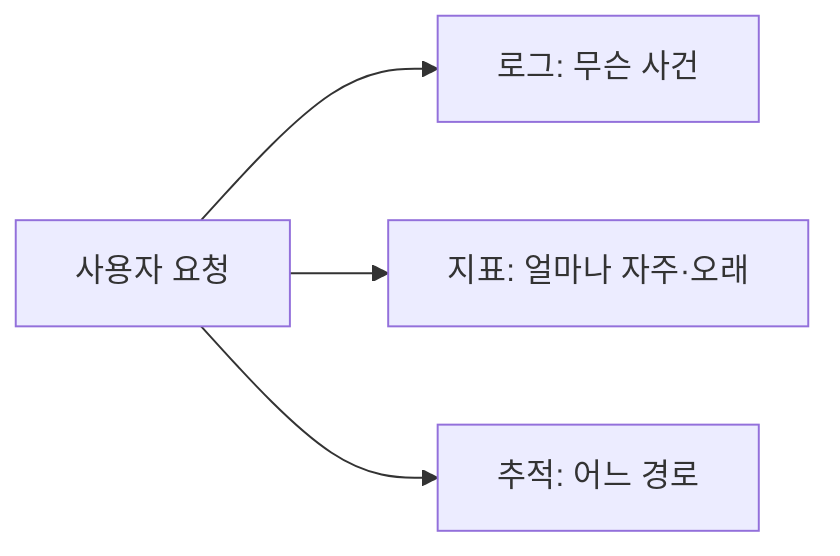

<!-- level:1 -->
# 관측 가능성 — 시스템 안에서 무슨 일이 일어나는지 찾기

> **한 문장으로:** 로그·지표·요청 추적을 연결해 느린 이유와 실패한 위치를 설명할 수 있게 합니다.

## 왜 필요한가요?

사용자는 ‘느리다’고 말하지만 원인은 서버·DB·네트워크 등 여러 곳일 수 있습니다. 결과만 보는 대신 요청이 지나간 과정과 증거를 남겨야 합니다.

## 일상에서 떠올려 보기

병원 접수 과정의 사건 기록, 대기 인원 숫자, 한 환자가 거친 창구 순서를 구분해 보세요. 사건 기록은 로그, 반복 측정값은 지표, 한 요청의 경로는 추적에 가깝습니다. 이 자료를 연결하면 어느 단계에서 기다렸는지 알 수 있습니다.

## 순서대로 따라가기

1. 어떤 업무가 성공하고 얼마나 걸렸는지 의미 있는 사건을 기록합니다.
2. 요청량·오류율·지연 같은 지표의 변화를 관찰합니다.
3. 요청 ID로 여러 서비스의 기록을 연결해 실제 진행 경로와 문제 위치를 조사합니다.



## 작은 예로 확인하기

대부분은 1초 안에 끝나지만 일부 사용자는 매우 오래 기다릴 수 있습니다. 평균값 하나로는 그 불편이 잘 드러나지 않을 수 있습니다. p95는 관측값 중 약 95%가 그 값 이하였음을 보는 지표로, 느린 쪽의 분포를 이해하는 데 도움이 됩니다.

## 처음 만나는 용어

| 용어 | 쉬운 뜻 |
|---|---|
| 로그 | 어떤 사건이 언제 어떻게 일어났는지 기록한 자료입니다. |
| 지표(metrics) | 요청 수·대기 시간처럼 반복 측정하는 숫자입니다. |
| 추적(trace) | 한 요청이 여러 단계나 서비스를 거친 기록입니다. |
| 꼬리 지연 | 일부 요청에서 나타나는 특히 긴 처리 시간입니다. |

**비유의 한계:** 기록을 많이 모으는 것만으로 원인을 찾을 수 있지는 않습니다. 의미와 연결 기준이 필요하고, 개인 정보·비밀값을 과도하게 기록하면 안 됩니다.

## 스스로 확인

평균 응답은 빠른데 일부 사용자는 오래 기다립니다. 어떤 정보를 더 보면 좋을까요?

**답과 이유:** p95 같은 느린 구간의 지연 분포와 해당 요청의 경로를 봅니다. 평균만으로 놓친 사용자 경험을 확인할 수 있습니다.
<!-- level:2 -->
# 의미 있는 이벤트와 카디널리티

<!-- beginner-guide:start -->
## 읽기 전 길잡이

로그 예제에서 사건 종류와 요청 식별자를 찾아보세요. 반복 집계할 지표에 사용자마다 다른 ID를 넣으면 종류가 폭증할 수 있으므로 기록 역할을 구분합니다.

## 이 단계에서 만날 말

| 용어 | 쉬운 뜻 |
|---|---|
| 구조화 로그 | 시각·요청 ID·결과 같은 필드로 정리한 사건 기록입니다. |
| severity | 정보·경고·오류 등 사건의 중요도입니다. |
| 카디널리티 | 지표의 분류값 조합이 얼마나 많이 생기는지와 관련된 규모입니다. |
| label | 지표를 서비스·결과 종류 등으로 구분하는 표시입니다. |
| SLO | 사용자에게 제공하려는 품질 목표입니다. |
| 샘플링 | 모든 사건 대신 일부를 선택해 보관·조사하는 방식입니다. |

<!-- beginner-guide:end -->

로그에는 시각·severity·서비스·요청/trace ID·사건 종류·결과를 구조화한다. metrics label에는 제한된 차원을 사용한다. 사용자 ID나 요청 ID를 label로 넣으면 시계열이 폭증할 수 있다. 그 정보는 적절히 보호된 로그·trace에 둘 수 있다.

Python 3의 구조화 로그 학습 예제다. 실제 사용자 데이터는 포함하지 않는다.

```python
import json, time
started = time.perf_counter()
# 예제 작업
result = sum(range(1000))
print(json.dumps({
    "event": "calculation_complete", "status": "ok",
    "duration_ms": (time.perf_counter()-started)*1000,
    "result": result,
}))
```

분산 trace는 컨텍스트를 호출 경계로 전파하고 span 수명·오류를 기록한다. trace ID를 인증 권한으로 사용하지 않는다. latency histogram의 bucket/집계 방식과 quantile 의미를 확인하고 서로 다른 호스트의 quantile을 단순 평균내지 않는다.
<!-- level:3 -->
# 가상 장애 — 평균은 정상인데 사용자 불만이 늘어난다

<!-- beginner-guide:start -->
## 읽기 전 길잡이

느린 한 요청의 서비스·DB 경로를 따라가며 시간이 어디에서 늘었는지 봅니다. 오류율과 지연, 최근 배포 등 여러 증거를 연결해 가설을 확인하세요.

<!-- beginner-guide:end -->

가상 서비스의 일부 tenant가 느린 DB 쿼리를 만나 p99가 악화된다. 평균만 보면 정상처럼 보인다. 지연 분포와 endpoint·지역·의존성·배포 버전을 제한된 차원으로 비교하고 trace에서 critical path를 찾는다.

**수정:** 느린 경로와 포화 자원을 개선하고 에러·SLO burn rate 알림을 사용자 영향에 연결한다. 알림마다 담당·심각도·runbook·조치 가능성을 정한다. 임계치만 낮춰 알림을 늘리면 대응 품질이 떨어질 수 있다.

**재검증:** 부하·부분 장애·배포 변화에서 지표와 trace가 실제 원인을 가리키는지 확인한다. 수집기 장애와 텔레메트리 비용도 관측한다. 로그에 토큰·전체 본문이 남는지 검사한다.
<!-- level:4 -->
# 관측 비용과 운영 판단

<!-- beginner-guide:start -->
## 읽기 전 길잡이

얼마나 자세히 남길지와 저장·수집 비용을 비교합니다. 사용자의 품질 목표에서 출발해 필요한 지표와 사건을 정하고, 문제 발생 시 조사할 수 있는 연결을 유지하세요.

<!-- beginner-guide:end -->

| 자료 | 강점 | 비용 |
|---|---|---|
| metrics | 저비용 추세·알림 | 차원·분포 표현 제한 |
| logs | 사건 상세·감사 단서 | 저장·검색·민감 정보 |
| traces | 여러 의존성의 지연 경로 | 전파·샘플링·수집 비용 |

SLO는 사용자가 기대하는 성공·지연의 목표와 측정 창이다. error budget은 실패 허용량을 운영 판단에 연결한다. 모니터링 지표를 전부 늘리기보다 빠진 질문과 실패 복구에 필요한 정보를 고른다. 고가치 오류 trace 보관, 정상 요청 샘플링, retention과 redaction을 계획한다.

**판단 연습:** 로그인 실패 증가가 앱 결함인지 외부 인증 장애인지 설명하려면 어떤 지표·로그·trace를 연결해야 할까?

참고: [OpenTelemetry Signals](https://opentelemetry.io/docs/concepts/signals/), [Google SRE Monitoring](https://sre.google/sre-book/monitoring-distributed-systems/).
<!-- quizzes -->
[{"level":1,"question":"평균 지연만으로 놓칠 수 있는 것은?","choices":["모든 CPU 명령","모든 코드 줄","일부 사용자의 큰 꼬리 지연","응답의 존재 자체"],"answer_index":2,"explanation":"평균은 분포의 극단을 숨길 수 있습니다. p95·p99와 오류·포화를 사용자 흐름과 함께 봅니다."},{"level":2,"question":"metric label에 요청 ID를 넣을 때의 주요 문제는?","choices":["카디널리티와 시계열 비용 폭증","항상 모든 성능 개선","로그가 불필요","trace가 자동 인증"],"answer_index":0,"explanation":"요청마다 고유 label은 시계열 수를 크게 늘립니다. 제한된 차원과 로그·trace의 적절한 연결을 설계합니다."},{"level":3,"question":"알림 품질을 높이는 요소는?","choices":["무조건 임계치 최소","사용자 영향·담당·runbook·조치 가능성","모든 요청 본문 공개","정상 trace 무한 저장"],"answer_index":1,"explanation":"실제 대응 가능한 알림이어야 합니다. SLO와 원인 조사 자료를 연결하고 잡음과 민감 데이터 비용을 통제합니다."},{"level":4,"question":"observability 설계의 올바른 기준은?","choices":["도구 개수 최대","지표는 많을수록 항상 좋음","샘플링은 항상 금지","답할 질문·실패 복구·SLO와 저장·보안 비용"],"answer_index":3,"explanation":"관측은 시스템 상태를 추론하고 대응하기 위한 것입니다. 수집·보관·권한·비용을 실제 질문에 맞춰 선택합니다."}]
