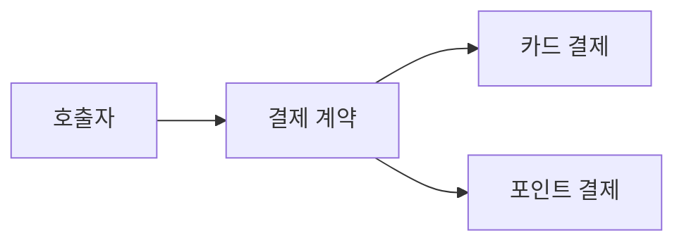

<!-- level:1 -->
# 객체지향 — 상태를 지키는 행동의 경계

은행 계좌는 잔고 숫자만이 아니라 입금·출금 규칙을 가진다. 객체는 관련 상태와 행동을 묶어 불변식을 지키는 경계가 될 수 있다. 추상화는 필요한 계약을 드러내고, 캡슐화는 내부 표현을 보호하며, 상속은 관계를 표현하고, 다형성은 같은 계약을 서로 다른 구현으로 수행하게 한다.



클래스를 많이 만드는 것이 객체지향의 목표는 아니다. 외부 코드가 잔고를 마음대로 바꾸지 않고 검증된 행동을 통하게 하는 것이 더 중요한 예다. 다형성은 분기 위치를 구현 경계로 옮길 수 있지만 모든 조건문을 제거할 의무는 없다.

**비유의 한계:** 현실의 “종류” 분류를 그대로 깊은 상속 계층으로 만들면 변경이 어려워질 수 있다. is-a라는 이름보다 호출자가 요구하는 행동 계약이 중요하다.

**확인:** 부모 타입을 기대하는 코드에 자식 객체를 넣었을 때 예외와 동작 조건이 바뀌면 어떤 문제가 생길까?
<!-- level:2 -->
# 불변식과 대체 가능한 계약

캡슐화는 필드를 private으로 표시하는 것만으로 끝나지 않는다. 객체가 외부에 가변 내부 리스트를 그대로 돌려주면 보호 경계가 깨질 수 있다. 계약에는 입력 조건·반환 결과·오류·상태 변화가 포함된다.

Python 3의 간단한 계좌 예제다. 금액은 정수 최소 단위로 제한한다.

```python
class Account:
    def __init__(self, balance):
        if balance < 0: raise ValueError("negative balance")
        self._balance = balance
    @property
    def balance(self): return self._balance
    def withdraw(self, amount):
        if amount <= 0 or amount > self._balance:
            raise ValueError("invalid withdrawal")
        self._balance -= amount

a = Account(100)
a.withdraw(30)
assert a.balance == 70
```

Python의 밑줄은 관례이며 보안 샌드박스가 아니다. 이 객체도 동시 요청·DB 영속성·거래 기록을 구현하지 않는다. 상속 관계에서 자식이 부모 계약을 좁히거나 호출자가 예상하지 못한 결과를 내면 대체 가능성이 깨진다. 조합은 객체가 다른 객체의 기능을 사용하는 방식으로, 변경 방향에 따라 상속보다 적합할 수 있다.
<!-- level:3 -->
# 가상 장애 — 새 구현이 기존 호출자를 깨뜨린다

가상 저장소 계약은 “없는 키에는 None을 반환”인데 새 구현은 예외를 던진다. 호출자는 기존 계약으로 작성되어 장애를 일으킨다. 클래스 구조가 비슷한 것과 행동 계약이 같은 것은 다르다.

**진단:** 모든 구현에 동일한 계약 테스트를 적용한다. 입력 경계, 빈 데이터, 오류·취소, 순서·수명 조건을 확인한다. mock이 성공 경로만 흉내내면 차이를 놓칠 수 있다.

**수정:** 계약을 명확히 하고 구현을 맞추거나 변경을 버전으로 드러낸다. 외부 라이브러리의 차이를 어댑터로 정규화할 수 있다. 단지 상속을 삭제한다고 업무 불변식 문제가 해결되는 것은 아니다.

**재검증:** 기존 호출자 테스트와 각 구현의 통합 테스트를 실행한다. 가변 내부 상태가 반환값을 통해 노출되는지도 검사한다.
<!-- level:4 -->
# 클래스보다 변경 경계를 선택하기

| 선택 | 유리한 상황 | 부담 |
|---|---|---|
| 상속 | 안정된 공통 행동 계약 | 깊은 계층·대체 가능성 |
| 조합·위임 | 독립 기능을 교체 | 객체 연결·설정 복잡성 |
| 함수·불변 데이터 | 단순 변환·계산 | 상태 수명 경계 별도 설계 |

객체 경계는 업무 규칙, 상태 소유권, 변경 빈도에 맞춘다. 서비스 규모가 커질 때 객체 모델을 그대로 네트워크 마이크로서비스로 바꾸지 않는다. 원격 호출은 실패·지연·부분 완료라는 추가 계약을 갖는다.

**판단 연습:** 할인 정책이 자주 바뀌고 주문 저장은 안정적이라면 어느 책임을 객체·함수·인터페이스로 분리할까? 결합도와 테스트 계약을 근거로 결정하자.

참고: [Oracle Java Inheritance](https://docs.oracle.com/javase/tutorial/java/IandI/subclasses.html), [Python Classes](https://docs.python.org/3/tutorial/classes.html).
<!-- quizzes -->
[{"level":1,"question":"캡슐화의 실질적인 목적은 무엇인가요?","choices":["클래스 수를 최대화","모든 값을 전역 공개","검증된 행동 경계로 상태 불변식을 보호","조건문을 무조건 없앰"],"answer_index":2,"explanation":"내부 표현과 변경 경계를 통제해 업무 규칙을 지키는 것이 목적입니다. 접근 제어 키워드만으로 완성되지 않습니다."},{"level":2,"question":"부모 계약을 따르는 호출자에 자식 구현을 넣을 때 필요한 것은?","choices":["자식이 입력 조건을 마음대로 더 좁힘","행동·오류·결과의 대체 가능성","클래스 이름만 동일","상속 계층 깊이 최대화"],"answer_index":1,"explanation":"타입 관계뿐 아니라 행동 계약이 맞아야 합니다. 호출자가 기대한 조건과 결과를 깨면 대체 가능성이 사라집니다."},{"level":3,"question":"저장소 구현별 없는 키 처리 차이를 탐지할 방법은?","choices":["외형만 비교","성공 경로 mock만 사용","로그를 없앰","모든 구현에 공통 계약 테스트"],"answer_index":3,"explanation":"빈 데이터·오류 등 계약 경계를 같은 테스트로 검증해야 구현을 교체할 때 호출자를 보호할 수 있습니다."},{"level":4,"question":"조합을 선택하는 합리적 이유는?","choices":["독립된 기능 교체와 변경 경계를 표현하기 쉬워서","항상 실행 속도가 두 배","모든 상태를 제거","원격 호출 실패를 자동 해결"],"answer_index":0,"explanation":"조합은 변경하는 기능을 위임·교체하는 데 유용합니다. 객체 연결과 설정 비용이 있으므로 상속·함수 대안과 비교합니다."}]
