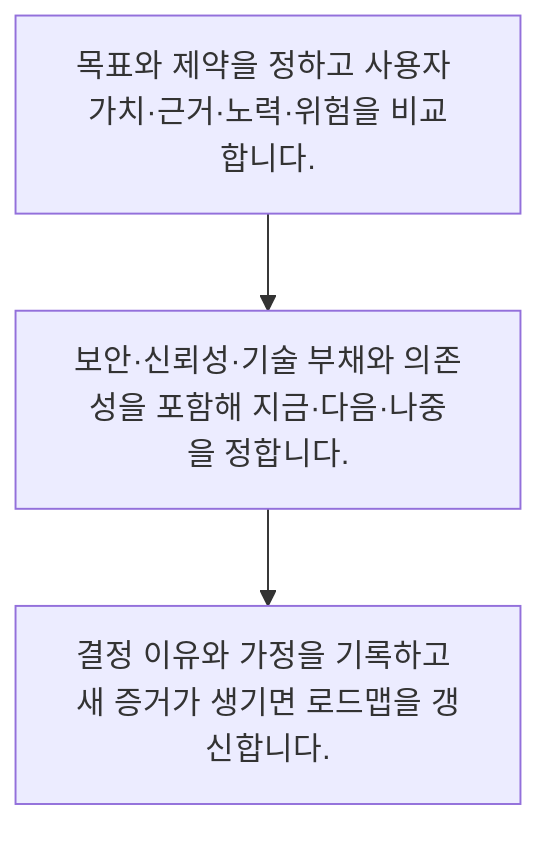

<!-- level:1 -->
# 우선순위·제품 로드맵·기술 부채

> **한 문장으로:** 우선순위는 요청을 줄 세우는 계산만이 아니라, 목표·증거·비용·위험을 비교하고 하지 않을 일도 정하는 결정입니다.

## 왜 필요한가요?

로드맵은 모든 기능의 확정 납기표와 다릅니다. 가까운 약속과 먼 방향의 불확실성을 표시해야 이해관계자가 기대를 조정할 수 있습니다. 기술 부채는 추상적인 청소라는 표현보다 변경 지연·장애·보안 비용과 연결해 설명합니다.

## 일상에서 떠올려 보기

한정된 시간에 집을 수리할 때 보기 좋은 벽지보다 누수를 먼저 고칠 수 있습니다. 긴급한 안전 문제와 생활 편의, 비용을 함께 봐야 합니다. 제품도 눈에 보이는 기능뿐 아니라 장애와 보안·기술 부채를 같이 비교합니다.

## 순서대로 따라가기

1. 목표와 제약을 정하고 사용자 가치·근거·노력·위험을 비교합니다.
2. 보안·신뢰성·기술 부채와 의존성을 포함해 지금·다음·나중을 정합니다.
3. 결정 이유와 가정을 기록하고 새 증거가 생기면 로드맵을 갱신합니다.



## 처음 만나는 용어

| 용어 | 쉬운 뜻 |
|---|---|
| 우선순위 | 제약 아래 먼저 할 일과 미룰 일을 정한 순서 |
| 로드맵 | 시간에 따라 해결할 문제와 방향·가정을 공유하는 계획 |
| 기술 부채 | 현재 선택 때문에 이후 변경과 운영에 추가 비용이 생기는 상태 |

**비유의 한계:** 점수표는 서로 다른 가정의 비교를 돕지만 객관적인 진실은 아닙니다. 작은 점수 차이에 집착하거나 추정치를 조정해 원하는 순위를 만드는 일을 피해야 합니다.

## 스스로 확인

우선순위 결정에서 함께 볼 것은 무엇인가요?

**답과 이유:** 가치·근거·비용·위험과 제약 — 서로 다른 가치와 비용을 함께 봐야 제약 아래 합리적인 선택을 할 수 있습니다.
<!-- level:2 -->
# 우선순위·제품 로드맵·기술 부채 — 실제 흐름 따라가기

## 읽기 전 길잡이

우선순위는 요청을 줄 세우는 계산만이 아니라, 목표·증거·비용·위험을 비교하고 하지 않을 일도 정하는 결정입니다. 아래 예제는 외부 시스템에 연결하지 않는 작은 학습용 사례입니다. 입력, 처리 조건, 결과를 순서대로 살펴보세요.

1. 목표와 제약을 정하고 사용자 가치·근거·노력·위험을 비교합니다.
2. 보안·신뢰성·기술 부채와 의존성을 포함해 지금·다음·나중을 정합니다.
3. 결정 이유와 가정을 기록하고 새 증거가 생기면 로드맵을 갱신합니다.

## 예제로 확인하기

```markdown
# 우선순위 검토 기록
- 목표: 상담원의 잘못된 답변 줄이기
- 후보 A: 근거 문서 최신성 표시
  근거: 오래된 정책 인용 사례 확인, 노력: 작음
- 후보 B: 답변 말투 개인화
  근거: 선호 의견만 있음, 노력: 중간
- 필수 제약: 접근 제어 결함 우선 수정
- 지금: 권한 결함과 최신성 표시
- 다음: 대표 평가셋 보완
- 나중: 말투 실험, 기대 효과 증거부터 수집
```

## 결과를 해석하기

로드맵은 모든 기능의 확정 납기표와 다릅니다. 가까운 약속과 먼 방향의 불확실성을 표시해야 이해관계자가 기대를 조정할 수 있습니다. 기술 부채는 추상적인 청소라는 표현보다 변경 지연·장애·보안 비용과 연결해 설명합니다.

## 실무에 옮기기 전

점수표는 서로 다른 가정의 비교를 돕지만 객관적인 진실은 아닙니다. 작은 점수 차이에 집착하거나 추정치를 조정해 원하는 순위를 만드는 일을 피해야 합니다. 실제 업무에서는 필수 안전·보안 조건은 임의의 성장 점수와 단순 교환하지 않습니다. 점수는 토론의 출발점으로 쓰고, 목표·의존성·불확실성·운영 부담을 포함해 책임자가 결정을 내리고 이유를 공개합니다.

## 확인 질문

로드맵의 먼 미래 항목은 어떻게 표현하나요?

**답과 이유:** 먼 계획은 증거와 환경에 따라 달라질 수 있으므로 확실성 수준을 알려야 합니다.
<!-- level:3 -->
# 우선순위·제품 로드맵·기술 부채 — 가상 사례로 문제 해결하기

실제 고객의 장애 기록이 아닌 학습용 재현 시나리오입니다. 결과만 바꾸기 전에 관측한 증거와 원인 가설을 구분합니다.

## 1. 어떤 문제가 생겼나요?

점수 높은 기능을 계속 만들었지만 권한 결함과 장애가 늘어납니다.

## 2. 먼저 확인할 증거

점수표에는 새 사용자 수와 구현 시간만 있고 오류 비용과 기술 부채가 없습니다.

## 3. 원인 가설

비교 기준이 성장 기능에만 유리하게 설계된 것이 원인 가설입니다.

## 4. 수정 방법

필수 품질 조건을 우선 반영하고 위험 감소와 운영 비용을 비교 항목에 추가합니다.

## 5. 재검증

기능 성과와 장애·변경 소요를 함께 보고 실제로 목표에 가까워졌는지 확인합니다.

## 놓치기 쉬운 조건

점수표는 서로 다른 가정의 비교를 돕지만 객관적인 진실은 아닙니다. 작은 점수 차이에 집착하거나 추정치를 조정해 원하는 순위를 만드는 일을 피해야 합니다.

## 확인 질문

성장 기능만 늘고 장애가 커지면 무엇을 점검하나요?

**답과 이유:** 평가 기준이 성장에 치우치면 신뢰성과 변경 비용을 놓칠 수 있습니다.
<!-- level:4 -->
# 우선순위·제품 로드맵·기술 부채 — 업무와 아키텍처의 선택

## 읽기 전 길잡이

같은 개념도 업무의 규모, 오류 비용, 운영 역량에 따라 적용 방식이 달라집니다. 아래 비교는 특정 제품의 성능 순위가 아닌 선택 기준입니다.

| 선택 | 얻는 점 | 감수할 점 |
|---|---|---|
| 점수 기반 후보 비교 | 많은 요청을 일관되게 논의하기 쉬움 | 가정과 입력 편향이 숫자 뒤에 숨을 수 있음 |
| 목표·증거 중심 로드맵 | 방향과 선택 이유를 전달하기 좋음 | 세부 납기나 의존성은 추가 계획 필요 |

## 선택 기준

필수 안전·보안 조건은 임의의 성장 점수와 단순 교환하지 않습니다. 점수는 토론의 출발점으로 쓰고, 목표·의존성·불확실성·운영 부담을 포함해 책임자가 결정을 내리고 이유를 공개합니다.

## 도입과 운영에서 확인할 것

필수 품질 조건을 우선 반영하고 위험 감소와 운영 비용을 비교 항목에 추가합니다. 기능 성과와 장애·변경 소요를 함께 보고 실제로 목표에 가까워졌는지 확인합니다.

## 판단 연습

점수표의 적절한 역할은 무엇인가요?

**판단의 근거:** 점수는 불확실한 입력을 요약한 도구이며 판단과 근거를 대신하지 않습니다.

참고: [GOV.UK Service Manual](https://www.gov.uk/service-manual), [WCAG 2.2](https://www.w3.org/TR/WCAG22/).
<!-- quizzes -->
[{"level":1,"question":"우선순위 결정에서 함께 볼 것은 무엇인가요?","choices":["화면 수만","점수의 소수점만","가치·근거·비용·위험과 제약","요청자의 목소리 크기만"],"answer_index":2,"explanation":"서로 다른 가치와 비용을 함께 봐야 제약 아래 합리적인 선택을 할 수 있습니다."},{"level":2,"question":"로드맵의 먼 미래 항목은 어떻게 표현하나요?","choices":["모두 확정 날짜로 약속한다","이유를 숨긴다","사용자 문제를 제외한다","방향과 가정·불확실성을 함께 표시한다"],"answer_index":3,"explanation":"먼 계획은 증거와 환경에 따라 달라질 수 있으므로 확실성 수준을 알려야 합니다."},{"level":3,"question":"성장 기능만 늘고 장애가 커지면 무엇을 점검하나요?","choices":["우선순위 기준의 품질·운영 위험 누락","기능 이름만","점수 소수점 부족","문서 글꼴"],"answer_index":0,"explanation":"평가 기준이 성장에 치우치면 신뢰성과 변경 비용을 놓칠 수 있습니다."},{"level":4,"question":"점수표의 적절한 역할은 무엇인가요?","choices":["입력을 숨긴 채 권위를 만든다","가정이 드러나는 비교와 토론을 돕는다","모든 결정을 자동으로 확정한다","보안 결함을 항상 낮게 둔다"],"answer_index":1,"explanation":"점수는 불확실한 입력을 요약한 도구이며 판단과 근거를 대신하지 않습니다."}]
