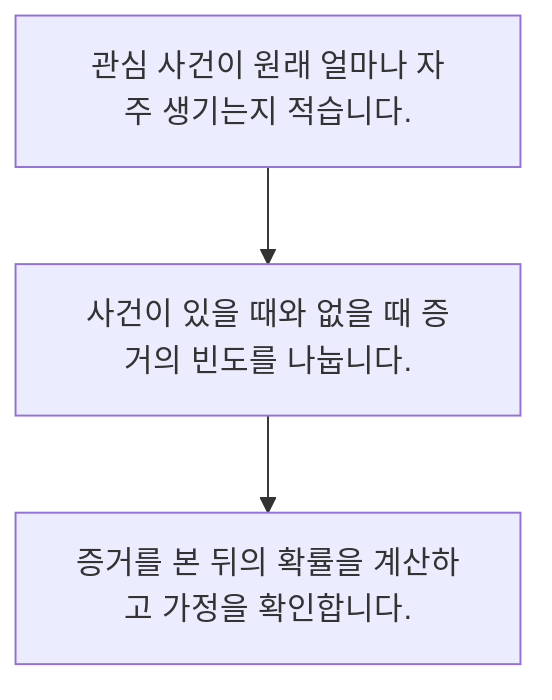

<!-- level:1 -->
# 확률·조건부 확률과 베이즈 사고

> **한 문장으로:** 새로운 증거를 해석할 때 기존 발생률과 그 증거가 나타날 가능성을 함께 고려합니다.

## 왜 필요한가요?

가상 조건에서 발생률 1%, 감지율 90%, 비사건의 경보율 5%이면 경보 후 사건 확률은 약 15.4%입니다. 90% 감지율을 사건 확률로 뒤집으면 기준 발생률을 놓칩니다.

## 일상에서 떠올려 보기

화재 경보가 울렸다고 모두 화재인 것은 아닙니다. 실제 화재가 드문 장소와 자주 나는 장소에서는 같은 경보라도 믿을 정도가 다릅니다.

## 순서대로 따라가기

1. 관심 사건이 원래 얼마나 자주 생기는지 적습니다.
2. 사건이 있을 때와 없을 때 증거의 빈도를 나눕니다.
3. 증거를 본 뒤의 확률을 계산하고 가정을 확인합니다.



## 처음 만나는 용어

| 용어 | 쉬운 뜻 |
|---|---|
| 사전 확률 | 새 증거를 보기 전 사건에 부여한 확률 |
| 조건부 확률 | 어떤 조건이 주어졌을 때의 확률 |
| 사후 확률 | 관측한 증거를 반영해 갱신한 확률 |

**비유의 한계:** 확률은 전제와 자료에 의존합니다. 간단한 계산이 환경 변화나 검사의 독립성을 자동으로 보장하지 않으며, 원인 관계를 바로 입증하지도 않습니다.

## 스스로 확인

경보 후 사건 확률을 판단할 때 필요한 추가 정보는?

**답과 이유:** 기존 사건 발생률 — 감지 성능이 같아도 사건이 원래 드물면 경보 중 오경보 비중이 클 수 있습니다.
<!-- level:2 -->
# 확률·조건부 확률과 베이즈 사고 — 실제 흐름 따라가기

## 읽기 전 길잡이

새로운 증거를 해석할 때 기존 발생률과 그 증거가 나타날 가능성을 함께 고려합니다. 아래 예제는 외부 시스템에 연결하지 않는 작은 학습용 사례입니다. 입력, 처리 조건, 결과를 순서대로 살펴보세요.

1. 관심 사건이 원래 얼마나 자주 생기는지 적습니다.
2. 사건이 있을 때와 없을 때 증거의 빈도를 나눕니다.
3. 증거를 본 뒤의 확률을 계산하고 가정을 확인합니다.

## 예제로 확인하기

```python
prior, sensitivity, false_alarm = 0.01, 0.9, 0.05
p_alarm = prior*sensitivity + (1-prior)*false_alarm
posterior = prior*sensitivity / p_alarm
assert 0.15 < posterior < 0.16
print(round(posterior, 3))
```

## 결과를 해석하기

가상 조건에서 발생률 1%, 감지율 90%, 비사건의 경보율 5%이면 경보 후 사건 확률은 약 15.4%입니다. 90% 감지율을 사건 확률로 뒤집으면 기준 발생률을 놓칩니다.

## 실무에 옮기기 전

확률은 전제와 자료에 의존합니다. 간단한 계산이 환경 변화나 검사의 독립성을 자동으로 보장하지 않으며, 원인 관계를 바로 입증하지도 않습니다. 실제 업무에서는 발생률이 다른 업무에 같은 경보 해석을 복사하지 않습니다. 검사의 성능과 조사 용량, 놓침·오경보 비용을 함께 판단하고 전제가 바뀌면 재추정합니다.

## 확인 질문

예제의 사후 확률은 대략 얼마인가요?

**답과 이유:** 사건과 경보의 동시 확률을 전체 경보 확률로 나눕니다. 감지율을 뒤집어 사용할 수 없습니다.
<!-- level:3 -->
# 확률·조건부 확률과 베이즈 사고 — 가상 사례로 문제 해결하기

실제 고객의 장애 기록이 아닌 학습용 재현 시나리오입니다. 결과만 바꾸기 전에 관측한 증거와 원인 가설을 구분합니다.

## 1. 어떤 문제가 생겼나요?

가상 탐지 팀이 경보 대부분을 실제 사고라고 판단해 조사 인력이 부족해집니다.

## 2. 먼저 확인할 증거

전체 건수와 실제 사건 수, 오경보의 절대 건수를 확인합니다.

## 3. 원인 가설

감지율과 경보가 맞을 확률을 혼동하고 낮은 발생률을 무시했습니다.

## 4. 수정 방법

기준 발생률을 포함한 혼동표를 만들고 조사 비용에 따라 임계값을 검토합니다.

## 5. 재검증

새 기간에서 실제 양성 비율과 놓친 사건을 측정해 예측과 대조합니다.

## 놓치기 쉬운 조건

확률은 전제와 자료에 의존합니다. 간단한 계산이 환경 변화나 검사의 독립성을 자동으로 보장하지 않으며, 원인 관계를 바로 입증하지도 않습니다.

## 확인 질문

오경보가 많은 탐지 시스템에서 확인할 자료는?

**답과 이유:** 분모와 실제 사건 수가 있어야 기준 발생률과 오경보 부담을 구별할 수 있습니다.
<!-- level:4 -->
# 확률·조건부 확률과 베이즈 사고 — 업무와 아키텍처의 선택

## 읽기 전 길잡이

같은 개념도 업무의 규모, 오류 비용, 운영 역량에 따라 적용 방식이 달라집니다. 아래 비교는 특정 제품의 성능 순위가 아닌 선택 기준입니다.

| 선택 | 얻는 점 | 감수할 점 |
|---|---|---|
| 고정된 사전 확률 | 운영과 설명 간단 | 환경이 바뀌면 오판 가능 |
| 집단·시점별 갱신 | 상황별 차이 반영 | 작은 표본과 편향 관리 필요 |

## 선택 기준

발생률이 다른 업무에 같은 경보 해석을 복사하지 않습니다. 검사의 성능과 조사 용량, 놓침·오경보 비용을 함께 판단하고 전제가 바뀌면 재추정합니다.

## 도입과 운영에서 확인할 것

기준 발생률을 포함한 혼동표를 만들고 조사 비용에 따라 임계값을 검토합니다. 새 기간에서 실제 양성 비율과 놓친 사건을 측정해 예측과 대조합니다.

## 판단 연습

다른 고객군에 경보를 적용할 때 합리적인 선택은?

**판단의 근거:** 집단별 발생률과 비용이 다르면 같은 검사 결과의 의미와 운영 기준도 달라집니다.

참고: [NIST 통계 핸드북](https://www.itl.nist.gov/div898/handbook/), [PostgreSQL 쿼리](https://www.postgresql.org/docs/current/queries.html).
<!-- quizzes -->
[{"level":1,"question":"경보 후 사건 확률을 판단할 때 필요한 추가 정보는?","choices":["서버 이름","화면 크기","기존 사건 발생률","경보 색상"],"answer_index":2,"explanation":"감지 성능이 같아도 사건이 원래 드물면 경보 중 오경보 비중이 클 수 있습니다."},{"level":2,"question":"예제의 사후 확률은 대략 얼마인가요?","choices":["90%","99%","1%로 고정","15.4%"],"answer_index":3,"explanation":"사건과 경보의 동시 확률을 전체 경보 확률로 나눕니다. 감지율을 뒤집어 사용할 수 없습니다."},{"level":3,"question":"오경보가 많은 탐지 시스템에서 확인할 자료는?","choices":["전체 모집단과 혼동표","맞은 경보만","알림 제목만","대시보드 장식"],"answer_index":0,"explanation":"분모와 실제 사건 수가 있어야 기준 발생률과 오경보 부담을 구별할 수 있습니다."},{"level":4,"question":"다른 고객군에 경보를 적용할 때 합리적인 선택은?","choices":["검사 성능만 보고 확정","발생률과 오류 비용을 다시 평가","사후 확률을 무조건 복사","오경보를 삭제"],"answer_index":1,"explanation":"집단별 발생률과 비용이 다르면 같은 검사 결과의 의미와 운영 기준도 달라집니다."}]
