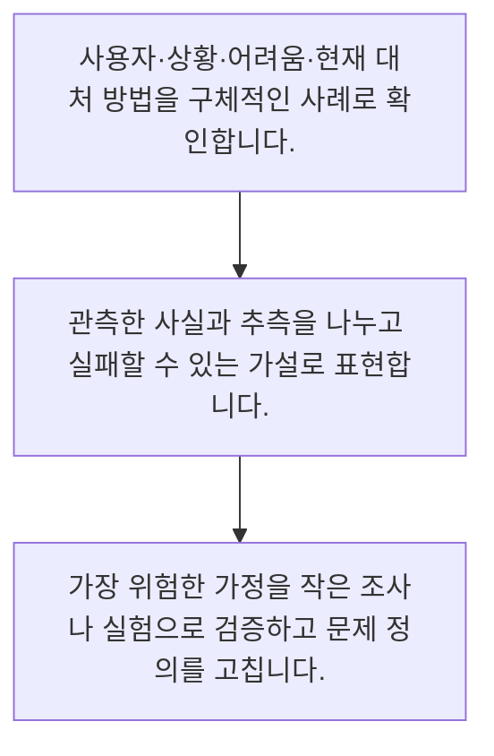

<!-- level:1 -->
# 문제 발견·사용자 가치·가설

> **한 문장으로:** 제품 기획은 만들 기능을 고르기 전에, 누가 어떤 상황에서 무엇 때문에 어려운지 확인하는 일입니다.

## 왜 필요한가요?

열심히 만든 기능을 사용자가 쓰지 않는 일이 생깁니다. 해결책을 정하기 전에 실제 어려움과 현재 대처를 확인하면 필요 없는 개발을 줄이고 더 적합한 방법을 찾을 수 있습니다.

## 일상에서 떠올려 보기

우산을 팔기 전에 사람들이 비를 맞는 이유를 살펴봅니다. 우산이 없어서인지, 들고 다니기 불편해서인지, 비 소식을 몰라서인지에 따라 해결책은 달라집니다. 앱이나 AI를 먼저 정하면 실제 문제를 놓칠 수 있습니다.

## 순서대로 따라가기

1. 사용자·상황·어려움·현재 대처 방법을 구체적인 사례로 확인합니다.
2. 관측한 사실과 추측을 나누고 실패할 수 있는 가설로 표현합니다.
3. 가장 위험한 가정을 작은 조사나 실험으로 검증하고 문제 정의를 고칩니다.



## 처음 만나는 용어

| 용어 | 쉬운 뜻 |
|---|---|
| 문제 정의 | 누가 어떤 상황에서 겪는 어려움과 영향의 설명 |
| 가설 | 증거를 통해 맞거나 틀릴 수 있도록 표현한 예상 |
| 사용자 가치 | 사용자가 얻는 시간·편의·정확성 등의 변화 |

**비유의 한계:** 사용자의 말 한마디가 전체 시장의 수요를 대표하지는 않습니다. 관찰·인터뷰·행동 자료를 함께 보고 해결책에 대한 호감과 실제 이용 의사를 구분합니다.

## 스스로 확인

기능을 정하기 전에 확인할 것은 무엇인가요?

**답과 이유:** 사용자·상황·어려움과 현재 대처 — 문제가 구체적이어야 어떤 해결책이 필요한지 비교할 수 있습니다.
<!-- level:2 -->
# 문제 발견·사용자 가치·가설 — 실제 흐름 따라가기

## 읽기 전 길잡이

제품 기획은 만들 기능을 고르기 전에, 누가 어떤 상황에서 무엇 때문에 어려운지 확인하는 일입니다. 아래 예제는 외부 시스템에 연결하지 않는 작은 학습용 사례입니다. 입력, 처리 조건, 결과를 순서대로 살펴보세요.

1. 사용자·상황·어려움·현재 대처 방법을 구체적인 사례로 확인합니다.
2. 관측한 사실과 추측을 나누고 실패할 수 있는 가설로 표현합니다.
3. 가장 위험한 가정을 작은 조사나 실험으로 검증하고 문제 정의를 고칩니다.

## 예제로 확인하기

```markdown
# 문제 탐색 메모
- 사용자: 새로 입사한 상담원
- 상황: 처음 보는 환불 문의에 응답할 때
- 관측: 정책 문서 위치를 몰라 동료에게 여러 번 질문
- 현재 대처: 팀 채팅 검색, 옆자리 질문
- 가설: 최신 정책의 근거를 바로 찾으면 탐색 시간이 줄어든다.
- 아직 모르는 것: 검색 실패인지 정책 자체가 모호한지
- 다음 확인: 실제 문의 5건에서 찾는 과정 관찰
- 해결책 후보: 문서 정리, 검색 개선, AI 보조를 비교
```

## 결과를 해석하기

관측은 실제 본 행동이고 가설은 그 이유에 대한 설명입니다. 둘을 분리하면 AI가 필요하다는 결론을 미리 정하지 않을 수 있습니다. 몇 번의 인터뷰는 문제를 발견하는 단서이며 비율을 추정하는 통계 조사로 과장하지 않습니다.

## 실무에 옮기기 전

사용자의 말 한마디가 전체 시장의 수요를 대표하지는 않습니다. 관찰·인터뷰·행동 자료를 함께 보고 해결책에 대한 호감과 실제 이용 의사를 구분합니다. 실제 업무에서는 되돌리기 비싼 기능일수록 문제와 가치 가설을 먼저 확인합니다. 조사만 반복하지 않도록 다음 결정에 필요한 증거와 기한을 정하고, 기술 도입 자체를 사용자 성과로 취급하지 않습니다.

## 확인 질문

관측과 가설을 구분한 예시는 무엇인가요?

**답과 이유:** 행동과 그 이유의 추측을 구분하면 잘못된 원인을 수정할 수 있습니다.
<!-- level:3 -->
# 문제 발견·사용자 가치·가설 — 가상 사례로 문제 해결하기

실제 고객의 장애 기록이 아닌 학습용 재현 시나리오입니다. 결과만 바꾸기 전에 관측한 증거와 원인 가설을 구분합니다.

## 1. 어떤 문제가 생겼나요?

AI 검색 화면을 만들었지만 상담원이 계속 동료에게 묻습니다.

## 2. 먼저 확인할 증거

관찰해 보니 문서는 찾지만 정책 문구가 모호해 결정을 못 합니다.

## 3. 원인 가설

문서 탐색 문제라고 단정하고 정책 해석 문제를 놓친 것이 원인 가설입니다.

## 4. 수정 방법

정책 예시와 책임자 문의 경로를 먼저 보완하고 검색 개선의 역할을 다시 정합니다.

## 5. 재검증

같은 유형의 실제 업무에서 결정 시간·오류와 사용자 행동을 확인하고 가설을 갱신합니다.

## 놓치기 쉬운 조건

사용자의 말 한마디가 전체 시장의 수요를 대표하지는 않습니다. 관찰·인터뷰·행동 자료를 함께 보고 해결책에 대한 호감과 실제 이용 의사를 구분합니다.

## 확인 질문

검색은 되는데 계속 질문한다면 무엇을 확인하나요?

**답과 이유:** 표면 행동 뒤의 업무 과정을 살펴야 실제 병목을 구분할 수 있습니다.
<!-- level:4 -->
# 문제 발견·사용자 가치·가설 — 업무와 아키텍처의 선택

## 읽기 전 길잡이

같은 개념도 업무의 규모, 오류 비용, 운영 역량에 따라 적용 방식이 달라집니다. 아래 비교는 특정 제품의 성능 순위가 아닌 선택 기준입니다.

| 선택 | 얻는 점 | 감수할 점 |
|---|---|---|
| 해결책부터 구현 | 눈에 보이는 결과를 빨리 만들 수 있음 | 문제가 다르면 구현 비용을 낭비 |
| 문제와 위험 가정부터 탐색 | 작은 비용으로 방향을 바꿀 수 있음 | 조사에도 시간이 들고 완전한 확신은 어려움 |

## 선택 기준

되돌리기 비싼 기능일수록 문제와 가치 가설을 먼저 확인합니다. 조사만 반복하지 않도록 다음 결정에 필요한 증거와 기한을 정하고, 기술 도입 자체를 사용자 성과로 취급하지 않습니다.

## 도입과 운영에서 확인할 것

정책 예시와 책임자 문의 경로를 먼저 보완하고 검색 개선의 역할을 다시 정합니다. 같은 유형의 실제 업무에서 결정 시간·오류와 사용자 행동을 확인하고 가설을 갱신합니다.

## 판단 연습

문제 탐색을 끝없이 반복하지 않으려면 어떻게 하나요?

**판단의 근거:** 탐색은 결정에 필요한 불확실성을 줄이는 활동이며 완벽한 예언을 목표로 하지 않습니다.

참고: [GOV.UK Service Manual](https://www.gov.uk/service-manual), [WCAG 2.2](https://www.w3.org/TR/WCAG22/).
<!-- quizzes -->
[{"level":1,"question":"기능을 정하기 전에 확인할 것은 무엇인가요?","choices":["사용자·상황·어려움과 현재 대처","유행 기술의 이름만","경쟁사의 색상","로고 크기"],"answer_index":0,"explanation":"문제가 구체적이어야 어떤 해결책이 필요한지 비교할 수 있습니다."},{"level":2,"question":"관측과 가설을 구분한 예시는 무엇인가요?","choices":["가설은 검증할 수 없어야 한다","동료에게 질문한 것은 관측이고 문서 위치가 원인이라는 것은 가설","모든 인터뷰 답은 통계적 사실이다","AI가 필요하다는 말은 항상 관측이다"],"answer_index":1,"explanation":"행동과 그 이유의 추측을 구분하면 잘못된 원인을 수정할 수 있습니다."},{"level":3,"question":"검색은 되는데 계속 질문한다면 무엇을 확인하나요?","choices":["인터뷰를 전부 무시","질문 기능 삭제","찾기 이후 정책 해석과 결정 과정","검색 화면 색만"],"answer_index":2,"explanation":"표면 행동 뒤의 업무 과정을 살펴야 실제 병목을 구분할 수 있습니다."},{"level":4,"question":"문제 탐색을 끝없이 반복하지 않으려면 어떻게 하나요?","choices":["확신이 100%가 될 때까지 기다린다","항상 기능을 먼저 고정한다","사용자 행동은 보지 않는다","다음 결정에 필요한 증거와 기한을 정한다"],"answer_index":3,"explanation":"탐색은 결정에 필요한 불확실성을 줄이는 활동이며 완벽한 예언을 목표로 하지 않습니다."}]
