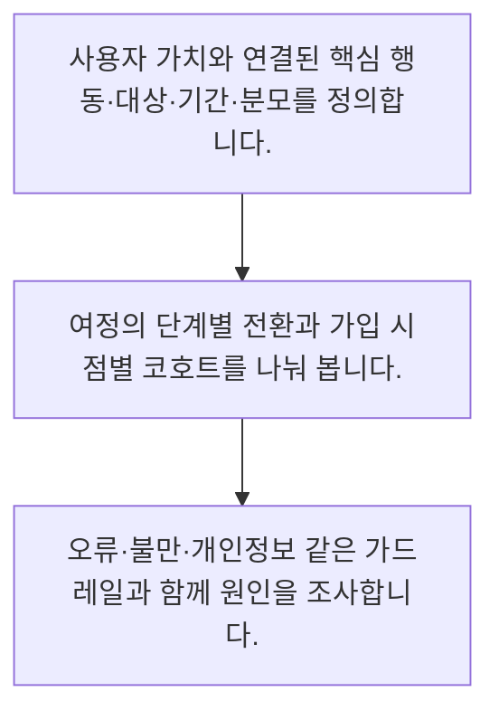

<!-- level:1 -->
# 제품 지표·퍼널·코호트·가드레일

> **한 문장으로:** 제품 지표는 사용자의 가치 달성과 위험을 함께 보여야 하며, 분모·기간·대상을 명확히 해야 해석할 수 있습니다.

## 왜 필요한가요?

방문이나 클릭이 늘었다고 사용자가 문제를 해결한 것은 아닙니다. 여정과 대상별 결과·오류를 함께 보면 어디에서 막히는지와 어떤 변화가 필요한지 찾을 수 있습니다.

## 일상에서 떠올려 보기

도서관의 방문자 수만 늘어도 책을 빌리거나 필요한 정보를 찾지 못하면 서비스가 좋아졌다고 할 수 없습니다. 입장·검색·자료 확인·문제 해결의 흐름을 살피고 불편과 실패도 같이 봐야 합니다.

## 순서대로 따라가기

1. 사용자 가치와 연결된 핵심 행동·대상·기간·분모를 정의합니다.
2. 여정의 단계별 전환과 가입 시점별 코호트를 나눠 봅니다.
3. 오류·불만·개인정보 같은 가드레일과 함께 원인을 조사합니다.



## 처음 만나는 용어

| 용어 | 쉬운 뜻 |
|---|---|
| 퍼널 | 여러 단계의 통과 비율로 이탈 지점을 보는 분석 |
| 코호트 | 같은 가입 시점이나 경험을 공유하는 사용자 집단 |
| 가드레일 | 목표 개선 중 악화되면 안 되는 품질·안전 지표 |

**비유의 한계:** 로그는 관측한 행동만 담습니다. 화면 체류 시간이 길어진 이유가 깊은 학습인지 혼란인지 지표 하나만으로 판단할 수 없고 수집 누락·중복·개인정보 조건도 확인해야 합니다.

## 스스로 확인

지표 해석 전에 확인할 정보는 무엇인가요?

**답과 이유:** 대상·기간·분모와 이벤트 정의 — 같은 숫자도 측정 대상과 분모가 다르면 의미가 달라지므로 정의가 필요합니다.
<!-- level:2 -->
# 제품 지표·퍼널·코호트·가드레일 — 실제 흐름 따라가기

## 읽기 전 길잡이

제품 지표는 사용자의 가치 달성과 위험을 함께 보여야 하며, 분모·기간·대상을 명확히 해야 해석할 수 있습니다. 아래 예제는 외부 시스템에 연결하지 않는 작은 학습용 사례입니다. 입력, 처리 조건, 결과를 순서대로 살펴보세요.

1. 사용자 가치와 연결된 핵심 행동·대상·기간·분모를 정의합니다.
2. 여정의 단계별 전환과 가입 시점별 코호트를 나눠 봅니다.
3. 오류·불만·개인정보 같은 가드레일과 함께 원인을 조사합니다.

## 예제로 확인하기

```python
counts = {"eligible": 100, "searched": 60, "checked_source": 30}
search_rate = counts["searched"] / counts["eligible"]
source_rate_of_search = counts["checked_source"] / counts["searched"]
source_rate_total = counts["checked_source"] / counts["eligible"]
assert search_rate == 0.6
assert source_rate_of_search == 0.5
assert source_rate_total == 0.3
print(search_rate, source_rate_of_search, source_rate_total)
```

## 결과를 해석하기

같은 근거 확인 30명도 분모가 검색자 60명이면 50%, 대상 100명이면 30%입니다. 퍼널은 같은 대상과 기간, 중복 제거 기준으로 집계해야 합니다. 단계별 수가 줄었다는 사실은 원인의 증거가 아니므로 사용자 조사와 계측 검증을 이어갑니다.

## 실무에 옮기기 전

로그는 관측한 행동만 담습니다. 화면 체류 시간이 길어진 이유가 깊은 학습인지 혼란인지 지표 하나만으로 판단할 수 없고 수집 누락·중복·개인정보 조건도 확인해야 합니다. 실제 업무에서는 지표를 늘리기보다 결정에 쓸 핵심 지표와 최소 가드레일을 고릅니다. AI 사용량이나 토큰 수를 업무 가치로 직접 해석하지 말고, 사람의 재작업·오류·비용을 포함한 결과를 평가합니다.

## 확인 질문

예제에서 전체 대상의 근거 확인율은 얼마인가요?

**답과 이유:** 근거 확인 30명을 전체 대상 100명으로 나누면 30%이며 검색자 기준 50%와 구분해야 합니다.
<!-- level:3 -->
# 제품 지표·퍼널·코호트·가드레일 — 가상 사례로 문제 해결하기

실제 고객의 장애 기록이 아닌 학습용 재현 시나리오입니다. 결과만 바꾸기 전에 관측한 증거와 원인 가설을 구분합니다.

## 1. 어떤 문제가 생겼나요?

AI 답변 사용률은 올랐지만 고객 불만도 늘어납니다.

## 2. 먼저 확인할 증거

사용률은 클릭 이벤트 기준이고 답변 오류와 취소·재문의는 지표에서 제외됐습니다.

## 3. 원인 가설

쉬운 중간 행동을 가치 달성으로 간주한 것이 원인 가설입니다.

## 4. 수정 방법

답변 해결·오류·재문의·순시간을 함께 정의하고 중복 이벤트와 대상 분모를 점검합니다.

## 5. 재검증

같은 코호트와 기간에서 핵심 지표와 가드레일을 재계산하고 실제 사례를 확인합니다.

## 놓치기 쉬운 조건

로그는 관측한 행동만 담습니다. 화면 체류 시간이 길어진 이유가 깊은 학습인지 혼란인지 지표 하나만으로 판단할 수 없고 수집 누락·중복·개인정보 조건도 확인해야 합니다.

## 확인 질문

클릭은 늘고 불만도 늘면 무엇을 해야 하나요?

**답과 이유:** 중간 행동이 최종 가치와 같지 않으므로 결과와 부작용을 함께 확인해야 합니다.
<!-- level:4 -->
# 제품 지표·퍼널·코호트·가드레일 — 업무와 아키텍처의 선택

## 읽기 전 길잡이

같은 개념도 업무의 규모, 오류 비용, 운영 역량에 따라 적용 방식이 달라집니다. 아래 비교는 특정 제품의 성능 순위가 아닌 선택 기준입니다.

| 선택 | 얻는 점 | 감수할 점 |
|---|---|---|
| 단일 대표 지표 | 방향을 단순하게 공유 | 왜곡과 부작용을 놓치기 쉬움 |
| 핵심 지표와 가드레일·세분화 | 가치와 위험·집단 차이를 함께 파악 | 정의와 계측 관리가 더 필요 |

## 선택 기준

지표를 늘리기보다 결정에 쓸 핵심 지표와 최소 가드레일을 고릅니다. AI 사용량이나 토큰 수를 업무 가치로 직접 해석하지 말고, 사람의 재작업·오류·비용을 포함한 결과를 평가합니다.

## 도입과 운영에서 확인할 것

답변 해결·오류·재문의·순시간을 함께 정의하고 중복 이벤트와 대상 분모를 점검합니다. 같은 코호트와 기간에서 핵심 지표와 가드레일을 재계산하고 실제 사례를 확인합니다.

## 판단 연습

AI 제품의 운영 지표 선택으로 적절한 것은 무엇인가요?

**판단의 근거:** AI 사용량 자체보다 사용자가 얻는 결과와 오류·비용의 균형이 중요합니다.

참고: [GOV.UK Service Manual](https://www.gov.uk/service-manual), [WCAG 2.2](https://www.w3.org/TR/WCAG22/).
<!-- quizzes -->
[{"level":1,"question":"지표 해석 전에 확인할 정보는 무엇인가요?","choices":["대상·기간·분모와 이벤트 정의","색상만","대시보드 크기만","모델 이름만"],"answer_index":0,"explanation":"같은 숫자도 측정 대상과 분모가 다르면 의미가 달라지므로 정의가 필요합니다."},{"level":2,"question":"예제에서 전체 대상의 근거 확인율은 얼마인가요?","choices":["100%","30%","50%","60%"],"answer_index":1,"explanation":"근거 확인 30명을 전체 대상 100명으로 나누면 30%이며 검색자 기준 50%와 구분해야 합니다."},{"level":3,"question":"클릭은 늘고 불만도 늘면 무엇을 해야 하나요?","choices":["불만을 삭제","분모를 숨긴다","가치 달성·오류·재문의와 계측 정의를 함께 본다","클릭만 성공으로 발표"],"answer_index":2,"explanation":"중간 행동이 최종 가치와 같지 않으므로 결과와 부작용을 함께 확인해야 합니다."},{"level":4,"question":"AI 제품의 운영 지표 선택으로 적절한 것은 무엇인가요?","choices":["토큰이 많으면 항상 성공","사용 시간을 무조건 늘린다","오류는 측정하지 않는다","업무 결과와 품질·비용 가드레일을 함께 둔다"],"answer_index":3,"explanation":"AI 사용량 자체보다 사용자가 얻는 결과와 오류·비용의 균형이 중요합니다."}]
