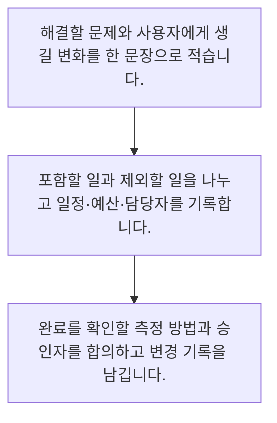

<!-- level:1 -->
# 프로젝트 목표·범위·성공 기준

> **한 문장으로:** 프로젝트는 정해진 기간에 변화를 만드는 일이며, 목표·범위·성공 기준을 먼저 합의해야 합니다.

## 왜 필요한가요?

목표가 다르면 같은 기능을 만들어도 성공을 다르게 판단합니다. 무엇을 왜 어디까지 할지 합의하면 요청이 바뀔 때 일정과 비용의 영향을 비교하며 결정할 수 있습니다.

## 일상에서 떠올려 보기

이사를 준비할 때 새집에서 살기라는 목적과 짐 포장, 운송이라는 할 일을 구분합니다. 모든 가구를 새로 사는 일까지 포함할지, 언제 입주할지, 누가 비용을 승인할지 정해야 일정과 돈을 함께 관리할 수 있습니다.

## 순서대로 따라가기

1. 해결할 문제와 사용자에게 생길 변화를 한 문장으로 적습니다.
2. 포함할 일과 제외할 일을 나누고 일정·예산·담당자를 기록합니다.
3. 완료를 확인할 측정 방법과 승인자를 합의하고 변경 기록을 남깁니다.



## 처음 만나는 용어

| 용어 | 쉬운 뜻 |
|---|---|
| 목표 | 사용자나 조직에 만들려는 변화 |
| 범위 | 이번 프로젝트에 포함하거나 제외한 일의 경계 |
| 성공 기준 | 변화가 일어났는지 확인하는 측정 가능한 조건 |

**비유의 한계:** 프로젝트는 이사보다 이해관계와 불확실성이 큽니다. 처음 작성한 범위는 영구 고정된 약속이 아니라 변경의 영향을 비교하는 기준선입니다.

## 스스로 확인

프로젝트 목표로 더 적절한 표현은 무엇인가요?

**답과 이유:** 문의 담당자 탐색 시간을 줄인다 — 목표는 사용자에게 생기는 변화이고 화면과 회의는 그 변화를 위한 수단입니다.
<!-- level:2 -->
# 프로젝트 목표·범위·성공 기준 — 실제 흐름 따라가기

## 읽기 전 길잡이

프로젝트는 정해진 기간에 변화를 만드는 일이며, 목표·범위·성공 기준을 먼저 합의해야 합니다. 아래 예제는 외부 시스템에 연결하지 않는 작은 학습용 사례입니다. 입력, 처리 조건, 결과를 순서대로 살펴보세요.

1. 해결할 문제와 사용자에게 생길 변화를 한 문장으로 적습니다.
2. 포함할 일과 제외할 일을 나누고 일정·예산·담당자를 기록합니다.
3. 완료를 확인할 측정 방법과 승인자를 합의하고 변경 기록을 남깁니다.

## 예제로 확인하기

```markdown
# 프로젝트 시작 합의서
- 문제: 문의 담당자를 찾는 데 시간이 오래 걸린다.
- 목표: 담당자 탐색 시간을 줄인다.
- 포함: FAQ 검색, 상담원 연결
- 제외: 자동 환불, 계약 변경
- 성공 판단: 시범 사용자 탐색 시간과 오연결률을 함께 측정
- 제약: 4주 시범 운영, 상담원 2명 검토 가능
- 승인자: 고객지원 책임자
- 변경 기록: 요청 / 영향 / 결정 / 날짜
```

## 결과를 해석하기

목표와 산출물은 다릅니다. FAQ 검색 화면을 만들었다는 사실만으로 탐색 시간이 줄었다고 결론 낼 수 없습니다. 시작 합의서는 기능 목록과 함께 측정 방법, 제외 범위, 의사결정 권한을 보이게 합니다.

## 실무에 옮기기 전

프로젝트는 이사보다 이해관계와 불확실성이 큽니다. 처음 작성한 범위는 영구 고정된 약속이 아니라 변경의 영향을 비교하는 기준선입니다. 실제 업무에서는 불확실성이 큰 AI 프로젝트는 학습 목표와 제한된 시범 범위를 먼저 정합니다. 계약이나 안전 요구가 크면 승인 근거를 더 상세히 남기되, 문서 분량보다 실제 결정에 쓰이는지를 확인합니다.

## 확인 질문

시작 합의서에 제외 범위도 적는 이유는 무엇인가요?

**답과 이유:** 제외 범위는 현재 합의의 경계이며 변경 요청을 비교하고 결정하는 기준이 됩니다.
<!-- level:3 -->
# 프로젝트 목표·범위·성공 기준 — 가상 사례로 문제 해결하기

실제 고객의 장애 기록이 아닌 학습용 재현 시나리오입니다. 결과만 바꾸기 전에 관측한 증거와 원인 가설을 구분합니다.

## 1. 어떤 문제가 생겼나요?

시범 FAQ 프로젝트에 자동 환불 기능이 추가되면서 출시가 지연됩니다.

## 2. 먼저 확인할 증거

최초 합의서에는 검색만 포함돼 있고 새 요청의 일정·보안 영향 분석이 없습니다.

## 3. 원인 가설

문서가 없어서가 아니라 변경 결정과 책임자의 승인 절차가 없었던 것이 원인 가설입니다.

## 4. 수정 방법

환불 요청을 별도 변경 항목으로 기록하고 기존 범위 유지·일정 연장·기능 교체의 영향을 승인자와 비교합니다.

## 5. 재검증

다음 요청이 들어왔을 때 영향과 결정 이력이 남는지 확인하고 성공 지표도 기존 목적과 맞는지 재검증합니다.

## 놓치기 쉬운 조건

프로젝트는 이사보다 이해관계와 불확실성이 큽니다. 처음 작성한 범위는 영구 고정된 약속이 아니라 변경의 영향을 비교하는 기준선입니다.

## 확인 질문

범위 밖 요청으로 일정이 밀릴 때 먼저 할 일은 무엇인가요?

**답과 이유:** 범위 변경은 일정·비용·품질에 영향을 주므로 권한 있는 사람이 선택할 근거가 필요합니다.
<!-- level:4 -->
# 프로젝트 목표·범위·성공 기준 — 업무와 아키텍처의 선택

## 읽기 전 길잡이

같은 개념도 업무의 규모, 오류 비용, 운영 역량에 따라 적용 방식이 달라집니다. 아래 비교는 특정 제품의 성능 순위가 아닌 선택 기준입니다.

| 선택 | 얻는 점 | 감수할 점 |
|---|---|---|
| 짧은 시작 합의서 | 작은 팀도 빠르게 목적과 책임을 맞춤 | 큰 계약의 상세 통제에는 부족함 |
| 상세 범위 기준선 | 의존성과 승인 조건을 명확히 관리 | 변화가 잦으면 유지 비용이 큼 |

## 선택 기준

불확실성이 큰 AI 프로젝트는 학습 목표와 제한된 시범 범위를 먼저 정합니다. 계약이나 안전 요구가 크면 승인 근거를 더 상세히 남기되, 문서 분량보다 실제 결정에 쓰이는지를 확인합니다.

## 도입과 운영에서 확인할 것

환불 요청을 별도 변경 항목으로 기록하고 기존 범위 유지·일정 연장·기능 교체의 영향을 승인자와 비교합니다. 다음 요청이 들어왔을 때 영향과 결정 이력이 남는지 확인하고 성공 지표도 기존 목적과 맞는지 재검증합니다.

## 판단 연습

불확실한 AI 프로젝트의 초기 범위는 어떻게 잡나요?

**판단의 근거:** 작은 시범은 실패 비용을 제한하며 다음 투자나 범위 결정을 위한 증거를 만듭니다.

참고: [Scrum Guide](https://scrumguides.org/scrum-guide.html), [The Kanban Guide 2025](https://kanbanguides.org/the-kanban-guide/2025.5/), [GOV.UK Agile delivery](https://www.gov.uk/service-manual/agile-delivery).
<!-- quizzes -->
[{"level":1,"question":"프로젝트 목표로 더 적절한 표현은 무엇인가요?","choices":["문의 담당자 탐색 시간을 줄인다","검색 화면 세 개를 만든다","회의를 매일 연다","모든 요청을 넣는다"],"answer_index":0,"explanation":"목표는 사용자에게 생기는 변화이고 화면과 회의는 그 변화를 위한 수단입니다."},{"level":2,"question":"시작 합의서에 제외 범위도 적는 이유는 무엇인가요?","choices":["담당자를 없애려고","요청의 경계와 변경 영향을 판단하려고","새 요청을 영구 금지하려고","일정을 숨기려고"],"answer_index":1,"explanation":"제외 범위는 현재 합의의 경계이며 변경 요청을 비교하고 결정하는 기준이 됩니다."},{"level":3,"question":"범위 밖 요청으로 일정이 밀릴 때 먼저 할 일은 무엇인가요?","choices":["성공 지표를 삭제한다","모든 요청을 즉시 거절한다","영향과 선택지를 기록해 승인자와 결정한다","담당자가 조용히 야근한다"],"answer_index":2,"explanation":"범위 변경은 일정·비용·품질에 영향을 주므로 권한 있는 사람이 선택할 근거가 필요합니다."},{"level":4,"question":"불확실한 AI 프로젝트의 초기 범위는 어떻게 잡나요?","choices":["모든 업무를 자동화한다","성공 기준 없이 모델부터 산다","일정만 고정하고 오류를 무시한다","검증할 가설과 제한된 시범 범위를 정한다"],"answer_index":3,"explanation":"작은 시범은 실패 비용을 제한하며 다음 투자나 범위 결정을 위한 증거를 만듭니다."}]
