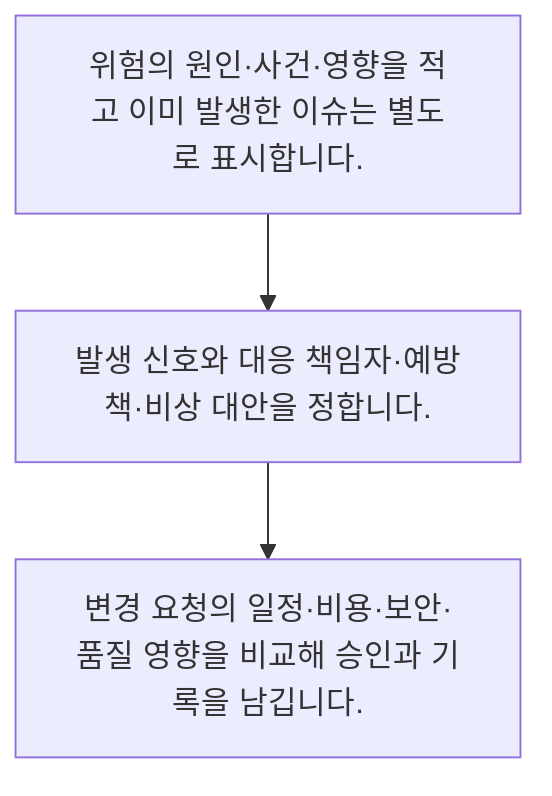

<!-- level:1 -->
# 프로젝트 위험·이슈·변경 관리

> **한 문장으로:** 아직 일어나지 않은 위험과 이미 발생한 이슈를 구분하고, 변경의 영향과 대응 책임을 관리합니다.

## 왜 필요한가요?

문제가 생긴 뒤에만 대응하면 선택할 시간이 부족합니다. 발생 전의 위험과 이미 생긴 문제를 구분하고 대응 신호·담당자·대안을 정하면 변화를 더 차분히 관리할 수 있습니다.

## 일상에서 떠올려 보기

야외 행사에서 비가 올 가능성은 위험이고 행사 당일 비가 내리는 것은 이슈입니다. 천막을 미리 준비할지, 예보가 어느 정도면 실내로 옮길지 정해 두면 상황이 바뀌어도 우왕좌왕하지 않습니다.

## 순서대로 따라가기

1. 위험의 원인·사건·영향을 적고 이미 발생한 이슈는 별도로 표시합니다.
2. 발생 신호와 대응 책임자·예방책·비상 대안을 정합니다.
3. 변경 요청의 일정·비용·보안·품질 영향을 비교해 승인과 기록을 남깁니다.



## 처음 만나는 용어

| 용어 | 쉬운 뜻 |
|---|---|
| 위험 | 앞으로 발생해 목표에 영향을 줄 수 있는 불확실한 사건 |
| 이슈 | 이미 발생해 해결이나 결정이 필요한 문제 |
| 변경 통제 | 현재 합의에서 바뀌는 내용과 영향을 검토하는 절차 |

**비유의 한계:** 소프트웨어와 AI 위험은 날씨처럼 독립적이지 않을 수 있습니다. 숫자로 적은 가능성 점수는 객관적 확률이 아닐 수 있으며 낮은 빈도의 큰 피해도 별도 검토해야 합니다.

## 스스로 확인

위험과 이슈의 차이는 무엇인가요?

**답과 이유:** 위험은 가능성이고 이슈는 이미 발생한 문제다 — 발생 전에는 예방과 대비를, 발생 후에는 해결과 의사결정을 중심으로 관리합니다.
<!-- level:2 -->
# 프로젝트 위험·이슈·변경 관리 — 실제 흐름 따라가기

## 읽기 전 길잡이

아직 일어나지 않은 위험과 이미 발생한 이슈를 구분하고, 변경의 영향과 대응 책임을 관리합니다. 아래 예제는 외부 시스템에 연결하지 않는 작은 학습용 사례입니다. 입력, 처리 조건, 결과를 순서대로 살펴보세요.

1. 위험의 원인·사건·영향을 적고 이미 발생한 이슈는 별도로 표시합니다.
2. 발생 신호와 대응 책임자·예방책·비상 대안을 정합니다.
3. 변경 요청의 일정·비용·보안·품질 영향을 비교해 승인과 기록을 남깁니다.

## 예제로 확인하기

```markdown
# 위험 등록부 예시
- 원인: 외부 데이터 제공 일정이 확정되지 않음
- 사건: 시범 학습 데이터가 검증일보다 늦게 도착
- 영향: 모델 평가와 출시 판단 지연
- 신호: 예정일 5일 전에도 샘플 전달 없음
- 담당: 데이터 협력 담당자
- 예방: 샘플과 계약 조건 조기 확인
- 대안: 비식별 합성 샘플로 파이프라인만 검증, 모델 성능 판단은 보류
- 변경 요청: 평가일 조정 또는 시범 범위 축소, 승인 근거 기록
```

## 결과를 해석하기

위험 등록부는 예언 목록이 아니라 관측과 행동을 연결하는 도구입니다. 이미 데이터가 늦었다면 이슈 대응으로 전환합니다. 대체 샘플은 시스템 연결을 확인하는 데 쓸 수 있어도 실제 사용자 데이터의 성능을 대신 입증하지 못합니다.

## 실무에 옮기기 전

소프트웨어와 AI 위험은 날씨처럼 독립적이지 않을 수 있습니다. 숫자로 적은 가능성 점수는 객관적 확률이 아닐 수 있으며 낮은 빈도의 큰 피해도 별도 검토해야 합니다. 실제 업무에서는 변경의 영향에 비례해 승인 강도를 정하고 작은 가역적 변경은 빠르게 처리합니다. 권한·개인정보·큰 비용처럼 되돌리기 어려운 변경은 근거와 결정권자를 명확히 하며 임시 조치를 성공 증거로 과장하지 않습니다.

## 확인 질문

위험 등록부에 필요한 행동 정보는 무엇인가요?

**답과 이유:** 신호와 책임이 있어야 위험을 관측하고 실제 대응으로 이어갈 수 있습니다.
<!-- level:3 -->
# 프로젝트 위험·이슈·변경 관리 — 가상 사례로 문제 해결하기

실제 고객의 장애 기록이 아닌 학습용 재현 시나리오입니다. 결과만 바꾸기 전에 관측한 증거와 원인 가설을 구분합니다.

## 1. 어떤 문제가 생겼나요?

데이터가 늦어졌는데도 합성 샘플의 높은 정확도로 출시가 승인됩니다.

## 2. 먼저 확인할 증거

평가 표에는 데이터 출처와 대표성 제약이 빠져 있습니다.

## 3. 원인 가설

위험 대응의 임시 수단을 최종 성능 증거로 바꿔 해석한 것이 원인 가설입니다.

## 4. 수정 방법

연결 검증과 실제 성능 검증을 분리하고 제한 사항·미해결 이슈·출시 대안을 결정권자에게 제시합니다.

## 5. 재검증

실제 대표 데이터의 별도 평가와 승인 기록을 확인하고 새로운 일정 위험을 다시 점검합니다.

## 놓치기 쉬운 조건

소프트웨어와 AI 위험은 날씨처럼 독립적이지 않을 수 있습니다. 숫자로 적은 가능성 점수는 객관적 확률이 아닐 수 있으며 낮은 빈도의 큰 피해도 별도 검토해야 합니다.

## 확인 질문

합성 샘플로 연결만 확인했을 때 어떤 판단이 맞나요?

**답과 이유:** 파이프라인 동작과 대표 데이터에서의 성능은 별도의 검증 대상입니다.
<!-- level:4 -->
# 프로젝트 위험·이슈·변경 관리 — 업무와 아키텍처의 선택

## 읽기 전 길잡이

같은 개념도 업무의 규모, 오류 비용, 운영 역량에 따라 적용 방식이 달라집니다. 아래 비교는 특정 제품의 성능 순위가 아닌 선택 기준입니다.

| 선택 | 얻는 점 | 감수할 점 |
|---|---|---|
| 가벼운 위험·변경 로그 | 작은 팀이 빠르게 신호와 책임을 공유 | 복잡한 승인 통제에는 세부 추적 필요 |
| 정식 변경 심의 | 큰 영향과 계약 의존성을 통합 검토 | 작은 변경까지 적용하면 병목이 됨 |

## 선택 기준

변경의 영향에 비례해 승인 강도를 정하고 작은 가역적 변경은 빠르게 처리합니다. 권한·개인정보·큰 비용처럼 되돌리기 어려운 변경은 근거와 결정권자를 명확히 하며 임시 조치를 성공 증거로 과장하지 않습니다.

## 도입과 운영에서 확인할 것

연결 검증과 실제 성능 검증을 분리하고 제한 사항·미해결 이슈·출시 대안을 결정권자에게 제시합니다. 실제 대표 데이터의 별도 평가와 승인 기록을 확인하고 새로운 일정 위험을 다시 점검합니다.

## 판단 연습

변경 승인 절차의 강도는 무엇에 맞추나요?

**판단의 근거:** 큰 영향의 변경은 충분한 검토가 필요하지만 작은 가역적 변경까지 막으면 전달 속도를 해칠 수 있습니다.

참고: [Scrum Guide](https://scrumguides.org/scrum-guide.html), [The Kanban Guide 2025](https://kanbanguides.org/the-kanban-guide/2025.5/), [GOV.UK Agile delivery](https://www.gov.uk/service-manual/agile-delivery).
<!-- quizzes -->
[{"level":1,"question":"위험과 이슈의 차이는 무엇인가요?","choices":["둘 다 완료 작업이다","위험은 항상 장애다","이슈는 문서 이름이다","위험은 가능성이고 이슈는 이미 발생한 문제다"],"answer_index":3,"explanation":"발생 전에는 예방과 대비를, 발생 후에는 해결과 의사결정을 중심으로 관리합니다."},{"level":2,"question":"위험 등록부에 필요한 행동 정보는 무엇인가요?","choices":["발생 신호·대응 담당·대안","위험 제목만","추측 점수만","담당자 없는 마감일"],"answer_index":0,"explanation":"신호와 책임이 있어야 위험을 관측하고 실제 대응으로 이어갈 수 있습니다."},{"level":3,"question":"합성 샘플로 연결만 확인했을 때 어떤 판단이 맞나요?","choices":["위험이 전부 사라졌다","실제 사용자 성능은 아직 검증하지 못했다","모든 사용자 정확도가 입증됐다","보안 검토가 필요 없다"],"answer_index":1,"explanation":"파이프라인 동작과 대표 데이터에서의 성능은 별도의 검증 대상입니다."},{"level":4,"question":"변경 승인 절차의 강도는 무엇에 맞추나요?","choices":["개발자의 취향만","모든 변경에 동일한 긴 회의","영향·가역성·의존성","요청 제목 길이"],"answer_index":2,"explanation":"큰 영향의 변경은 충분한 검토가 필요하지만 작은 가역적 변경까지 막으면 전달 속도를 해칠 수 있습니다."}]
