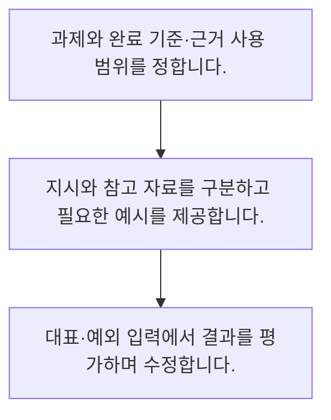

<!-- level:1 -->
# 프롬프트·지시·예시와 검증

> **한 문장으로:** 좋은 프롬프트는 과제·입력·출력 기준과 예시를 명확히 하고 실제 결과로 개선합니다.

## 왜 필요한가요?

같은 AI에도 무엇을 하라고 말하는 방식에 따라 결과가 달라집니다. 과제와 입력·출력 기준을 분명히 쓰고 확인하는 방법을 익히면 업무에 맞는 결과를 얻기 쉬워집니다.

## 일상에서 떠올려 보기

동료에게 일을 맡길 때 목적과 참고 자료, 원하는 결과 형식, 하지 말아야 할 일을 구체적으로 설명하는 과정과 비슷합니다.

## 순서대로 따라가기

1. 과제와 완료 기준·근거 사용 범위를 정합니다.
2. 지시와 참고 자료를 구분하고 필요한 예시를 제공합니다.
3. 대표·예외 입력에서 결과를 평가하며 수정합니다.



## 처음 만나는 용어

| 용어 | 쉬운 뜻 |
|---|---|
| 프롬프트 | 모델에 전달하는 지시와 문맥의 구성 |
| 예시 학습 | 입력·출력 사례를 문맥에 넣어 원하는 패턴을 보여 주는 방식 |
| 평가 기준 | 출력이 과제를 충족했는지 판단하는 규칙 |

**비유의 한계:** 지시문을 자세히 써도 정확성이나 보안이 보장되지 않습니다. 자료 안의 악성 지시를 구분하는 문제는 프롬프트만으로 완전히 해결할 수 없습니다.

## 스스로 확인

프롬프트에서 먼저 명확히 할 것은?

**답과 이유:** 과제와 완료 기준 — 무엇을 어떤 기준으로 해야 하는지가 있어야 결과를 검증할 수 있습니다.
<!-- level:2 -->
# 프롬프트·지시·예시와 검증 — 실제 흐름 따라가기

## 읽기 전 길잡이

좋은 프롬프트는 과제·입력·출력 기준과 예시를 명확히 하고 실제 결과로 개선합니다. 아래 예제는 외부 시스템에 연결하지 않는 작은 학습용 사례입니다. 입력, 처리 조건, 결과를 순서대로 살펴보세요.

1. 과제와 완료 기준·근거 사용 범위를 정합니다.
2. 지시와 참고 자료를 구분하고 필요한 예시를 제공합니다.
3. 대표·예외 입력에서 결과를 평가하며 수정합니다.

## 예제로 확인하기

```python
prompt={"task":"문의 분류","labels":["배송","환불","기타"],"rule":"모르면 기타","input":"배송이 늦어요"}
assert prompt["rule"] and len(prompt["labels"])==3
print(prompt)
```

## 결과를 해석하기

모델 호출 없이 지시 구성 요소를 확인하는 예제입니다. 레이블 범위와 불확실할 때의 처리 기준을 명시합니다. 실제 분류 성능은 다양한 문의와 경계 사례에서 측정해야 합니다.

## 실무에 옮기기 전

지시문을 자세히 써도 정확성이나 보안이 보장되지 않습니다. 자료 안의 악성 지시를 구분하는 문제는 프롬프트만으로 완전히 해결할 수 없습니다. 실제 업무에서는 프롬프트 길이를 품질로 간주하지 않습니다. 대표 실패를 기준으로 한 번에 바꾼 요소를 기록하고 평가 세트와 실제 운영 결과로 효과를 확인합니다.

## 확인 질문

예제에서 기타 규칙의 역할은?

**답과 이유:** 지원 범위를 벗어난 경우를 명시적으로 처리하는 기준입니다.
<!-- level:3 -->
# 프롬프트·지시·예시와 검증 — 가상 사례로 문제 해결하기

실제 고객의 장애 기록이 아닌 학습용 재현 시나리오입니다. 결과만 바꾸기 전에 관측한 증거와 원인 가설을 구분합니다.

## 1. 어떤 문제가 생겼나요?

가상 분류 프롬프트가 비슷한 문의를 일관되지 않게 분류합니다.

## 2. 먼저 확인할 증거

레이블 정의와 경계 사례·출력 예시를 대조합니다.

## 3. 원인 가설

배송 지연과 환불 요구의 우선순위가 불명확했습니다.

## 4. 수정 방법

중복 상황의 기준과 모를 때의 처리를 정하고 예시를 추가합니다.

## 5. 재검증

보류한 평가 문의에서 일관성·미분류·잘못된 확신을 측정합니다.

## 놓치기 쉬운 조건

지시문을 자세히 써도 정확성이나 보안이 보장되지 않습니다. 자료 안의 악성 지시를 구분하는 문제는 프롬프트만으로 완전히 해결할 수 없습니다.

## 확인 질문

분류 경계가 일관되지 않으면?

**답과 이유:** 업무 정의가 모호하면 생성 설정만으로 해결되지 않습니다.
<!-- level:4 -->
# 프롬프트·지시·예시와 검증 — 업무와 아키텍처의 선택

## 읽기 전 길잡이

같은 개념도 업무의 규모, 오류 비용, 운영 역량에 따라 적용 방식이 달라집니다. 아래 비교는 특정 제품의 성능 순위가 아닌 선택 기준입니다.

| 선택 | 얻는 점 | 감수할 점 |
|---|---|---|
| 간단한 지시 | 읽기·변경·비용 부담 작음 | 경계 상황 설명 부족 |
| 예시와 세부 기준 | 원하는 패턴 명확화 | 길이·유지·예시 편향 |

## 선택 기준

프롬프트 길이를 품질로 간주하지 않습니다. 대표 실패를 기준으로 한 번에 바꾼 요소를 기록하고 평가 세트와 실제 운영 결과로 효과를 확인합니다.

## 도입과 운영에서 확인할 것

중복 상황의 기준과 모를 때의 처리를 정하고 예시를 추가합니다. 보류한 평가 문의에서 일관성·미분류·잘못된 확신을 측정합니다.

## 판단 연습

프롬프트 변경의 효과는 어떻게 판단하나요?

**판단의 근거:** 동일 조건의 평가 결과와 운영 영향을 비교해야 합니다.

참고: [Hugging Face LLM 과정](https://huggingface.co/learn/llm-course/chapter1/1), [RAG 원논문](https://arxiv.org/abs/2005.11401), [LoRA 원논문](https://arxiv.org/abs/2106.09685), [JSON Schema 학습](https://json-schema.org/learn/getting-started-step-by-step).
<!-- quizzes -->
[{"level":1,"question":"프롬프트에서 먼저 명확히 할 것은?","choices":["최대한 긴 글","모델 칭찬","과제와 완료 기준","격려 문장만"],"answer_index":2,"explanation":"무엇을 어떤 기준으로 해야 하는지가 있어야 결과를 검증할 수 있습니다."},{"level":2,"question":"예제에서 기타 규칙의 역할은?","choices":["정답 자동 보장","외부 권한 부여","토큰 제거","불확실한 입력 처리 기준"],"answer_index":3,"explanation":"지원 범위를 벗어난 경우를 명시적으로 처리하는 기준입니다."},{"level":3,"question":"분류 경계가 일관되지 않으면?","choices":["레이블·경계 예시 정리","온도만 0","응답 길이만 늘림","실패 사례 삭제"],"answer_index":0,"explanation":"업무 정의가 모호하면 생성 설정만으로 해결되지 않습니다."},{"level":4,"question":"프롬프트 변경의 효과는 어떻게 판단하나요?","choices":["작성자 자신감","보류 평가와 실패 유형 비교","문장 길이","새로운 표현 사용"],"answer_index":1,"explanation":"동일 조건의 평가 결과와 운영 영향을 비교해야 합니다."}]
