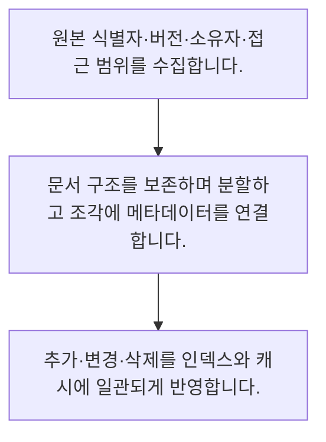

<!-- level:1 -->
# RAG 문서 수집·청킹·권한·삭제

> **한 문장으로:** RAG 품질은 검색 전의 문서 추출·분할·버전·권한·삭제 처리부터 시작됩니다.

## 왜 필요한가요?

정적인 목록에서 버전과 테넌트를 필터하는 예제입니다. 실제 권한 검사는 인증된 사용자와 문서 ACL을 서버에서 연결하고 검색·캐시·재랭킹 경계에도 유지해야 합니다.

## 일상에서 떠올려 보기

도서관 책을 조각으로 복사할 때 제목·판본·열람 권한을 잃으면 어느 책인지, 읽어도 되는지 알 수 없습니다.

## 순서대로 따라가기

1. 원본 식별자·버전·소유자·접근 범위를 수집합니다.
2. 문서 구조를 보존하며 분할하고 조각에 메타데이터를 연결합니다.
3. 추가·변경·삭제를 인덱스와 캐시에 일관되게 반영합니다.



## 처음 만나는 용어

| 용어 | 쉬운 뜻 |
|---|---|
| 수집 파이프라인 | 원본을 추출·정제·인덱싱하는 흐름 |
| 청크 메타데이터 | 출처·버전·권한 등 조각의 부가 정보 |
| 삭제 전파 | 원본 삭제를 파생 저장소에도 반영하는 과정 |

**비유의 한계:** 청크를 작게 나누는 것이 항상 좋지는 않습니다. 표·절·예외가 분리되면 의미가 손상되고 원본 삭제가 복사본 삭제로 자동 이어지지도 않습니다.

## 스스로 확인

청크에 함께 유지할 정보는?

**답과 이유:** 출처·버전·권한 — 조각이 원본과 접근 경계를 잃지 않도록 메타데이터가 필요합니다.
<!-- level:2 -->
# RAG 문서 수집·청킹·권한·삭제 — 실제 흐름 따라가기

## 읽기 전 길잡이

RAG 품질은 검색 전의 문서 추출·분할·버전·권한·삭제 처리부터 시작됩니다. 아래 예제는 외부 시스템에 연결하지 않는 작은 학습용 사례입니다. 입력, 처리 조건, 결과를 순서대로 살펴보세요.

1. 원본 식별자·버전·소유자·접근 범위를 수집합니다.
2. 문서 구조를 보존하며 분할하고 조각에 메타데이터를 연결합니다.
3. 추가·변경·삭제를 인덱스와 캐시에 일관되게 반영합니다.

## 예제로 확인하기

```python
chunks=[{"doc":"D","version":2,"tenant":"A","text":"규정 본문"}]
visible=[c for c in chunks if c["tenant"]=="A" and c["version"]==2]
assert len(visible)==1
print(visible)
```

## 결과를 해석하기

정적인 목록에서 버전과 테넌트를 필터하는 예제입니다. 실제 권한 검사는 인증된 사용자와 문서 ACL을 서버에서 연결하고 검색·캐시·재랭킹 경계에도 유지해야 합니다.

## 실무에 옮기기 전

청크를 작게 나누는 것이 항상 좋지는 않습니다. 표·절·예외가 분리되면 의미가 손상되고 원본 삭제가 복사본 삭제로 자동 이어지지도 않습니다. 실제 업무에서는 실제 질문의 근거 검색률과 인용 품질로 청크 전략을 비교합니다. 인덱스 신선도·권한 변경·삭제 완료를 운영 지표와 책임자로 연결합니다.

## 확인 질문

예제 필터의 기준은?

**답과 이유:** 정해진 범위와 버전의 자료만 남깁니다.
<!-- level:3 -->
# RAG 문서 수집·청킹·권한·삭제 — 가상 사례로 문제 해결하기

실제 고객의 장애 기록이 아닌 학습용 재현 시나리오입니다. 결과만 바꾸기 전에 관측한 증거와 원인 가설을 구분합니다.

## 1. 어떤 문제가 생겼나요?

가상 RAG가 삭제된 내부 문서를 계속 답에 사용합니다.

## 2. 먼저 확인할 증거

원본·청크·벡터·캐시의 문서 ID와 삭제 이벤트를 추적합니다.

## 3. 원인 가설

원본만 지우고 파생 인덱스와 캐시를 남겼습니다.

## 4. 수정 방법

문서 ID 기반 삭제 전파와 재시도·완료 확인을 구성합니다.

## 5. 재검증

삭제·권한 변경 후 검색과 응답 캐시에서 다시 노출되지 않는지 검사합니다.

## 놓치기 쉬운 조건

청크를 작게 나누는 것이 항상 좋지는 않습니다. 표·절·예외가 분리되면 의미가 손상되고 원본 삭제가 복사본 삭제로 자동 이어지지도 않습니다.

## 확인 질문

삭제 문서가 계속 보이면?

**답과 이유:** 자료의 복사본과 캐시에 삭제가 전파됐는지 확인해야 합니다.
<!-- level:4 -->
# RAG 문서 수집·청킹·권한·삭제 — 업무와 아키텍처의 선택

## 읽기 전 길잡이

같은 개념도 업무의 규모, 오류 비용, 운영 역량에 따라 적용 방식이 달라집니다. 아래 비교는 특정 제품의 성능 순위가 아닌 선택 기준입니다.

| 선택 | 얻는 점 | 감수할 점 |
|---|---|---|
| 고정 길이 청크 | 구현·대량 처리 간단 | 문맥 경계 손상 |
| 구조 기반 청크 | 절·표의 의미 보존 | 문서 형식별 처리 비용 |

## 선택 기준

실제 질문의 근거 검색률과 인용 품질로 청크 전략을 비교합니다. 인덱스 신선도·권한 변경·삭제 완료를 운영 지표와 책임자로 연결합니다.

## 도입과 운영에서 확인할 것

문서 ID 기반 삭제 전파와 재시도·완료 확인을 구성합니다. 삭제·권한 변경 후 검색과 응답 캐시에서 다시 노출되지 않는지 검사합니다.

## 판단 연습

청킹 방식 선택의 근거는?

**판단의 근거:** 청크 경계가 필요한 문맥과 예외를 보존하는지 평가해야 합니다.

참고: [Anthropic 에이전트 설계](https://www.anthropic.com/engineering/building-effective-agents), [MCP 소개](https://modelcontextprotocol.io/docs/getting-started/intro), [OWASP 생성형 AI 보안](https://genai.owasp.org/llm-top-10/).
<!-- quizzes -->
[{"level":1,"question":"청크에 함께 유지할 정보는?","choices":["모델 이름만","출처·버전·권한","텍스트 길이만","파일 색상"],"answer_index":1,"explanation":"조각이 원본과 접근 경계를 잃지 않도록 메타데이터가 필요합니다."},{"level":2,"question":"예제 필터의 기준은?","choices":["모든 조직","무작위 순서","테넌트 A와 버전 2","가장 긴 텍스트"],"answer_index":2,"explanation":"정해진 범위와 버전의 자료만 남깁니다."},{"level":3,"question":"삭제 문서가 계속 보이면?","choices":["프롬프트만 변경","원본 이름만 삭제","모델 점수만 확인","파생 인덱스·캐시 추적"],"answer_index":3,"explanation":"자료의 복사본과 캐시에 삭제가 전파됐는지 확인해야 합니다."},{"level":4,"question":"청킹 방식 선택의 근거는?","choices":["질문별 근거 품질","항상 가장 작은 크기","문자 수만","항상 전체 파일"],"answer_index":0,"explanation":"청크 경계가 필요한 문맥과 예외를 보존하는지 평가해야 합니다."}]
