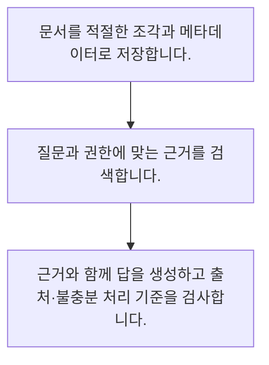

<!-- level:1 -->
# RAG·검색 증강 생성의 전체 흐름

> **한 문장으로:** RAG는 필요한 외부 자료를 검색해 모델의 문맥에 넣고 그 근거로 답하도록 구성하는 방식입니다.

## 왜 필요한가요?

질문에 맞는 정책 조각을 고르는 작은 검색 예제입니다. 실제 RAG는 추출·인덱스·권한·최신성·생성과 평가를 함께 운영합니다. 문서 전체를 모델에 넣는 것과 목적은 비슷해도 실패 경계가 여러 개입니다.

## 일상에서 떠올려 보기

시험 전에 모든 내용을 외우게 하기보다 질문에 맞는 참고서를 찾아 펼쳐 주는 모습과 비슷합니다. 잘못된 페이지를 펼치면 답도 틀릴 수 있습니다.

## 순서대로 따라가기

1. 문서를 적절한 조각과 메타데이터로 저장합니다.
2. 질문과 권한에 맞는 근거를 검색합니다.
3. 근거와 함께 답을 생성하고 출처·불충분 처리 기준을 검사합니다.



## 처음 만나는 용어

| 용어 | 쉬운 뜻 |
|---|---|
| RAG | 검색한 외부 근거를 생성 문맥에 제공하는 방식 |
| 청크 | 검색·문맥 구성을 위해 나눈 문서 조각 |
| 근거성 | 응답의 주장이 제공한 자료로 뒷받침되는 성질 |

**비유의 한계:** 검색 자료를 넣었다고 사실성이 보장되지는 않습니다. 검색 누락·오래된 근거·권한 위반·근거를 잘못 해석하는 생성 오류를 나누어 확인해야 합니다.

## 스스로 확인

RAG가 모델에 추가하는 것은?

**답과 이유:** 검색한 외부 근거 문맥 — 검색 근거를 문맥에 넣지만 최종 답의 정확성은 별도 검증해야 합니다.
<!-- level:2 -->
# RAG·검색 증강 생성의 전체 흐름 — 실제 흐름 따라가기

## 읽기 전 길잡이

RAG는 필요한 외부 자료를 검색해 모델의 문맥에 넣고 그 근거로 답하도록 구성하는 방식입니다. 아래 예제는 외부 시스템에 연결하지 않는 작은 학습용 사례입니다. 입력, 처리 조건, 결과를 순서대로 살펴보세요.

1. 문서를 적절한 조각과 메타데이터로 저장합니다.
2. 질문과 권한에 맞는 근거를 검색합니다.
3. 근거와 함께 답을 생성하고 출처·불충분 처리 기준을 검사합니다.

## 예제로 확인하기

```python
# 키워드 검색만 보여 주는 예제이며 생성 모델은 호출하지 않습니다.
docs=[{"id":"policy-v2","text":"환불 기간은 7일"},{"id":"delivery","text":"배송은 2일"}]
query="환불"
hits=[d for d in docs if query in d["text"]]
assert hits[0]["id"]=="policy-v2"
print(hits)
```

## 결과를 해석하기

질문에 맞는 정책 조각을 고르는 작은 검색 예제입니다. 실제 RAG는 추출·인덱스·권한·최신성·생성과 평가를 함께 운영합니다. 문서 전체를 모델에 넣는 것과 목적은 비슷해도 실패 경계가 여러 개입니다.

## 실무에 옮기기 전

검색 자료를 넣었다고 사실성이 보장되지는 않습니다. 검색 누락·오래된 근거·권한 위반·근거를 잘못 해석하는 생성 오류를 나누어 확인해야 합니다. 실제 업무에서는 최신 지식 공급과 행동 학습을 구분합니다. 검색에 정답이 없을 때의 답 유보와 사람 연결을 설계하고 검색·생성 품질을 각각 측정합니다.

## 확인 질문

예제에서 환불 질의가 고르는 문서는?

**답과 이유:** 환불이라는 단어가 포함된 문서를 고르는 단순 검색입니다.
<!-- level:3 -->
# RAG·검색 증강 생성의 전체 흐름 — 가상 사례로 문제 해결하기

실제 고객의 장애 기록이 아닌 학습용 재현 시나리오입니다. 결과만 바꾸기 전에 관측한 증거와 원인 가설을 구분합니다.

## 1. 어떤 문제가 생겼나요?

가상 RAG가 존재하는 환불 규정을 찾지 못합니다.

## 2. 먼저 확인할 증거

정답 문서의 인덱스 포함·분할 위치·검색 후보와 최종 문맥을 봅니다.

## 3. 원인 가설

업데이트 문서가 누락되거나 질문에 필요한 조각이 검색되지 않았습니다.

## 4. 수정 방법

수집·분할·검색 단계별 원인을 수정하고 문서 버전을 표시합니다.

## 5. 재검증

정답 근거의 검색률과 생성 답의 근거성을 나누어 재평가합니다.

## 놓치기 쉬운 조건

검색 자료를 넣었다고 사실성이 보장되지는 않습니다. 검색 누락·오래된 근거·권한 위반·근거를 잘못 해석하는 생성 오류를 나누어 확인해야 합니다.

## 확인 질문

정답 규정을 못 찾으면 먼저 볼 것은?

**답과 이유:** 근거가 어느 단계에서 사라졌는지 분리해야 합니다.
<!-- level:4 -->
# RAG·검색 증강 생성의 전체 흐름 — 업무와 아키텍처의 선택

## 읽기 전 길잡이

같은 개념도 업무의 규모, 오류 비용, 운영 역량에 따라 적용 방식이 달라집니다. 아래 비교는 특정 제품의 성능 순위가 아닌 선택 기준입니다.

| 선택 | 얻는 점 | 감수할 점 |
|---|---|---|
| RAG | 자주 변하는 자료를 외부에서 갱신 | 검색·권한·인덱스 운영 |
| 미세조정 | 행동·표현 패턴 적응 | 학습·배포 비용과 지식 갱신 한계 |

## 선택 기준

최신 지식 공급과 행동 학습을 구분합니다. 검색에 정답이 없을 때의 답 유보와 사람 연결을 설계하고 검색·생성 품질을 각각 측정합니다.

## 도입과 운영에서 확인할 것

수집·분할·검색 단계별 원인을 수정하고 문서 버전을 표시합니다. 정답 근거의 검색률과 생성 답의 근거성을 나누어 재평가합니다.

## 판단 연습

RAG와 미세조정 선택의 핵심 구분은?

**판단의 근거:** 문제 원인에 따라 검색과 학습의 역할을 다르게 평가합니다.

참고: [Hugging Face LLM 과정](https://huggingface.co/learn/llm-course/chapter1/1), [RAG 원논문](https://arxiv.org/abs/2005.11401), [LoRA 원논문](https://arxiv.org/abs/2106.09685), [JSON Schema 학습](https://json-schema.org/learn/getting-started-step-by-step).
<!-- quizzes -->
[{"level":1,"question":"RAG가 모델에 추가하는 것은?","choices":["학습 자료 전체 복제","검색한 외부 근거 문맥","자동 사실 보증","무제한 권한"],"answer_index":1,"explanation":"검색 근거를 문맥에 넣지만 최종 답의 정확성은 별도 검증해야 합니다."},{"level":2,"question":"예제에서 환불 질의가 고르는 문서는?","choices":["모든 문서 삭제","정답 없음","policy-v2","delivery"],"answer_index":2,"explanation":"환불이라는 단어가 포함된 문서를 고르는 단순 검색입니다."},{"level":3,"question":"정답 규정을 못 찾으면 먼저 볼 것은?","choices":["생성 문장 길이만","모델 온도만","출처 숨기기","수집·분할·후보·최종 문맥"],"answer_index":3,"explanation":"근거가 어느 단계에서 사라졌는지 분리해야 합니다."},{"level":4,"question":"RAG와 미세조정 선택의 핵심 구분은?","choices":["지식 공급과 행동 적응","항상 같은 기능","둘 다 검증 불필요","미세조정은 실시간 검색"],"answer_index":0,"explanation":"문제 원인에 따라 검색과 학습의 역할을 다르게 평가합니다."}]
