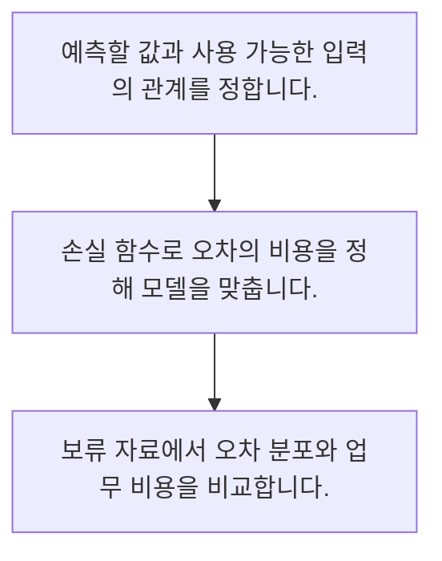

<!-- level:1 -->
# 회귀·손실 함수와 예측 오차

> **한 문장으로:** 연속적인 값을 예측하는 회귀에서는 오차를 어떻게 계산하느냐에 따라 학습 목표와 업무 해석이 달라집니다.

## 왜 필요한가요?

매출·시간·수요처럼 숫자를 예상해야 할 때가 있습니다. 회귀를 이해하면 어떤 입력으로 숫자를 예측하는지와 예측이 틀릴 수 있는 범위를 생각할 수 있습니다.

## 일상에서 떠올려 보기

배달 도착 시간을 예상하는 경우를 떠올려 보세요. 평균적으로 맞는 것과 아주 크게 늦는 예측을 줄이는 것은 다른 목표일 수 있습니다.

## 순서대로 따라가기

1. 예측할 값과 사용 가능한 입력의 관계를 정합니다.
2. 손실 함수로 오차의 비용을 정해 모델을 맞춥니다.
3. 보류 자료에서 오차 분포와 업무 비용을 비교합니다.



## 처음 만나는 용어

| 용어 | 쉬운 뜻 |
|---|---|
| 회귀 | 연속적인 목표 값을 예측하는 문제 |
| 손실 함수 | 예측과 정답의 차이를 수치화한 학습 목표 |
| MAE | 절대 오차의 평균 |

**비유의 한계:** 직선 예제는 복잡한 현실 관계를 모두 표현하지 않습니다. 상관관계가 원인을 뜻하지 않으며 학습 범위 밖의 외삽은 특히 조심해야 합니다.

## 스스로 확인

회귀가 주로 예측하는 대상은?

**답과 이유:** 연속적인 수치 — 수요·시간·가격 같은 수치가 회귀의 대표 대상입니다.
<!-- level:2 -->
# 회귀·손실 함수와 예측 오차 — 실제 흐름 따라가기

## 읽기 전 길잡이

연속적인 값을 예측하는 회귀에서는 오차를 어떻게 계산하느냐에 따라 학습 목표와 업무 해석이 달라집니다. 아래 예제는 외부 시스템에 연결하지 않는 작은 학습용 사례입니다. 입력, 처리 조건, 결과를 순서대로 살펴보세요.

1. 예측할 값과 사용 가능한 입력의 관계를 정합니다.
2. 손실 함수로 오차의 비용을 정해 모델을 맞춥니다.
3. 보류 자료에서 오차 분포와 업무 비용을 비교합니다.

## 예제로 확인하기

```python
actual=[10,20,30]; predicted=[12,18,35]
mae=sum(abs(a-p) for a,p in zip(actual,predicted))/len(actual)
mse=sum((a-p)**2 for a,p in zip(actual,predicted))/len(actual)
assert mae==3
print(mae,mse)
```

## 결과를 해석하기

절대 오차는 2·2·5이므로 MAE는 3입니다. 제곱 오차는 큰 오차를 상대적으로 더 강조합니다. 어느 지표가 맞는지는 과소·과대 예측의 업무 비용에 따라 결정합니다.

## 실무에 옮기기 전

직선 예제는 복잡한 현실 관계를 모두 표현하지 않습니다. 상관관계가 원인을 뜻하지 않으며 학습 범위 밖의 외삽은 특히 조심해야 합니다. 실제 업무에서는 전체 평균뿐 아니라 중요한 구간과 과소·과대 예측 비용을 따로 봅니다. 더 복잡한 모델은 독립 평가에서 얻는 이득이 운영 부담보다 클 때 선택합니다.

## 확인 질문

예제의 MAE는 얼마인가요?

**답과 이유:** 절대 오차 2·2·5의 평균은 3입니다. 제곱 오차와 구분합니다.
<!-- level:3 -->
# 회귀·손실 함수와 예측 오차 — 가상 사례로 문제 해결하기

실제 고객의 장애 기록이 아닌 학습용 재현 시나리오입니다. 결과만 바꾸기 전에 관측한 증거와 원인 가설을 구분합니다.

## 1. 어떤 문제가 생겼나요?

가상 수요 예측은 평균 오차가 작지만 품절이 반복됩니다.

## 2. 먼저 확인할 증거

수요가 높은 날짜와 과소 예측의 비용을 따로 봅니다.

## 3. 원인 가설

대칭적인 평균 오차만 최적화해 품절 비용을 놓쳤습니다.

## 4. 수정 방법

업무 비용과 예측 구간·비대칭 손실을 검토하고 기준선과 비교합니다.

## 5. 재검증

성수기·신상품·극단 수요에서 오차와 품절 영향을 다시 평가합니다.

## 놓치기 쉬운 조건

직선 예제는 복잡한 현실 관계를 모두 표현하지 않습니다. 상관관계가 원인을 뜻하지 않으며 학습 범위 밖의 외삽은 특히 조심해야 합니다.

## 확인 질문

평균 오차가 작아도 품절이 많다면?

**답과 이유:** 평균은 중요한 구간과 비대칭 비용을 숨길 수 있습니다.
<!-- level:4 -->
# 회귀·손실 함수와 예측 오차 — 업무와 아키텍처의 선택

## 읽기 전 길잡이

같은 개념도 업무의 규모, 오류 비용, 운영 역량에 따라 적용 방식이 달라집니다. 아래 비교는 특정 제품의 성능 순위가 아닌 선택 기준입니다.

| 선택 | 얻는 점 | 감수할 점 |
|---|---|---|
| 단순 회귀 | 설명과 기준선 구축이 쉬움 | 복잡한 관계 표현 한계 |
| 복잡한 비선형 모델 | 다양한 패턴 표현 | 자료·튜닝·운영 비용 |

## 선택 기준

전체 평균뿐 아니라 중요한 구간과 과소·과대 예측 비용을 따로 봅니다. 더 복잡한 모델은 독립 평가에서 얻는 이득이 운영 부담보다 클 때 선택합니다.

## 도입과 운영에서 확인할 것

업무 비용과 예측 구간·비대칭 손실을 검토하고 기준선과 비교합니다. 성수기·신상품·극단 수요에서 오차와 품절 영향을 다시 평가합니다.

## 판단 연습

모델 복잡도를 높일 근거는?

**판단의 근거:** 학습 자료에 잘 맞는 것보다 새 자료의 가치와 유지 비용이 중요합니다.

참고: [Google ML Crash Course](https://developers.google.com/machine-learning/crash-course), [scikit-learn 평가](https://scikit-learn.org/stable/model_selection.html), [scikit-learn 흔한 실수](https://scikit-learn.org/stable/common_pitfalls.html).
<!-- quizzes -->
[{"level":1,"question":"회귀가 주로 예측하는 대상은?","choices":["연속적인 수치","언제나 클래스 이름","파일 확장자만","모델 버전"],"answer_index":0,"explanation":"수요·시간·가격 같은 수치가 회귀의 대표 대상입니다."},{"level":2,"question":"예제의 MAE는 얼마인가요?","choices":["0","3","9","5"],"answer_index":1,"explanation":"절대 오차 2·2·5의 평균은 3입니다. 제곱 오차와 구분합니다."},{"level":3,"question":"평균 오차가 작아도 품절이 많다면?","choices":["성수기 제거","오차 로그 삭제","과소 예측 비용과 구간별 오차 확인","평균만 홍보"],"answer_index":2,"explanation":"평균은 중요한 구간과 비대칭 비용을 숨길 수 있습니다."},{"level":4,"question":"모델 복잡도를 높일 근거는?","choices":["파라미터 수만","유명한 이름","학습 오차 0만","독립 평가의 이득과 운영 부담 비교"],"answer_index":3,"explanation":"학습 자료에 잘 맞는 것보다 새 자료의 가치와 유지 비용이 중요합니다."}]
