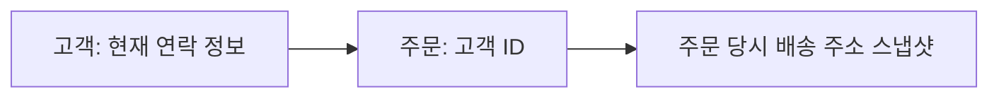

<!-- level:1 -->
# 정규화와 역정규화 — 사실의 원본을 어디에 둘까

주문마다 고객 주소를 반복 적으면 주소 변경 때 일부 주문만 수정되는 문제가 생길 수 있다. 정규화는 사실의 종속 관계를 분석해 중복과 삽입·갱신·삭제 이상을 줄이는 설계다. 그러나 주문 당시 배송 주소처럼 과거 상태를 보존해야 하는 데이터는 현재 고객 주소와 다른 사실이다.



키는 행을 식별하고 함수 종속은 어떤 속성이 다른 속성을 결정하는 관계다. 1NF, 2NF, 3NF를 단순히 “테이블을 계속 쪼개는 단계”로 외우지 않는다. 어떤 사실이 무엇에 종속되는지 먼저 판단한다.

**비유의 한계:** 중복을 모두 없애는 것이 목표가 아니다. 읽기 최적화·이력·분석의 필요로 중복을 둘 수 있지만 원본과 갱신 규칙을 명시해야 한다.
<!-- level:2 -->
# 키·제약과 사실의 단위

복합 키의 일부에만 종속되는 속성, 키 아닌 속성에 간접 종속되는 속성을 검토한다. 후보 키와 실제 업무 규칙을 확인하고 NULL·unique의 의미도 DB 계약에 맞춰 정한다. 외래키는 존재 관계를 보호하지만 모든 업무 규칙을 보장하지는 않는다.

1NF는 관계의 속성 값과 반복 그룹을 정리하는 출발점이다. 2NF는 후보 키 일부에 대한 비주요 속성의 부분 종속을 없애고, 3NF는 비자명한 함수 종속 X→A에서 X가 superkey이거나 A가 후보 키의 일부인 조건을 요구한다. BCNF는 모든 비자명한 종속의 결정자가 superkey여야 한다. 단순히 surrogate ID를 추가해도 기존 업무 속성 사이의 종속은 사라지지 않는다. 분해 후 조인으로 원래 관계를 복원하는 무손실성과, 조인 없이 제약을 검사할 수 있는 종속 보존도 확인한다.

PostgreSQL 17 학습 DB에서 실행할 예제다.

```sql
CREATE TEMP TABLE customers_demo (
  id bigint PRIMARY KEY, name text NOT NULL
);
CREATE TEMP TABLE orders_demo (
  id bigint PRIMARY KEY,
  customer_id bigint NOT NULL REFERENCES customers_demo(id),
  shipping_address_snapshot text NOT NULL
);
INSERT INTO customers_demo VALUES (1, 'Kim');
INSERT INTO orders_demo VALUES (100, 1, '주문 당시 주소');
SELECT o.id, c.name, o.shipping_address_snapshot
FROM orders_demo o JOIN customers_demo c ON c.id=o.customer_id;
```

고객 이름 원본과 주문 배송 사실을 나눴다. 조회 화면의 고객 이름 캐시를 추가한다면 변경 동기화와 신선도 계약이 필요하다. 정규화 이론의 종속 관계와 실제 워크로드의 조인 비용을 따로 검토한다.
<!-- level:3 -->
# 가상 장애 — 고객 이름이 화면마다 다르다

가상 서비스가 주문 행에도 현재 고객 이름을 복제했지만 프로필 수정 시 일부 복제만 갱신한다. 먼저 값이 “현재 정보”인지 “주문 당시 기록”인지 정의한다. 의미가 다른 스냅샷을 오류로 지우면 이력이 손상된다.

**진단:** 원본·복제 위치·갱신 경로·실패 재시도와 stale 기간을 확인한다. 참조 무결성 위반, 누락된 갱신, 이벤트 지연을 구분한다.

**수정:** 현재 사실은 단일 원본을 참조하거나 명시적 비동기 projection으로 관리한다. 복제는 버전·재처리·정합성 검사 정책을 둔다. 이력은 의미가 드러나는 snapshot 컬럼으로 보존한다.

**재검증:** 이름 변경·이벤트 중복·전송 실패·재구축을 재현하고 화면 간 허용 신선도와 원본 일치를 검사한다.
<!-- level:4 -->
# 읽기 비용과 데이터 의미의 균형

| 모델 | 장점 | 책임 |
|---|---|---|
| 정규화 원본 | 갱신 규칙과 무결성 명확 | 조회 조인·인덱스 설계 |
| 역정규화 조회 모델 | 자주 쓰는 화면의 읽기 단순화 | 중복·동기화·재구축 |
| 사건 시점 스냅샷 | 과거 업무 사실 보존 | 현재 정보와 의미 구분 |

대규모 읽기 최적화는 조인이 있다는 이유만으로 시작하지 않는다. 실행 계획·조회량·인덱스·지연을 측정하고 projection의 지연·쓰기 비용·복구를 비교한다. 분석 스키마와 거래 원본은 목적이 다를 수 있다.

**판단 연습:** 주문 영수증의 주소와 고객 프로필의 주소를 같은 사실로 취급할까? 소유권·시간 의미·보존 정책을 먼저 적고 성능을 최적화하자.

참고: [UC Berkeley CS186 — DB Design and Normalization](https://cs186berkeley.net/notes/note13/), [PostgreSQL Constraints](https://www.postgresql.org/docs/17/ddl-constraints.html).
<!-- quizzes -->
[{"level":1,"question":"주문 당시 주소와 현재 고객 주소를 구분해야 하는 이유는?","choices":["두 값은 서로 다른 시점의 업무 사실","정규화는 모든 이력을 삭제","주소는 키가 될 수 없음","조인은 금지"],"answer_index":0,"explanation":"스냅샷은 당시 거래 사실이고 프로필은 현재 정보입니다. 의미가 다른 값을 중복 오류로 취급하면 이력을 손상시킵니다."},{"level":2,"question":"정규화 판단의 출발점은?","choices":["테이블 수 최대화","키와 함수 종속·업무 사실의 단위","컬럼 이름 길이","조인 횟수만 감소"],"answer_index":1,"explanation":"어떤 속성이 무엇을 결정하는지 분석해야 갱신 이상을 줄일 수 있습니다. 무조건 분할하는 절차가 아닙니다."},{"level":3,"question":"역정규화 값의 불일치 조사에서 먼저 정할 것은?","choices":["모든 데이터 삭제","DB 제품 교체","현재 정보인지 시점 스냅샷인지 의미","컬럼 순서만 변경"],"answer_index":2,"explanation":"의도한 의미를 알아야 stale 복제와 올바른 이력을 구분합니다. 원본·동기화 경로·재처리도 확인해야 합니다."},{"level":4,"question":"조회 모델을 역정규화할 때 추가 책임은?","choices":["쓰기 비용은 0","원본이 불필요","실패가 자동 복구","갱신·신선도·재구축·정합성 검증"],"answer_index":3,"explanation":"빠른 읽기는 복제 관리 비용을 만듭니다. 허용 지연과 복구 계약까지 설계해야 합니다."}]
