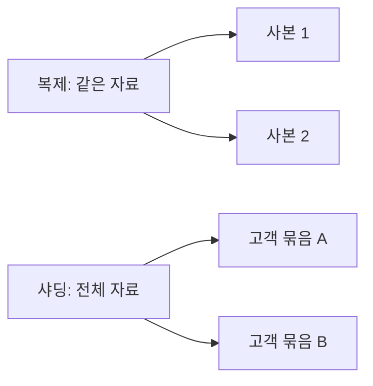

<!-- level:1 -->
# 복제와 샤딩 — 사본을 만들거나 자료를 나누기

> **한 문장으로:** 복제는 같은 자료의 사본을 만들고, 샤딩은 자료를 기준에 따라 여러 곳에 나눠 보관합니다.

## 왜 필요한가요?

한 서버가 고장 나도 자료를 읽고 싶거나, 자료량이 한 서버 용량을 넘을 수 있습니다. 고장 대비와 용량 확장은 서로 다른 목적의 설계를 요구합니다.

## 일상에서 떠올려 보기

같은 책을 여러 도서관에 두는 것은 복제입니다. 책을 주제별로 서로 다른 도서관에 나누어 두는 것은 샤딩에 가깝습니다. 사본의 내용이 언제 같아지는지와 어느 자료가 어느 곳에 있는지는 다른 문제입니다.

## 순서대로 따라가기

1. 복제에서는 원본의 변경 내용을 사본에 전달합니다.
2. 샤딩에서는 고객 번호 같은 기준으로 자료의 담당 서버를 정합니다.
3. 장애나 서버 추가 때 사본 전환과 자료 위치 변경을 안전하게 처리합니다.



## 작은 예로 확인하기

고객 1~1000은 서버 A, 1001~2000은 서버 B에 둘 수 있습니다. 이 방식은 자료 분할입니다. 각 서버의 자료를 다른 서버에도 복사하면 복제를 함께 사용한 것입니다. 나누기와 복사는 서로 조합할 수 있습니다.

## 처음 만나는 용어

| 용어 | 쉬운 뜻 |
|---|---|
| 복제 | 같은 데이터의 사본을 다른 곳에 유지하는 것입니다. |
| 샤딩 | 자료를 기준에 따라 여러 담당 저장소에 나누는 것입니다. |
| primary·replica | 변경을 맡는 주 서버와 그 변경을 따라가는 사본입니다. |
| 샤드 키 | 어느 저장소가 자료를 맡을지 결정하는 기준값입니다. |

**비유의 한계:** 사본이 있다고 항상 최신 읽기나 무손실 전환이 보장되지 않습니다. 자료를 나누면 여러 저장소에 걸친 조회와 변경이 더 복잡해질 수 있습니다.

## 스스로 확인

전체 자료를 똑같이 두 서버에 두는 것과 고객별로 나누는 것은 각각 무엇일까요?

**답과 이유:** 같은 자료의 사본을 두는 것은 복제, 고객 기준으로 담당 서버를 나누는 것은 샤딩입니다.
<!-- level:2 -->
# 복제 로그와 데이터 라우팅

<!-- beginner-guide:start -->
## 읽기 전 길잡이

교육용 라우팅 코드에서 어떤 키가 어느 서버를 선택하는지 보세요. 복제 로그 전달과 자료 담당 선택은 서로 다른 흐름입니다. 실제 운영에서는 서버 추가와 안정된 라우팅 규칙도 필요합니다.

## 이 단계에서 만날 말

| 용어 | 쉬운 뜻 |
|---|---|
| WAL | 변경을 복구·전달하기 위해 기록하는 로그입니다. |
| 동기·비동기 복제 | 사본 확인을 기다리거나 나중 반영을 허용하는 방식입니다. |
| 복제 지연 | 원본 변경이 사본에 반영되기까지의 차이입니다. |
| 승격 | 사본이 새로운 쓰기 담당이 되는 과정입니다. |
| fencing | 이전 쓰기 담당이 계속 쓰지 못하도록 차단하는 것입니다. |
| 리밸런싱 | 서버 수나 부하 변화에 따라 자료 담당을 재분배하는 것입니다. |

<!-- beginner-guide:end -->

PostgreSQL 물리 복제는 WAL 등을 사용해 사본을 갱신한다. 동기 복제와 비동기 복제의 쓰기 확인 시점이 다르고, 장애 시 손실·지연 계약도 달라진다. 사본 승격에는 이전 primary의 쓰기를 차단하는 fencing이 중요하다.

교육용 Python 라우팅 예제다. 운영 hash를 이대로 사용하지 않는다.

```python
import hashlib
def shard(key, count):
    digest = hashlib.sha256(key.encode()).digest()
    return int.from_bytes(digest[:8], "big") % count
assert shard("tenant-7", 4) == shard("tenant-7", 4)
print([shard(f"tenant-{i}", 4) for i in range(8)])
```

샤드 개수가 바뀌면 단순 modulo는 많은 키의 위치를 바꾼다. consistent hashing·가상 샤드·directory 기반 라우팅은 이동 비용과 제어를 다르게 제공한다. row partitioning과 여러 독립 DB로의 sharding도 구분한다. 하나의 DB 파티셔닝이 여러 서버 쓰기 확장을 자동 제공하지 않는다.
<!-- level:3 -->
# 가상 장애 — 한 샤드만 과부하

<!-- beginner-guide:start -->
## 읽기 전 길잡이

서버를 교체한 뒤 자료가 달라졌다면 사본 지연, 이전 담당의 쓰기, 라우팅 변경을 각각 조사합니다. 두 서버가 동시에 원본이라고 생각하는 상황을 막아야 합니다.

<!-- beginner-guide:end -->

가상 시스템이 tenant ID로 분할했는데 거대 tenant 하나가 대부분의 쓰기를 만든다. 평균 행 수가 고르더라도 작업 비용은 편중될 수 있다. 샤드별 읽기·쓰기·p95·CPU·저장량과 핫키를 확인한다.

**수정:** 큰 tenant의 별도 샤드, 더 세밀한 키, 가상 샤드 이동을 검토한다. 분산 키를 바꾸면 범위 조회와 같은 tenant의 원자성이 어려워질 수 있다. 이행은 복사·변경 추적·검증·라우팅 전환·rollback을 설계한다.

**재검증:** 데이터 수만 아니라 처리량 분포와 복제 지연을 비교한다. 장애 승격·오래된 라우팅·이동 중 쓰기·중복 처리에서 무결성과 복구 시간을 확인한다.
<!-- level:4 -->
# 샤딩 전에 비용 경계를 보기

<!-- beginner-guide:start -->
## 읽기 전 길잡이

읽기량 증가와 쓰기·저장 용량 증가를 구분해 목표를 정합니다. 복제·분할의 이득과 장애 전환·재분배·여러 저장소 조회 비용을 함께 비교하세요.

<!-- beginner-guide:end -->

| 선택 | 이득 | 부담 |
|---|---|---|
| 단일 DB 최적화 | 운영·트랜잭션 단순 | 단일 노드 자원 한계 |
| 읽기 복제 | 읽기 부하 분산·복구 옵션 | stale read·승격 |
| 샤딩 | 저장·쓰기 분산 가능 | cross-shard·이동·전역 제약 |

샤딩은 인덱스·쿼리·연결·배치 최적화로 해결하지 못하는 실제 한도에서 검토한다. 전역 unique, 조인, 집계, 트랜잭션과 backup restore가 복잡해진다. RPO는 허용 데이터 손실, RTO는 복구 시간 목표이며 실제 복구 훈련으로 확인한다.

**판단 연습:** 모든 사용자 데이터를 tenant별로 묶을 때 거대 tenant와 전역 검색을 어떻게 처리할까? 키 선택의 이득과 비용을 기록하자.

참고: [PostgreSQL High Availability](https://www.postgresql.org/docs/17/high-availability.html), [Table Partitioning](https://www.postgresql.org/docs/17/ddl-partitioning.html).
<!-- quizzes -->
[{"level":1,"question":"복제와 샤딩의 차이는?","choices":["둘 다 같은 데이터 분할만 의미","복제는 항상 모든 쓰기를 분산","복제는 사본, 샤딩은 키에 따른 데이터 분할","샤딩은 백업과 동일"],"answer_index":2,"explanation":"사본을 추가하는 것과 저장 책임을 나누는 것은 다릅니다. 읽기 replica만으로 primary 쓰기 병목이 사라지지는 않습니다."},{"level":2,"question":"단순 key hash modulo에서 샤드 개수를 바꾸면 어떤 일이 생길 수 있나요?","choices":["많은 키의 라우팅 위치가 달라짐","모든 키가 반드시 같은 위치","데이터 이동 필요 없음","복제 지연이 자동 0"],"answer_index":0,"explanation":"분모가 바뀌면 매핑이 달라집니다. 가상 샤드·consistent hash·directory 등의 이동 관리 대안을 검토합니다."},{"level":3,"question":"샤드 행 수는 고른데 한 노드만 느리면 확인할 것은?","choices":["사이트 제목","작업 비용과 핫키·tenant별 부하 분포","모든 데이터를 즉시 삭제","평균 행 수만 재확인"],"answer_index":1,"explanation":"같은 행 수가 같은 부하를 의미하지 않습니다. 읽기·쓰기·핫키·지연 분포와 복제 상태를 함께 확인해야 합니다."},{"level":4,"question":"샤딩 도입에서 추가되는 중요한 운영 책임은?","choices":["전역 unique가 자동 쉬워짐","모든 조인이 공짜","backup이 불필요","cross-shard 질의·이동·전역 제약·복구"],"answer_index":3,"explanation":"분할은 자원 확장 가능성을 주지만 여러 노드의 계약과 복구를 복잡하게 합니다. 실제 한도와 비용을 근거로 도입합니다."}]
