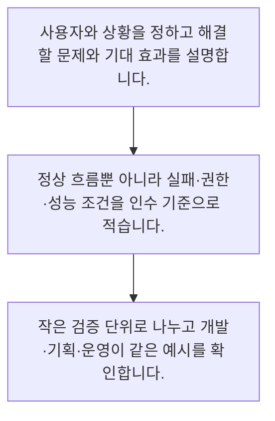

<!-- level:1 -->
# 요구사항·사용자 스토리·인수 조건

> **한 문장으로:** 요구사항은 기능 이름을 나열하는 일을 넘어, 누구의 어떤 문제를 어떤 조건에서 해결할지 합의하는 일입니다.

## 왜 필요한가요?

검색 기능처럼 짧은 이름만으로는 서로 같은 결과를 기대하기 어렵습니다. 사용자와 목적·성공과 실패 조건을 예시로 적으면 개발자와 검토자가 같은 기준으로 확인할 수 있습니다.

## 일상에서 떠올려 보기

식당에서 맛있는 음식을 달라고만 하면 기대가 어긋납니다. 알레르기, 식사 인원, 제공 시간까지 말하면 확인 가능한 주문이 됩니다. 사용자 스토리도 원하는 기능과 이유를 연결하고 인수 조건으로 결과를 확인합니다.

## 순서대로 따라가기

1. 사용자와 상황을 정하고 해결할 문제와 기대 효과를 설명합니다.
2. 정상 흐름뿐 아니라 실패·권한·성능 조건을 인수 기준으로 적습니다.
3. 작은 검증 단위로 나누고 개발·기획·운영이 같은 예시를 확인합니다.



## 처음 만나는 용어

| 용어 | 쉬운 뜻 |
|---|---|
| 사용자 스토리 | 누가 무엇을 왜 원하는지 설명한 짧은 요구 |
| 인수 조건 | 요구가 충족됐는지 판단하는 구체적인 조건 |
| 비기능 요구 | 성능·보안·접근성 등 서비스 품질의 조건 |

**비유의 한계:** 소프트웨어 사용 상황은 식당 주문보다 다양합니다. 짧은 스토리만으로 보안·성능·데이터 보존 같은 요구가 모두 표현되지는 않으므로 별도 조건을 함께 관리합니다.

## 스스로 확인

좋은 사용자 스토리에 필요한 연결은 무엇인가요?

**답과 이유:** 사용자·원하는 행동·그 이유 — 누가 어떤 가치를 얻는지 보여야 기능 목록을 넘어 요구의 목적을 이해할 수 있습니다.
<!-- level:2 -->
# 요구사항·사용자 스토리·인수 조건 — 실제 흐름 따라가기

## 읽기 전 길잡이

요구사항은 기능 이름을 나열하는 일을 넘어, 누구의 어떤 문제를 어떤 조건에서 해결할지 합의하는 일입니다. 아래 예제는 외부 시스템에 연결하지 않는 작은 학습용 사례입니다. 입력, 처리 조건, 결과를 순서대로 살펴보세요.

1. 사용자와 상황을 정하고 해결할 문제와 기대 효과를 설명합니다.
2. 정상 흐름뿐 아니라 실패·권한·성능 조건을 인수 기준으로 적습니다.
3. 작은 검증 단위로 나누고 개발·기획·운영이 같은 예시를 확인합니다.

## 예제로 확인하기

```markdown
# 스토리
상담원으로서 문의 근거 문서를 빨리 찾아 답변을 확인하고 싶다.

# 인수 조건
- 주어진 조건: 접근 가능한 문서 두 개가 검색됨
- 행동: 상담원이 결과의 출처를 선택
- 기대 결과: 해당 문서의 근거 구간이 열림
- 권한 없는 문서는 제목과 본문 모두 노출하지 않음
- 검색 장애 시 재시도 안내와 기존 상담 경로 제공
- 응답 시간은 시범 환경에서 합의한 부하·측정 기준으로 검증
```

## 결과를 해석하기

주어진 조건·행동·기대 결과를 적으면 같은 화면을 보고도 다르게 해석하는 일을 줄일 수 있습니다. AI 답변은 한 문장 일치보다 근거의 적합성·금지 동작·실패 대처를 평가하는 기준이 필요합니다.

## 실무에 옮기기 전

소프트웨어 사용 상황은 식당 주문보다 다양합니다. 짧은 스토리만으로 보안·성능·데이터 보존 같은 요구가 모두 표현되지는 않으므로 별도 조건을 함께 관리합니다. 실제 업무에서는 변경이 잦은 기능은 작은 스토리와 예시로 합의하고, 여러 기능에 공통인 보안·성능·접근성 조건은 별도 목록으로 연결합니다. AI의 불확실한 출력을 고정 정답처럼 약속하지 말고 평가 기준과 거부 경로를 정합니다.

## 확인 질문

인수 조건으로 더 검증 가능한 것은 무엇인가요?

**답과 이유:** 구체적인 조건과 결과가 있으면 개발자와 검토자가 같은 기준으로 확인할 수 있습니다.
<!-- level:3 -->
# 요구사항·사용자 스토리·인수 조건 — 가상 사례로 문제 해결하기

실제 고객의 장애 기록이 아닌 학습용 재현 시나리오입니다. 결과만 바꾸기 전에 관측한 증거와 원인 가설을 구분합니다.

## 1. 어떤 문제가 생겼나요?

검색 기능은 동작하지만 권한 없는 문서 제목이 노출돼 검수가 중단됩니다.

## 2. 먼저 확인할 증거

요구에는 검색 성공만 있고 접근 권한과 실패 시 동작이 없습니다.

## 3. 원인 가설

정상 경로만 인수 조건으로 작성한 것이 원인 가설입니다.

## 4. 수정 방법

역할별 접근 조건과 거부 예시를 추가하고 실패·빈 결과·오래된 문서도 테스트 사례로 만듭니다.

## 5. 재검증

허용·거부 역할의 동일 질의를 비교하고 제목·요약·로그까지 권한 정보가 새지 않는지 확인합니다.

## 놓치기 쉬운 조건

소프트웨어 사용 상황은 식당 주문보다 다양합니다. 짧은 스토리만으로 보안·성능·데이터 보존 같은 요구가 모두 표현되지는 않으므로 별도 조건을 함께 관리합니다.

## 확인 질문

정상 검색만 통과한 기능에서 무엇을 추가 확인하나요?

**답과 이유:** 실제 사용에는 거부와 실패 상황이 있으므로 정상 성공만으로 품질을 판단하면 안 됩니다.
<!-- level:4 -->
# 요구사항·사용자 스토리·인수 조건 — 업무와 아키텍처의 선택

## 읽기 전 길잡이

같은 개념도 업무의 규모, 오류 비용, 운영 역량에 따라 적용 방식이 달라집니다. 아래 비교는 특정 제품의 성능 순위가 아닌 선택 기준입니다.

| 선택 | 얻는 점 | 감수할 점 |
|---|---|---|
| 스토리와 구체 예시 | 사용자 가치와 검증을 가까이 연결 | 전체 시스템 제약은 별도 관리 필요 |
| 상세 요구 명세 | 복잡한 규정과 계약의 추적에 유리 | 긴 문서가 실제 피드백보다 앞서갈 수 있음 |

## 선택 기준

변경이 잦은 기능은 작은 스토리와 예시로 합의하고, 여러 기능에 공통인 보안·성능·접근성 조건은 별도 목록으로 연결합니다. AI의 불확실한 출력을 고정 정답처럼 약속하지 말고 평가 기준과 거부 경로를 정합니다.

## 도입과 운영에서 확인할 것

역할별 접근 조건과 거부 예시를 추가하고 실패·빈 결과·오래된 문서도 테스트 사례로 만듭니다. 허용·거부 역할의 동일 질의를 비교하고 제목·요약·로그까지 권한 정보가 새지 않는지 확인합니다.

## 판단 연습

AI 답변 기능의 인수 조건은 어떻게 설계하나요?

**판단의 근거:** 생성 결과는 달라질 수 있으므로 업무 가치와 위험에 맞는 여러 평가 기준이 필요합니다.

참고: [Scrum Guide](https://scrumguides.org/scrum-guide.html), [The Kanban Guide 2025](https://kanbanguides.org/the-kanban-guide/2025.5/), [GOV.UK Agile delivery](https://www.gov.uk/service-manual/agile-delivery).
<!-- quizzes -->
[{"level":1,"question":"좋은 사용자 스토리에 필요한 연결은 무엇인가요?","choices":["개발 언어만","팀의 기분만","사용자·원하는 행동·그 이유","화면 색상만"],"answer_index":2,"explanation":"누가 어떤 가치를 얻는지 보여야 기능 목록을 넘어 요구의 목적을 이해할 수 있습니다."},{"level":2,"question":"인수 조건으로 더 검증 가능한 것은 무엇인가요?","choices":["검색은 무조건 완벽하다","화면이 멋있다","사용자가 좋아할 것이다","권한 없는 문서는 검색 결과에 노출하지 않는다"],"answer_index":3,"explanation":"구체적인 조건과 결과가 있으면 개발자와 검토자가 같은 기준으로 확인할 수 있습니다."},{"level":3,"question":"정상 검색만 통과한 기능에서 무엇을 추가 확인하나요?","choices":["권한·빈 결과·실패 경로","로고 크기만","회의 시간만","담당자의 직급만"],"answer_index":0,"explanation":"실제 사용에는 거부와 실패 상황이 있으므로 정상 성공만으로 품질을 판단하면 안 됩니다."},{"level":4,"question":"AI 답변 기능의 인수 조건은 어떻게 설계하나요?","choices":["평가를 출시 후로 미룬다","근거 적합성과 금지 동작·실패 대응을 함께 평가한다","모든 답을 한 문장으로 고정한다","출력 길이만 본다"],"answer_index":1,"explanation":"생성 결과는 달라질 수 있으므로 업무 가치와 위험에 맞는 여러 평가 기준이 필요합니다."}]
