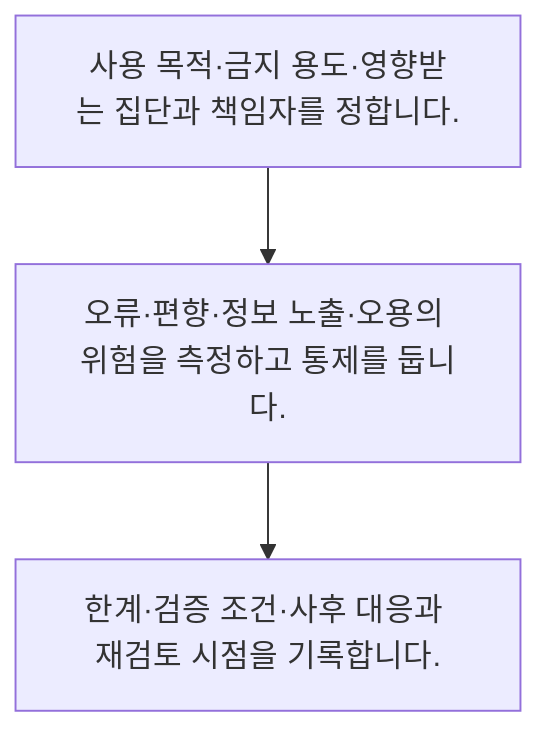

<!-- level:1 -->
# 책임 있는 AI·위험 평가·모델 카드

> **한 문장으로:** AI 위험은 모델 점수만이 아니라 사용 맥락·영향받는 사람·오류 피해·책임과 통제를 함께 평가합니다.

## 왜 필요한가요?

검토 가능한 최소 문서 구조입니다. 실제 모델 카드에는 자료·평가 조건·구간별 결과·인간 감독·변경 이력이 필요하며 평가되지 않은 용도를 명확히 구분합니다.

## 일상에서 떠올려 보기

자동문을 만들 때 잘 열리는 비율뿐 아니라 누가 끼일 수 있는지, 고장 때 어떻게 멈추는지와 누가 관리하는지도 보는 것과 같습니다.

## 순서대로 따라가기

1. 사용 목적·금지 용도·영향받는 집단과 책임자를 정합니다.
2. 오류·편향·정보 노출·오용의 위험을 측정하고 통제를 둡니다.
3. 한계·검증 조건·사후 대응과 재검토 시점을 기록합니다.



## 처음 만나는 용어

| 용어 | 쉬운 뜻 |
|---|---|
| AI 위험 | AI 사용으로 발생할 수 있는 부정적 영향과 그 가능성 |
| 모델 카드 | 모델의 용도·평가·한계 등을 기록한 문서 |
| 책임성 | 판단·감시·대응의 역할과 근거를 명확히 하는 성질 |

**비유의 한계:** 한 번의 점검이나 모델 카드가 모든 안전·공정성·준수를 보증하지 않습니다. 사용 범위와 환경이 바뀌면 위험과 평가도 다시 검토해야 합니다.

## 스스로 확인

AI 위험 평가에 포함할 것은?

**답과 이유:** 사용 맥락과 오류 피해 — 같은 모델도 쓰는 목적과 영향을 받는 사람에 따라 위험이 달라집니다.
<!-- level:2 -->
# 책임 있는 AI·위험 평가·모델 카드 — 실제 흐름 따라가기

## 읽기 전 길잡이

AI 위험은 모델 점수만이 아니라 사용 맥락·영향받는 사람·오류 피해·책임과 통제를 함께 평가합니다. 아래 예제는 외부 시스템에 연결하지 않는 작은 학습용 사례입니다. 입력, 처리 조건, 결과를 순서대로 살펴보세요.

1. 사용 목적·금지 용도·영향받는 집단과 책임자를 정합니다.
2. 오류·편향·정보 노출·오용의 위험을 측정하고 통제를 둡니다.
3. 한계·검증 조건·사후 대응과 재검토 시점을 기록합니다.

## 예제로 확인하기

```python
card={"intended_use":"문의 초안","forbidden_use":"자동 최종 결정","owner":"support-lead","limitations":["근거 누락 가능"]}
assert card["owner"] and card["limitations"]
print(card)
```

## 결과를 해석하기

검토 가능한 최소 문서 구조입니다. 실제 모델 카드에는 자료·평가 조건·구간별 결과·인간 감독·변경 이력이 필요하며 평가되지 않은 용도를 명확히 구분합니다.

## 실무에 옮기기 전

한 번의 점검이나 모델 카드가 모든 안전·공정성·준수를 보증하지 않습니다. 사용 범위와 환경이 바뀌면 위험과 평가도 다시 검토해야 합니다. 실제 업무에서는 NIST AI RMF의 거버넌스·맥락 파악·측정·관리 관점을 참고해 역할을 정합니다. 위험의 심각도와 사용 범위에 따라 출시 기준과 사람 감독 수준을 다르게 둡니다.

## 확인 질문

예제 카드에서 허용한 용도는?

**답과 이유:** 평가된 의도 용도와 금지 용도를 구분합니다.
<!-- level:3 -->
# 책임 있는 AI·위험 평가·모델 카드 — 가상 사례로 문제 해결하기

실제 고객의 장애 기록이 아닌 학습용 재현 시나리오입니다. 결과만 바꾸기 전에 관측한 증거와 원인 가설을 구분합니다.

## 1. 어떤 문제가 생겼나요?

가상 분류 모델의 전체 점수는 높지만 특정 업무군에서 오류가 큽니다.

## 2. 먼저 확인할 증거

집단별 표본 수·오류 유형·실제 피해와 자료 수집을 확인합니다.

## 3. 원인 가설

전체 평균만 보고 불균등한 실패와 영향받는 사람을 놓쳤습니다.

## 4. 수정 방법

사용 제한·사람 검토와 자료·평가 개선을 함께 검토합니다.

## 5. 재검증

구간별 품질과 피해 감소, 이의 제기·대응 경로를 다시 확인합니다.

## 놓치기 쉬운 조건

한 번의 점검이나 모델 카드가 모든 안전·공정성·준수를 보증하지 않습니다. 사용 범위와 환경이 바뀌면 위험과 평가도 다시 검토해야 합니다.

## 확인 질문

전체 점수와 특정 업무군 성능이 다르면?

**답과 이유:** 전체 평균이 특정 상황의 실패를 숨길 수 있습니다.
<!-- level:4 -->
# 책임 있는 AI·위험 평가·모델 카드 — 업무와 아키텍처의 선택

## 읽기 전 길잡이

같은 개념도 업무의 규모, 오류 비용, 운영 역량에 따라 적용 방식이 달라집니다. 아래 비교는 특정 제품의 성능 순위가 아닌 선택 기준입니다.

| 선택 | 얻는 점 | 감수할 점 |
|---|---|---|
| 성능 중심 검토 | 측정과 비교가 간단 | 맥락·피해·책임 누락 |
| 맥락 기반 위험 관리 | 사용의 영향과 통제를 연결 | 다분야 협업·지속 관리 |

## 선택 기준

NIST AI RMF의 거버넌스·맥락 파악·측정·관리 관점을 참고해 역할을 정합니다. 위험의 심각도와 사용 범위에 따라 출시 기준과 사람 감독 수준을 다르게 둡니다.

## 도입과 운영에서 확인할 것

사용 제한·사람 검토와 자료·평가 개선을 함께 검토합니다. 구간별 품질과 피해 감소, 이의 제기·대응 경로를 다시 확인합니다.

## 판단 연습

모델 카드 작성 뒤 필요한 것은?

**판단의 근거:** 문서는 위험 관리의 기록이며 지속적인 검토를 대신하지 않습니다.

참고: [Google Cloud MLOps](https://docs.cloud.google.com/architecture/mlops-continuous-delivery-and-automation-pipelines-in-machine-learning), [NIST AI RMF](https://www.nist.gov/itl/ai-risk-management-framework), [OWASP 생성형 AI 보안](https://genai.owasp.org/llm-top-10/), [Google SRE Workbook](https://sre.google/workbook/table-of-contents/).
<!-- quizzes -->
[{"level":1,"question":"AI 위험 평가에 포함할 것은?","choices":["사용 맥락과 오류 피해","평균 점수만","모델 크기만","가격만"],"answer_index":0,"explanation":"같은 모델도 쓰는 목적과 영향을 받는 사람에 따라 위험이 달라집니다."},{"level":2,"question":"예제 카드에서 허용한 용도는?","choices":["권한 없는 자료 수집","문의 초안","자동 최종 결정","모든 판단"],"answer_index":1,"explanation":"평가된 의도 용도와 금지 용도를 구분합니다."},{"level":3,"question":"전체 점수와 특정 업무군 성능이 다르면?","choices":["불리한 집단 삭제","평가 중단","구간별 오류·피해 조사","평균만 유지"],"answer_index":2,"explanation":"전체 평균이 특정 상황의 실패를 숨길 수 있습니다."},{"level":4,"question":"모델 카드 작성 뒤 필요한 것은?","choices":["영구 안전 보장","모든 감독 제거","평가 자료 폐기","환경·용도 변경 시 재검토"],"answer_index":3,"explanation":"문서는 위험 관리의 기록이며 지속적인 검토를 대신하지 않습니다."}]
