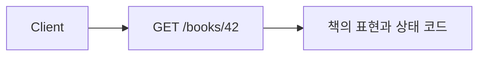

<!-- level:1 -->
# REST API — 주소와 HTTP 의미로 표현하는 계약

도서관에서 책 목록과 특정 책을 구분하듯 API는 리소스와 그 표현을 구분한다. REST는 웹의 제약을 이용하는 아키텍처 스타일이며 JSON을 보내는 모든 HTTP API가 엄밀한 REST인 것은 아니다. 실무에서는 리소스 주소, 메서드, 상태 코드, 캐시와 오류의 일관된 계약이 특히 중요하다.



GET은 안전한 조회 의미를, PUT은 지정 리소스 교체의 멱등 의미를 갖는다. 멱등은 여러 번 수행했을 때 의도한 서버 상태 효과가 한 번과 같다는 뜻이며 응답 코드가 매번 같다는 뜻이 아니다. POST가 항상 중복을 피한다는 보장은 없고 별도 멱등 키를 설계할 수 있다.

**비유의 한계:** 리소스 주소를 알았다고 접근 권한을 얻는 것은 아니다. 인증·인가와 데이터 검증은 API 계약의 필수 경계다.
<!-- level:2 -->
# 요청·응답·경쟁 갱신을 연결하기

상태 코드와 오류 본문은 호출자의 다음 행동을 알려야 한다. 400은 잘못된 요청, 401은 인증 필요, 403은 접근 거부, 404는 찾지 못함 등의 계약으로 사용하되 보안 노출도 검토한다. content type과 입력 크기·필드 범위를 검증한다.

다음은 **가상 API 요청 예시**이며 그대로 실행할 서버는 제공하지 않는다.

```http
GET /books/42 HTTP/1.1
Host: api.example.test
Accept: application/json

HTTP/1.1 200 OK
Content-Type: application/json
ETag: "revision-7"

{"id":"42","title":"Networks"}
```

클라이언트는 갱신 때 `If-Match: "revision-7"` 조건을 보내 경쟁 변경을 검출할 수 있다. 조건이 맞지 않으면 서버는 계약에 따라 412 등을 반환한다. 목록은 안정된 정렬과 페이지네이션 계약을 두고, 바뀌는 대량 데이터에는 cursor 방식의 장단점을 검토한다. cursor도 권한과 입력 검증이 필요하다.
<!-- level:3 -->
# 가상 장애 — 두 사용자의 편집이 서로 덮어쓴다

두 클라이언트가 같은 revision을 읽고 각각 PUT한다. 뒤 요청이 앞 변경을 조용히 덮으면 lost update다. 요청 ID·읽은 버전·저장 버전을 비교한다. HTTP 메서드가 PUT이라는 이유만으로 동시 편집 안전성이 생기지는 않는다.

**수정:** ETag/If-Match 또는 명시적 revision을 DB 조건 UPDATE와 연결한다. 비교와 저장을 원자적으로 수행한다. 충돌 시 클라이언트가 최신 값을 재조회·병합하도록 오류 계약을 만든다. 멱등 키는 중복 요청 방지이고 경쟁 편집 검출과는 다른 기능이다.

**재검증:** 같은 버전의 동시 변경, 저장 후 응답 손실, 권한 없는 리소스 ID, 잘못된 페이지 cursor를 검사한다. 충돌률·오류율·API 지연을 관측한다.
<!-- level:4 -->
# API 스타일과 장기 호환성

| 스타일 | 강점 | 비용 |
|---|---|---|
| 리소스 중심 HTTP | 웹 캐시·메서드 의미·도구 | 복잡한 질의·워크플로 표현 |
| RPC | 업무 동작과 타입 계약 명확 | 결합·버전·전송 규약 |
| GraphQL | 필요한 필드·관계 선택 | 질의 비용·인가·캐시 |

장기 API는 호환 필드 추가, enum 확장, 오류 변화, 삭제 이행을 계획한다. 성능에는 응답 크기·N+1·DB 쿼리·rate limit이 중요하다. 인가를 클라이언트 화면에만 두지 말고 서버에서 리소스 소유권을 확인한다.

**판단 연습:** 공개 상품 조회와 내부 결제 명령에 같은 스타일을 적용할까? 소비자 수·캐시·지연·변경 비용을 비교하자.

참고: [Fielding REST Dissertation](https://ics.uci.edu/~fielding/pubs/dissertation/rest_arch_style.htm), [HTTP RFC 9110](https://www.rfc-editor.org/rfc/rfc9110).
<!-- quizzes -->
[{"level":1,"question":"HTTP 멱등의 의미로 정확한 것은?","choices":["매번 응답 코드가 같음","모든 요청이 조회만 함","반복 요청의 의도된 서버 상태 효과가 한 번과 같음","인증이 필요 없음"],"answer_index":2,"explanation":"멱등은 서버 효과의 계약입니다. 응답이 달라질 수 있고 인가·경쟁 변경·업무 중복은 별도 검토합니다."},{"level":2,"question":"ETag와 If-Match를 갱신에 연결하는 목적은?","choices":["읽은 버전과 저장 조건을 연결해 경쟁 변경 검출","서버 암호를 전송","모든 권한 자동 부여","JSON 크기 증가"],"answer_index":0,"explanation":"버전이 맞을 때만 원자적으로 저장하도록 만들면 stale 편집의 덮어쓰기를 막을 수 있습니다."},{"level":3,"question":"멱등 키와 경쟁 편집 검출의 관계는?","choices":["항상 동일 기능","서로 다른 문제이며 둘 다 필요할 수 있음","둘 다 DB 없이 자동 보장","POST만 쓰면 불필요"],"answer_index":1,"explanation":"멱등 키는 중복 업무 요청을, revision 조건은 stale 갱신을 다룹니다. 실패·동시성 계약에 맞춰 조합합니다."},{"level":4,"question":"GraphQL 도입에서 별도로 설계할 비용은?","choices":["모든 질의가 항상 저렴","인가가 자동 해결","버전 검토 불필요","질의 복잡도·N+1·인가·캐시"],"answer_index":3,"explanation":"클라이언트 유연성은 실행 비용과 권한 경계를 요구합니다. 스타일 이름만으로 확장성과 안전성이 보장되지 않습니다."}]
