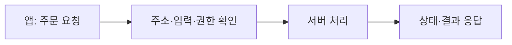

<!-- level:1 -->
# REST API — 필요한 자료와 행동을 정해진 약속으로 요청하기

> **한 문장으로:** 클라이언트와 서버가 자료의 이름, 요청 방식, 결과를 분명한 약속으로 주고받도록 설계합니다.

## 왜 필요한가요?

앱과 서버가 따로 만들어져도 주문 조회·수정의 의미를 같게 이해해야 합니다. 주소·입력·응답·오류를 매번 임의로 정하면 연결과 변경이 어려워집니다.

## 일상에서 떠올려 보기

도서관에서 ‘책 42번을 보여 주세요’ 또는 ‘예약을 취소해 주세요’처럼 대상과 행동을 구분한다고 생각해 보세요. 누구의 자료를 요청하는지, 허용된 행동인지, 없으면 어떤 답을 줄지도 약속해야 합니다.

## 순서대로 따라가기

1. 주문·상품처럼 다룰 자원을 정하고 식별할 주소를 만듭니다.
2. 읽기·생성·변경 등 요청의 의미와 필요한 입력을 정합니다.
3. 결과와 오류를 일관된 형식으로 응답하고 권한·반복 요청·동시 변경을 고려합니다.



## 작은 예로 확인하기

주문 취소 요청을 한 번 해도 두 번 해도 최종 의도는 ‘해당 주문이 취소된 상태’입니다. 이런 반복 효과를 멱등성이라고 합니다. 두 번째 응답의 내용까지 첫 번째와 완전히 같아야 한다는 뜻은 아닙니다.

## 처음 만나는 용어

| 용어 | 쉬운 뜻 |
|---|---|
| API | 다른 프로그램이 기능을 사용하는 요청·응답의 약속입니다. |
| 자원 | 주문·상품처럼 API가 다루는 대상입니다. |
| HTTP 메서드 | GET·POST·PUT·DELETE처럼 요청 의미를 나타내는 방식입니다. |
| 멱등성 | 같은 요청을 반복한 의도된 상태 효과가 한 번과 같은 성질입니다. |

**비유의 한계:** 주소를 예쁘게 만들고 HTTP 메서드를 쓴다고 REST의 모든 제약을 만족하는 것은 아닙니다. 인증·인가와 입력 검증도 별도로 구현해야 합니다.

## 스스로 확인

멱등한 요청을 두 번 보내면 응답 문장도 반드시 똑같아야 할까요?

**답과 이유:** 그렇지 않습니다. 멱등성은 서버 상태에 의도한 효과가 한 번과 같다는 의미입니다. 이미 취소됐다는 다른 응답을 줄 수도 있습니다.
<!-- level:2 -->
# 요청·응답·경쟁 갱신을 연결하기

<!-- beginner-guide:start -->
## 읽기 전 길잡이

가상 요청 예제에서 주소, 메서드, 입력, 응답 상태를 구분하세요. 동시에 수정하는 사용자가 있을 때 어떤 버전의 자료를 바꾸는지도 확인합니다.

## 이 단계에서 만날 말

| 용어 | 쉬운 뜻 |
|---|---|
| 상태 코드 | 성공·입력 문제·권한 문제 같은 응답 상태를 나타내는 번호입니다. |
| Content-Type | 데이터가 JSON 등 어떤 형식인지 알리는 정보입니다. |
| ETag | 자료 버전을 구별해 캐시와 조건부 변경 등에 사용하는 표시입니다. |
| 조건부 요청 | 기대한 버전 등의 조건이 맞을 때만 처리하게 하는 요청입니다. |
| 페이지네이션 | 큰 목록을 여러 묶음으로 나누어 읽는 방식입니다. |
| REST 제약 | 클라이언트·서버 분리, 상태 없는 요청, 캐시, 일관된 인터페이스 등을 포함하는 설계 조건입니다. |

<!-- beginner-guide:end -->

상태 코드와 오류 본문은 호출자의 다음 행동을 알려야 한다. 400은 잘못된 요청, 401은 인증 필요, 403은 접근 거부, 404는 찾지 못함 등의 계약으로 사용하되 보안 노출도 검토한다. content type과 입력 크기·필드 범위를 검증한다.

다음은 **가상 API 요청 예시**이며 그대로 실행할 서버는 제공하지 않는다.

```http
GET /books/42 HTTP/1.1
Host: api.example.test
Accept: application/json

HTTP/1.1 200 OK
Content-Type: application/json
ETag: "revision-7"

{"id":"42","title":"Networks"}
```

클라이언트는 갱신 때 `If-Match: "revision-7"` 조건을 보내 경쟁 변경을 검출할 수 있다. 조건이 맞지 않으면 서버는 계약에 따라 412 등을 반환한다. 목록은 안정된 정렬과 페이지네이션 계약을 두고, 바뀌는 대량 데이터에는 cursor 방식의 장단점을 검토한다. cursor도 권한과 입력 검증이 필요하다.
<!-- level:3 -->
# 가상 장애 — 두 사용자의 편집이 서로 덮어쓴다

<!-- beginner-guide:start -->
## 읽기 전 길잡이

응답이 없어 재시도했는데 주문이 두 개 생긴 상황을 봅니다. 읽기 요청과 새 작업 생성 요청의 반복 효과를 구분하고 요청 식별과 서버의 중복 처리를 조사하세요.

<!-- beginner-guide:end -->

두 클라이언트가 같은 revision을 읽고 각각 PUT한다. 뒤 요청이 앞 변경을 조용히 덮으면 lost update다. 요청 ID·읽은 버전·저장 버전을 비교한다. HTTP 메서드가 PUT이라는 이유만으로 동시 편집 안전성이 생기지는 않는다.

**수정:** ETag/If-Match 또는 명시적 revision을 DB 조건 UPDATE와 연결한다. 비교와 저장을 원자적으로 수행한다. 충돌 시 클라이언트가 최신 값을 재조회·병합하도록 오류 계약을 만든다. 멱등 키는 중복 요청 방지이고 경쟁 편집 검출과는 다른 기능이다.

**재검증:** 같은 버전의 동시 변경, 저장 후 응답 손실, 권한 없는 리소스 ID, 잘못된 페이지 cursor를 검사한다. 충돌률·오류율·API 지연을 관측한다.
<!-- level:4 -->
# API 스타일과 장기 호환성

<!-- beginner-guide:start -->
## 읽기 전 길잡이

사용자와 서비스가 오래 의존할 약속을 설계하는 단계입니다. 버전 변경, 오류 노출, 목록 조회 비용, 큰 요청의 한도를 포함해 편의성과 운영 비용을 비교하세요.

<!-- beginner-guide:end -->

| 스타일 | 강점 | 비용 |
|---|---|---|
| 리소스 중심 HTTP | 웹 캐시·메서드 의미·도구 | 복잡한 질의·워크플로 표현 |
| RPC | 업무 동작과 타입 계약 명확 | 결합·버전·전송 규약 |
| GraphQL | 필요한 필드·관계 선택 | 질의 비용·인가·캐시 |

장기 API는 호환 필드 추가, enum 확장, 오류 변화, 삭제 이행을 계획한다. 성능에는 응답 크기·N+1·DB 쿼리·rate limit이 중요하다. 인가를 클라이언트 화면에만 두지 말고 서버에서 리소스 소유권을 확인한다.

**판단 연습:** 공개 상품 조회와 내부 결제 명령에 같은 스타일을 적용할까? 소비자 수·캐시·지연·변경 비용을 비교하자.

참고: [Fielding REST Dissertation](https://ics.uci.edu/~fielding/pubs/dissertation/rest_arch_style.htm), [HTTP RFC 9110](https://www.rfc-editor.org/rfc/rfc9110).
<!-- quizzes -->
[{"level":1,"question":"HTTP 멱등의 의미로 정확한 것은?","choices":["매번 응답 코드가 같음","모든 요청이 조회만 함","반복 요청의 의도된 서버 상태 효과가 한 번과 같음","인증이 필요 없음"],"answer_index":2,"explanation":"멱등은 서버 효과의 계약입니다. 응답이 달라질 수 있고 인가·경쟁 변경·업무 중복은 별도 검토합니다."},{"level":2,"question":"ETag와 If-Match를 갱신에 연결하는 목적은?","choices":["읽은 버전과 저장 조건을 연결해 경쟁 변경 검출","서버 암호를 전송","모든 권한 자동 부여","JSON 크기 증가"],"answer_index":0,"explanation":"버전이 맞을 때만 원자적으로 저장하도록 만들면 stale 편집의 덮어쓰기를 막을 수 있습니다."},{"level":3,"question":"멱등 키와 경쟁 편집 검출의 관계는?","choices":["항상 동일 기능","서로 다른 문제이며 둘 다 필요할 수 있음","둘 다 DB 없이 자동 보장","POST만 쓰면 불필요"],"answer_index":1,"explanation":"멱등 키는 중복 업무 요청을, revision 조건은 stale 갱신을 다룹니다. 실패·동시성 계약에 맞춰 조합합니다."},{"level":4,"question":"GraphQL 도입에서 별도로 설계할 비용은?","choices":["모든 질의가 항상 저렴","인가가 자동 해결","버전 검토 불필요","질의 복잡도·N+1·인가·캐시"],"answer_index":3,"explanation":"클라이언트 유연성은 실행 비용과 권한 경계를 요구합니다. 스타일 이름만으로 확장성과 안전성이 보장되지 않습니다."}]
