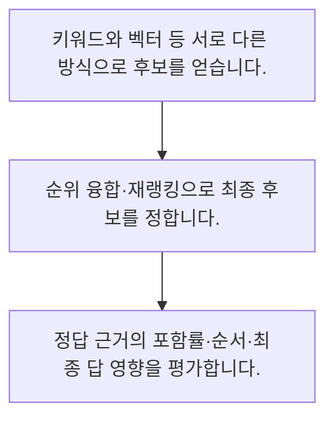

<!-- level:1 -->
# 하이브리드 검색·재랭킹·검색 평가

> **한 문장으로:** 서로 다른 검색 방법의 후보를 합치고 재랭킹으로 순서를 다듬되 정답 근거를 놓치지 않는지 평가합니다.

## 왜 필요한가요?

순위 기반 융합의 작은 예제입니다. 서로 다른 원점수를 직접 더하지 않고 각 순위의 역수를 더합니다. 상수와 후보 수는 실제 평가로 정해야 합니다.

## 일상에서 떠올려 보기

서점 직원 두 명이 각각 제목과 내용으로 책을 추천한 뒤 질문에 맞는 순서로 다시 고르는 과정과 비슷합니다.

## 순서대로 따라가기

1. 키워드와 벡터 등 서로 다른 방식으로 후보를 얻습니다.
2. 순위 융합·재랭킹으로 최종 후보를 정합니다.
3. 정답 근거의 포함률·순서·최종 답 영향을 평가합니다.



## 처음 만나는 용어

| 용어 | 쉬운 뜻 |
|---|---|
| 하이브리드 검색 | 서로 다른 검색 신호를 결합하는 방식 |
| 재랭킹 | 후보의 관련성을 다시 평가해 순서를 바꾸는 단계 |
| Recall@k | 정의한 정답 근거가 상위 k 후보에 얼마나 포함되는지 보는 지표 |

**비유의 한계:** 검색 점수의 척도가 다른데 그대로 더하면 비교가 왜곡됩니다. 재랭킹도 후보에 없는 정답을 새로 만들 수 없고 권한 필터를 대신하지 않습니다.

## 스스로 확인

재랭킹만으로 해결할 수 없는 문제는?

**답과 이유:** 후보에 없는 정답 근거 — 먼저 후보에 들어와야 재랭킹으로 선택할 수 있습니다.
<!-- level:2 -->
# 하이브리드 검색·재랭킹·검색 평가 — 실제 흐름 따라가기

## 읽기 전 길잡이

서로 다른 검색 방법의 후보를 합치고 재랭킹으로 순서를 다듬되 정답 근거를 놓치지 않는지 평가합니다. 아래 예제는 외부 시스템에 연결하지 않는 작은 학습용 사례입니다. 입력, 처리 조건, 결과를 순서대로 살펴보세요.

1. 키워드와 벡터 등 서로 다른 방식으로 후보를 얻습니다.
2. 순위 융합·재랭킹으로 최종 후보를 정합니다.
3. 정답 근거의 포함률·순서·최종 답 영향을 평가합니다.

## 예제로 확인하기

```python
rankings=[["A","B"],["B","C"]]; scores={}
for ranking in rankings:
    for rank,doc in enumerate(ranking,1): scores[doc]=scores.get(doc,0)+1/(60+rank)
assert max(scores,key=scores.get)=="B"
print(scores)
```

## 결과를 해석하기

순위 기반 융합의 작은 예제입니다. 서로 다른 원점수를 직접 더하지 않고 각 순위의 역수를 더합니다. 상수와 후보 수는 실제 평가로 정해야 합니다.

## 실무에 옮기기 전

검색 점수의 척도가 다른데 그대로 더하면 비교가 왜곡됩니다. 재랭킹도 후보에 없는 정답을 새로 만들 수 없고 권한 필터를 대신하지 않습니다. 실제 업무에서는 먼저 후보 누락과 순서 문제를 분리합니다. 후보 수 증가가 지연과 문맥 혼잡을 얼마나 늘리는지 측정하고 접근 범위는 모든 단계에서 유지합니다.

## 확인 질문

예제 순위 융합의 최고 문서는?

**답과 이유:** B는 두 검색 결과에 포함되어 합산 점수가 가장 높습니다.
<!-- level:3 -->
# 하이브리드 검색·재랭킹·검색 평가 — 가상 사례로 문제 해결하기

실제 고객의 장애 기록이 아닌 학습용 재현 시나리오입니다. 결과만 바꾸기 전에 관측한 증거와 원인 가설을 구분합니다.

## 1. 어떤 문제가 생겼나요?

가상 검색이 제품 코드 질의에서는 좋은 문서를 놓칩니다.

## 2. 먼저 확인할 증거

질의 유형별 후보 목록과 정답 문서 포함 여부를 확인합니다.

## 3. 원인 가설

의미 검색만 사용해 정확한 식별자 일치를 놓쳤습니다.

## 4. 수정 방법

키워드 후보를 결합하고 권한 필터 후 재랭킹합니다.

## 5. 재검증

식별자·동의어·긴 질문으로 검색 포함률과 답변 근거성을 재평가합니다.

## 놓치기 쉬운 조건

검색 점수의 척도가 다른데 그대로 더하면 비교가 왜곡됩니다. 재랭킹도 후보에 없는 정답을 새로 만들 수 없고 권한 필터를 대신하지 않습니다.

## 확인 질문

제품 코드 질의가 약하면 먼저 비교할 것은?

**답과 이유:** 식별자와 의미 질의의 특성이 달라 유형별 후보 품질을 봐야 합니다.
<!-- level:4 -->
# 하이브리드 검색·재랭킹·검색 평가 — 업무와 아키텍처의 선택

## 읽기 전 길잡이

같은 개념도 업무의 규모, 오류 비용, 운영 역량에 따라 적용 방식이 달라집니다. 아래 비교는 특정 제품의 성능 순위가 아닌 선택 기준입니다.

| 선택 | 얻는 점 | 감수할 점 |
|---|---|---|
| 단일 검색기 | 지연·운영 단순 | 질의 유형별 약점 |
| 혼합·재랭킹 | 다양한 신호 활용 | 추가 지연·평가·비용 |

## 선택 기준

먼저 후보 누락과 순서 문제를 분리합니다. 후보 수 증가가 지연과 문맥 혼잡을 얼마나 늘리는지 측정하고 접근 범위는 모든 단계에서 유지합니다.

## 도입과 운영에서 확인할 것

키워드 후보를 결합하고 권한 필터 후 재랭킹합니다. 식별자·동의어·긴 질문으로 검색 포함률과 답변 근거성을 재평가합니다.

## 판단 연습

혼합 검색 도입 시 함께 볼 것은?

**판단의 근거:** 추가 단계의 품질 이득과 지연·운영 부담을 함께 평가합니다.

참고: [Anthropic 에이전트 설계](https://www.anthropic.com/engineering/building-effective-agents), [MCP 소개](https://modelcontextprotocol.io/docs/getting-started/intro), [OWASP 생성형 AI 보안](https://genai.owasp.org/llm-top-10/).
<!-- quizzes -->
[{"level":1,"question":"재랭킹만으로 해결할 수 없는 문제는?","choices":["후보 관련성 비교","상위 후보 조정","후보에 없는 정답 근거","후보의 순서"],"answer_index":2,"explanation":"먼저 후보에 들어와야 재랭킹으로 선택할 수 있습니다."},{"level":2,"question":"예제 순위 융합의 최고 문서는?","choices":["A","C","모두 삭제","B"],"answer_index":3,"explanation":"B는 두 검색 결과에 포함되어 합산 점수가 가장 높습니다."},{"level":3,"question":"제품 코드 질의가 약하면 먼저 비교할 것은?","choices":["정확 일치 후보와 검색 유형","답변 말투","토큰 색","인덱스 이름"],"answer_index":0,"explanation":"식별자와 의미 질의의 특성이 달라 유형별 후보 품질을 봐야 합니다."},{"level":4,"question":"혼합 검색 도입 시 함께 볼 것은?","choices":["비용 무시","품질·지연·권한","원점수 단순 합만","후보 수만"],"answer_index":1,"explanation":"추가 단계의 품질 이득과 지연·운영 부담을 함께 평가합니다."}]
