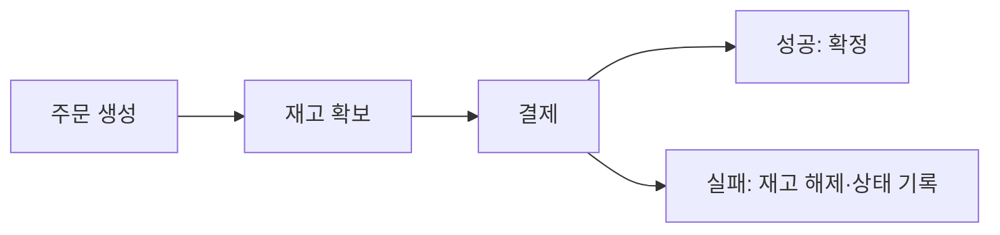

<!-- level:1 -->
# Saga — 여러 서비스의 업무를 단계별로 복구하기

> **한 문장으로:** 여러 서비스에서 진행한 일을 기록하고, 실패하면 필요한 취소·보상 행동을 이어서 수행합니다.

## 왜 필요한가요?

주문·재고·결제가 서로 다른 저장소에서 처리되면 하나의 DB rollback으로 모든 일을 취소하기 어렵습니다. 어느 단계까지 끝났는지와 실패 후 무엇을 할지 정해야 합니다.

## 일상에서 떠올려 보기

여행 예약에서 항공권과 호텔을 잡았는데 렌터카 예약이 실패했다고 생각해 보세요. 앞 예약을 취소하거나 다른 선택을 해야 합니다. 취소는 과거를 지우는 마법이 아니라 수수료·기한·실패 가능성이 있는 새 행동입니다.

## 순서대로 따라가기

1. 긴 업무를 각 서비스에서 처리할 수 있는 단계로 나눕니다.
2. 각 단계의 결과와 현재 업무 상태를 지속적으로 기록합니다.
3. 실패나 불확실한 결과를 확인하고 필요한 보상을 진행합니다. 보상 자체의 실패와 중복도 처리합니다.



## 작은 예로 확인하기

결제 응답이 늦었다고 반드시 결제가 실패한 것은 아닙니다. 결제는 끝났지만 응답만 사라졌을 수 있습니다. 거래 ID로 상태를 확인한 뒤 복구 방향을 정해야 합니다. 재고 해제도 반복될 수 있어 한 번의 업무 효과를 지키는 규칙이 필요합니다.

## 처음 만나는 용어

| 용어 | 쉬운 뜻 |
|---|---|
| Saga | 여러 로컬 업무 단계와 복구 행동을 연결하는 패턴입니다. |
| 로컬 트랜잭션 | 한 서비스의 저장 경계 안에서 성공·실패를 관리하는 작업입니다. |
| 보상 | 이미 진행한 업무의 영향을 복구하려고 추가로 수행하는 행동입니다. |
| 불확실 상태 | 상대가 실제로 처리했는지 아직 확인되지 않은 상태입니다. |

**비유의 한계:** Saga는 완전한 시간 되돌리기나 자동 격리를 제공하지 않습니다. 이미 보낸 메일과 배송을 완벽히 취소할 수는 없으며 보상도 실패할 수 있습니다.

## 스스로 확인

호텔 예약 취소가 실패했습니다. Saga의 보상은 반드시 성공하는 역연산일까요?

**답과 이유:** 아닙니다. 보상은 새 업무 행동이므로 실패·중복·재시도와 수동 복구까지 설계해야 합니다.
<!-- level:2 -->
# 상태 머신과 멱등 전이

<!-- beginner-guide:start -->
## 읽기 전 길잡이

상태 전이 예제에서 현재 상태와 허용된 다음 상태를 찾아보세요. 상태를 같은 값으로 다시 쓰는 것과 외부 결제를 중복하지 않는 것은 별개의 보장입니다.

## 이 단계에서 만날 말

| 용어 | 쉬운 뜻 |
|---|---|
| orchestration | 조정자가 단계와 복구 흐름을 관리하는 방식입니다. |
| choreography | 서비스가 사건에 반응하며 협력하는 방식입니다. |
| durable 상태 | 재시작 후에도 남도록 저장한 업무 상태입니다. |
| 멱등 키 | 같은 업무 요청을 구별해 중복 효과를 막는 기준입니다. |
| 상태 머신 | 현재 상태에서 어떤 다음 상태로 갈 수 있는지 정한 규칙입니다. |
| 2PC | 여러 참여자의 준비·확정을 조정하는 분산 커밋 방식입니다. |

<!-- beginner-guide:end -->

orchestration은 조정자가 단계와 복구를 관리하고 choreography는 이벤트 반응으로 협력한다. 두 방식 모두 durable 상태, 멱등 키, 기한과 재처리를 필요로 한다.

Python 3의 **교육용 상태 전이 모델**이다. 실제 서비스는 DB 조건 갱신과 이벤트 발행 경계를 연결한다.

```python
allowed = {"pending": {"reserved", "failed"},
           "reserved": {"paid", "compensating"},
           "compensating": {"failed"}, "paid": set(), "failed": set()}
state = "pending"
def transition(next_state):
    global state
    if next_state == state: return  # 같은 상태 재적용
    if next_state not in allowed[state]: raise ValueError("invalid transition")
    state = next_state
transition("reserved"); transition("compensating"); transition("failed")
```

동일 상태 허용만으로 외부 결제 중복을 막지는 않는다. 단계별 효과의 멱등 키와 결과 저장이 필요하다. outbox는 로컬 저장과 발행 이행을 연결하고 inbox·unique 기록은 중복 소비를 관리할 수 있다.
<!-- level:3 -->
# 가상 장애 — 결제 성공 뒤 응답이 없어 보상한다

<!-- beginner-guide:start -->
## 읽기 전 길잡이

결제가 성공했는데 응답이 사라진 사례를 봅니다. 응답 없음, 확정 실패, 확정 성공을 구분하고 상태 조회와 업무 식별자로 결과를 맞춰야 합니다.

<!-- beginner-guide:end -->

가상 조정자가 결제 timeout을 실패로 확정하고 재고를 풀지만 실제 결제는 완료됐다. 응답 없음과 확정 실패는 다르다. step ID·외부 거래 ID·상태 조회와 기한을 대조한다.

**수정:** 불확실 상태를 모델에 포함하고 외부 결과를 조회·조정한다. 보상은 단계별 멱등·재시도·실패 상태를 갖게 한다. 오래된 이벤트가 완료된 업무를 다시 바꾸지 않도록 버전·조건 전이를 적용한다.

**재검증:** 각 단계의 처리 후 응답 손실, 조정자 재시작, 중복·지연 이벤트, 보상 실패를 주입한다. 누락·중복 결제와 미해결 Saga 수, 복구 시간·수동 조치율을 확인한다.
<!-- level:4 -->
# 분산 업무의 선택과 한계

<!-- beginner-guide:start -->
## 읽기 전 길잡이

업무가 실제로 보상 가능한지와 중간 상태를 사용자가 어떻게 볼지 먼저 정합니다. 단일 DB 처리, 분산 커밋, Saga의 복구·운영 비용을 비교하세요.

<!-- beginner-guide:end -->

| 방식 | 이득 | 부담 |
|---|---|---|
| 단일 DB 트랜잭션 | 원자 경계 단순 | 한 저장 경계에 제한 |
| 2PC 계열 | 참여자 계약에 따른 원자 commit | 지원·블로킹·운영 비용 |
| Saga | 로컬 자율성과 긴 흐름 | 중간 상태·보상·비격리 |

Saga는 일반적인 rollback 버튼이 아니다. 업무가 보상 가능한지, 경쟁 요청이 중간 상태를 어떻게 해석할지, 완료 확정 시점을 사용자에게 어떻게 알릴지 정한다. choreography는 중앙 결합을 줄일 수 있지만 흐름 발견·순환·추적이 어렵다. orchestration은 흐름이 보이지만 조정자 수명과 병목을 관리한다.

**판단 연습:** 이미 배송된 물건의 결제 실패를 기술적 취소만으로 해결할 수 있을까? 환불·회수·수동 조정이라는 업무 정책을 먼저 정의하자.

참고: [Microservices.io — Saga](https://microservices.io/patterns/data/saga.html), [Transactional Outbox](https://microservices.io/patterns/data/transactional-outbox.html).
<!-- quizzes -->
[{"level":1,"question":"Saga 보상에 대한 정확한 설명은?","choices":["항상 원래 세계로 완벽히 되돌림","새 업무 행동이며 실패·중복 가능성도 있음","DB 격리를 자동 제공","모든 이메일을 회수"],"answer_index":1,"explanation":"보상은 외부 효과의 의미를 복구하는 행동입니다. 완전한 역연산이 아닐 수 있고 자체 복구 정책이 필요합니다."},{"level":2,"question":"Saga 단계의 안전한 재처리에 필요한 것은?","choices":["메모리 변수 하나만","모든 이벤트 순서 가정","durable 상태·멱등 키·조건 전이","보상 로그 제거"],"answer_index":2,"explanation":"재시작과 중복 전달을 고려해 상태와 업무 결과를 지속적으로 기록해야 합니다. 상태 전이와 외부 효과 경계도 검증합니다."},{"level":3,"question":"결제 timeout을 받은 조정자의 올바른 판단은?","choices":["실행 여부가 불확실할 수 있어 거래 상태 확인","무조건 결제 안 됨","즉시 무한 결제 반복","항상 모든 작업 삭제"],"answer_index":0,"explanation":"응답 손실은 확정 실패가 아닙니다. 외부 거래 ID와 멱등성·상태 조회로 결과를 조정해야 합니다."},{"level":4,"question":"Saga를 선택할 때 중요한 업무 전제는?","choices":["모든 단계는 격리됨","보상이 절대 실패하지 않음","사용자 상태는 숨겨도 됨","중간 상태와 보상 가능한 의미·복구 정책"],"answer_index":3,"explanation":"Saga는 비격리 중간 상태와 보상 비용을 갖습니다. 업무 규칙과 관측·수동 복구까지 설계해야 합니다."}]
