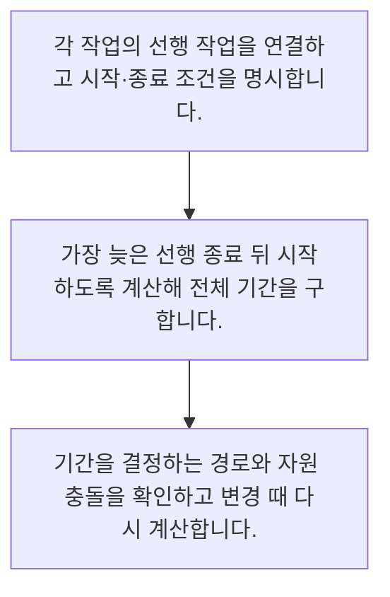

<!-- level:1 -->
# 일정·의존성·핵심 경로

> **한 문장으로:** 일정은 작업 시간을 단순히 더하는 표가 아니라, 먼저 끝나야 할 일과 동시에 할 수 있는 일을 표현한 계획입니다.

## 왜 필요한가요?

개별 작업을 빨리 끝내도 다른 일이 늦으면 전체 출시는 밀릴 수 있습니다. 먼저 끝나야 하는 일과 동시에 가능한 일을 연결하면 일정에 영향을 주는 병목을 찾을 수 있습니다.

## 일상에서 떠올려 보기

식사를 준비할 때 밥을 짓는 동안 반찬을 만들 수 있지만 장을 봐야 조리를 시작합니다. 가장 오래 걸리는 연결된 작업이 식사 시간을 결정합니다. 다만 한 사람이 두 일을 동시에 할 수 없다는 자원 제약도 확인해야 합니다.

## 순서대로 따라가기

1. 각 작업의 선행 작업을 연결하고 시작·종료 조건을 명시합니다.
2. 가장 늦은 선행 종료 뒤 시작하도록 계산해 전체 기간을 구합니다.
3. 기간을 결정하는 경로와 자원 충돌을 확인하고 변경 때 다시 계산합니다.



## 처음 만나는 용어

| 용어 | 쉬운 뜻 |
|---|---|
| 의존성 | 한 작업을 시작하거나 끝내기 위해 다른 작업이 필요한 관계 |
| 핵심 경로 | 총 기간을 결정하며 지연 여유가 없는 작업의 연결 |
| 일정 여유 | 전체 종료에 영향을 주지 않고 늦출 수 있는 시간 |

**비유의 한계:** 예제의 핵심 경로는 작업 기간이 확정되고 자원 충돌이 없다는 가정의 계산입니다. 실제 프로젝트에는 휴일·공유 인력·재작업·외부 대기가 있어 별도 검토가 필요합니다.

## 스스로 확인

동시에 할 수 있는 작업의 기간은 어떻게 이해하나요?

**답과 이유:** 의존성과 자원을 보고 겹쳐 계산한다 — 전체 기간은 순서와 병렬 가능성에 따라 달라지며 자원 제약도 함께 봐야 합니다.
<!-- level:2 -->
# 일정·의존성·핵심 경로 — 실제 흐름 따라가기

## 읽기 전 길잡이

일정은 작업 시간을 단순히 더하는 표가 아니라, 먼저 끝나야 할 일과 동시에 할 수 있는 일을 표현한 계획입니다. 아래 예제는 외부 시스템에 연결하지 않는 작은 학습용 사례입니다. 입력, 처리 조건, 결과를 순서대로 살펴보세요.

1. 각 작업의 선행 작업을 연결하고 시작·종료 조건을 명시합니다.
2. 가장 늦은 선행 종료 뒤 시작하도록 계산해 전체 기간을 구합니다.
3. 기간을 결정하는 경로와 자원 충돌을 확인하고 변경 때 다시 계산합니다.

## 예제로 확인하기

```python
durations = {"requirements": 2, "api": 3, "ui": 2, "integration": 1}
parents = {"requirements": [], "api": ["requirements"], "ui": ["requirements"], "integration": ["api", "ui"]}
finish = {}
for task in durations:  # 위상 순서로 적은 가상 작업
    start = max((finish[p] for p in parents[task]), default=0)
    finish[task] = start + durations[task]
assert finish["integration"] == 6
print(finish)
```

## 결과를 해석하기

API와 UI를 동시에 진행할 수 있다는 가정에서 전체 기간은 2+3+1=6입니다. 두 작업을 모두 더한 8과 다릅니다. API 작업이 하루 지연되면 종료도 지연되지만 UI의 하루 지연은 현재 여유 안에 들어갑니다. 자원을 공유하면 이 결과를 그대로 쓸 수 없습니다.

## 실무에 옮기기 전

예제의 핵심 경로는 작업 기간이 확정되고 자원 충돌이 없다는 가정의 계산입니다. 실제 프로젝트에는 휴일·공유 인력·재작업·외부 대기가 있어 별도 검토가 필요합니다. 실제 업무에서는 긴 프로젝트의 모든 일을 일별로 고정하기보다 가까운 작업은 상세히, 먼 작업은 가정과 이정표로 관리합니다. 기한이 고정이면 핵심 경로의 위험과 줄일 범위를 먼저 논의하고 모든 사람의 가동률을 100%로 잡지 않습니다.

## 확인 질문

예제에서 통합 종료가 6인 이유는 무엇인가요?

**답과 이유:** 통합은 두 선행 작업이 모두 끝나야 하므로 늦은 API 종료를 기준으로 시작합니다.
<!-- level:3 -->
# 일정·의존성·핵심 경로 — 가상 사례로 문제 해결하기

실제 고객의 장애 기록이 아닌 학습용 재현 시나리오입니다. 결과만 바꾸기 전에 관측한 증거와 원인 가설을 구분합니다.

## 1. 어떤 문제가 생겼나요?

개별 작업은 예상 시간 안에 끝났지만 통합 일정이 늦어집니다.

## 2. 먼저 확인할 증거

UI와 API를 같은 개발자가 맡았는데 계획에서는 동시 작업으로 놓았습니다.

## 3. 원인 가설

작업 간 논리적 의존성만 계산하고 사람의 가용 시간을 무시한 것이 원인 가설입니다.

## 4. 수정 방법

공유 인력 제약과 통합 검토를 반영해 순서·범위·배정을 조정합니다.

## 5. 재검증

계획이 휴일·외부 승인·담당자 부재를 포함하는지 확인하고 주기적으로 핵심 경로를 다시 계산합니다.

## 놓치기 쉬운 조건

예제의 핵심 경로는 작업 기간이 확정되고 자원 충돌이 없다는 가정의 계산입니다. 실제 프로젝트에는 휴일·공유 인력·재작업·외부 대기가 있어 별도 검토가 필요합니다.

## 확인 질문

동시 계획이 불가능했던 원인은 무엇인가요?

**답과 이유:** 논리적 병렬 가능성과 실제 인력의 병렬 가능성은 별도로 확인해야 합니다.
<!-- level:4 -->
# 일정·의존성·핵심 경로 — 업무와 아키텍처의 선택

## 읽기 전 길잡이

같은 개념도 업무의 규모, 오류 비용, 운영 역량에 따라 적용 방식이 달라집니다. 아래 비교는 특정 제품의 성능 순위가 아닌 선택 기준입니다.

| 선택 | 얻는 점 | 감수할 점 |
|---|---|---|
| 간단한 의존성 일정 | 중요한 대기와 순서를 빨리 파악 | 자원과 변동성을 별도로 봐야 함 |
| 자원 제약을 반영한 상세 일정 | 공유 인력·외부 납기 조정에 유리 | 유지 비용과 가짜 정밀도가 커질 수 있음 |

## 선택 기준

긴 프로젝트의 모든 일을 일별로 고정하기보다 가까운 작업은 상세히, 먼 작업은 가정과 이정표로 관리합니다. 기한이 고정이면 핵심 경로의 위험과 줄일 범위를 먼저 논의하고 모든 사람의 가동률을 100%로 잡지 않습니다.

## 도입과 운영에서 확인할 것

공유 인력 제약과 통합 검토를 반영해 순서·범위·배정을 조정합니다. 계획이 휴일·외부 승인·담당자 부재를 포함하는지 확인하고 주기적으로 핵심 경로를 다시 계산합니다.

## 판단 연습

고정 기한 프로젝트에서 먼저 논의할 것은 무엇인가요?

**판단의 근거:** 기한을 지키려면 실제 병목과 위험을 다루고 범위·자원의 대안을 비교해야 합니다.

참고: [Scrum Guide](https://scrumguides.org/scrum-guide.html), [The Kanban Guide 2025](https://kanbanguides.org/the-kanban-guide/2025.5/), [GOV.UK Agile delivery](https://www.gov.uk/service-manual/agile-delivery).
<!-- quizzes -->
[{"level":1,"question":"동시에 할 수 있는 작업의 기간은 어떻게 이해하나요?","choices":["의존성과 자원을 보고 겹쳐 계산한다","항상 모두 더한다","항상 가장 짧은 것만 본다","담당자 수로 무조건 나눈다"],"answer_index":0,"explanation":"전체 기간은 순서와 병렬 가능성에 따라 달라지며 자원 제약도 함께 봐야 합니다."},{"level":2,"question":"예제에서 통합 종료가 6인 이유는 무엇인가요?","choices":["통합이 0일이어서","요구 2 뒤 API 3과 UI 2 중 늦은 쪽을 기다리고 통합 1","모든 작업을 순서대로 더해서","UI가 없어져서"],"answer_index":1,"explanation":"통합은 두 선행 작업이 모두 끝나야 하므로 늦은 API 종료를 기준으로 시작합니다."},{"level":3,"question":"동시 계획이 불가능했던 원인은 무엇인가요?","choices":["색상이 같아서","회의록이 길어서","같은 사람이 두 작업을 맡은 자원 제약","작업 이름이 짧아서"],"answer_index":2,"explanation":"논리적 병렬 가능성과 실제 인력의 병렬 가능성은 별도로 확인해야 합니다."},{"level":4,"question":"고정 기한 프로젝트에서 먼저 논의할 것은 무엇인가요?","choices":["전원 가동률을 항상 100%로 올리기","모든 여유 제거","변경을 기록하지 않기","핵심 경로 위험과 줄일 수 있는 범위"],"answer_index":3,"explanation":"기한을 지키려면 실제 병목과 위험을 다루고 범위·자원의 대안을 비교해야 합니다."}]
