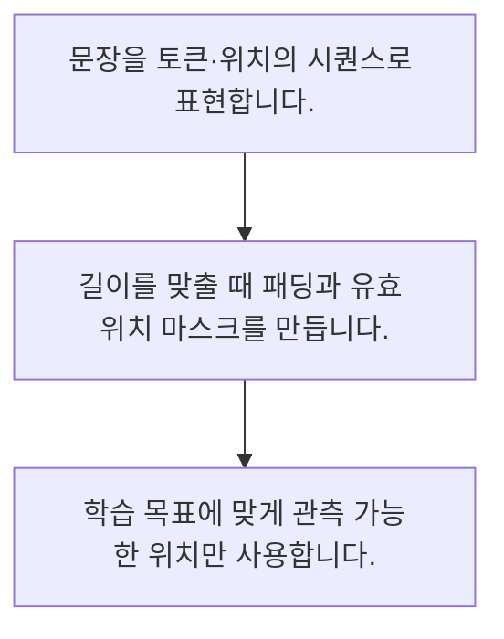

<!-- level:1 -->
# 자연어 처리·시퀀스·마스킹

> **한 문장으로:** 문장과 시계열은 순서와 길이가 의미를 가지므로 패딩·위치·유효 범위를 함께 다뤄야 합니다.

## 왜 필요한가요?

단어와 소리의 순서는 의미를 바꿉니다. 문장이나 시간에 따라 이어지는 자료를 다루는 방법을 알면 순서를 지우거나 잘못 자를 때 생기는 오류를 이해할 수 있습니다.

## 일상에서 떠올려 보기

같은 단어 카드도 놓는 순서에 따라 뜻이 달라집니다. 짧은 문장 옆에 빈 카드를 채웠다면 빈 카드까지 단어 수로 세지 않아야 합니다.

## 순서대로 따라가기

1. 문장을 토큰·위치의 시퀀스로 표현합니다.
2. 길이를 맞출 때 패딩과 유효 위치 마스크를 만듭니다.
3. 학습 목표에 맞게 관측 가능한 위치만 사용합니다.



## 처음 만나는 용어

| 용어 | 쉬운 뜻 |
|---|---|
| 시퀀스 | 순서를 가진 값의 열 |
| 패딩 | 묶음의 길이를 맞추기 위해 넣는 보조 값 |
| 마스크 | 연산에서 사용할 위치를 구분하는 표시 |

**비유의 한계:** 공백 분리는 실제 모델의 서브워드 토큰화와 다릅니다. 패딩을 무시하는 것과 미래 정보를 가리는 인과 마스크는 목적이 다릅니다.

## 스스로 확인

패딩 마스크의 주요 목적은?

**답과 이유:** 보조 위치를 연산에서 구별 — 패딩은 실제 관측이 아니므로 적절히 제외해야 합니다.
<!-- level:2 -->
# 자연어 처리·시퀀스·마스킹 — 실제 흐름 따라가기

## 읽기 전 길잡이

문장과 시계열은 순서와 길이가 의미를 가지므로 패딩·위치·유효 범위를 함께 다뤄야 합니다. 아래 예제는 외부 시스템에 연결하지 않는 작은 학습용 사례입니다. 입력, 처리 조건, 결과를 순서대로 살펴보세요.

1. 문장을 토큰·위치의 시퀀스로 표현합니다.
2. 길이를 맞출 때 패딩과 유효 위치 마스크를 만듭니다.
3. 학습 목표에 맞게 관측 가능한 위치만 사용합니다.

## 예제로 확인하기

```python
values=[2,4,0,0]; mask=[1,1,0,0]
mean=sum(x*m for x,m in zip(values,mask))/sum(mask)
assert mean==3
print(mean)
```

## 결과를 해석하기

유효 위치 2와 4의 평균은 3입니다. 패딩 0까지 단순 평균하면 1.5가 되어 표현이 달라집니다. 마스크는 합계와 분모 양쪽에 일관되게 적용합니다.

## 실무에 옮기기 전

공백 분리는 실제 모델의 서브워드 토큰화와 다릅니다. 패딩을 무시하는 것과 미래 정보를 가리는 인과 마스크는 목적이 다릅니다. 실제 업무에서는 평균 길이뿐 아니라 긴 입력과 잘림 비율을 관측합니다. 길이 최적화가 문장 의미와 평가 조건을 바꾸지 않도록 확인합니다.

## 확인 질문

예제 유효 값의 평균은?

**답과 이유:** 2와 4를 유효 위치 수 2로 나눈 값입니다.
<!-- level:3 -->
# 자연어 처리·시퀀스·마스킹 — 가상 사례로 문제 해결하기

실제 고객의 장애 기록이 아닌 학습용 재현 시나리오입니다. 결과만 바꾸기 전에 관측한 증거와 원인 가설을 구분합니다.

## 1. 어떤 문제가 생겼나요?

가상 문장 모델이 배치 구성에 따라 점수가 바뀝니다.

## 2. 먼저 확인할 증거

패딩 길이와 마스크 적용 위치, 평균 분모를 확인합니다.

## 3. 원인 가설

패딩까지 평균내어 길이가 짧은 문장의 표현이 희석되었습니다.

## 4. 수정 방법

유효 위치만 집계하고 인과·패딩 마스크를 구분합니다.

## 5. 재검증

같은 문장을 서로 다른 길이의 배치에 넣어 결과 일관성을 확인합니다.

## 놓치기 쉬운 조건

공백 분리는 실제 모델의 서브워드 토큰화와 다릅니다. 패딩을 무시하는 것과 미래 정보를 가리는 인과 마스크는 목적이 다릅니다.

## 확인 질문

배치 길이에 따라 같은 문장 점수가 바뀌면?

**답과 이유:** 패딩이 표현 계산에 섞였는지 재현해야 합니다.
<!-- level:4 -->
# 자연어 처리·시퀀스·마스킹 — 업무와 아키텍처의 선택

## 읽기 전 길잡이

같은 개념도 업무의 규모, 오류 비용, 운영 역량에 따라 적용 방식이 달라집니다. 아래 비교는 특정 제품의 성능 순위가 아닌 선택 기준입니다.

| 선택 | 얻는 점 | 감수할 점 |
|---|---|---|
| 고정 길이 패딩 | 배치와 구현 간단 | 불필요 계산·잘림 |
| 길이별 묶음 | 패딩 비용 감소 | 배치 구성·순서 관리 |

## 선택 기준

평균 길이뿐 아니라 긴 입력과 잘림 비율을 관측합니다. 길이 최적화가 문장 의미와 평가 조건을 바꾸지 않도록 확인합니다.

## 도입과 운영에서 확인할 것

유효 위치만 집계하고 인과·패딩 마스크를 구분합니다. 같은 문장을 서로 다른 길이의 배치에 넣어 결과 일관성을 확인합니다.

## 판단 연습

길이별 묶음의 이득과 부담은?

**판단의 근거:** 연산 낭비를 줄일 수 있지만 배치 구성과 재현 조건 관리가 필요합니다.

참고: [PyTorch 기초](https://docs.pytorch.org/tutorials/beginner/basics/intro.html), [Attention Is All You Need](https://arxiv.org/abs/1706.03762), [DDPM 논문](https://arxiv.org/abs/2006.11239).
<!-- quizzes -->
[{"level":1,"question":"패딩 마스크의 주요 목적은?","choices":["문장 번역","보조 위치를 연산에서 구별","모든 순서 제거","정답을 입력에 추가"],"answer_index":1,"explanation":"패딩은 실제 관측이 아니므로 적절히 제외해야 합니다."},{"level":2,"question":"예제 유효 값의 평균은?","choices":["6","0","3","1.5"],"answer_index":2,"explanation":"2와 4를 유효 위치 수 2로 나눈 값입니다."},{"level":3,"question":"배치 길이에 따라 같은 문장 점수가 바뀌면?","choices":["문장 이름 변경","긴 문장만 삭제","학습 점수만 확인","패딩·분모·마스크 확인"],"answer_index":3,"explanation":"패딩이 표현 계산에 섞였는지 재현해야 합니다."},{"level":4,"question":"길이별 묶음의 이득과 부담은?","choices":["패딩 감소와 배치 관리","토큰화 제거","항상 품질 상승","메모리 무제한"],"answer_index":0,"explanation":"연산 낭비를 줄일 수 있지만 배치 구성과 재현 조건 관리가 필요합니다."}]
