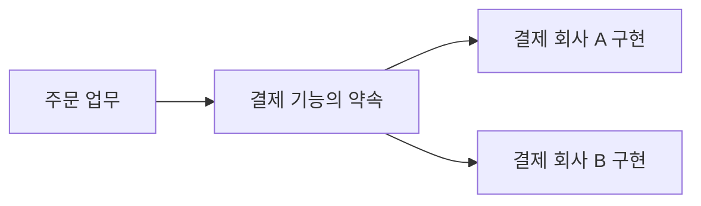

<!-- level:1 -->
# SOLID — 바뀔 일을 예상해 코드의 책임 나누기

> **한 문장으로:** 서로 다른 변경 이유를 분리하고 기능의 약속을 명확히 하면 수정의 영향을 이해하기 쉬워집니다.

## 왜 필요한가요?

가격 계산을 고쳤는데 이메일 발송까지 깨지면 작은 변경도 불안해집니다. 함께 바뀌는 일과 따로 바뀌는 일을 구별해 책임과 연결을 설계해야 합니다.

## 일상에서 떠올려 보기

가게에서 계산 담당과 배송 담당이 각각 자기 규칙을 관리한다고 생각해 보세요. 배송 회사가 바뀌어도 계산 방법 전체를 다시 만들 필요가 없어야 합니다. 다만 역할을 너무 잘게 나누면 서로 협의하는 비용이 커질 수 있습니다.

## 순서대로 따라가기

1. 어떤 이유로 코드가 바뀌는지 찾고 함께 바뀌는 책임을 묶습니다.
2. 사용하는 기능의 약속을 만들고 특정 도구의 세부사항과 분리합니다.
3. 다른 구현으로 바꾸거나 기능을 추가할 때 기존 약속을 지키는지 확인합니다.



## 작은 예로 확인하기

영수증의 금액 규칙은 회계 정책 때문에, 이메일 전송은 발송 회사 설정 때문에 바뀔 수 있습니다. 두 변경 이유를 구별하면 하나를 수정할 때 다른 기능을 덜 건드릴 수 있습니다. 단일 책임은 코드 줄 수나 메서드 개수를 정하는 규칙이 아닙니다.

## 처음 만나는 용어

| 용어 | 쉬운 뜻 |
|---|---|
| 책임 | 코드가 맡아 지켜야 하는 역할과 규칙입니다. |
| 의존성 | 한 기능이 다른 기능이나 도구를 필요로 하는 관계입니다. |
| 인터페이스 | 기능을 사용할 때 지켜야 하는 약속입니다. |
| SOLID | 변경과 기능 경계를 생각하도록 돕는 다섯 설계 원칙의 이름입니다. |

**비유의 한계:** 역할마다 무조건 클래스를 만드는 공식이 아닙니다. 원칙을 적용하면서 읽기 어려운 간접 연결이 늘어날 수 있습니다. 실제 변경 이유와 팀의 이해 비용을 확인해야 합니다.

## 스스로 확인

SRP를 판단할 때 ‘함수가 한 개인가?’보다 무엇을 먼저 생각해야 할까요?

**답과 이유:** 어떤 이유로 코드가 바뀌고 그 책임이 서로 함께 바뀌는지 봅니다. 변경 이유가 다른 역할을 무작정 묶지 않는 것이 핵심입니다.
<!-- level:2 -->
# 의존성의 방향을 코드로 보기

<!-- beginner-guide:start -->
## 읽기 전 길잡이

결제 예제는 실제 결제를 하지 않습니다. 주문 규칙이 필요한 기능만 요청하고 외부 결제 구현이 그 약속을 채우는 방향을 따라가세요.

## 이 단계에서 만날 말

| 용어 | 쉬운 뜻 |
|---|---|
| SRP | 변경 이유와 책임이 잘 모이도록 나누는 단일 책임 원칙입니다. |
| OCP | 안정된 코드를 과하게 수정하지 않고 새 기능을 확장하는 방향입니다. |
| LSP | 다른 구현으로 바꿔도 기존 사용자가 기대한 약속을 지키는 원칙입니다. |
| ISP | 사용자가 필요하지 않은 큰 기능 약속에 억지로 의존하지 않게 하는 원칙입니다. |
| DIP | 핵심 업무가 구체 도구보다 기능의 약속에 의존하도록 하는 원칙입니다. |
| 어댑터 | 외부 도구를 앱이 기대하는 기능 약속에 맞게 연결하는 코드입니다. |

<!-- beginner-guide:end -->

고수준 업무 정책이 구체적인 결제 SDK를 직접 호출하면 SDK 변경이 정책 테스트에 스며든다. 정책은 필요한 기능만 갖는 계약에 의존하고 어댑터는 외부 구현을 그 계약으로 연결한다.

Python 3의 최소 예제다. 실제 결제를 하지 않는다.

```python
from typing import Protocol
class Payment(Protocol):
    def charge(self, amount: int) -> str: ...
def checkout(amount: int, payment: Payment) -> str:
    if amount <= 0: raise ValueError("invalid amount")
    return payment.charge(amount)
class FakePayment:
    def charge(self, amount: int) -> str:
        return f"test:{amount}"
assert checkout(100, FakePayment()) == "test:100"
```

이 fake가 외부 결제사의 오류·멱등성 계약을 검증해 주지는 않는다. 계약에는 성공값뿐 아니라 실패·취소·중복 요구도 정의해야 한다. OCP도 코드를 영원히 수정하지 않는다는 뜻이 아니라 자주 바뀌는 축을 안정된 경계로 확장한다는 방향이다. LSP는 메서드 이름보다 입력·결과·불변식의 대체 가능성을 요구한다.
<!-- level:3 -->
# 가상 장애 — 거대한 인터페이스가 배포를 묶는다

<!-- beginner-guide:start -->
## 읽기 전 길잡이

작은 수정이 많은 곳에 퍼지는 사례를 봅니다. 업무 규칙과 외부 도구 설정이 섞였는지, 구현을 바꿨을 때 기능의 약속도 달라졌는지 확인하세요.

<!-- beginner-guide:end -->

가상 Payment 계약이 결제·환불·보고서·파일 출력 메서드를 모두 요구한다. 결제만 필요한 호출자도 보고서 SDK 변경으로 다시 빌드·테스트해야 한다. 실제 변경 이력과 의존 그래프를 확인해 어떤 호출자가 무엇을 사용하고 있는지 본다.

**수정:** 클라이언트가 필요한 작은 계약으로 나누고 공통 업무 규칙을 남긴다. 지나치게 잘게 쪼개 호출 흐름이 어려워지면 다시 묶는다. 인터페이스 이름에 “SOLID”를 붙이는 것으로 설계가 개선되지는 않는다.

**재검증:** 계약 테스트·업무 테스트·외부 어댑터 통합 테스트를 함께 실행한다. 변경 때 영향받는 모듈과 테스트 범위가 줄었는지, 새 결제사 추가가 기존 오류 처리를 깨지 않는지 확인한다.
<!-- level:4 -->
# 추상화의 비용도 설계 대상

<!-- beginner-guide:start -->
## 읽기 전 길잡이

확장 가능성을 얻기 위해 연결 단계를 늘리는 비용을 비교합니다. 어떤 변경이 실제로 자주 생기는지, 지금의 단순한 구조로 충분한지를 근거로 판단하세요.

<!-- beginner-guide:end -->

| 선택 | 유리한 조건 | 부담 |
|---|---|---|
| 직접 구현 의존 | 변화 적고 작은 내부 코드 | 교체 시 영향 범위 |
| 작은 계약과 어댑터 | 외부 도구·정책이 독립 변경 | 계층·계약 관리 |
| 플러그인 확장 | 여러 구현이 실제 필요 | 설정·관측·버전 복잡성 |

설계 원칙은 성능·팀 구조·출시 속도의 제약 안에서 적용한다. 원격 서비스 계약은 코드 인터페이스보다 부분 실패와 지연 비용이 크다. 추상화를 추가하기 전에 실제 변경 사례, 테스트 어려움, 외부 의존성 경계를 제시한다.

**판단 연습:** 결제사는 자주 바뀌지만 할인 계산은 한 정책뿐이다. 어느 쪽에 교체 계약을 먼저 둘까? 예상하지 않은 모든 미래 변화까지 인터페이스로 만들 필요가 있는지 설명하자.

참고: [Martin Fowler — Dependency Injection](https://martinfowler.com/articles/injection.html), [Microsoft Architecture Principles](https://learn.microsoft.com/en-us/dotnet/architecture/modern-web-apps-azure/architectural-principles).
<!-- quizzes -->
[{"level":1,"question":"SRP를 판단하는 중요한 기준은?","choices":["클래스 줄 수만","메서드는 항상 하나","변경 이유와 책임의 응집","파일 이름 길이"],"answer_index":2,"explanation":"SRP는 단순한 코드 줄 수 제한이 아닙니다. 함께 바뀌는 책임과 독립 변경 이유를 살펴 경계를 정합니다."},{"level":2,"question":"DIP와 의존성 주입의 관계로 적절한 것은?","choices":["의존성 주입은 DIP를 실현할 수 있는 기법","둘은 항상 완전히 같은 말","주입하면 모든 계약이 자동 보장","인터페이스는 외부 오류를 없앰"],"answer_index":0,"explanation":"DIP는 의존성 방향의 원칙입니다. 주입은 연결을 구성하는 기법이며 행동·오류 계약은 별도로 설계합니다."},{"level":3,"question":"호출자가 쓰지 않는 메서드까지 큰 계약에 묶일 때 검토할 원칙은?","choices":["모든 기능을 전역 함수로만 이동","ISP와 실제 호출자의 계약 요구","데이터 캐시 TTL","CPU 클럭"],"answer_index":1,"explanation":"필요 없는 계약에 의존하지 않도록 분리할 수 있습니다. 다만 지나친 분할 비용도 실제 변경과 테스트 흐름으로 평가합니다."},{"level":4,"question":"추상화 추가의 근거로 가장 적절한 것은?","choices":["미래에는 모든 것이 가능","무조건 클래스 수 증가","원칙 이름을 모두 코드에 넣기","실제 변경 축·교체 요구·검증 경계"],"answer_index":3,"explanation":"추상화는 계약·계층 비용을 만듭니다. 실제 변화와 테스트·운영 요구를 근거로 가장 필요한 경계를 선택합니다."}]
