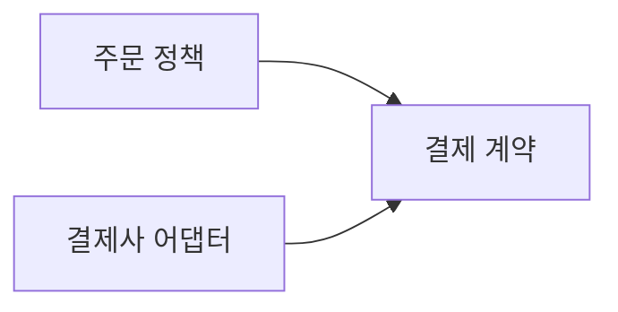

<!-- level:1 -->
# SOLID — 변경의 이유와 의존성을 다루는 다섯 관점

식당 주문 담당이 메뉴 계산·영수증 출력·결제사 통신·화면 배치까지 맡으면 작은 변경도 여러 일을 흔든다. SOLID는 설계의 변경 경계를 검토하는 다섯 원칙이다. SRP는 변경 이유를 모으고, OCP는 안정된 계약으로 확장을 돕고, LSP는 대체 가능한 행동을, ISP는 필요한 계약의 크기를, DIP는 정책과 구현의 의존성 방향을 다룬다.



원칙을 적용한다는 것이 함수마다 인터페이스를 추가하라는 뜻은 아니다. 서로 함께 바뀌는 것은 모으고 독립적으로 바뀌는 것은 분리하는 판단이 중요하다. 의존성 주입은 DIP를 실현할 수 있는 기법이며 둘은 동일 개념이 아니다.

**비유의 한계:** 현실의 업무 분업을 그대로 클래스 수로 바꾸면 과도한 계층이 생길 수 있다. 현재 필요한 변경과 검증 가능한 경계를 근거로 적용한다.
<!-- level:2 -->
# 의존성의 방향을 코드로 보기

고수준 업무 정책이 구체적인 결제 SDK를 직접 호출하면 SDK 변경이 정책 테스트에 스며든다. 정책은 필요한 기능만 갖는 계약에 의존하고 어댑터는 외부 구현을 그 계약으로 연결한다.

Python 3의 최소 예제다. 실제 결제를 하지 않는다.

```python
from typing import Protocol
class Payment(Protocol):
    def charge(self, amount: int) -> str: ...
def checkout(amount: int, payment: Payment) -> str:
    if amount <= 0: raise ValueError("invalid amount")
    return payment.charge(amount)
class FakePayment:
    def charge(self, amount: int) -> str:
        return f"test:{amount}"
assert checkout(100, FakePayment()) == "test:100"
```

이 fake가 외부 결제사의 오류·멱등성 계약을 검증해 주지는 않는다. 계약에는 성공값뿐 아니라 실패·취소·중복 요구도 정의해야 한다. OCP도 코드를 영원히 수정하지 않는다는 뜻이 아니라 자주 바뀌는 축을 안정된 경계로 확장한다는 방향이다. LSP는 메서드 이름보다 입력·결과·불변식의 대체 가능성을 요구한다.
<!-- level:3 -->
# 가상 장애 — 거대한 인터페이스가 배포를 묶는다

가상 Payment 계약이 결제·환불·보고서·파일 출력 메서드를 모두 요구한다. 결제만 필요한 호출자도 보고서 SDK 변경으로 다시 빌드·테스트해야 한다. 실제 변경 이력과 의존 그래프를 확인해 어떤 호출자가 무엇을 사용하고 있는지 본다.

**수정:** 클라이언트가 필요한 작은 계약으로 나누고 공통 업무 규칙을 남긴다. 지나치게 잘게 쪼개 호출 흐름이 어려워지면 다시 묶는다. 인터페이스 이름에 “SOLID”를 붙이는 것으로 설계가 개선되지는 않는다.

**재검증:** 계약 테스트·업무 테스트·외부 어댑터 통합 테스트를 함께 실행한다. 변경 때 영향받는 모듈과 테스트 범위가 줄었는지, 새 결제사 추가가 기존 오류 처리를 깨지 않는지 확인한다.
<!-- level:4 -->
# 추상화의 비용도 설계 대상

| 선택 | 유리한 조건 | 부담 |
|---|---|---|
| 직접 구현 의존 | 변화 적고 작은 내부 코드 | 교체 시 영향 범위 |
| 작은 계약과 어댑터 | 외부 도구·정책이 독립 변경 | 계층·계약 관리 |
| 플러그인 확장 | 여러 구현이 실제 필요 | 설정·관측·버전 복잡성 |

설계 원칙은 성능·팀 구조·출시 속도의 제약 안에서 적용한다. 원격 서비스 계약은 코드 인터페이스보다 부분 실패와 지연 비용이 크다. 추상화를 추가하기 전에 실제 변경 사례, 테스트 어려움, 외부 의존성 경계를 제시한다.

**판단 연습:** 결제사는 자주 바뀌지만 할인 계산은 한 정책뿐이다. 어느 쪽에 교체 계약을 먼저 둘까? 예상하지 않은 모든 미래 변화까지 인터페이스로 만들 필요가 있는지 설명하자.

참고: [Martin Fowler — Dependency Injection](https://martinfowler.com/articles/injection.html), [Microsoft Architecture Principles](https://learn.microsoft.com/en-us/dotnet/architecture/modern-web-apps-azure/architectural-principles).
<!-- quizzes -->
[{"level":1,"question":"SRP를 판단하는 중요한 기준은?","choices":["클래스 줄 수만","메서드는 항상 하나","변경 이유와 책임의 응집","파일 이름 길이"],"answer_index":2,"explanation":"SRP는 단순한 코드 줄 수 제한이 아닙니다. 함께 바뀌는 책임과 독립 변경 이유를 살펴 경계를 정합니다."},{"level":2,"question":"DIP와 의존성 주입의 관계로 적절한 것은?","choices":["의존성 주입은 DIP를 실현할 수 있는 기법","둘은 항상 완전히 같은 말","주입하면 모든 계약이 자동 보장","인터페이스는 외부 오류를 없앰"],"answer_index":0,"explanation":"DIP는 의존성 방향의 원칙입니다. 주입은 연결을 구성하는 기법이며 행동·오류 계약은 별도로 설계합니다."},{"level":3,"question":"호출자가 쓰지 않는 메서드까지 큰 계약에 묶일 때 검토할 원칙은?","choices":["모든 기능을 전역 함수로만 이동","ISP와 실제 호출자의 계약 요구","데이터 캐시 TTL","CPU 클럭"],"answer_index":1,"explanation":"필요 없는 계약에 의존하지 않도록 분리할 수 있습니다. 다만 지나친 분할 비용도 실제 변경과 테스트 흐름으로 평가합니다."},{"level":4,"question":"추상화 추가의 근거로 가장 적절한 것은?","choices":["미래에는 모든 것이 가능","무조건 클래스 수 증가","원칙 이름을 모두 코드에 넣기","실제 변경 축·교체 요구·검증 경계"],"answer_index":3,"explanation":"추상화는 계약·계층 비용을 만듭니다. 실제 변화와 테스트·운영 요구를 근거로 가장 필요한 경계를 선택합니다."}]
