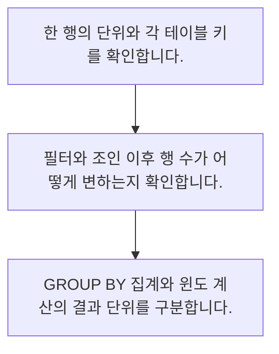

<!-- level:1 -->
# SQL 집계·조인·윈도 함수

> **한 문장으로:** 여러 행을 묶거나 연결할 때 한 행의 의미를 유지해야 보고서의 합계와 순위가 정확해집니다.

## 왜 필요한가요?

업무 자료가 데이터베이스에 쌓여 있어도 필요한 집계가 없으면 판단하기 어렵습니다. SQL을 알면 기간별 합계와 사용자별 변화를 직접 질문하고 결과를 확인할 수 있습니다.

## 일상에서 떠올려 보기

주문 장부와 주문 상품 목록을 붙이면 주문 한 건이 상품 수만큼 반복됩니다. 장부를 합쳤다고 금액을 그대로 더하면 매출이 부풀 수 있습니다.

## 순서대로 따라가기

1. 한 행의 단위와 각 테이블 키를 확인합니다.
2. 필터와 조인 이후 행 수가 어떻게 변하는지 확인합니다.
3. GROUP BY 집계와 윈도 계산의 결과 단위를 구분합니다.



## 처음 만나는 용어

| 용어 | 쉬운 뜻 |
|---|---|
| 집계 | 여러 행을 한 그룹의 값으로 요약하는 계산 |
| 조인 | 키와 조건으로 테이블의 행을 연결하는 연산 |
| 윈도 함수 | 행을 유지하면서 관련 행들의 통계를 계산하는 함수 |

**비유의 한계:** 예제는 작은 테이블의 집계 원리입니다. 실제 데이터의 NULL, 시간대, 중복 키와 조인 관계를 확인하고 쿼리 비용도 따로 측정해야 합니다.

## 스스로 확인

윈도 함수의 특징은 무엇인가요?

**답과 이유:** 원본 행을 유지하며 관련 행 계산 — 윈도 함수는 각 행에 계산 결과를 붙입니다. GROUP BY의 행 축소와 구분해야 합니다.
<!-- level:2 -->
# SQL 집계·조인·윈도 함수 — 실제 흐름 따라가기

## 읽기 전 길잡이

여러 행을 묶거나 연결할 때 한 행의 의미를 유지해야 보고서의 합계와 순위가 정확해집니다. 아래 예제는 외부 시스템에 연결하지 않는 작은 학습용 사례입니다. 입력, 처리 조건, 결과를 순서대로 살펴보세요.

1. 한 행의 단위와 각 테이블 키를 확인합니다.
2. 필터와 조인 이후 행 수가 어떻게 변하는지 확인합니다.
3. GROUP BY 집계와 윈도 계산의 결과 단위를 구분합니다.

## 예제로 확인하기

```sql
CREATE TEMP TABLE orders(id int, customer text, amount int);
INSERT INTO orders VALUES (1,'A',100),(2,'A',200),(3,'B',50);
SELECT customer, sum(amount) AS revenue FROM orders GROUP BY customer;
SELECT id, amount, sum(amount) OVER (PARTITION BY customer) AS customer_total FROM orders;
```

## 결과를 해석하기

GROUP BY 결과는 고객당 한 행이고 윈도 함수 결과는 주문당 한 행입니다. A의 합계는 300이지만 윈도 결과에는 그 값이 주문 두 행에 각각 붙습니다. 두 결과의 합계를 다시 더할 때 단위를 주의하세요.

## 실무에 옮기기 전

예제는 작은 테이블의 집계 원리입니다. 실제 데이터의 NULL, 시간대, 중복 키와 조인 관계를 확인하고 쿼리 비용도 따로 측정해야 합니다. 실제 업무에서는 최신성이 꼭 필요한 수치와 정기 집계로 충분한 수치를 나눕니다. 요약 테이블에도 집계 단위·갱신 시각·원본 추적 경로를 남깁니다.

## 확인 질문

예제에서 고객 A의 합계는?

**답과 이유:** A의 주문 100과 200을 합칩니다. B의 50은 다른 그룹입니다.
<!-- level:3 -->
# SQL 집계·조인·윈도 함수 — 가상 사례로 문제 해결하기

실제 고객의 장애 기록이 아닌 학습용 재현 시나리오입니다. 결과만 바꾸기 전에 관측한 증거와 원인 가설을 구분합니다.

## 1. 어떤 문제가 생겼나요?

가상 매출 보고서가 주문 상품을 조인한 뒤 두 배로 커집니다.

## 2. 먼저 확인할 증거

조인 전후 행 수와 주문 ID별 반복 횟수를 비교합니다.

## 3. 원인 가설

일대다 조인으로 주문 금액이 여러 행에 복제되었습니다.

## 4. 수정 방법

상품 집계를 먼저 하거나 주문 단위를 유지하는 집계 쿼리로 수정합니다.

## 5. 재검증

샘플 주문의 손 계산과 전체 합계, NULL 키와 다중 상품 주문을 대조합니다.

## 놓치기 쉬운 조건

예제는 작은 테이블의 집계 원리입니다. 실제 데이터의 NULL, 시간대, 중복 키와 조인 관계를 확인하고 쿼리 비용도 따로 측정해야 합니다.

## 확인 질문

일대다 조인 뒤 합계가 커졌다면 먼저 볼 것은?

**답과 이유:** 조인으로 금액이 복제되는지 확인해야 합니다. 보기 형식으로는 중복 집계를 고칠 수 없습니다.
<!-- level:4 -->
# SQL 집계·조인·윈도 함수 — 업무와 아키텍처의 선택

## 읽기 전 길잡이

같은 개념도 업무의 규모, 오류 비용, 운영 역량에 따라 적용 방식이 달라집니다. 아래 비교는 특정 제품의 성능 순위가 아닌 선택 기준입니다.

| 선택 | 얻는 점 | 감수할 점 |
|---|---|---|
| 원본에 직접 집계 | 최신 자료를 바로 반영 | 조인 복잡성·실행 비용 |
| 검증된 요약 테이블 | 정의 일관성과 조회 속도 | 갱신 지연·재처리 필요 |

## 선택 기준

최신성이 꼭 필요한 수치와 정기 집계로 충분한 수치를 나눕니다. 요약 테이블에도 집계 단위·갱신 시각·원본 추적 경로를 남깁니다.

## 도입과 운영에서 확인할 것

상품 집계를 먼저 하거나 주문 단위를 유지하는 집계 쿼리로 수정합니다. 샘플 주문의 손 계산과 전체 합계, NULL 키와 다중 상품 주문을 대조합니다.

## 판단 연습

요약 테이블을 쓸 때 함께 관리할 것은?

**판단의 근거:** 요약 결과의 의미와 최신성을 알아야 원본과 비교하거나 재처리할 수 있습니다.

참고: [NIST 통계 핸드북](https://www.itl.nist.gov/div898/handbook/), [PostgreSQL 쿼리](https://www.postgresql.org/docs/current/queries.html).
<!-- quizzes -->
[{"level":1,"question":"윈도 함수의 특징은 무엇인가요?","choices":["테이블을 영구 삭제","원본 행을 유지하며 관련 행 계산","항상 그룹당 한 행으로 축소","모든 중복 자동 제거"],"answer_index":1,"explanation":"윈도 함수는 각 행에 계산 결과를 붙입니다. GROUP BY의 행 축소와 구분해야 합니다."},{"level":2,"question":"예제에서 고객 A의 합계는?","choices":["200","350","300","100"],"answer_index":2,"explanation":"A의 주문 100과 200을 합칩니다. B의 50은 다른 그룹입니다."},{"level":3,"question":"일대다 조인 뒤 합계가 커졌다면 먼저 볼 것은?","choices":["정렬 색상","쿼리 이름","소수점 표기","키별 반복과 행 수"],"answer_index":3,"explanation":"조인으로 금액이 복제되는지 확인해야 합니다. 보기 형식으로는 중복 집계를 고칠 수 없습니다."},{"level":4,"question":"요약 테이블을 쓸 때 함께 관리할 것은?","choices":["집계 정의와 갱신 시각","테이블 이름만","DB 로고","화면 너비"],"answer_index":0,"explanation":"요약 결과의 의미와 최신성을 알아야 원본과 비교하거나 재처리할 수 있습니다."}]
