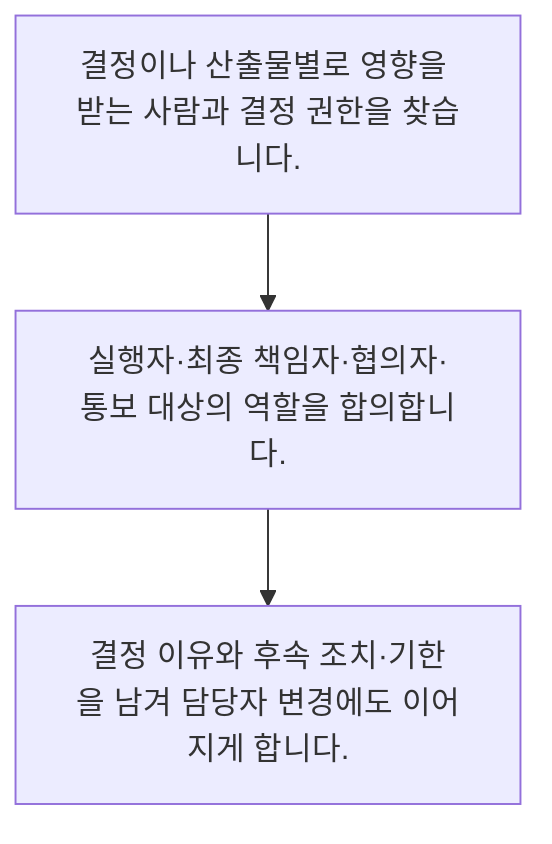

<!-- level:1 -->
# 이해관계자·RACI·의사결정 기록

> **한 문장으로:** 일하는 사람과 최종 결정할 사람을 구분하고, 영향을 받는 사람에게 필요한 정보를 전달합니다.

## 왜 필요한가요?

일할 사람은 정했는데 결정할 사람이 없어서 일이 멈추는 경우가 있습니다. 실행과 승인·협의의 역할을 나누면 필요한 사람에게 적절한 시점에 질문하고 인계할 수 있습니다.

## 일상에서 떠올려 보기

학급 여행에서는 예약하는 학생, 최종 승인하는 선생님, 의견을 주는 학부모, 일정만 전달받는 학생이 다릅니다. 모두를 모든 예약 회의에 부르면 느려지고 승인자가 없으면 예약 자체가 멈춥니다.

## 순서대로 따라가기

1. 결정이나 산출물별로 영향을 받는 사람과 결정 권한을 찾습니다.
2. 실행자·최종 책임자·협의자·통보 대상의 역할을 합의합니다.
3. 결정 이유와 후속 조치·기한을 남겨 담당자 변경에도 이어지게 합니다.



## 처음 만나는 용어

| 용어 | 쉬운 뜻 |
|---|---|
| 이해관계자 | 결과에 영향을 주거나 영향을 받는 사람 |
| RACI | 실행·최종 책임·협의·통보를 구분하는 역할 표 |
| 결정 기록 | 선택한 안과 이유·책임자·날짜를 남긴 기록 |

**비유의 한계:** 사람은 표의 한 칸으로만 움직이지 않습니다. 실제 권한·업무량·갈등을 대화로 확인해야 하며 RACI 표가 조직의 신뢰를 대신하지는 않습니다.

## 스스로 확인

RACI에서 실행자와 최종 책임자를 구분하는 목적은 무엇인가요?

**답과 이유:** 실행과 결정 권한의 혼선을 줄이려고 — 실무 수행과 최종 결정은 다를 수 있으므로 권한과 책임을 명확히 해야 합니다.
<!-- level:2 -->
# 이해관계자·RACI·의사결정 기록 — 실제 흐름 따라가기

## 읽기 전 길잡이

일하는 사람과 최종 결정할 사람을 구분하고, 영향을 받는 사람에게 필요한 정보를 전달합니다. 아래 예제는 외부 시스템에 연결하지 않는 작은 학습용 사례입니다. 입력, 처리 조건, 결과를 순서대로 살펴보세요.

1. 결정이나 산출물별로 영향을 받는 사람과 결정 권한을 찾습니다.
2. 실행자·최종 책임자·협의자·통보 대상의 역할을 합의합니다.
3. 결정 이유와 후속 조치·기한을 남겨 담당자 변경에도 이어지게 합니다.

## 예제로 확인하기

```markdown
# AI 상담 시범 출시 결정
- Responsible: 개발 담당자, 운영 매뉴얼 작성
- Accountable: 고객지원 책임자, 출시 최종 결정
- Consulted: 보안 담당자와 상담원 대표
- Informed: 영업팀
- 결정: 환불 자동 실행 제외, 상담원 승인 유지
- 근거: 오처리의 비용과 검토 가능 인원
- 후속 조치: 개발 담당자가 금요일까지 승인 흐름 검증
```

## 결과를 해석하기

RACI의 A는 업무별로 한 사람을 두면 결정 충돌을 줄이기 쉽습니다. 현실의 공동 승인 규정이 있다면 승인 순서와 교착 시 해결자를 추가합니다. 이름을 적는 것보다 당사자가 권한과 시간을 실제로 갖는지 확인하는 일이 중요합니다.

## 실무에 옮기기 전

사람은 표의 한 칸으로만 움직이지 않습니다. 실제 권한·업무량·갈등을 대화로 확인해야 하며 RACI 표가 조직의 신뢰를 대신하지는 않습니다. 실제 업무에서는 작은 팀은 중요한 결정 로그부터 시작하고, 조직 간 인계가 반복되는 지점에 RACI를 추가합니다. 최종 책임이 여러 명이면 해결 경로를 명시하고 책임 표를 사람 평가의 대체물로 사용하지 않습니다.

## 확인 질문

결정 기록에 필요한 내용은 무엇인가요?

**답과 이유:** 이유와 후속 조치가 있어야 담당자가 바뀌어도 결정을 해석하고 실행할 수 있습니다.
<!-- level:3 -->
# 이해관계자·RACI·의사결정 기록 — 가상 사례로 문제 해결하기

실제 고객의 장애 기록이 아닌 학습용 재현 시나리오입니다. 결과만 바꾸기 전에 관측한 증거와 원인 가설을 구분합니다.

## 1. 어떤 문제가 생겼나요?

보안 검토를 마친 줄 알고 출시했지만 보안 담당자는 의견만 전달했다고 말합니다.

## 2. 먼저 확인할 증거

회의록에는 검토 의견은 있으나 최종 승인자·판정·미해결 항목이 없습니다.

## 3. 원인 가설

협의와 승인 책임을 같은 의미로 사용한 것이 원인 가설입니다.

## 4. 수정 방법

출시 결정의 최종 책임자와 필수 승인 절차를 분리하고 열린 항목·결정·근거를 문서화합니다.

## 5. 재검증

책임자 부재 시 대체 결정 경로를 시험하고 관련 부서가 동일한 출시 상태를 이해하는지 확인합니다.

## 놓치기 쉬운 조건

사람은 표의 한 칸으로만 움직이지 않습니다. 실제 권한·업무량·갈등을 대화로 확인해야 하며 RACI 표가 조직의 신뢰를 대신하지는 않습니다.

## 확인 질문

협의했는데 승인 여부가 불명확하면 무엇을 확인하나요?

**답과 이유:** 의견을 받는 것과 출시를 승인하는 것은 다른 행위이며 명시적 결정이 필요합니다.
<!-- level:4 -->
# 이해관계자·RACI·의사결정 기록 — 업무와 아키텍처의 선택

## 읽기 전 길잡이

같은 개념도 업무의 규모, 오류 비용, 운영 역량에 따라 적용 방식이 달라집니다. 아래 비교는 특정 제품의 성능 순위가 아닌 선택 기준입니다.

| 선택 | 얻는 점 | 감수할 점 |
|---|---|---|
| 간단한 결정 로그 | 변경 이유와 담당자를 빠르게 공유 | 반복 업무의 역할 경계를 모두 담기 어려움 |
| 산출물별 RACI | 조직 간 인계와 승인 책임이 명확함 | 너무 세분화하면 표 관리가 업무를 압도함 |

## 선택 기준

작은 팀은 중요한 결정 로그부터 시작하고, 조직 간 인계가 반복되는 지점에 RACI를 추가합니다. 최종 책임이 여러 명이면 해결 경로를 명시하고 책임 표를 사람 평가의 대체물로 사용하지 않습니다.

## 도입과 운영에서 확인할 것

출시 결정의 최종 책임자와 필수 승인 절차를 분리하고 열린 항목·결정·근거를 문서화합니다. 책임자 부재 시 대체 결정 경로를 시험하고 관련 부서가 동일한 출시 상태를 이해하는지 확인합니다.

## 판단 연습

작은 팀의 역할 문서는 어떻게 시작하는 것이 적절한가요?

**판단의 근거:** 문서는 실제 혼선과 인계 비용을 줄일 정도로 유지하며 대화를 뒷받침해야 합니다.

참고: [Scrum Guide](https://scrumguides.org/scrum-guide.html), [The Kanban Guide 2025](https://kanbanguides.org/the-kanban-guide/2025.5/), [GOV.UK Agile delivery](https://www.gov.uk/service-manual/agile-delivery).
<!-- quizzes -->
[{"level":1,"question":"RACI에서 실행자와 최종 책임자를 구분하는 목적은 무엇인가요?","choices":["문서 작성을 금지하려고","실행과 결정 권한의 혼선을 줄이려고","회의 참석자를 늘리려고","개발을 전부 외주화하려고"],"answer_index":1,"explanation":"실무 수행과 최종 결정은 다를 수 있으므로 권한과 책임을 명확히 해야 합니다."},{"level":2,"question":"결정 기록에 필요한 내용은 무엇인가요?","choices":["참석자 사진만","소문과 추측만","선택·이유·책임자·후속 조치","결정 제목만"],"answer_index":2,"explanation":"이유와 후속 조치가 있어야 담당자가 바뀌어도 결정을 해석하고 실행할 수 있습니다."},{"level":3,"question":"협의했는데 승인 여부가 불명확하면 무엇을 확인하나요?","choices":["참석자 수만","메일의 글자 수","개발자의 성격","승인 권한자와 실제 판정 기록"],"answer_index":3,"explanation":"의견을 받는 것과 출시를 승인하는 것은 다른 행위이며 명시적 결정이 필요합니다."},{"level":4,"question":"작은 팀의 역할 문서는 어떻게 시작하는 것이 적절한가요?","choices":["중요 결정부터 기록하고 인계 지점에 역할 표를 추가한다","모든 사소한 대화를 승인 대상으로 만든다","책임자를 두지 않는다","표가 있으면 대화는 없앤다"],"answer_index":0,"explanation":"문서는 실제 혼선과 인계 비용을 줄일 정도로 유지하며 대화를 뒷받침해야 합니다."}]
