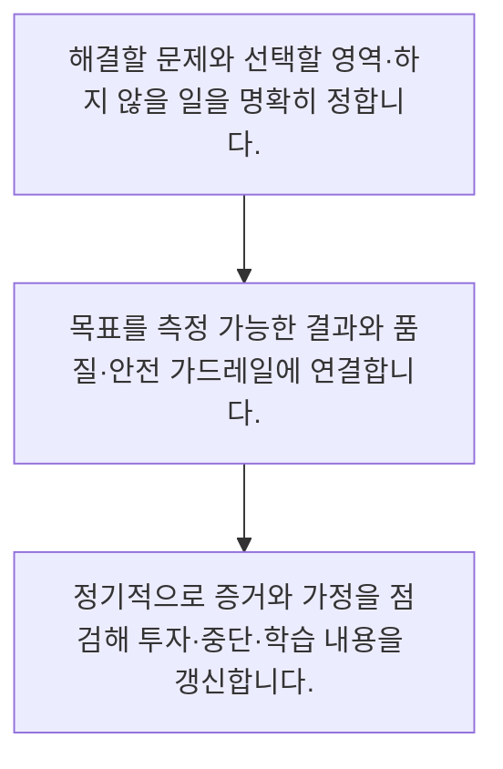

<!-- level:1 -->
# IT·AI 전략·OKR·조직 학습

> **한 문장으로:** 전략은 유행 기술 목록이 아니라 어느 문제에 역량을 집중할지 선택하는 일이며, OKR은 목표와 결과를 연결하는 도구입니다.

## 왜 필요한가요?

기능 수나 AI 사용량만 목표로 삼으면 실제 업무가 나빠져도 성공처럼 보일 수 있습니다. 해결할 문제와 결과·부작용을 연결하면 실행을 바꾸고 배운 점을 다음 결정에 반영할 수 있습니다.

## 일상에서 떠올려 보기

등산에서는 정상이라는 방향과 현재 위치·남은 거리·체력 상태를 함께 봅니다. 발걸음 수만 늘리면 길을 잘못 들어도 열심히 걷는 것처럼 보입니다. 조직도 기능 수나 AI 사용량보다 원하는 변화에 가까워지는지 확인해야 합니다.

## 순서대로 따라가기

1. 해결할 문제와 선택할 영역·하지 않을 일을 명확히 정합니다.
2. 목표를 측정 가능한 결과와 품질·안전 가드레일에 연결합니다.
3. 정기적으로 증거와 가정을 점검해 투자·중단·학습 내용을 갱신합니다.



## 처음 만나는 용어

| 용어 | 쉬운 뜻 |
|---|---|
| 전략 | 제약 아래 어디에 집중하고 무엇을 포기할지 정한 선택 |
| OKR | 질적인 목표와 확인 가능한 핵심 결과를 연결하는 방식 |
| 산출물과 성과 | 만든 것과 그로 인해 사용자·조직에 생긴 변화 |

**비유의 한계:** 조직의 결과는 한 팀의 행동만으로 정해지지 않습니다. 지표 변화의 원인을 단정하지 말고 외부 환경·측정 오류·역효과를 점검하며 목표가 개인 평가용 숫자 맞추기로 변하지 않게 합니다.

## 스스로 확인

전략을 더 잘 설명한 것은 무엇인가요?

**답과 이유:** 어디에 집중하고 무엇을 하지 않을지 선택한다 — 전략은 제약 아래 자원을 집중하는 선택이며 하지 않을 일도 포함합니다.
<!-- level:2 -->
# IT·AI 전략·OKR·조직 학습 — 실제 흐름 따라가기

## 읽기 전 길잡이

전략은 유행 기술 목록이 아니라 어느 문제에 역량을 집중할지 선택하는 일이며, OKR은 목표와 결과를 연결하는 도구입니다. 아래 예제는 외부 시스템에 연결하지 않는 작은 학습용 사례입니다. 입력, 처리 조건, 결과를 순서대로 살펴보세요.

1. 해결할 문제와 선택할 영역·하지 않을 일을 명확히 정합니다.
2. 목표를 측정 가능한 결과와 품질·안전 가드레일에 연결합니다.
3. 정기적으로 증거와 가정을 점검해 투자·중단·학습 내용을 갱신합니다.

## 예제로 확인하기

```markdown
# 목표와 결과 예시
- Objective: 신규 상담원이 근거 있는 답변을 자신 있게 제공한다.
- Key Result 후보: 대표 문의의 근거 확인 성공률 개선
- Key Result 후보: 같은 코호트의 순처리 시간 개선
- 가드레일: 오답·민감정보 노출·검토 부담을 악화시키지 않음
- 실행 후보: 문서 정리, 교육, 검색 개선, AI 보조
- 하지 않을 일: 근거 없이 전사 자동 응답 확대
- 점검: 측정 정의·기준선·오류 사례·사용자 피드백
- 결정: 가정이 틀리면 실행과 투자 범위를 조정
```

## 결과를 해석하기

검색 화면 세 개 만들기나 AI 교육 열 번은 활동·산출물입니다. 근거 확인의 성공과 순처리 시간은 결과에 가까우나 분모·기간·기준선이 있어야 검증할 수 있습니다. 숫자 목표를 정할 때 현실의 근거와 품질 가드레일을 함께 합의합니다.

## 실무에 옮기기 전

조직의 결과는 한 팀의 행동만으로 정해지지 않습니다. 지표 변화의 원인을 단정하지 말고 외부 환경·측정 오류·역효과를 점검하며 목표가 개인 평가용 숫자 맞추기로 변하지 않게 합니다. 실제 업무에서는 조직 전략에서는 도구 도입을 목표로 삼기보다 핵심 문제·역량·데이터·운영 책임을 연결합니다. 지표를 강제하는 데서 끝내지 말고 실패에서 배운 점과 중단 결정을 공유하며 단기 숫자가 신뢰성과 장기 역량을 해치지 않게 합니다.

## 확인 질문

산출물보다 결과에 가까운 지표는 무엇인가요?

**답과 이유:** 결과 지표는 사용자의 변화에 연결되지만 대상과 측정 정의도 명확해야 합니다.
<!-- level:3 -->
# IT·AI 전략·OKR·조직 학습 — 가상 사례로 문제 해결하기

실제 고객의 장애 기록이 아닌 학습용 재현 시나리오입니다. 결과만 바꾸기 전에 관측한 증거와 원인 가설을 구분합니다.

## 1. 어떤 문제가 생겼나요?

AI 도입 목표를 달성했지만 직원들은 시간을 더 쓰고 오류도 늘었습니다.

## 2. 먼저 확인할 증거

목표가 AI 기능 수와 교육 참석자 수였고 실제 업무 결과는 측정하지 않았습니다.

## 3. 원인 가설

산출물을 성과로 사용한 것이 원인 가설입니다.

## 4. 수정 방법

문제와 기준선을 다시 정의하고 순시간·품질·업무 부담을 결과 지표로 연결합니다.

## 5. 재검증

동일 대상의 실제 결과와 부작용을 검토하고 도움이 없는 실행은 중단하거나 수정합니다.

## 놓치기 쉬운 조건

조직의 결과는 한 팀의 행동만으로 정해지지 않습니다. 지표 변화의 원인을 단정하지 말고 외부 환경·측정 오류·역효과를 점검하며 목표가 개인 평가용 숫자 맞추기로 변하지 않게 합니다.

## 확인 질문

AI 기능 수는 늘고 업무가 나빠지면 무엇을 바꿔야 하나요?

**답과 이유:** 활동을 달성했다고 업무 가치가 생기지는 않으므로 결과와 부작용을 측정해야 합니다.
<!-- level:4 -->
# IT·AI 전략·OKR·조직 학습 — 업무와 아키텍처의 선택

## 읽기 전 길잡이

같은 개념도 업무의 규모, 오류 비용, 운영 역량에 따라 적용 방식이 달라집니다. 아래 비교는 특정 제품의 성능 순위가 아닌 선택 기준입니다.

| 선택 | 얻는 점 | 감수할 점 |
|---|---|---|
| 활동·산출물 중심 계획 | 진행 여부를 확인하기 쉬움 | 사용자 가치와 연결되지 않을 수 있음 |
| 결과·학습 중심 목표 | 실행을 바꾸며 가치에 집중 | 측정·귀속·가드레일 설계가 필요 |

## 선택 기준

조직 전략에서는 도구 도입을 목표로 삼기보다 핵심 문제·역량·데이터·운영 책임을 연결합니다. 지표를 강제하는 데서 끝내지 말고 실패에서 배운 점과 중단 결정을 공유하며 단기 숫자가 신뢰성과 장기 역량을 해치지 않게 합니다.

## 도입과 운영에서 확인할 것

문제와 기준선을 다시 정의하고 순시간·품질·업무 부담을 결과 지표로 연결합니다. 동일 대상의 실제 결과와 부작용을 검토하고 도움이 없는 실행은 중단하거나 수정합니다.

## 판단 연습

OKR 운영에서 필요한 태도는 무엇인가요?

**판단의 근거:** 목표는 학습과 선택을 돕는 도구이며 지표 왜곡이나 품질 희생을 유도하면 목적을 잃습니다.

참고: [GOV.UK Service Manual](https://www.gov.uk/service-manual), [WCAG 2.2](https://www.w3.org/TR/WCAG22/).
<!-- quizzes -->
[{"level":1,"question":"전략을 더 잘 설명한 것은 무엇인가요?","choices":["회의 횟수를 늘린다","어디에 집중하고 무엇을 하지 않을지 선택한다","유행 기술을 모두 도입한다","모든 요청을 동시에 시작한다"],"answer_index":1,"explanation":"전략은 제약 아래 자원을 집중하는 선택이며 하지 않을 일도 포함합니다."},{"level":2,"question":"산출물보다 결과에 가까운 지표는 무엇인가요?","choices":["교육 개최 수","코드 줄 수","대표 문의의 근거 확인 성공률","개발한 화면 수"],"answer_index":2,"explanation":"결과 지표는 사용자의 변화에 연결되지만 대상과 측정 정의도 명확해야 합니다."},{"level":3,"question":"AI 기능 수는 늘고 업무가 나빠지면 무엇을 바꿔야 하나요?","choices":["기능 수를 더 늘린다","실패 자료 삭제","교육 참석만 더 강제","실제 순시간·품질·부담과 연결된 목표로 재정의한다"],"answer_index":3,"explanation":"활동을 달성했다고 업무 가치가 생기지는 않으므로 결과와 부작용을 측정해야 합니다."},{"level":4,"question":"OKR 운영에서 필요한 태도는 무엇인가요?","choices":["증거로 가정을 점검하고 실행·투자를 조정한다","수치를 맞추기 위해 분모를 바꾼다","목표를 개인 순위표로만 쓴다","가드레일을 없앤다"],"answer_index":0,"explanation":"목표는 학습과 선택을 돕는 도구이며 지표 왜곡이나 품질 희생을 유도하면 목적을 잃습니다."}]
