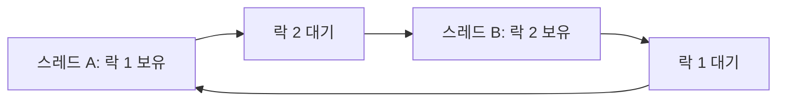

<!-- level:1 -->
# 동기화와 데드락 — 함께 쓰는 장부의 규칙

두 사람이 같은 재고 장부를 읽고 각각 “하나 남았다”는 판단을 하면 한 물건을 두 번 팔 수 있다. 동기화는 함께 쓰는 상태의 읽기·판단·변경이 지켜야 할 순서를 만든다. 뮤텍스는 한 번에 한 실행자가 임계 구역에 들어가게 하는 도구이고, 세마포어는 허용 가능한 자원 수를 관리할 수 있다.



서로 상대가 가진 자원을 기다리며 진행할 수 없는 상태가 데드락이다. 데이터 레이스, 데드락, 굶주림, livelock은 증상과 해결이 다르다. 데드락의 고전적 필요 조건은 상호 배제, 점유와 대기, 강제 회수 불가, 순환 대기다.

**비유의 한계:** 락을 추가하면 모든 문제가 사라지지는 않는다. 잠금 범위가 틀리면 불변식을 지키지 못하고, 넓으면 경합이 커진다. 하나의 원자 변수도 여러 변수에 걸친 규칙을 자동으로 원자화하지 않는다.

**확인:** 잔고와 출금 기록이 함께 바뀌어야 한다면 한 변수만 atomic으로 만드는 것으로 충분한가?
<!-- level:2 -->
# 임계 구역의 기준은 데이터의 불변식

“재고가 0 아래로 내려가지 않는다”라는 규칙을 지키려면 확인과 차감이 같은 임계 구역 안에 있어야 한다. 가시성과 메모리 순서도 동기화 계약의 일부다. 조건 변수는 상태가 원하는 조건이 될 때까지 기다리는 도구이며 깨어났다는 이유만으로 조건이 참이라고 가정하지 않는다. predicate를 반복 확인한다.

Python 3의 단일 프로세스 스레드 예제다. GIL을 업무 불변식의 잠금으로 대신하지 않는다.

```python
from threading import Lock, Thread
stock, sold = 1, 0
lock = Lock()
def buy():
    global stock, sold
    with lock:
        if stock > 0:
            stock -= 1
            sold += 1
workers = [Thread(target=buy) for _ in range(20)]
for worker in workers: worker.start()
for worker in workers: worker.join()
assert stock == 0 and sold == 1
```

컨텍스트 매니저는 예외가 나도 잠금을 해제하도록 돕는다. 여러 락이 필요하다면 모든 경로에서 동일한 순서로 획득한다. 락을 가진 채 외부 네트워크 호출을 수행하면 대기 시간이 길어지며 순환 의존성도 생길 수 있다. 서로 다른 프로세스나 DB 트랜잭션에는 다른 잠금 경계가 필요하다.
<!-- level:3 -->
# 재현 사례 — 두 계좌를 반대 순서로 잠근다

가상 송금 코드가 A→B에서는 A 락 뒤 B 락, B→A에서는 B 락 뒤 A 락을 잡는다. 두 요청이 동시에 실행하면 서로를 기다릴 수 있다.

```text
thread-1 holds account-A; waits account-B
thread-2 holds account-B; waits account-A
```

모든 스레드의 스택을 같은 시점에 수집하고 보유·대기 락을 그래프로 그린다. “CPU가 낮다”만으로 데드락이라고 단정하지 말고 I/O 대기와 조건 변수 대기도 확인한다. 재현에는 barrier를 써 획득 순서를 맞출 수 있지만 실제 운영에서 강제 무한 대기를 만들지 않는다.

**수정:** 계좌 ID 등 안정된 키 순서로 락을 획득하고 역순으로 해제한다. 임계 구역을 작게 하며 타임아웃·취소·재시도에는 자원 정리를 포함한다. 타임아웃만 추가해도 중간 변경의 무결성은 자동 복구되지 않는다.

**재검증:** 반대 방향 요청, 예외, 취소, 중복 요청을 함께 실행한다. 계좌 총합 같은 불변식과 락 대기 시간, 처리량을 확인한다. C/C++의 데이터 레이스에는 ThreadSanitizer가 보조 수단이다.
<!-- level:4 -->
# 동기화 전략을 고르는 기준

| 전략 | 유리한 작업 | 부담 |
|---|---|---|
| 단일 뮤텍스 | 단순한 복합 불변식 | 병목·긴 임계 구역 |
| 세분화 락 | 독립 키의 병렬 변경 | 잠금 순서·관리 복잡성 |
| atomic/CAS | 작은 상태의 경쟁 갱신 | 메모리 순서·ABA·재시도 비용 |
| 소유권과 메시지 전달 | 공유 가변 상태 최소화 | 큐·지연·분할 설계 |

lock-free는 각 스레드가 반드시 기다리지 않는다는 뜻이 아니며 wait-free와 다르다. 읽기 쓰기 락도 읽기 비율이 높다는 이유만으로 항상 빠르지 않다. 업무 불변식부터 정하고 도구의 보장 범위를 확인한다.

대규모 서비스에서는 전역 락을 분산 락으로 바꾸기 전에 상태를 키별로 분할하거나 DB 원자 갱신으로 표현할 수 있는지 본다. 분산 락은 lease 만료·네트워크 분할·오래된 소유자의 쓰기 문제까지 고려해야 한다. 락 대기 시간, 충돌률, 취소와 복구를 SLO와 연결한다.

**판단 연습:** 인기 상품 한 개와 수만 개의 독립 상품 재고를 같은 잠금 방식으로 처리해야 할까? 정확성과 핫키 부하를 기준으로 선택하자.

참고: [Python threading](https://docs.python.org/3/library/threading.html), [Clang ThreadSanitizer](https://clang.llvm.org/docs/ThreadSanitizer.html).
<!-- quizzes -->
[{"level":1,"question":"원자 카운터 하나가 복합 업무 불변식을 자동으로 보장하지 못하는 이유는?","choices":["atomic은 항상 느리기 때문","여러 상태 사이의 확인·변경 전체는 별도 경계가 필요","모든 스레드가 같은 CPU만 쓰기 때문","락에는 메모리가 없기 때문"],"answer_index":1,"explanation":"한 변수의 원자성은 여러 변수에 걸친 상태 변경의 원자성을 보장하지 않습니다. 보호할 불변식과 임계 구역을 정해야 합니다."},{"level":2,"question":"조건 변수에서 깨어난 후 필요한 동작은?","choices":["조건을 보지 않고 실행","락을 영구 보유","predicate를 다시 확인","스레드를 무조건 종료"],"answer_index":2,"explanation":"깨움과 조건의 참 여부는 같지 않습니다. 경쟁 변화와 spurious wakeup 등을 고려해 조건을 반복 검사합니다."},{"level":3,"question":"반대 방향 송금의 두 락이 순환 대기를 만들 때 수정 출발점은?","choices":["모든 경로의 락 획득 순서를 안정된 키 순서로 통일","타임아웃 숫자만 키우기","로그를 삭제","무결성 검사를 제거"],"answer_index":0,"explanation":"일관된 락 순서는 순환 대기를 예방하는 방법입니다. 예외·취소 시 해제와 업무 불변식 검증도 함께 필요합니다."},{"level":4,"question":"lock-free 알고리즘에 대한 정확한 설명은?","choices":["모든 스레드가 항상 제한 시간 안에 완료","경합이 절대 없음","분산 장애도 자동 해결","시스템 수준 진행 보장과 각 스레드의 완료 보장은 구분"],"answer_index":3,"explanation":"lock-free와 wait-free는 다릅니다. CAS 경쟁에서 특정 스레드는 재시도를 반복할 수 있어 진행·공정성·비용을 따로 검토합니다."}]
