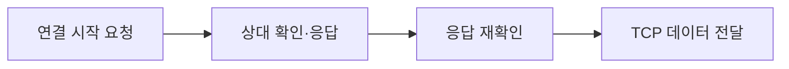

<!-- level:1 -->
# TCP와 UDP — 데이터를 전달하는 두 가지 기본 방식

> **한 문장으로:** TCP는 연결 상태와 순서를 관리하며 데이터를 전달하고, UDP는 메시지를 보내는 기본 통로를 제공합니다.

## 왜 필요한가요?

파일은 한 부분이 빠지면 다시 받아야 하고, 실시간 소리는 늦은 데이터보다 새 데이터가 중요할 수 있습니다. 앱마다 필요한 전달 보장이 달라 통신 방식을 선택해야 합니다.

## 일상에서 떠올려 보기

TCP를 함께 번호를 맞추며 문서의 줄을 주고받는 두 사람으로 생각해 보세요. 빠진 줄은 다시 요청하고 순서대로 정리합니다. UDP는 각 쪽지를 보내는 방식에 가깝습니다. 기본 통로만으로는 도착 여부나 순서를 보장하지 않습니다.

## 순서대로 따라가기

1. TCP를 쓰려는 쪽이 연결 시작 신호를 보내고 첫 데이터 번호를 알립니다.
2. 상대가 이를 확인하며 자신의 시작 번호도 알려 주고, 처음 쪽이 다시 확인합니다. 이 세 번의 확인이 3-way handshake입니다.
3. 연결 뒤 TCP는 데이터 순서와 재전송을 관리합니다. UDP를 쓰는 앱은 필요한 확인과 복구 기능을 별도로 설계할 수 있습니다.



## 작은 예로 확인하기

파일 앞부분이 빠지면 뒤에 받은 바이트도 원래 순서대로 정리해야 합니다. TCP는 이를 관리합니다. 하지만 TCP 연결 확인이 성공했다고 결제 요청이 성공했거나 상대 서비스가 정상이라고 단정할 수는 없습니다. 통신 연결과 업무 결과는 별도입니다.

## 처음 만나는 용어

| 용어 | 쉬운 뜻 |
|---|---|
| TCP | 연결 안에서 바이트의 순서와 전달 복구를 관리하는 통신 방식입니다. |
| UDP | 메시지 단위로 데이터를 보내는 기본 통신 방식입니다. |
| 핸드셰이크 | 통신 시작 전에 서로 필요한 상태를 확인하는 절차입니다. |
| 시퀀스 번호 | 데이터가 흐름의 어느 위치에 있는지 나타내는 번호입니다. |

**비유의 한계:** TCP가 모든 업무 성공을 보장하지 않고, UDP가 모든 상황에서 더 빠른 것도 아닙니다. UDP 위에도 신뢰성 기능을 구현할 수 있으며 HTTP/3의 QUIC이 한 예입니다.

## 스스로 확인

3-way handshake가 끝났다면 상품 주문까지 성공했다고 볼 수 있을까요?

**답과 이유:** 아닙니다. 양쪽의 연결 상태와 시작 번호를 확인한 것입니다. 주문 처리는 이후 앱의 요청·응답으로 따로 확인해야 합니다.
<!-- level:2 -->
# 스트림의 프레이밍과 재시도 경계

<!-- beginner-guide:start -->
## 읽기 전 길잡이

아래 예제는 받는 쪽이 데이터 길이를 먼저 읽어 한 메시지의 범위를 찾습니다. 보내는 코드 한 번과 받는 코드 한 번이 항상 대응하지 않는다는 점에 집중하세요.

## 이 단계에서 만날 말

| 용어 | 쉬운 뜻 |
|---|---|
| ACK | 어디까지 받았는지 상대에게 알리는 확인입니다. |
| 재전송 | 빠졌다고 판단한 데이터를 다시 보내는 것입니다. |
| 바이트 스트림 | 앱의 메시지 경계 없이 이어지는 데이터 흐름입니다. |
| 데이터그램 | UDP에서 보내는 한 메시지 묶음입니다. |
| 혼잡 제어 | 네트워크가 감당할 수 있도록 보내는 속도를 조절하는 것입니다. |
| 프레이밍 | 연속 데이터에서 한 메시지의 범위를 구별하는 약속입니다. |

<!-- beginner-guide:end -->

TCP 시퀀스 번호는 바이트의 위치를 나타내고 ACK는 수신한 범위를 알린다. 손실을 추정하면 재전송하며 순서대로 앱에 전달한다. UDP 데이터그램은 메시지 단위를 갖지만 크기와 IP 단편화 등 경로 제약이 있다. “UDP는 항상 빠르다”는 말은 구현·부하·신뢰성 요구를 생략한다.

Python 3에서 로컬 TCP 스타일 스트림의 길이 프레이밍을 재현한다.

```python
import socket, struct
a, b = socket.socketpair()
payload = b"hello"
b.sendall(struct.pack("!I", len(payload)) + payload)
def read_exact(sock, length):
    result = bytearray()
    while len(result) < length:
        chunk = sock.recv(length - len(result))
        if not chunk: raise EOFError("connection closed")
        result.extend(chunk)
    return bytes(result)
length = struct.unpack("!I", read_exact(a, 4))[0]
if length > 1024: raise ValueError("message too large")
print(read_exact(a, length))
a.close(); b.close()
```

길이 검사와 반복 읽기가 중요하다. 이 학습 예제에는 운영용 기한·취소·다중 메시지 상태 머신을 추가해야 한다. TCP ACK는 서버 앱이 주문을 DB에 저장했다는 확인이 아니다. 업무 확인 응답을 별도로 설계한다.
<!-- level:3 -->
# 가상 장애 — 타임아웃 재시도로 주문이 중복된다

<!-- beginner-guide:start -->
## 읽기 전 길잡이

응답이 없으면 상대가 요청을 받지 못했을 수도 있고, 일을 끝낸 뒤 응답만 사라졌을 수도 있습니다. 통신 오류를 확정된 업무 실패와 구분하고 재시도 중 중복 처리도 생각해 보세요.

<!-- beginner-guide:end -->

서버가 주문을 저장했지만 응답 패킷이 늦어 클라이언트가 재요청한다. TCP 재전송은 연결 안의 바이트 전달을 관리하지만 새 HTTP 요청의 업무 중복까지 제거하지 않는다.

가상 로그에서 동일 주문 키의 “처리 성공”과 “클라이언트 타임아웃”을 시간축에 놓는다. 연결 실패인지 요청 전송 후 응답 대기 실패인지 구분하고 `ss -ti`나 권한 있는 캡처로 RTT·재전송 단서를 확인한다. 패킷 손실률과 앱 처리 지연을 혼동하지 않는다.

**수정:** 요청 기한과 제한된 재시도·지터를 두고 멱등 키로 업무 결과를 재사용한다. 재시도는 한 계층에서 통제해 증폭을 막는다. 주문 저장과 멱등 키 등록이 원자적으로 연결돼야 한다.

**재검증:** 응답만 손실되는 경우와 서버 처리 전에 연결이 끊기는 경우를 모두 재현한다. 중복 업무 수, 재시도율, 서버 부하와 사용자 성공률을 비교한다.
<!-- level:4 -->
# 전송 선택과 애플리케이션 보장

<!-- beginner-guide:start -->
## 읽기 전 길잡이

파일 전송, 실시간 영상, 게임에서 허용할 수 있는 지연과 누락은 다릅니다. 필요한 보장을 먼저 적고 기본 전송과 앱의 추가 기능을 함께 비교하세요.

<!-- beginner-guide:end -->

| 선택 | 유리한 상황 | 책임 |
|---|---|---|
| TCP | 순서·신뢰성이 필요한 스트림 | 프레이밍·기한·업무 멱등성 |
| UDP 기반 앱 프로토콜 | 오래된 데이터보다 최신 상태가 중요한 통신 | 손실·순서·혼잡·보안 설계 |
| QUIC | UDP 위의 보안 스트림과 연결 이동 | 구현·경로 지원·운영 관측 |

손실 데이터가 치명적인지, 지연된 데이터가 쓸모없는지, 경로가 UDP를 허용하는지를 먼저 정한다. TCP의 연결 수·핸드셰이크·keepalive·TIME_WAIT·NAT 한도도 운영에 영향을 준다. 장기 연결은 설정 비용을 줄일 수 있지만 장애 감지와 재연결 폭주를 설계해야 한다.

**판단 연습:** 영상 프레임, 결제 명령, 게임 위치 업데이트에 같은 재전송 정책을 적용할까? 전송의 보장과 업무의 보장을 따로 적고, 혼잡 상황의 유입 제한과 복구를 설명하자.

참고: [TCP RFC 9293](https://www.rfc-editor.org/rfc/rfc9293), [UDP RFC 768](https://www.rfc-editor.org/rfc/rfc768).
<!-- quizzes -->
[{"level":1,"question":"TCP 3-way handshake가 직접 보장하는 것은?","choices":["DB 주문 저장 완료","TLS 암호화 완료","양쪽 초기 시퀀스와 연결 상태 확인","서버 업무 무중복 실행"],"answer_index":2,"explanation":"TCP 연결 설정은 전송 상태를 맞춥니다. 암호화와 업무 저장·중복 방지는 다른 계층의 계약입니다."},{"level":2,"question":"TCP 메시지 수신 코드에 필요한 것은?","choices":["send와 recv 호출 수만 동일하게 맞춤","프레이밍·부분 읽기·길이 상한 처리","한 recv로 모든 메시지를 보장","바이트 순서 규칙 제거"],"answer_index":1,"explanation":"TCP는 바이트 스트림입니다. 앱은 길이 또는 구분자를 정하고 부분 수신·종료·입력 상한을 처리해야 합니다."},{"level":3,"question":"응답 타임아웃으로 주문 요청을 다시 보낼 때 중복 방지 방법은?","choices":["TCP ACK만 믿기","재시도 횟수 무제한","DNS 캐시 삭제","멱등 키와 원자적인 업무 결과 등록"],"answer_index":3,"explanation":"전송 재전송은 새 업무 요청의 중복을 막지 않습니다. 멱등 키와 저장 경계를 설계해 처리 결과를 재사용합니다."},{"level":4,"question":"UDP 선택의 판단으로 적절한 것은?","choices":["손실·최신성·지연·혼잡 제어 요구와 경로 지원을 비교","항상 TCP보다 빠르다고 단정","보안이 자동으로 포함됨","운영 관측이 필요 없음"],"answer_index":0,"explanation":"UDP는 기본 전달 보장이 적으며 앱 프로토콜에 추가 책임이 있습니다. 요구와 환경을 함께 평가해야 합니다."}]
