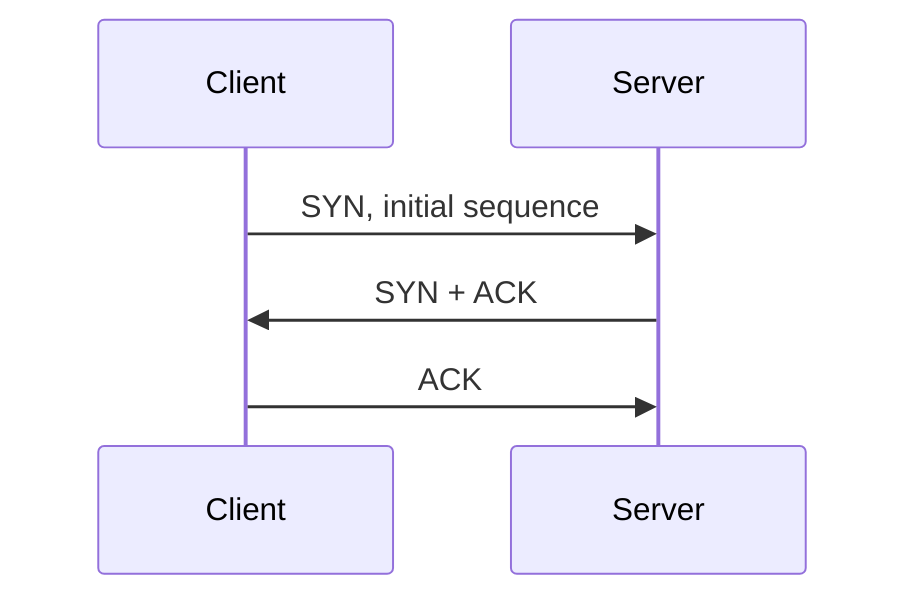

<!-- level:1 -->
# TCP와 UDP — 연결된 대화와 독립 우편물

TCP는 순서 있는 바이트 스트림을 전달하며 손실을 재전송하고 수신 측과 네트워크의 처리 능력을 고려한다. UDP는 개별 데이터그램을 보내며 전달·중복 방지·순서를 자체적으로 보장하지 않는다. UDP를 사용하는 앱도 필요한 신뢰성을 상위 프로토콜로 구현할 수 있다.



TCP 연결 설정은 양쪽의 초기 시퀀스와 통신 상태를 확인한다. 세 번째 메시지까지 포함한 3-way handshake를 “암호화”로 설명하면 안 된다. TLS는 별도의 보안 프로토콜이다. 흐름 제어는 수신자 버퍼, 혼잡 제어는 네트워크 경로의 과부하를 다룬다.

**비유의 한계:** TCP 연결은 전용 물리 회선을 예약하지 않는다. TCP가 메시지 경계를 보존하거나 앱 처리 완료까지 보장하는 것도 아니다.

**확인:** 메시지를 늦게 받는 것보다 오래된 메시지를 버리는 것이 나은 실시간 앱에서는 어떤 전달 정책을 고려할까?
<!-- level:2 -->
# 스트림의 프레이밍과 재시도 경계

TCP 시퀀스 번호는 바이트의 위치를 나타내고 ACK는 수신한 범위를 알린다. 손실을 추정하면 재전송하며 순서대로 앱에 전달한다. UDP 데이터그램은 메시지 단위를 갖지만 크기와 IP 단편화 등 경로 제약이 있다. “UDP는 항상 빠르다”는 말은 구현·부하·신뢰성 요구를 생략한다.

Python 3에서 로컬 TCP 스타일 스트림의 길이 프레이밍을 재현한다.

```python
import socket, struct
a, b = socket.socketpair()
payload = b"hello"
b.sendall(struct.pack("!I", len(payload)) + payload)
def read_exact(sock, length):
    result = bytearray()
    while len(result) < length:
        chunk = sock.recv(length - len(result))
        if not chunk: raise EOFError("connection closed")
        result.extend(chunk)
    return bytes(result)
length = struct.unpack("!I", read_exact(a, 4))[0]
if length > 1024: raise ValueError("message too large")
print(read_exact(a, length))
a.close(); b.close()
```

길이 검사와 반복 읽기가 중요하다. 이 학습 예제에는 운영용 기한·취소·다중 메시지 상태 머신을 추가해야 한다. TCP ACK는 서버 앱이 주문을 DB에 저장했다는 확인이 아니다. 업무 확인 응답을 별도로 설계한다.
<!-- level:3 -->
# 가상 장애 — 타임아웃 재시도로 주문이 중복된다

서버가 주문을 저장했지만 응답 패킷이 늦어 클라이언트가 재요청한다. TCP 재전송은 연결 안의 바이트 전달을 관리하지만 새 HTTP 요청의 업무 중복까지 제거하지 않는다.

가상 로그에서 동일 주문 키의 “처리 성공”과 “클라이언트 타임아웃”을 시간축에 놓는다. 연결 실패인지 요청 전송 후 응답 대기 실패인지 구분하고 `ss -ti`나 권한 있는 캡처로 RTT·재전송 단서를 확인한다. 패킷 손실률과 앱 처리 지연을 혼동하지 않는다.

**수정:** 요청 기한과 제한된 재시도·지터를 두고 멱등 키로 업무 결과를 재사용한다. 재시도는 한 계층에서 통제해 증폭을 막는다. 주문 저장과 멱등 키 등록이 원자적으로 연결돼야 한다.

**재검증:** 응답만 손실되는 경우와 서버 처리 전에 연결이 끊기는 경우를 모두 재현한다. 중복 업무 수, 재시도율, 서버 부하와 사용자 성공률을 비교한다.
<!-- level:4 -->
# 전송 선택과 애플리케이션 보장

| 선택 | 유리한 상황 | 책임 |
|---|---|---|
| TCP | 순서·신뢰성이 필요한 스트림 | 프레이밍·기한·업무 멱등성 |
| UDP 기반 앱 프로토콜 | 오래된 데이터보다 최신 상태가 중요한 통신 | 손실·순서·혼잡·보안 설계 |
| QUIC | UDP 위의 보안 스트림과 연결 이동 | 구현·경로 지원·운영 관측 |

손실 데이터가 치명적인지, 지연된 데이터가 쓸모없는지, 경로가 UDP를 허용하는지를 먼저 정한다. TCP의 연결 수·핸드셰이크·keepalive·TIME_WAIT·NAT 한도도 운영에 영향을 준다. 장기 연결은 설정 비용을 줄일 수 있지만 장애 감지와 재연결 폭주를 설계해야 한다.

**판단 연습:** 영상 프레임, 결제 명령, 게임 위치 업데이트에 같은 재전송 정책을 적용할까? 전송의 보장과 업무의 보장을 따로 적고, 혼잡 상황의 유입 제한과 복구를 설명하자.

참고: [TCP RFC 9293](https://www.rfc-editor.org/rfc/rfc9293), [UDP RFC 768](https://www.rfc-editor.org/rfc/rfc768).
<!-- quizzes -->
[{"level":1,"question":"TCP 3-way handshake가 직접 보장하는 것은?","choices":["DB 주문 저장 완료","TLS 암호화 완료","양쪽 초기 시퀀스와 연결 상태 확인","서버 업무 무중복 실행"],"answer_index":2,"explanation":"TCP 연결 설정은 전송 상태를 맞춥니다. 암호화와 업무 저장·중복 방지는 다른 계층의 계약입니다."},{"level":2,"question":"TCP 메시지 수신 코드에 필요한 것은?","choices":["send와 recv 호출 수만 동일하게 맞춤","프레이밍·부분 읽기·길이 상한 처리","한 recv로 모든 메시지를 보장","바이트 순서 규칙 제거"],"answer_index":1,"explanation":"TCP는 바이트 스트림입니다. 앱은 길이 또는 구분자를 정하고 부분 수신·종료·입력 상한을 처리해야 합니다."},{"level":3,"question":"응답 타임아웃으로 주문 요청을 다시 보낼 때 중복 방지 방법은?","choices":["TCP ACK만 믿기","재시도 횟수 무제한","DNS 캐시 삭제","멱등 키와 원자적인 업무 결과 등록"],"answer_index":3,"explanation":"전송 재전송은 새 업무 요청의 중복을 막지 않습니다. 멱등 키와 저장 경계를 설계해 처리 결과를 재사용합니다."},{"level":4,"question":"UDP 선택의 판단으로 적절한 것은?","choices":["손실·최신성·지연·혼잡 제어 요구와 경로 지원을 비교","항상 TCP보다 빠르다고 단정","보안이 자동으로 포함됨","운영 관측이 필요 없음"],"answer_index":0,"explanation":"UDP는 기본 전달 보장이 적으며 앱 프로토콜에 추가 책임이 있습니다. 요구와 환경을 함께 평가해야 합니다."}]
